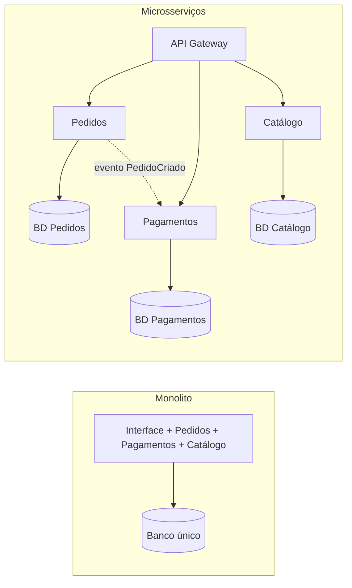
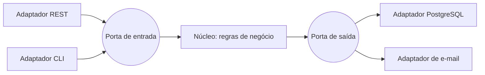

## O que é

Um **estilo** (ou padrão) **arquitetural** é uma forma recorrente de organizar sistemas inteiros: define **tipos de componentes**, **conectores** e **restrições** de como se combinam (Pressman, Shaw e Garlan). Exemplos: em camadas, cliente-servidor, orientado a objetos, orientado a eventos, monolítico, microsserviços, SOA, hexagonal.

## Para que serve

Escolher um estilo é escolher **trade-offs**: simplicidade × escalabilidade independente, consistência × autonomia de equipes, desempenho × flexibilidade. Analisar alternativas **cedo**, quando mudar ainda é barato, reduz riscos.

## Como funciona

### Arquitetura monolítica

O sistema é **uma única unidade de implantação**: interface, regras e acesso a dados no mesmo artefato e, em geral, no mesmo processo.

- Simples de desenvolver, testar e implantar no começo; chamadas internas rápidas.
- À medida que cresce, fica difícil de entender, escalar partes isoladas e implantar com frequência (qualquer mudança exige reimplantar tudo).
- **Monolito modular**: monolito com módulos bem separados — um meio-termo saudável.

### Microsserviços

O sistema é dividido em **serviços pequenos e independentes**, cada um responsável por uma **capacidade de negócio** (pedidos, pagamentos, catálogo), com **seu próprio banco de dados**, comunicando-se por **APIs leves** (HTTP/REST, gRPC) ou **mensagens**.

- Cada serviço é **implantado, escalado e evoluído individualmente**, por equipes autônomas.
- **Baixo acoplamento** e **alta coesão** são **requisitos** do estilo.
- Custos: complexidade de **sistema distribuído** (rede, latência, falhas parciais), consistência eventual, observabilidade, orquestração (contêineres, Kubernetes).

### SOA — Arquitetura Orientada a Serviços

Organiza a empresa em **serviços reutilizáveis** com **contratos** bem definidos, normalmente expostos como **web services** (SOAP/WSDL ou REST) e integrados por um **barramento de serviços (ESB)**. Foco em **integração corporativa** e **reúso** entre sistemas diferentes. Microsserviços são frequentemente vistos como uma evolução mais leve e descentralizada da SOA.

### Arquitetura hexagonal (portas e adaptadores — Alistair Cockburn)

O **núcleo da aplicação** (regras de negócio) fica no centro e não conhece tecnologia. Ele define **portas** (interfaces) e o mundo externo se conecta por **adaptadores**:

- **Adaptadores primários (de entrada):** quem **chama** a aplicação — controlador REST, CLI, testes.
- **Adaptadores secundários (de saída):** o que a aplicação **usa** — repositório de banco, cliente de e-mail, fila.

Trocar o banco ou a interface significa trocar um adaptador, sem tocar no núcleo.

### Clean Architecture (Robert C. Martin)

Camadas **concêntricas**: **Entidades** (regras de negócio da empresa) → **Casos de uso** (regras da aplicação) → **Adaptadores de interface** (controllers, presenters, gateways) → **Frameworks e drivers** (web, banco, UI). A **regra da dependência**: o código só pode depender **para dentro** — as camadas internas não conhecem as externas (aplicação direta da Inversão de Dependência).

### Outros estilos citados

- **Orientado a objetos:** componentes são objetos que encapsulam dados e operações e se comunicam por **troca de mensagens**.
- **Orientado a eventos:** componentes reagem a **eventos** publicados (pub/sub, filas).
- **Pipes and filters:** dados passam por uma sequência de filtros (compiladores, processamento de mídia).
- **Centrado em dados (repositório):** componentes acessam um repositório central.

### Princípios transversais

- **Separação de responsabilidades (separation of concerns):** cada parte cuida de uma preocupação (interface, regra, persistência).
- **Alta coesão:** cada componente agrupa coisas relacionadas.
- **Baixo acoplamento:** componentes dependem pouco uns dos outros, de preferência via abstrações.

## Características principais

| Estilo | Unidade de implantação | Dados | Comunicação |
|---|---|---|---|
| Monolito | uma só | banco compartilhado | chamadas internas |
| Microsserviços | **uma por serviço** | **banco por serviço** | HTTP/gRPC/mensagens |
| SOA | serviços corporativos | variados | web services + ESB |
| Hexagonal / Clean | (organização interna) | atrás de portas/gateways | por interfaces |

## Exemplos práticos

:::example Uma startup crescendo
Começa como **monolito modular** (rápido de entregar). Quando o módulo de pagamentos precisa escalar sozinho e ter deploy independente, ele é extraído como **microsserviço**. Internamente, cada serviço usa **arquitetura hexagonal**, para que a troca do provedor de pagamento seja só um novo adaptador.
:::

## Representação visual

## Vantagens e desvantagens

| Estilo | Vantagens | Desvantagens |
|---|---|---|
| Monolito | simples, rápido no início, transações locais | escala e implantação "tudo ou nada"; tende a crescer acoplado |
| Microsserviços | escala e deploy independentes, autonomia de equipes, tecnologia por serviço | complexidade distribuída, consistência eventual, operação cara |
| SOA | reúso e integração corporativa | ESB centralizado pode virar gargalo; contratos pesados |
| Hexagonal/Clean | núcleo testável e independente de tecnologia | mais interfaces e camadas |

## Diferenças entre conceitos semelhantes

- **Microsserviços × SOA:** SOA foca em **reúso e integração** corporativa, com barramento central; microsserviços focam em **autonomia e implantação independente**, com "pontos inteligentes e canos burros".
- **Hexagonal × camadas:** em camadas, a dependência desce até o banco; na hexagonal, o **núcleo** está no centro e **tecnologias são plugáveis** dos dois lados.
- **Clean × hexagonal:** ideias irmãs; a Clean detalha camadas concêntricas e a **regra da dependência**.
- **Monolito × "código ruim":** monolito é um estilo legítimo; o problema é o **monolito acoplado** ("big ball of mud").

## Como cai no ENADE

:::enade
Afirmações sobre estilos (2021): orientado a objetos se comunica por **mensagens**; monolito **não** é "dividido em pequenas partes com evolução individual" (isso é microsserviços); microsserviços **não** são "altamente acoplados"; o Modelo do MVC guarda dados e estado usados pela Visão.
:::

## Pegadinhas

:::trap Microsserviços buscam baixo acoplamento
Qualquer afirmativa dizendo que componentes de microsserviços são "altamente acoplados" está errada.
:::

:::trap Monolito não é "dividido em pequenas partes independentes"
Essa é a definição de microsserviços.
:::

## Questões comentadas

::question 2021-objective-19 Estilos e padrões arquiteturais

**I** correta (OO se comunica por troca de mensagens). **II** errada (descreve microsserviços, não monolito). **III** correta, no contexto da questão (o Modelo concentra os dados manipulados via Controle e exibidos na Visão). **IV** errada (microsserviços buscam **baixo** acoplamento). Resposta: **I e III**.

## Resumo para memorizar

:::summary
- **Monolito**: uma unidade de implantação. **Microsserviços**: serviços pequenos, **banco próprio**, deploy e escala **independentes**.
- **SOA**: serviços corporativos reutilizáveis, contratos, **ESB**.
- **Hexagonal**: núcleo + **portas** (interfaces) + **adaptadores** (entrada e saída).
- **Clean Architecture**: entidades → casos de uso → adaptadores → frameworks; dependências **apontam para dentro**.
- Meta de todos: **separação de responsabilidades, alta coesão, baixo acoplamento**.
:::

## Miniquestionário

:::quiz
[
  {
    "question": "Qual característica define a arquitetura de microsserviços?",
    "options": ["Um único artefato implantado", "Serviços independentes, com dados próprios e implantação individual", "Componentes altamente acoplados", "Ausência de rede"],
    "answer": 1,
    "explanation": "Autonomia de implantação, escala e dados é a essência do estilo."
  },
  {
    "question": "Na arquitetura hexagonal, um repositório que grava no PostgreSQL é:",
    "options": ["Uma porta de entrada", "Um adaptador secundário (de saída)", "Uma entidade de domínio", "Um ator UML"],
    "answer": 1,
    "explanation": "O núcleo define a porta (interface); o repositório concreto é um adaptador de saída."
  },
  {
    "question": "A 'regra da dependência' da Clean Architecture diz que:",
    "options": ["Camadas internas dependem das externas", "Dependências de código apontam sempre para dentro, em direção às regras de negócio", "Não pode haver interfaces", "O banco é o centro da arquitetura"],
    "answer": 1,
    "explanation": "Entidades e casos de uso não conhecem frameworks, banco ou interface."
  }
]
:::

## Referências

- PRESSMAN, R. S.; MAXIM, B. R. *Engenharia de Software*. 8. ed. AMGH, 2016 — cap. 13 (projeto de arquitetura).
- NEWMAN, S. *Criando Microsserviços*. 2. ed. Novatec, 2022.
- MARTIN, R. C. *Arquitetura Limpa*. Alta Books, 2019.
- COCKBURN, A. *Hexagonal Architecture*, 2005. Disponível em alistair.cockburn.us.
- ERL, T. *SOA: princípios de design de serviços*. Pearson, 2009.
- INEP. ENADE TADS 2021, questão 19.
