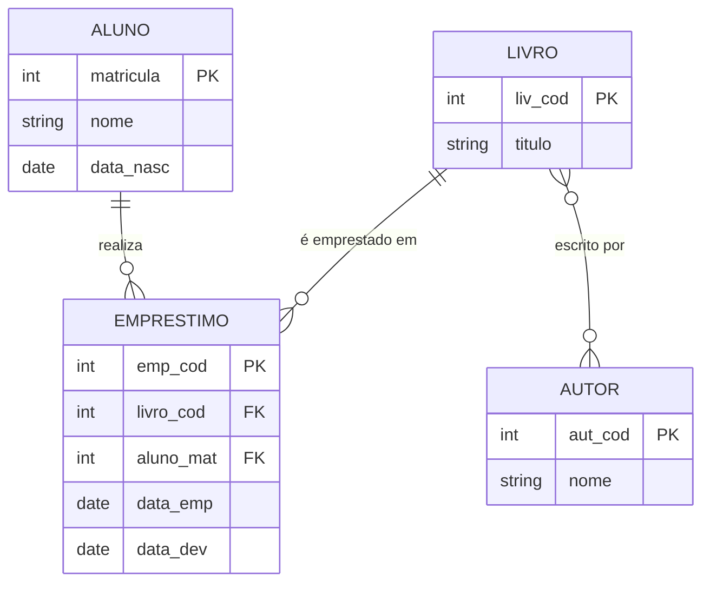

## O que é

**Modelagem de dados** é o processo de representar **quais dados** um sistema precisa guardar e **como eles se relacionam**, em três níveis de abstração:

| Nível | Pergunta | Representação | Depende de SGBD? |
|---|---|---|---|
| **Conceitual** | quais coisas do negócio existem e como se ligam? | **DER/MER** (entidades, atributos, relacionamentos) | não |
| **Lógico** | como organizar em tabelas, colunas e chaves? | esquema relacional (tabelas, PK, FK) | depende do **modelo** (relacional), não do produto |
| **Físico** | como implementar em um SGBD específico? | `CREATE TABLE`, tipos, índices, partições | **sim** (PostgreSQL, MySQL, Oracle) |

## Para que serve

Garantir que o banco represente corretamente as **regras do negócio**, evite **redundâncias e inconsistências**, permita as consultas necessárias e sirva de contrato entre analistas, desenvolvedores e DBAs.

## Como funciona

### Diagrama Entidade-Relacionamento (Peter Chen, 1976)

- **Entidade** (retângulo): algo do mundo real sobre o qual se guardam dados — Aluno, Curso.
  - **Entidade fraca** (retângulo duplo ou arredondado, conforme a notação): depende de outra para ser identificada (Dependente de um Funcionário; ItemPedido de um Pedido). Sua chave inclui a chave da entidade forte.
- **Atributo** (elipse): propriedade — nome, CPF.
  - **Identificador/chave** (sublinhado); **composto** (endereço = rua + número + cidade); **multivalorado** (vários telefones → vira tabela própria); **derivado** (idade, calculada da data de nascimento).
- **Relacionamento** (losango): associação entre entidades — Aluno *matricula-se em* Turma. Pode ter **atributos** (data da matrícula pertence ao relacionamento, não ao aluno nem à turma).

### Cardinalidades

Indicam quantas ocorrências de uma entidade se associam a uma ocorrência da outra, com **mínimo e máximo** (notação (mín, máx)):

- **(0,1)**: zero ou um — opcional e único.
- **(1,1)**: exatamente um — obrigatório e único.
- **(0,N)**: zero ou muitos. **(1,N)**: pelo menos um.

Tipos pelo máximo: **1:1**, **1:N** e **N:M**. Na notação **pé de galinha** (Crow's Foot): traço = um, círculo = zero, "pé de galinha" = muitos.

### Do conceitual para o lógico (mapeamento)

| Situação | Regra |
|---|---|
| Entidade | vira **tabela**; identificador vira **chave primária** |
| 1:N | a **chave do lado 1** vira **chave estrangeira** no lado **N** |
| 1:1 | FK em um dos lados (geralmente o opcional) ou fusão das tabelas |
| **N:M** | cria **tabela associativa** com as chaves das duas (inclusive compostas), que juntas formam a PK; atributos do relacionamento vão para ela |
| Atributo multivalorado | nova tabela com FK para a entidade |
| Entidade fraca | tabela com PK composta: chave da forte + chave parcial |

### Chaves

- **Superchave:** conjunto de atributos que identifica unicamente cada linha.
- **Chave candidata:** superchave **mínima** (CPF, RG, matrícula podem ser candidatas).
- **Chave primária (PK):** a candidata **escolhida**; única e **não nula**.
- **Chave estrangeira (FK):** coluna que **referencia** a PK de outra tabela, implementando o relacionamento.
- **Chave alternativa:** candidata não escolhida (geralmente com restrição UNIQUE).

### Terminologia relacional e restrições

**Relação** = tabela; **tupla** = linha; **atributo** = coluna; **domínio** = conjunto de valores permitidos. Restrições:

- **De domínio:** o valor respeita o tipo/faixa (idade ≥ 0).
- **De chave / unicidade:** PK e UNIQUE não se repetem.
- **De integridade da entidade:** PK **não pode ser nula**.
- **De integridade referencial:** FK deve apontar para uma PK **existente** (ou ser nula, se permitido).
- **De integridade semântica (regras de negócio):** regras do domínio, como "o salário do empregado não deve exceder o do supervisor" — normalmente implementadas com **triggers**, CHECK ou na aplicação.

## Características principais

- O conceitual é independente de tecnologia e serve para conversar com o cliente.
- Cardinalidades **mínimas** expressam **obrigatoriedade**; máximas, **quantidade**.
- N:M **sempre** gera uma terceira tabela no modelo relacional.

## Exemplos práticos

:::example Biblioteca: do DER às tabelas
Aluno (1,1) —**realiza**— (0,N) Empréstimo (N,1) —**de**— Livro; Livro (N) —**escrito por**— (M) Autor.

```sql
CREATE TABLE aluno (matricula INT PRIMARY KEY, nome VARCHAR(100) NOT NULL);
CREATE TABLE livro (liv_cod INT PRIMARY KEY, titulo VARCHAR(200) NOT NULL);
CREATE TABLE autor (aut_cod INT PRIMARY KEY, nome VARCHAR(100));
CREATE TABLE livro_autor (                       -- N:M → tabela associativa
  liv_cod INT REFERENCES livro(liv_cod),
  aut_cod INT REFERENCES autor(aut_cod),
  PRIMARY KEY (liv_cod, aut_cod)
);
CREATE TABLE emprestimo (
  emp_cod INT PRIMARY KEY,
  livro_cod INT NOT NULL REFERENCES livro(liv_cod),     -- 1:N → FK no lado N
  aluno_mat INT NOT NULL REFERENCES aluno(matricula),
  data_emp DATE NOT NULL,
  data_dev DATE                                          -- NULL = ainda emprestado
);
```
:::

## Representação visual



## Vantagens e desvantagens

| Boa modelagem | Modelagem ruim |
|---|---|
| dados consistentes, sem duplicação | anomalias de inserção, atualização e exclusão |
| consultas simples e corretas | junções impossíveis ou ambíguas |
| regras de negócio garantidas pelo banco | regras só no código, fáceis de burlar |

## Diferenças entre conceitos semelhantes

- **Conceitual × lógico × físico:** negócio (DER) × tabelas e chaves × implementação em um SGBD.
- **Chave candidata × primária:** todas as candidatas identificam; a primária é a escolhida.
- **Entidade forte × fraca:** a fraca não se identifica sozinha.
- **Integridade referencial × semântica:** a primeira só verifica se a FK existe; a segunda expressa regras de negócio arbitrárias.
- **DER × diagrama de classes:** DER modela **dados persistentes**; classes modelam dados **e comportamento** (métodos).

## Como cai no ENADE

:::enade
Contar chaves estrangeiras após mapear um DER (2011), interpretar cardinalidades (0,1) e (1,1) (2017), escolher o modelo lógico correto a partir de uma planilha (2021), classificar restrições (2014: semântica com triggers) e localizar atributos de relacionamento (data da matrícula).
:::

## Pegadinhas

:::trap N:M não se resolve com FK em uma das tabelas
Precisa de **tabela associativa** com as chaves das duas — inclusive todas as partes de chaves compostas.
:::

:::trap Atributo do relacionamento
A data da matrícula pertence à **matrícula** (relacionamento/tabela associativa), não ao aluno nem ao curso.
:::

:::trap Cardinalidade mínima
(1,1) do lado da pessoa significa que **todo cavalo** precisa de exatamente um dono; (0,1) do lado do cavalo significa que a pessoa pode ter **no máximo um** cavalo — não vários.
:::

## Questões comentadas

::question 2017-objective-34 Chicó, a velha e o cavalo

Pessoa pode cadastrar Chicó e a velha (I correta). A cardinalidade (0,1) impede uma pessoa de ter **mais de um** cavalo (II errada). O identificador indicado é `codigo`, não `rg` (III errada). O cavalo exige um dono e a pessoa pode existir sem cavalo (IV correta). Resposta: **I e IV**.

::question 2014-objective-22 Salário do empregado × supervisor

Regra de negócio implementada com triggers é **restrição de integridade semântica** (alternativa E).

::question 2011-objective-23 Quantas colunas de chave estrangeira

Cada N:M vira tabela associativa com as chaves das duas entidades (incluindo chaves compostas); em cada 1:N, a chave do lado 1 migra para o lado N. Somando as colunas pedidas pelo diagrama, chega-se a **9** (alternativa E).

## Resumo para memorizar

:::summary
- Conceitual (DER) → lógico (tabelas, PK, FK) → físico (SGBD).
- Entidade → tabela; 1:N → FK no lado N; **N:M → tabela associativa**; multivalorado → tabela.
- Cardinalidade (mín, máx): mínimo = obrigatoriedade; máximo = quantidade.
- PK: única e não nula. FK: aponta para PK existente.
- Restrições: domínio, chave, entidade, referencial, **semântica (triggers)**.
:::

## Miniquestionário

:::quiz
[
  {
    "question": "Como se implementa um relacionamento N:M entre Aluno e Disciplina no modelo relacional?",
    "options": ["FK de Aluno em Disciplina", "FK de Disciplina em Aluno", "Uma tabela associativa com as chaves de Aluno e de Disciplina", "Não é possível"],
    "answer": 2,
    "explanation": "A tabela associativa (ex.: Matricula) guarda os pares e os atributos do relacionamento."
  },
  {
    "question": "Uma FK que aponta para um registro inexistente viola qual restrição?",
    "options": ["De domínio", "De integridade referencial", "De integridade da entidade", "Semântica"],
    "answer": 1,
    "explanation": "A integridade referencial exige que a referência exista."
  },
  {
    "question": "Qual modelo é independente do SGBD e usado para conversar com o cliente?",
    "options": ["Físico", "Lógico", "Conceitual", "Índice"],
    "answer": 2,
    "explanation": "O modelo conceitual (DER) representa o negócio sem detalhes de implementação."
  }
]
:::

## Referências

- HEUSER, C. A. *Projeto de Banco de Dados*. 6. ed. Bookman, 2009.
- ELMASRI, R.; NAVATHE, S. B. *Sistemas de Banco de Dados*. 7. ed. Pearson, 2018 — caps. 3, 5 e 9.
- CHEN, P. P. The Entity-Relationship Model — Toward a Unified View of Data. *ACM TODS*, v. 1, n. 1, 1976.
- INEP. ENADE TADS 2008 (questão 34), 2011 (questão 23), 2014 (questões 21 e 22), 2017 (questão 34) e 2021 (questão 15).
