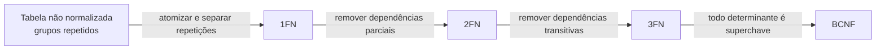

## O que é

**Normalização** é um processo de organizar tabelas para **eliminar redundâncias** e **anomalias**, decompondo-as em tabelas menores e bem estruturadas, com base em **dependências funcionais**. Cada **forma normal** (FN) é um nível de qualidade que exige a anterior.

:::definition Dependência funcional (X → Y)
Y **depende funcionalmente** de X quando, conhecido X, Y fica determinado. Ex.: `cpf → nome` (cada CPF tem um nome); `(matricula, curso) → data_matricula`.
:::

## Para que serve

Evita as **anomalias**:

- **De inserção:** não dá para cadastrar um curso novo sem ter um aluno nele.
- **De atualização:** mudar o telefone do professor exige alterar dezenas de linhas (e esquecer uma gera inconsistência).
- **De exclusão:** apagar o último aluno de um curso apaga também os dados do curso.

## Como funciona

### 1FN — atributos atômicos

Uma tabela está na **1FN** se **todos os atributos são atômicos** (indivisíveis) e **não há grupos repetidos** ou atributos multivalorados.

- Violação: coluna `telefones = "1111-1111, 2222-2222"`; colunas curso1, curso2, curso3.
- Correção: criar tabela `telefone(pessoa_id, numero)`; uma linha por matrícula.

### 2FN — sem dependência parcial

Está na **2FN** se está na 1FN e **nenhum atributo não-chave depende de só parte** de uma chave primária **composta**.

- Em `matricula(aluno_id, curso_id, nome_aluno, nome_curso, data)`, `nome_aluno` depende só de `aluno_id` → **dependência parcial**.
- Correção: `aluno(aluno_id, nome)`, `curso(curso_id, nome)`, `matricula(aluno_id, curso_id, data)`.
- Tabelas com PK **simples** na 1FN já estão na 2FN.

### 3FN — sem dependência transitiva

Está na **3FN** se está na 2FN e **nenhum atributo não-chave depende de outro atributo não-chave**.

- Em `turma(turma_id, professor_id, nome_professor)`, `nome_professor` depende de `professor_id`, que não é chave → **transitiva**.
- Correção: `professor(professor_id, nome)` e `turma(turma_id, professor_id)`.

:::mnemonic A chave, toda a chave e nada além da chave
Cada atributo não-chave deve depender **da chave** (1FN), **de toda a chave** (2FN) e **de nada além da chave** (3FN) — "so help me Codd".
:::

### BCNF (Boyce-Codd)

Para toda dependência X → Y não trivial, **X deve ser superchave**. É uma 3FN mais rigorosa, relevante quando há várias chaves candidatas sobrepostas.

### 4FN e 5FN

A **4FN** elimina **dependências multivaloradas** independentes (professor com vários idiomas e várias disciplinas na mesma tabela). A 5FN trata dependências de junção — raras na prática.

### Desnormalização

Em sistemas de leitura intensa (relatórios, data warehouses), às vezes se **duplica** dados de propósito para evitar junções caras. É uma decisão **consciente** de desempenho, com controles para manter a consistência.

## Características principais

- Cada forma normal pressupõe as anteriores.
- Normalizar costuma **aumentar o número de tabelas** e de junções, mas **reduz** redundância.
- Na prática, a meta usual de sistemas transacionais é a **3FN** (ou BCNF).

## Exemplos práticos

:::example Da planilha de matrículas ao modelo normalizado (ENADE 2021)
Planilha: estudante, data de nascimento, responsável, contatos (vários), curso, horário, professor — com estudantes repetidos para cada curso.
1. **1FN:** contatos viram tabela própria; uma linha por matrícula.
2. **2FN/3FN:** separar **Pessoa** (estudantes e responsáveis), **Contato**, **Curso**, **Turma** (curso + horário + professor) e **Matrícula** (estudante + turma + **data de efetivação**).
A data pertence à **matrícula**; o horário e o professor, à **turma**; não ao curso isolado.
:::

## Representação visual

## Vantagens e desvantagens

| Normalizar | Desnormalizar |
|---|---|
| sem redundância nem anomalias | leituras mais rápidas (menos junções) |
| atualizações em um único lugar | risco de inconsistência |
| mais tabelas e junções | mais espaço |

## Diferenças entre conceitos semelhantes

- **Dependência parcial × transitiva:** parcial = depende de **parte da chave composta** (viola 2FN); transitiva = depende de **outro não-chave** (viola 3FN).
- **3FN × BCNF:** a BCNF exige que **todo determinante** seja superchave, sem exceções.
- **Normalização × modelagem conceitual:** a modelagem identifica entidades; a normalização **valida e refina** as tabelas.

## Como cai no ENADE

:::enade
Escolher o modelo lógico correto a partir de uma **planilha desnormalizada** (2021) e aplicar a 3FN para contar tabelas e chaves estrangeiras (2011).
:::

## Pegadinhas

:::trap Tabela com PK simples na 1FN já está na 2FN
Dependência parcial só existe com chave **composta**.
:::

:::trap Atributo multivalorado viola a 1FN
Vários telefones em uma coluna = tabela fora da 1FN.
:::

## Questões comentadas

::question 2021-objective-15 Planilha de matrículas da fundação cultural

O modelo correto separa **pessoas** (estudantes e responsáveis), **contatos**, **cursos**, **turmas** (com horário e professor) e **matrículas** ligando estudante e turma com a **data** — eliminando repetições e anomalias da planilha (alternativa B).

## Resumo para memorizar

:::summary
- **1FN**: atributos atômicos, sem grupos repetidos.
- **2FN**: 1FN + sem dependência **parcial** da chave composta.
- **3FN**: 2FN + sem dependência **transitiva** (não-chave → não-chave).
- **BCNF**: todo determinante é superchave.
- Objetivo: eliminar anomalias de **inserção, atualização e exclusão**.
:::

## Miniquestionário

:::quiz
[
  {
    "question": "Uma tabela tem a coluna 'telefones' com vários números separados por vírgula. Qual forma normal ela viola?",
    "options": ["1FN", "2FN", "3FN", "BCNF"],
    "answer": 0,
    "explanation": "Atributo multivalorado não é atômico."
  },
  {
    "question": "Em funcionario(id, depto_id, nome_depto), nome_depto depende de depto_id. Isso é:",
    "options": ["Dependência parcial", "Dependência transitiva (viola a 3FN)", "Chave candidata", "Integridade referencial"],
    "answer": 1,
    "explanation": "Um atributo não-chave depende de outro não-chave."
  },
  {
    "question": "Qual anomalia ocorre quando, ao excluir o último aluno de um curso, perdem-se os dados do curso?",
    "options": ["De inserção", "De atualização", "De exclusão", "De domínio"],
    "answer": 2,
    "explanation": "A exclusão de uma linha remove informações que deveriam continuar existindo."
  }
]
:::

## Referências

- CODD, E. F. A Relational Model of Data for Large Shared Data Banks. *Communications of the ACM*, v. 13, n. 6, 1970.
- ELMASRI, R.; NAVATHE, S. B. *Sistemas de Banco de Dados*. 7. ed. Pearson, 2018 — caps. 14 e 15.
- HEUSER, C. A. *Projeto de Banco de Dados*. 6. ed. Bookman, 2009 — cap. 6.
- INEP. ENADE TADS 2011 (questão 23) e 2021 (questão 15).
