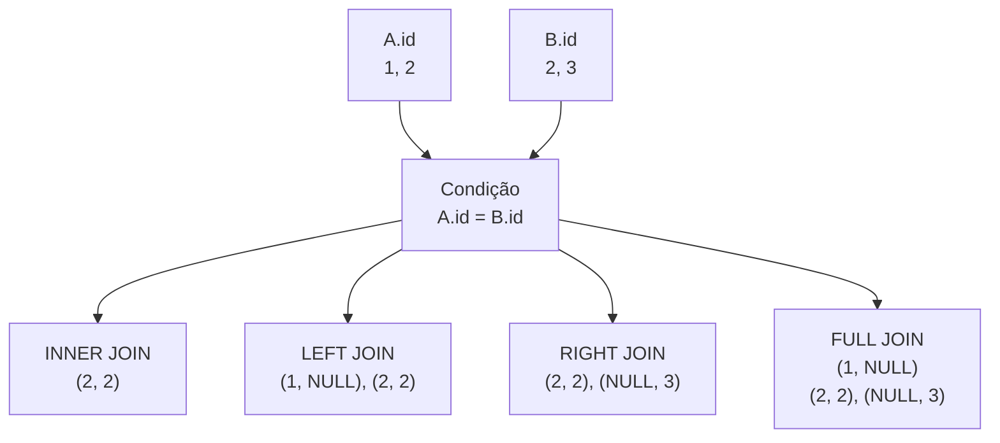

## O que é

**SQL (Structured Query Language)** é a linguagem padrão para **definir, manipular, consultar e controlar** dados em bancos relacionais. É **declarativa**: você descreve **o que** quer; o SGBD decide **como** buscar.

| Sublinguagem | Comandos | Função |
|---|---|---|
| **DDL** (definição) | CREATE, ALTER, DROP, TRUNCATE | estrutura: tabelas, índices, restrições |
| **DML** (manipulação) | INSERT, UPDATE, DELETE, (SELECT) | dados |
| **DQL** (consulta) | SELECT | leitura |
| **DCL** (controle) | GRANT, REVOKE | permissões |
| **TCL** (transação) | COMMIT, ROLLBACK, SAVEPOINT | transações |

## Para que serve

É como aplicações, relatórios e analistas conversam com o banco. No ENADE, a tarefa típica é **escolher a consulta correta** entre cinco muito parecidas.

## Como funciona

### Ordem lógica de execução do SELECT

```sql
SELECT   colunas, agregações          -- 5. o que mostrar
FROM     tabela(s) com JOINs          -- 1. de onde
WHERE    filtro de linhas             -- 2. quais linhas
GROUP BY colunas de agrupamento       -- 3. agrupar
HAVING   filtro de grupos             -- 4. quais grupos
ORDER BY colunas                      -- 6. ordenar
```

### Agregação

`COUNT(*)` (linhas), `COUNT(coluna)` (valores não nulos), `SUM`, `AVG`, `MIN`, `MAX`. **Regra:** toda coluna no SELECT que **não** está dentro de uma função de agregação **precisa estar no GROUP BY**. Filtro sobre agregados usa **HAVING**, não WHERE.

```sql
-- total de votos por candidato e partido
SELECT c.nome, p.nome, SUM(v.votos) AS total
FROM candidato c
JOIN partido p  ON p.numero = c.partido
JOIN votacao v  ON v.candidato = c.numero
GROUP BY c.nome, p.nome
HAVING SUM(v.votos) > 1000000
ORDER BY total DESC;
```

### JOINs

| JOIN | Retorna |
|---|---|
| **INNER JOIN** | só as linhas com correspondência nas **duas** tabelas |
| **LEFT (OUTER) JOIN** | **todas** da esquerda + correspondentes da direita (ou NULL) |
| **RIGHT (OUTER) JOIN** | todas da direita + correspondentes da esquerda |
| **FULL (OUTER) JOIN** | todas de ambas |
| **CROSS JOIN** | produto cartesiano (todas as combinações) |
| *self join* | a tabela com ela mesma (empregado e supervisor) |

Juntar com vírgula no FROM e condição no WHERE (`FROM a, b WHERE a.id = b.a_id`) equivale a um INNER JOIN; **sem** a condição, gera produto cartesiano.

### NULL

NULL é **ausência de valor**. Comparações com NULL usando `=` resultam em desconhecido: use **`IS NULL`** / **`IS NOT NULL`**. Agregações ignoram NULL (exceto `COUNT(*)`).

### Subconsultas

```sql
-- alunos com média acima da média geral
SELECT nome FROM aluno WHERE media > (SELECT AVG(media) FROM aluno);

-- clientes que nunca compraram
SELECT nome FROM cliente c
WHERE NOT EXISTS (SELECT 1 FROM pedido p WHERE p.cliente_id = c.id);

-- produtos de categorias ativas
SELECT * FROM produto WHERE categoria_id IN (SELECT id FROM categoria WHERE ativa);
```

### Operações de conjunto

- **UNION**: junta resultados sem duplicatas (`UNION ALL` mantém duplicatas).
- **INTERSECT**: só o que aparece nos dois.
- **EXCEPT** (ou **MINUS** no Oracle): o que está no primeiro e **não** no segundo.

As consultas precisam ter o **mesmo número de colunas** com tipos compatíveis.

### DML e DDL

```sql
CREATE TABLE jogador (
  pseudonimo VARCHAR(10) PRIMARY KEY,
  nome VARCHAR(25) NOT NULL,
  nivel INT REFERENCES nivel(nivel)
);
INSERT INTO jogador (pseudonimo, nome, nivel) VALUES ('neo', 'Thomas', 3);
UPDATE jogador SET nivel = 4 WHERE pseudonimo = 'neo';
DELETE FROM jogador WHERE nivel IS NULL;
```

:::warning UPDATE e DELETE sem WHERE
Afetam **todas** as linhas da tabela.
:::

## Características principais

- Declarativa, baseada na álgebra relacional (seleção σ, projeção π, junção ⋈, união, diferença).
- Resultado de um SELECT é uma **tabela** (que pode alimentar outra consulta).
- Padrão ANSI/ISO, com dialetos (PostgreSQL, MySQL, SQL Server, Oracle).

## Exemplos práticos

:::example Livros disponíveis para empréstimo (ENADE 2014)
Um livro está emprestado se tem empréstimo **com `data_dev` nula**. Disponíveis = todos os títulos **menos** os emprestados:
```sql
SELECT titulo FROM livro
EXCEPT
SELECT l.titulo FROM emprestimo e
JOIN livro l ON e.livro_cod = l.liv_cod
WHERE e.data_dev IS NULL;
```
:::

:::example Média movimentada por cliente com filtro de grupo
```sql
SELECT cl.nome, AVG(hm.val_movimentado) AS media
FROM cliente cl
JOIN historico_movimentacao hm ON hm.cliente_id = cl.id
GROUP BY cl.nome
HAVING AVG(hm.val_movimentado) > 5000;
```
:::

## Representação visual



Fonte: adaptado de ELMASRI; NAVATHE (2018, caps. 7 e 8) — recriado pela equipe Stacklyst.

Leia cada par de saída como (id de A, id de B). A chave 2 coincide nas duas tabelas. Quando a junção externa preserva uma linha sem par, a outra coluna recebe NULL. No ENADE, percorra as linhas preservadas antes de contar o resultado da consulta.

## Vantagens e desvantagens

| Recurso | Vantagem | Cuidado |
|---|---|---|
| JOIN | combina dados normalizados | condição faltando → produto cartesiano |
| Subconsulta | expressa filtros complexos | pode ser lenta se correlacionada |
| EXCEPT/INTERSECT | lógica de conjuntos clara | nem todo SGBD suporta (MySQL antigo) |

## Diferenças entre conceitos semelhantes

- **WHERE × HAVING:** WHERE filtra **linhas antes** de agrupar; HAVING filtra **grupos depois**.
- **COUNT × SUM:** COUNT conta **quantos** registros; SUM soma **valores**. "Total de votos" é SUM; "quantos estados" é COUNT.
- **UNION × UNION ALL:** sem × com duplicatas.
- **DELETE × TRUNCATE × DROP:** apaga linhas (com WHERE) × esvazia a tabela inteira × apaga a tabela.
- **IN × EXISTS:** IN compara com uma lista; EXISTS testa se a subconsulta retorna alguma linha.

## Como cai no ENADE

:::enade
Escolher a consulta correta (2008, 2011, 2014, 2017, 2021). As alternativas erradas costumam: usar COUNT em vez de SUM, esquecer o GROUP BY, colocar agregação no GROUP BY, trocar EXCEPT por UNION, usar `= NULL` ou inverter `IS NULL`/`IS NOT NULL`.
:::

## Pegadinhas

:::trap Agregação exige GROUP BY das outras colunas
`SELECT c.nome, SUM(v.votos)` sem `GROUP BY c.nome` é inválido no padrão SQL.
:::

:::trap Não se agrupa por função de agregação
`GROUP BY SUM(v.votos)` está errado.
:::

:::trap = NULL nunca é verdadeiro
Use `IS NULL`.
:::

## Questões comentadas

::question 2017-objective-32 Votos por candidato e partido

Correta a **C**: junta candidato, partido e votação, **soma** os votos com SUM e **agrupa** por candidato e partido. A sem GROUP BY é inválida; B e E usam COUNT (conta registros, não soma votos); D agrupa por SUM.

::question 2014-objective-11 Livros disponíveis

Correta a **A**: todos os títulos **EXCEPT** os ligados a empréstimos com `data_dev IS NULL` (ainda não devolvidos). C usa `IS NOT NULL` (removeria os já devolvidos); B e D usam UNION.

## Resumo para memorizar

:::summary
- Ordem lógica: **FROM → WHERE → GROUP BY → HAVING → SELECT → ORDER BY**.
- Coluna sem agregação no SELECT → precisa estar no **GROUP BY**. Filtro de agregado → **HAVING**.
- INNER (interseção), LEFT/RIGHT (tudo de um lado), FULL (tudo), CROSS (cartesiano).
- **IS NULL**, nunca `= NULL`.
- UNION (junta), INTERSECT (comum), **EXCEPT** (diferença).
:::

## Miniquestionário

:::quiz
[
  {
    "question": "Qual cláusula filtra grupos depois da agregação?",
    "options": ["WHERE", "HAVING", "ORDER BY", "DISTINCT"],
    "answer": 1,
    "explanation": "HAVING atua sobre os grupos formados pelo GROUP BY."
  },
  {
    "question": "Para listar todos os clientes, inclusive os que não têm pedidos, usa-se:",
    "options": ["INNER JOIN pedidos", "cliente LEFT JOIN pedido", "CROSS JOIN", "INTERSECT"],
    "answer": 1,
    "explanation": "O LEFT JOIN mantém todas as linhas da tabela da esquerda."
  },
  {
    "question": "Como selecionar empréstimos ainda não devolvidos (data_dev vazia)?",
    "options": ["WHERE data_dev = NULL", "WHERE data_dev IS NULL", "WHERE data_dev = ''", "WHERE NOT data_dev"],
    "answer": 1,
    "explanation": "Ausência de valor é testada com IS NULL."
  },
  {
    "question": "SELECT nome FROM a EXCEPT SELECT nome FROM b retorna:",
    "options": ["Nomes presentes nas duas", "Nomes de a que não estão em b", "Todos os nomes de a e b", "Nomes de b que não estão em a"],
    "answer": 1,
    "explanation": "EXCEPT é a diferença de conjuntos."
  }
]
:::

## Referências

- ELMASRI, R.; NAVATHE, S. B. *Sistemas de banco de dados*. 7. ed. São Paulo: Pearson Education do Brasil, 2018.
- SILBERSCHATZ, A.; KORTH, H. F.; SUDARSHAN, S. *Sistema de Banco de Dados*. 7. ed. Elsevier, 2020 — caps. 3 a 5.
- POSTGRESQL. *Documentation — Queries*. Disponível em postgresql.org/docs.
- INEP. ENADE TADS 2008 (questão 30), 2011 (questão 22), 2014 (questão 11), 2017 (questão 32) e 2021 (questão 17).
