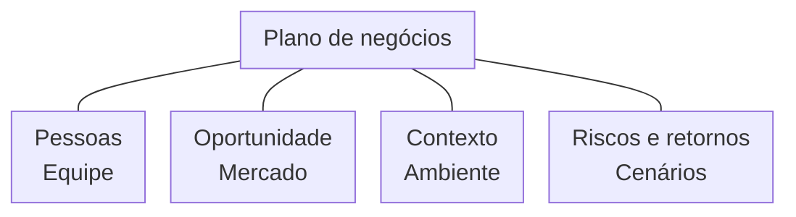

## O que é

**Empreendedorismo** é o processo de **identificar oportunidades** e **mobilizar recursos** para criar algo de valor — um negócio, um produto, um serviço ou uma solução social —, assumindo **riscos calculados**. O **empreendedor** é quem conduz esse processo; dentro de organizações existentes, fala-se em **intraempreendedorismo**.

**Inovação** é a **aplicação bem-sucedida** de uma ideia nova (produto, processo, modelo de negócio, marketing ou organização) que gera valor. Nem toda ideia criativa é inovação: ela precisa ser **implementada** e **adotada**.

O **plano de negócios** é o documento que descreve o empreendimento, o modelo que o sustenta e como ele vai funcionar e se financiar.

## Para que serve

- Empreender gera empregos, renda e soluções; para profissionais de TI, é o caminho de startups, produtos e consultorias.
- O plano de negócios serve para **aprender sobre o próprio negócio**, **tomar decisões**, **comunicar** a equipe e **convencer** públicos externos — investidores, bancos, parceiros, fornecedores, clientes — sobre benefícios, custos e riscos.

## Como funciona

### Perfil empreendedor

Características frequentes (McClelland, Dornelas): busca de oportunidades e iniciativa, persistência, comprometimento, exigência de qualidade e eficiência, **correr riscos calculados** (não é aventureiro nem foge de todo risco), estabelecimento de metas, busca de informações, planejamento e monitoramento, persuasão e rede de contatos, independência e autoconfiança.

:::trap Empreendedor não "procura riscos" nem assume todos sozinho
Ele **avalia e gerencia** riscos, dividindo-os com sócios, investidores e parceiros quando faz sentido.
:::

### Pessoas, oportunidade, contexto, riscos e recompensas

William Sahlman (Harvard) propõe que o sucesso de um novo empreendimento depende do **ajuste** entre quatro fatores, que o plano de negócios deve analisar:

1. **Pessoas** — quem vai executar (fundadores, equipe, parceiros): competências e experiência;
2. **Oportunidade** — o problema, o mercado, o crescimento e a margem possíveis;
3. **Contexto** — economia, legislação, tecnologia, concorrência, regulação;
4. **Riscos e recompensas** — o que pode dar errado, como reagir e qual o retorno esperado para cada envolvido.

### Empreendedores e investidores

- **Investidor-anjo:** pessoa física que investe capital e experiência no início.
- **Venture capital:** fundos que investem em empresas de alto crescimento em troca de participação.
- **Aceleradoras/incubadoras**, **crowdfunding**, editais e financiamento bancário.
Investidores avaliam sobretudo **a equipe**, o tamanho da **oportunidade** e a forma de lidar com **riscos**; projeções financeiras detalhadas são hipóteses, **não garantias** de sucesso.

### Tipos de inovação

- **Incremental:** melhora o que existe (nova versão de um app).
- **Radical:** cria algo novo, com ruptura técnica (o primeiro smartphone).
- **Disruptiva** (Christensen): começa simples e barata em um nicho e acaba substituindo líderes (streaming × locadoras).
- Por objeto (Manual de Oslo): **produto**, **processo**, **marketing**, **organizacional**.
- **Aberta:** com parceiros externos, universidades, startups.

### Empreendedorismo social

Usa a lógica empreendedora para resolver **problemas sociais ou ambientais**; o **impacto** é o objetivo central, e o resultado financeiro serve para sustentar e ampliar a missão (negócios de impacto, ONGs com receita própria).

### Estrutura de um plano de negócios

1. **Sumário executivo** (escrito por último, lido primeiro);
2. Descrição da empresa e da equipe;
3. Produtos e serviços (proposta de valor);
4. **Análise de mercado** (clientes, concorrentes, fornecedores, tamanho do mercado);
5. **Plano de marketing** (4 Ps: produto, preço, praça, promoção);
6. **Plano operacional** (processos, capacidade, tecnologia);
7. **Plano financeiro** (investimento inicial, custos, receitas, fluxo de caixa, ponto de equilíbrio, [indicadores](lib:viabilidade-economica));
8. **Análise de riscos e plano de contingência**.

Não existe uma "fórmula de sucesso" pronta: o plano é adaptado ao negócio e revisado continuamente.

## Características principais

- O plano é um **processo de aprendizagem**, não só um documento para obter crédito.
- Inovação e sustentabilidade **não são antagônicas** — muitas inovações reduzem impactos ambientais.
- Ferramentas complementares: [Canvas, SWOT e MVP](lib:canvas-swot-mvp).

## Exemplos práticos

:::example Uma startup de agendamento para clínicas
**Pessoas:** dois desenvolvedores e uma ex-gerente de clínica. **Oportunidade:** clínicas pequenas perdem 20% das consultas por faltas. **Contexto:** pacientes usam WhatsApp, LGPD exige cuidado com dados de saúde. **Riscos e recompensas:** concorrentes grandes podem copiar; recompensa: receita recorrente por assinatura. O plano mostra mercado, preço, custo de aquisição de clientes e quando a empresa atinge o ponto de equilíbrio.
:::

## Representação visual

Leia os quatro ramos como perguntas que o plano precisa responder em conjunto. No ENADE, diferencie as competências da equipe, as condições externas e a resposta da empresa a cenários de risco.

Fonte: adaptado de SAHLMAN (1997) — recriado pela equipe Stacklyst.

## Vantagens e desvantagens

| Plano de negócios | Vantagem | Limitação |
|---|---|---|
| Completo | visão integral, credibilidade com bancos e investidores | demorado; envelhece rápido em mercados incertos |
| Enxuto (Canvas + MVP) | rápido, focado em validar hipóteses | pode faltar detalhamento financeiro |

## Diferenças entre conceitos semelhantes

- **Criatividade × inovação:** ter a ideia × implementá-la com valor reconhecido.
- **Invenção × inovação:** criar algo novo × levar ao mercado/uso.
- **Plano de negócios × modelo de negócios (Canvas):** documento detalhado de **execução e finanças** × visão de **como a empresa cria, entrega e captura valor**.
- **Plano de negócios × plano de contingência:** o de contingência define respostas para **indisponibilidade/incidentes** (como falhas de TIC) e garante a continuidade das operações.

## Como cai no ENADE

:::enade
Fatores do sucesso de empreendimentos (2008: pessoas, oportunidades, contexto, riscos e recompensas), utilidade do plano de negócios em asserção-razão (2011), inovação × criatividade × sustentabilidade (2014) e plano de contingência para indisponibilidade de TIC (2014).
:::

## Pegadinhas

:::trap Projeções financeiras não garantem sucesso
São estimativas sujeitas a erro; investidores olham equipe, oportunidade e riscos.
:::

:::trap Inovação × sustentabilidade
Afirmar que são processos antagônicos é falso.
:::

## Questões comentadas

::question 2008-objective-31 Empreendedores, investidores e plano de negócios

Correta a **D**: pessoas, oportunidades, contexto e riscos/recompensas são os quatro fatores fundamentais. As demais distorcem o perfil do empreendedor (vender logo, transferir todos os riscos para si) ou supervalorizam fórmulas e projeções.

::question 2011-objective-34 Por que o plano de negócios é importante

As duas asserções são verdadeiras e a segunda justifica a primeira: o plano ajuda a gerir e decidir **porque** organiza a comunicação interna e convence o público externo sobre benefícios e custos (alternativa A).

::question 2014-objective-12 Indisponibilidade de TIC

Documentar como eliminar ou reduzir cenários de indisponibilidade e manter os negócios operando é um **plano de contingência** (alternativa C).

## Resumo para memorizar

:::summary
- Empreender = oportunidade + recursos + **riscos calculados**.
- Sahlman: **pessoas, oportunidade, contexto, riscos e recompensas**.
- Inovação = ideia **aplicada** com valor; incremental, radical, disruptiva.
- Plano de negócios: sumário, empresa, mercado, marketing, operações, **finanças**, riscos.
- Plano de contingência = continuidade diante de incidentes.
:::

## Miniquestionário

:::quiz
[
  {
    "question": "Qual afirmação descreve melhor o comportamento do empreendedor diante do risco?",
    "options": ["Evita qualquer risco", "Procura riscos pelo prazer de arriscar", "Assume riscos calculados, avaliando e gerenciando-os", "Transfere sempre todo o risco aos investidores"],
    "answer": 2,
    "explanation": "Riscos calculados: avaliados, mitigados e compartilhados quando faz sentido."
  },
  {
    "question": "Qual seção do plano de negócios costuma ser escrita por último?",
    "options": ["Análise de mercado", "Sumário executivo", "Plano financeiro", "Plano operacional"],
    "answer": 1,
    "explanation": "O sumário resume todo o plano, por isso é escrito ao final."
  },
  {
    "question": "Um serviço de streaming barato que acaba substituindo as locadoras é exemplo de inovação:",
    "options": ["incremental", "disruptiva", "organizacional apenas", "fechada"],
    "answer": 1,
    "explanation": "Começa em um nicho com proposta mais simples e substitui os líderes."
  }
]
:::

## Referências

- DORNELAS, J. *Empreendedorismo: transformando ideias em negócios*. 8. ed. Empreende, 2021.
- SAHLMAN, William A. How to write a great business plan. *Harvard Business Review*, Boston, v. 75, n. 4, p. 98–108, jul./ago. 1997. Disponível em: [Harvard Business Review](https://hbr.org/1997/07/how-to-write-a-great-business-plan). Acesso em: 25 nov. 2026.
- CHRISTENSEN, C. M. *O Dilema da Inovação*. M.Books, 2012.
- OCDE. *Manual de Oslo*. 4. ed., 2018.
- SEBRAE. *Como elaborar um plano de negócio*. Disponível em sebrae.com.br.
- INEP. ENADE TADS 2008 (questão 31), 2011 (questão 34) e 2014 (questões 12 e 23).
