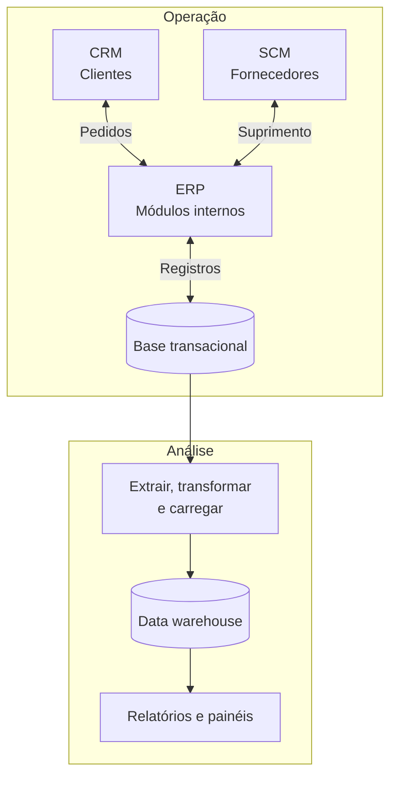

## O que é

Um **sistema de informação (SI)** é um conjunto de componentes — **pessoas, processos, dados, software, hardware e redes** — que coleta, processa, armazena e distribui informação para **apoiar operações, decisões e controle** em uma organização.

Os sistemas empresariais mais cobrados:

- **ERP (Enterprise Resource Planning):** sistema integrado de gestão que reúne em uma **base única** os processos de vários departamentos (finanças, contabilidade, compras, estoque, produção, vendas, RH).
- **CRM (Customer Relationship Management):** gestão do **relacionamento com clientes** — histórico, vendas, marketing, atendimento.
- **SCM (Supply Chain Management):** gestão da **cadeia de suprimentos** com fornecedores e logística.
- **BI (Business Intelligence):** conjunto de técnicas e ferramentas para transformar dados em **informação para decisão** — data warehouse, ETL, OLAP, dashboards, KPIs.
- **Sistema especialista:** sistema de IA que usa **conhecimento especializado** (geralmente em **regras de produção** "se-então") para resolver problemas como um especialista humano.

## Para que serve

Integrar a empresa, eliminar retrabalho e planilhas paralelas, dar visibilidade em tempo real, melhorar o atendimento e apoiar decisões com dados — e, para profissionais de ADS, é um dos maiores mercados de desenvolvimento, implantação e manutenção.

## Como funciona

### SI por nível organizacional

| Nível | Sistema | Exemplo |
|---|---|---|
| Operacional | **SPT/SIT** — processamento de transações | caixa, folha de pagamento, pedidos |
| Gerencial (tático) | **SIG** — informações gerenciais (relatórios) | relatório mensal de vendas por região |
| Gerencial/analítico | **SAD** — apoio à decisão (modelos, simulações) | simulação de preços |
| Estratégico | **SIE/ESS** — apoio executivo (indicadores) | painel com KPIs da diretoria |

### ERP

- **Módulos integrados** compartilhando o mesmo banco: uma venda atualiza estoque, financeiro e contabilidade **automaticamente**.
- Implantação costuma exigir **adequar processos** às boas práticas do sistema ou **customizar** — e toda mudança de legislação gera **manutenção adaptativa**.
- Exemplos: SAP, TOTVS, Oracle, Odoo.

### CRM

Operacional (automação de vendas, marketing, atendimento), analítico (segmentação, previsão) e colaborativo (canais integrados). Integrar ERP e CRM exige atenção a **escopo** e às **partes interessadas** — veja [Gerência de projetos](lib:gerencia-de-projetos-e-riscos).

### BI e data warehouse

1. **ETL** (extrair, transformar, carregar) dados dos sistemas transacionais;
2. **Data warehouse**: base histórica, integrada e orientada a assuntos (modelos **estrela**/floco de neve, com fatos e dimensões);
3. **OLAP**: análise multidimensional (drill-down, roll-up, slice and dice);
4. **Dashboards e KPIs** para gestores; **mineração de dados** e ciência de dados para padrões e previsões.

### Sistemas especialistas

- **Base de conhecimento:** fatos e **regras de produção** ("**se** temperatura > 38 °C **e** dores musculares intensas, **então** dengue com 70% de chance").
- **Memória de trabalho:** dados do caso atual.
- **Motor de inferência:** aplica as regras (encadeamento **para frente**, dos fatos às conclusões, ou **para trás**, da hipótese aos fatos).
- **Interface e módulo de explicação.**
Conclusões podem vir com **graus de certeza/probabilidade**, que valem para **cada caso** que satisfaz a condição — não são contagens garantidas.

## Características principais

- SI ≠ só software: processos e pessoas são parte dele.
- Integração reduz redundância e inconsistência de dados.
- Implantar sistemas empresariais é um **projeto** com gestão de mudança organizacional.

## Exemplos práticos

:::example Um pedido atravessando o ERP
O vendedor registra o pedido no **CRM** → o **ERP** reserva o estoque, emite a nota fiscal e lança o contas a receber → o **SCM** dispara a compra de matéria-prima abaixo do estoque mínimo → o **BI** atualiza o painel de vendas da diretoria no dia seguinte.
:::

## Representação visual

As setas de duas pontas indicam troca de dados operacionais e o fluxo descendente mostra o envio de dados para análise. No ENADE, associe clientes ao CRM, fornecedores ao SCM, integração interna ao ERP e consultas históricas ao data warehouse.

Fonte: adaptado de LAUDON; LAUDON (2022, caps. 6 e 9) — recriado pela equipe Stacklyst.

## Vantagens e desvantagens

| Sistema | Vantagens | Desvantagens |
|---|---|---|
| ERP | integração, dados únicos, padronização | caro, implantação longa, rigidez de processos |
| CRM | visão 360° do cliente | depende de alimentação correta pela equipe |
| BI | decisões baseadas em dados | qualidade dos dados de origem é crítica |
| Sistema especialista | conhecimento disponível 24 h, consistente | difícil manter regras; não aprende sozinho |

## Diferenças entre conceitos semelhantes

- **ERP × CRM:** gestão **interna** integrada × relacionamento com **clientes**.
- **Banco transacional (OLTP) × data warehouse (OLAP):** operações do dia a dia × análise histórica.
- **Sistema especialista × aprendizado de máquina:** regras escritas por especialistas × padrões aprendidos de dados.
- **SIG × SAD:** relatórios periódicos × modelos para analisar alternativas.

## Como cai no ENADE

:::enade
ERP em cenários de manutenção (2008 e 2021), integração ERP–CRM com problemas de gestão (2021) e sistemas especialistas com regras de produção e probabilidades (2021).
:::

## Pegadinhas

:::trap Probabilidade da regra vale por caso
"Cada pessoa com ambos os sintomas tem 0,7 de chance" ≠ "de cada 100, exatamente 70 terão".
:::

:::trap ERP não elimina manutenção
Mudanças de legislação e de negócio exigem manutenção adaptativa e evolutiva constante.
:::

## Questões comentadas

::question 2021-objective-34 Sistema especialista para diagnóstico de dengue

A regra exige **os dois** sintomas (conjunção). Para cada pessoa que os apresenta, o sistema atribui **probabilidade 0,7** de dengue (alternativa A). As demais tratam probabilidade como certeza ou aplicam a regra a quem tem um só sintoma.

::question 2021-objective-14 Integração ERP–CRM

Falhas e atrasos causados por desentendimentos, novos solicitantes e patrocinador ausente indicam a necessidade de priorizar a gestão das **partes interessadas**.

## Resumo para memorizar

:::summary
- SI = pessoas + processos + dados + tecnologia.
- **ERP** integra departamentos em base única; **CRM** clientes; **SCM** cadeia de suprimentos.
- **BI**: ETL → data warehouse → OLAP → dashboards/KPIs.
- **Sistema especialista**: base de conhecimento (regras se-então) + motor de inferência + memória de trabalho.
:::

## Miniquestionário

:::quiz
[
  {
    "question": "Qual sistema integra finanças, estoque, compras e RH em uma base única?",
    "options": ["CRM", "ERP", "BI", "Sistema especialista"],
    "answer": 1,
    "explanation": "O ERP integra os processos internos da empresa."
  },
  {
    "question": "No BI, o processo de extrair, transformar e carregar dados no data warehouse chama-se:",
    "options": ["OLTP", "ETL", "CRM", "DNS"],
    "answer": 1,
    "explanation": "ETL = Extract, Transform, Load."
  },
  {
    "question": "Em um sistema especialista, o componente que aplica as regras aos fatos é:",
    "options": ["a base de dados relacional", "o motor de inferência", "o data warehouse", "o ERP"],
    "answer": 1,
    "explanation": "O motor de inferência encadeia as regras para chegar às conclusões."
  }
]
:::

## Referências

- LAUDON, K. C.; LAUDON, J. P. *Sistemas de Informação Gerenciais*. 11. ed. Pearson, 2014.
- O'BRIEN, J. A.; MARAKAS, G. M. *Administração de Sistemas de Informação*. 15. ed. McGraw-Hill, 2013.
- RUSSELL, S.; NORVIG, P. *Inteligência Artificial*. 3. ed. Elsevier, 2013 — sistemas baseados em conhecimento.
- KIMBALL, R.; ROSS, M. *The Data Warehouse Toolkit*. 3. ed. Wiley, 2013.
- INEP. ENADE TADS 2008 (questão 36) e 2021 (questões 14, 23 e 34).
- LAUDON, Kenneth C.; LAUDON, Jane P. *Management information systems: managing the digital firm*. 17. ed. global. Harlow: Pearson Education, 2022.
