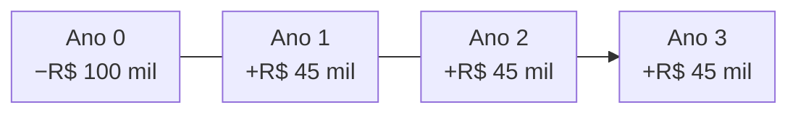

## O que é

**Viabilidade econômica** é a análise que responde: **o retorno esperado de um investimento compensa o custo e o risco?** Ela compara **entradas** e **saídas** de caixa ao longo do tempo com indicadores como **ROI**, **payback**, **VPL** e **TIR**.

É uma das dimensões do **estudo de viabilidade** (junto com a técnica, a operacional e a legal) — inclusive o primeiro passo da [engenharia de requisitos](lib:processo-de-requisitos).

## Para que serve

Decidir entre projetos, justificar a compra de um sistema (ERP, nuvem), definir preço e meta de vendas, convencer investidores e acompanhar se um investimento está dando o retorno prometido.

## Como funciona

### ROI — Retorno sobre o investimento

$$ROI = \frac{\text{ganho} - \text{investimento}}{\text{investimento}} \times 100\%$$

Um sistema que custou R$ 50.000 e gerou R$ 80.000 de economia: ROI = (80.000 − 50.000) / 50.000 = **60%**.

### Payback

**Tempo necessário para recuperar o investimento** com os fluxos de caixa gerados.

- **Simples:** soma os fluxos até igualar o investimento (ignora o valor do dinheiro no tempo).
- **Descontado:** usa os fluxos **trazidos a valor presente** pela taxa de desconto — é sempre igual ou maior que o simples.

:::example Payback simples
Investimento de R$ 100.000; fluxos anuais de R$ 30.000, R$ 40.000, R$ 50.000.
Acumulado: 30 mil (ano 1), 70 mil (ano 2) → faltam 30 mil, que serão cobertos com 30/50 = 0,6 do ano 3 → **payback = 2,6 anos**.
:::

### VPL — Valor Presente Líquido

Traz todos os fluxos futuros para hoje usando a **taxa mínima de atratividade (TMA)** e subtrai o investimento:

$$VPL = -I_0 + \sum_{t=1}^{n} \frac{FC_t}{(1 + i)^t}$$

- **VPL > 0** → o projeto **cria valor** acima da TMA: viável.
- **VPL = 0** → rende exatamente a TMA.
- **VPL < 0** → inviável.

### TIR — Taxa Interna de Retorno

É a taxa que **zera o VPL**. Se **TIR > TMA**, o projeto é atrativo.

### Ponto de equilíbrio

Volume em que a receita cobre **todos os custos** (lucro zero):

$$Q_{equilíbrio} = \frac{\text{custos fixos}}{\text{preço} - \text{custo variável unitário}}$$

O denominador é a **margem de contribuição** unitária. Um SaaS com custos fixos de R$ 20.000/mês, preço de R$ 100 e custo variável de R$ 20 por cliente precisa de 20.000 / 80 = **250 clientes** para empatar.

### Conceitos de custo

- **Custos fixos** (aluguel, salários) × **variáveis** (por unidade vendida, como servidor por cliente).
- **CAPEX** (investimento em bens de capital, como servidores próprios) × **OPEX** (despesas operacionais, como a assinatura de nuvem).
- **TCO** (custo total de propriedade): aquisição + implantação + operação + manutenção + descarte.

## Características principais

- Dinheiro tem **valor no tempo**: R$ 1.000 hoje valem mais que daqui a um ano.
- Indicadores devem ser usados **em conjunto**: payback mede liquidez/risco; VPL mede criação de valor.
- Toda análise depende de **projeções**, logo, de premissas — teste cenários (pessimista, provável, otimista).

## Exemplos práticos

:::example VPL de um sistema de automação
Investimento: R$ 100.000. Economia anual: R$ 45.000 por 3 anos. TMA: 10% a.a.
VPL = −100.000 + 45.000/1,1 + 45.000/1,21 + 45.000/1,331 ≈ −100.000 + 40.909 + 37.190 + 33.809 = **+R$ 11.908** → viável.
:::

## Representação visual

Leia o tempo da esquerda para a direita. O sinal negativo marca o desembolso inicial e os positivos marcam as economias esperadas. Para calcular o VPL no ENADE, desconte cada valor positivo a 10% pelo número de anos entre a sua entrada e o marco zero, e some o investimento com seu sinal.

Fonte: adaptado de DAHLQUIST; KNIGHT (2022, seção 16.2) — recriado pela equipe Stacklyst.

## Vantagens e desvantagens

| Indicador | Vantagem | Limitação |
|---|---|---|
| ROI | simples, comunica bem | ignora o tempo |
| Payback simples | mostra em quanto tempo o dinheiro volta | ignora o valor do dinheiro no tempo e o que vem depois |
| VPL | considera o tempo e mede valor criado | depende da TMA escolhida |
| TIR | taxa fácil de comparar | pode ter múltiplas soluções em fluxos irregulares |

## Diferenças entre conceitos semelhantes

- **ROI × VPL:** percentual sem tempo × valor em dinheiro de hoje.
- **Payback simples × descontado:** sem × com desconto dos fluxos.
- **TIR × TMA:** retorno do projeto × retorno mínimo exigido.
- **Viabilidade econômica × técnica:** compensa financeiramente? × é possível construir com a tecnologia e equipe disponíveis?

## Como cai no ENADE

:::enade
Indicadores de viabilidade aparecem em empreendedorismo, no plano financeiro do plano de negócios e no estudo de viabilidade da engenharia de requisitos; cálculos de porcentagem e consumo em formação geral usam o mesmo raciocínio.
:::

## Pegadinhas

:::trap Payback curto não significa melhor projeto
Um projeto pode recuperar rápido e gerar pouco valor depois; compare com o VPL.
:::

:::trap ROI positivo não basta
Sem considerar o tempo e o risco, um ROI de 20% em 10 anos pode ser pior que aplicar o dinheiro.
:::

## Questões comentadas

::question 2021-objective-18 Estudo de viabilidade na engenharia de requisitos

No enunciado, a empresa **já concluiu** o estudo de viabilidade. A questão pede artefatos das etapas seguintes, como registro de entrevista para elicitar e protótipo para validar. Tratar o estudo de custos e benefícios como registro de entrevista é a troca de etapas que a alternativa B explora.

## Resumo para memorizar

:::summary
- **ROI** = (ganho − investimento) ÷ investimento.
- **Payback** = tempo para recuperar o investimento (simples ou descontado).
- **VPL** > 0 → viável; **TIR** > TMA → atrativo.
- **Ponto de equilíbrio** = custos fixos ÷ margem de contribuição unitária.
- CAPEX × OPEX; TCO = custo total do ciclo de vida.
:::

## Miniquestionário

:::quiz
[
  {
    "question": "Um investimento de R$ 20.000 gerou ganho de R$ 26.000. Qual o ROI?",
    "options": ["6%", "30%", "130%", "23%"],
    "answer": 1,
    "explanation": "(26.000 − 20.000) / 20.000 = 0,30 = 30%."
  },
  {
    "question": "Investimento de R$ 60.000 com fluxos de R$ 20.000 por ano. Qual o payback simples?",
    "options": ["2 anos", "3 anos", "4 anos", "6 anos"],
    "answer": 1,
    "explanation": "20 + 20 + 20 = 60 mil em 3 anos."
  },
  {
    "question": "Um projeto com VPL negativo à TMA de 12% significa que:",
    "options": ["rende mais que 12%", "rende menos que a TMA e destrói valor", "o payback é imediato", "a TIR é infinita"],
    "answer": 1,
    "explanation": "Os fluxos descontados não cobrem o investimento à taxa exigida."
  }
]
:::

## Referências

- ASSAF NETO, A. *Matemática Financeira e suas Aplicações*. 14. ed. Atlas, 2019.
- GITMAN, L. J. *Princípios de Administração Financeira*. 14. ed. Pearson, 2017 — caps. 10 e 11.
- DORNELAS, J. *Plano de Negócios: seu guia definitivo*. 2. ed. Empreende, 2016.
- SOMMERVILLE, I. *Engenharia de Software*. 10. ed. Pearson, 2018 — estudo de viabilidade.
- DAHLQUIST, Julie; KNIGHT, Rainford. *Principles of finance*. Houston: OpenStax, 2022. Disponível em: [OpenStax](https://openstax.org/books/principles-finance/pages/16-2-net-present-value-npv-method). Acesso em: 25 nov. 2026.
