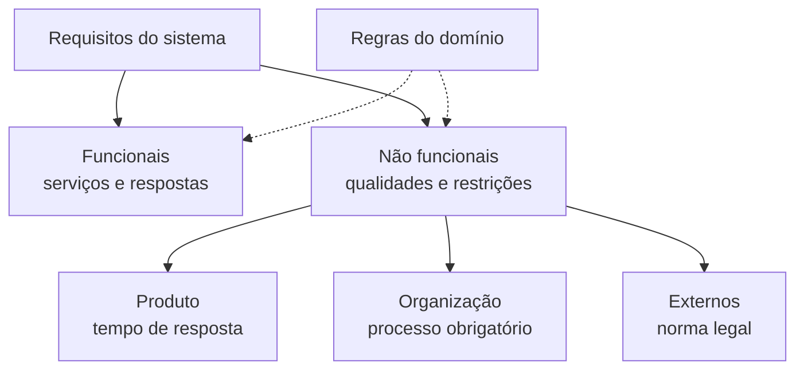

## O que é

Um **requisito** é uma **descrição do que o sistema deve fazer** ou de **uma propriedade ou restrição** que ele deve respeitar. Requisitos nascem das necessidades de pessoas e organizações e são a base de todo o resto: projeto, código, testes e aceite.

Sommerville separa dois níveis de detalhe:

- **Requisitos de usuário:** em linguagem natural e diagramas simples, para clientes e usuários ("o sistema deve gerar o boleto da mensalidade").
- **Requisitos de sistema:** descrição detalhada e precisa para a equipe técnica (formatos, regras de cálculo, condições).

## Para que serve

Requisitos mal definidos são a causa número um de projetos fracassados: o sistema é entregue, funciona — mas **não é o que o cliente precisava**. Definir bem os requisitos permite estimar, projetar, testar e **dizer quando o trabalho está pronto**.

## Como funciona

### Requisitos funcionais (RF)

Descrevem **funções, serviços ou comportamentos** do sistema: o que ele deve **fazer** em resposta a entradas e situações.

- "O sistema deve permitir que o professor lance as notas de suas turmas."
- "O sistema deve emitir relatório de compras a cada quinze dias."
- "O sistema deve permitir que o estudante se matricule nas disciplinas ofertadas."

### Requisitos não funcionais (RNF) — ou requisitos de qualidade

Descrevem **como** o sistema deve ser: **qualidades** e **restrições** sobre o funcionamento ou sobre o desenvolvimento. Normalmente se aplicam ao sistema como um todo ou a várias funções.

| Categoria | Exemplo |
|---|---|
| Desempenho | a nota aparece para o aluno em até **2 segundos** após o lançamento |
| Usabilidade | um auxiliar aprende a cadastrar alunos com **no máximo 10 minutos** de orientação |
| Portabilidade | o sistema deve ser transportado para outro SO em até 60 dias |
| Segurança | apenas usuários autorizados acessam a base de dados |
| Confiabilidade/disponibilidade | disponível 99,5% do tempo em horário comercial |
| Compatibilidade/plataforma | deve rodar em Linux; deve integrar com o sistema financeiro |
| Organizacionais / de processo | o desenvolvimento não deve ultrapassar **seis meses**; usar a linguagem Java |
| Externos / legais | cumprir a **LGPD** |

:::tip Teste rápido para classificar
Tente transformar o requisito em um **botão, tela ou operação** que o usuário aciona. Se der ("lançar notas", "emitir relatório"), é **funcional**. Se ele descreve **quão rápido, quão seguro, em que plataforma, em quanto tempo ou com que facilidade**, é **não funcional**.
:::

:::trap Requisitos não funcionais não são "menos importantes"
Um sistema bancário funcionalmente perfeito, mas inseguro ou lento, é inútil. RNFs muitas vezes são **mais críticos** que RFs e afetam a arquitetura inteira.
:::

### Regras de negócio

**Políticas, leis ou condições do negócio** que o sistema deve respeitar, **independentes de tecnologia**. Elas restringem ou definem como as funções se comportam.

- "Aluno com mensalidade atrasada há mais de 30 dias não pode se rematricular."
- "Desconto máximo de 10% sem aprovação do gerente."
- "Cada associado tem exatamente um tipo de associação."

Uma regra de negócio costuma originar ou condicionar **requisitos funcionais** (validações) e aparece em modelos como **multiplicidades** em diagramas de classes.

### Restrições

Limitações impostas à **solução** ou ao **projeto**: tecnologia obrigatória, orçamento, prazo, normas, hardware disponível. São um tipo de requisito não funcional (organizacional ou externo).

### Requisitos de domínio

Vêm do **domínio da aplicação** (área de conhecimento): "o cálculo de desaceleração do trem deve seguir a fórmula X". Podem ser funcionais ou não funcionais.

### Stakeholders (partes interessadas)

Todas as pessoas ou organizações que **afetam ou são afetadas** pelo sistema: clientes, usuários finais (de vários perfis), patrocinadores, gerentes, equipe de desenvolvimento, órgãos reguladores, operadores, suporte. Cada grupo tem necessidades — às vezes **conflitantes** — que precisam ser negociadas.

### Escopo

Define as **fronteiras** do sistema: o que **está dentro** e o que **fica fora**. Um escopo bem definido evita o *scope creep* (crescimento descontrolado). O documento de **visão** e o **diagrama de contexto** ajudam a comunicá-lo.

## Características principais

Um bom requisito é (IEEE 830 / ISO/IEC/IEEE 29148): **correto**, **não ambíguo**, **completo**, **consistente**, **verificável** (testável), **rastreável**, **priorizado** e **viável**.

:::example Tornando um RNF verificável
Ruim: "O sistema deve ser rápido." → Bom: "95% das consultas de nota devem responder em até 2 segundos com 500 usuários simultâneos."
:::

## Exemplos práticos

:::example Classifique os requisitos de um sistema acadêmico
- R1 — professor lança notas → **RF**
- R2 — transportável para outro SO em 60 dias → **RNF** (portabilidade)
- R3 — estudante faz matrícula → **RF**
- R4 — nota visível em até 2 s → **RNF** (desempenho)
- R5 — auxiliar aprende o cadastro em até 10 minutos → **RNF** (usabilidade/aprendizado)
- R6 — mensalidade em atraso bloqueia rematrícula → **regra de negócio**
:::

## Representação visual

Fonte: adaptado de SOMMERVILLE (2018, cap. 4) e WIEGERS; BEATTY (2013, caps. 9 e 14) — recriado pela equipe Stacklyst.

Leia primeiro o que o requisito descreve. Serviços e respostas são funcionais; qualidades ou restrições podem vir do produto, da organização ou de fontes externas. No ENADE, classifique “emitir relatório” como serviço e “em até dois segundos” como desempenho. Regras do domínio podem originar requisitos de ambos os tipos.

## Diferenças entre conceitos semelhantes

| Conceito | É sobre | Exemplo |
|---|---|---|
| Requisito funcional | **o que** o sistema faz | emitir boleto |
| Requisito não funcional | **como** / qualidade / restrição | emitir em até 3 s |
| Regra de negócio | **política do negócio** | multa de 2% após o vencimento |
| Restrição | **limite à solução** | usar PostgreSQL |
| Requisito de usuário | linguagem do **cliente** | "quero pagar com Pix" |
| Requisito de sistema | detalhe **técnico** | integração com a API Pix do Banco Central, formato do QR Code |

## Como cai no ENADE

:::enade
Muito frequente. Formatos: "qual item é um **requisito funcional**?" (2021), "quais destes são **não funcionais**?" (2017), afirmações sobre RNF complementarem RF (2014) e regras de negócio expressas em diagramas de classes (2017).
:::

## Pegadinhas

:::trap Prazo de desenvolvimento é requisito não funcional
"O tempo de desenvolvimento não deve ultrapassar seis meses" é uma restrição **organizacional**, logo não funcional — mesmo que fale de "tempo".
:::

:::trap RNF não precisa ser levantado depois do RF
Não há essa ordem obrigatória, e um RNF nem sempre vira uma funcionalidade concreta; ele **complementa** os RFs.
:::

:::trap Segurança de acesso costuma ser RNF
"Apenas usuários autorizados acessam" descreve uma qualidade/restrição. Já "o sistema deve permitir cadastrar perfis de acesso" é uma função (RF).
:::

## Questões comentadas

::question 2017-objective-12 Quais requisitos são não funcionais

R2 (portabilidade), R4 (tempo de resposta) e R5 (facilidade de aprendizado) descrevem qualidades; R1 e R3 descrevem funções. Resposta: **R2, R4 e R5** (alternativa D).

::question 2021-objective-9 Qual é o requisito funcional

"Emitir relatórios de compras a cada quinze dias" é uma função do sistema — alternativa C. Plataforma (Linux), prazo de desenvolvimento, tempo de resposta e proteção de acesso são não funcionais.

::question 2014-objective-19 Requisitos não funcionais e interface

Apenas **III** está correta: RNFs **complementam** os RFs. I (só depois dos funcionais) e II (sempre transformados em funcionais) são generalizações falsas.

## Resumo para memorizar

:::summary
- **RF** = o que o sistema **faz** (funções, serviços).
- **RNF** = **como** o sistema deve ser: desempenho, usabilidade, segurança, portabilidade, confiabilidade, restrições de prazo/tecnologia/leis.
- **Regra de negócio** = política do negócio, independente de tecnologia.
- **Stakeholders** = quem afeta ou é afetado. **Escopo** = fronteira do sistema.
- Requisito bom = claro, completo, consistente, **verificável**, rastreável, priorizado.
:::

:::mnemonic FURPS+
Classificação usada no RUP: **F**uncionalidade, **U**sabilidade, **R**eliability (confiabilidade), **P**erformance (desempenho), **S**uportabilidade (+ restrições de projeto, implementação, interface e físicas). Só o "F" é funcional.
:::

## Miniquestionário

:::quiz
[
  {
    "question": "Qual destes é um requisito funcional?",
    "options": ["O sistema deve responder em até 1 segundo", "O sistema deve permitir cancelar um pedido antes do envio", "O sistema deve rodar em Android 10 ou superior", "O código deve seguir o padrão da empresa"],
    "answer": 1,
    "explanation": "Cancelar pedido é uma função. As outras são desempenho, plataforma e processo — não funcionais."
  },
  {
    "question": "'Clientes inadimplentes há mais de 60 dias não podem fazer novos pedidos' é melhor classificado como:",
    "options": ["Requisito de desempenho", "Regra de negócio", "Restrição tecnológica", "Requisito de portabilidade"],
    "answer": 1,
    "explanation": "É uma política do negócio que condiciona o comportamento do sistema."
  },
  {
    "question": "Qual reescrita torna 'o sistema deve ser fácil de usar' verificável?",
    "options": ["O sistema deve ser intuitivo", "Usuários novos devem concluir um pedido em até 3 minutos sem ajuda, em 90% dos testes", "O sistema deve ter muitas cores", "O sistema deve ser moderno"],
    "answer": 1,
    "explanation": "Um requisito verificável tem critério mensurável."
  }
]
:::

## Referências

- SOMMERVILLE, Ian. *Engenharia de software*. 10. ed. São Paulo: Pearson, 2018.
- PRESSMAN, R. S.; MAXIM, B. R. *Engenharia de Software*. 8. ed. AMGH, 2016 — cap. 8.
- ISO/IEC/IEEE 29148:2018 — *Systems and software engineering — Life cycle processes — Requirements engineering*.
- WIEGERS, Karl; BEATTY, Joy. *Software requirements*. 3. ed. Redmond: Microsoft Press, 2013.
- INEP. ENADE TADS 2014 (questão 19), 2017 (questão 12) e 2021 (questão 9).
