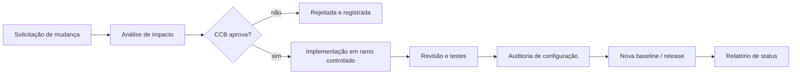

## O que é

**Gerência de Configuração de Software (GCS ou SCM)** é o conjunto de atividades que **identifica, controla, registra e audita** os artefatos de um projeto e todas as mudanças feitas neles ao longo do ciclo de vida. Seu objetivo é a **integridade**: saber exatamente **o que** compõe cada versão do sistema, **quem** mudou **o quê**, **quando** e **por quê**.

:::definition Item de configuração (IC)
Qualquer artefato colocado sob controle: documento de requisitos, modelo UML, código-fonte, script de banco, plano de testes, executável, arquivo de configuração e até ferramentas usadas no build.
:::

## Para que serve

Em todo projeto, artefatos mudam o tempo todo, por várias pessoas. Sem controle, surgem versões perdidas, correções sobrescritas, builds que "funcionavam ontem" e impossibilidade de reproduzir o que foi entregue ao cliente. A GCS permite **reproduzir qualquer versão**, avaliar **impacto** de mudanças e trabalhar em **paralelo** com segurança.

## Como funciona

### As cinco atividades clássicas (Pressman)

1. **Identificação** dos objetos/itens de configuração — definir o que será controlado e uma **nomenclatura** que identifique sem ambiguidade itens, baselines e releases.
2. **Controle de versão** — registrar as sucessivas versões de cada item e permitir recuperá-las (ex.: Git, SVN).
3. **Controle de mudança** — processo formal para propor, avaliar, aprovar ou rejeitar e implementar mudanças (solicitação de mudança → análise de impacto → decisão do **Comitê de Controle de Mudanças (CCB)** → implementação → verificação).
4. **Auditoria de configuração** — verificar se a mudança foi feita corretamente e se a configuração entregue corresponde à documentada.
5. **Relatório de status** (contabilização) — informar o que mudou, quem mudou, quando e o que foi afetado.

### Baselines (linhas de base)

Uma **baseline** é um conjunto de itens de configuração **formalmente revisados e aprovados** que serve de **base para as etapas seguintes**. Ela pode ser estabelecida ao fim de cada fase (baseline de requisitos, de projeto, de produto) ou em marcos definidos pela gerência. Depois de aprovada, **só pode ser alterada por meio do processo formal de controle de mudanças**, e **não é descartada**: é a referência histórica que garante rastreabilidade.

### Controle de versão na prática

- **Repositório** guarda o histórico; cada **commit** é uma versão identificável.
- **Branches** (ramos) permitem trabalho paralelo; **merge** integra.
- **Tags** marcam versões importantes (releases, baselines).
- Estratégias comuns: *trunk-based development* com integração contínua, ou *Git Flow* com ramos de feature, release e hotfix.

## Características principais

- Atua do **início ao fim** do projeto (no RUP, é uma disciplina de suporte contínua).
- Cobre **todos os artefatos**, não só código.
- Combina **ferramentas** (versionamento, build, rastreadores de solicitações) com **processo** (aprovação, auditoria).
- Base para **manutenção**, **integração contínua** e **releases** reproduzíveis.

## Exemplos práticos

:::example Uma solicitação de mudança
O cliente pede um novo tipo de bolsa na matrícula. É aberta a **solicitação de mudança SM-112**; o analista avalia o impacto (casos de uso, 3 classes, 2 telas, 5 testes); o **CCB** aprova para a próxima release; a desenvolvedora cria o ramo `feature/SM-112`, implementa e abre um pull request revisado; o build integrado passa nos testes; a **auditoria** confirma que tudo o que foi aprovado foi feito; o **relatório de status** registra a mudança na release 2.3, marcada com a tag `v2.3.0`.
:::

## Representação visual

## Vantagens e desvantagens

| Vantagens | Desvantagens |
|---|---|
| qualquer versão pode ser reproduzida | processo formal pode atrasar mudanças pequenas |
| rastreabilidade de quem mudou o quê | exige disciplina de toda a equipe |
| trabalho paralelo seguro | custo de ferramentas e administração |
| base para auditorias e certificações | baselines demais viram burocracia |

## Diferenças entre conceitos semelhantes

- **Controle de versão × gerência de configuração:** versionar é **uma** das atividades; a GCS também inclui identificação, controle de mudanças, auditoria e relatório.
- **Versão × release × baseline:** versão é qualquer estado registrado de um item; **baseline** é um conjunto **aprovado formalmente** como referência; **release** é uma versão entregue ao cliente.
- **Gerência de configuração × gerência de mudanças:** a de mudanças cuida do **fluxo de aprovação** das alterações; a de configuração engloba isso e o controle dos itens e versões.

## Como cai no ENADE

:::enade
Afirmações sobre **baselines** (o que são, quando ocorrem, se podem ser alteradas livremente) e a lista correta das **atividades da GCS** (identificação, controle de versão, controle de mudança, auditoria, relatório de status) aparecem em várias edições (2011, 2014, 2017, 2021).
:::

## Pegadinhas

:::trap Baseline não muda "a qualquer momento"
Depois de aprovada, alterar uma baseline exige o **procedimento formal** de controle de mudanças.
:::

:::trap Baseline não é descartada depois da aprovação da etapa
Ela continua como referência — descartá-la destruiria a rastreabilidade.
:::

:::trap "Controle de qualidade" não está na lista clássica
A lista de atividades da GCS é: identificação, controle de versão, controle de mudança, auditoria de configuração e relatório de status.
:::

## Questões comentadas

::question 2011-objective-24 Baselines

**I** (conjunto aprovado formalmente que serve de base) — correta. **II** (podem ocorrer ao fim de cada fase ou como a gerência definir) — correta. **III** (alteração a qualquer momento sem procedimento formal) — errada. **IV** (pode ser descartada após aceitação) — errada. **V** (identificação define nomenclatura inequívoca) — correta. Resposta: **I, II e V** (alternativa E).

::question 2021-objective-21 Atividades da gestão de configuração

A alternativa correta é a **B**: identificação de objetos na configuração, controle de versão, controle de alterações, auditoria de configuração e relatório de status — exatamente as cinco tarefas descritas por Pressman.

## Resumo para memorizar

:::summary
- GCS = **identificar, versionar, controlar mudanças, auditar e relatar**.
- **Item de configuração**: qualquer artefato sob controle (não só código).
- **Baseline**: conjunto aprovado, referência para as próximas etapas; muda **só** via processo formal e **não se descarta**.
- **CCB** decide sobre mudanças; auditoria confirma; relatório de status informa.
:::

:::mnemonic I-V-C-A-R
**I**dentificar, **V**ersionar, **C**ontrolar mudanças, **A**uditar, **R**elatar.
:::

## Miniquestionário

:::quiz
[
  {
    "question": "O que é uma baseline na gerência de configuração?",
    "options": ["Qualquer commit no repositório", "Um conjunto de itens formalmente aprovados que serve de base para as próximas etapas", "A primeira versão do código", "O backlog do produto"],
    "answer": 1,
    "explanation": "Baselines são referências aprovadas; mudanças nelas exigem controle formal."
  },
  {
    "question": "Qual atividade verifica se a configuração entregue corresponde ao que foi aprovado?",
    "options": ["Identificação", "Auditoria de configuração", "Controle de versão", "Relatório de status"],
    "answer": 1,
    "explanation": "A auditoria confere a correção e a completude da configuração."
  },
  {
    "question": "Quem tipicamente aprova ou rejeita uma solicitação de mudança em um processo formal?",
    "options": ["O próprio desenvolvedor", "O Comitê de Controle de Mudanças (CCB)", "O usuário final", "O testador"],
    "answer": 1,
    "explanation": "O CCB avalia impacto, custo e prioridade antes de autorizar a mudança."
  }
]
:::

## Referências

- PRESSMAN, R. S.; MAXIM, B. R. *Engenharia de Software*. 8. ed. AMGH, 2016 — cap. 29 (gestão de configuração de software).
- SOMMERVILLE, I. *Engenharia de Software*. 10. ed. Pearson, 2018 — cap. 25.
- IEEE Std 828-2012 — *Standard for Configuration Management in Systems and Software Engineering*.
- CHACON, S.; STRAUB, B. *Pro Git*. 2. ed. Apress, 2014 (disponível em git-scm.com/book).
