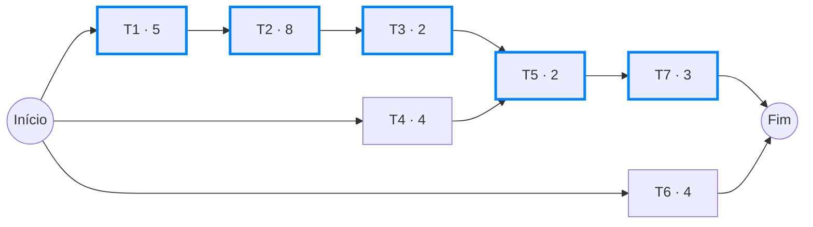

## O que é

**Gerência de projetos** é a aplicação de conhecimentos, habilidades, ferramentas e técnicas às atividades de um projeto para atender aos seus requisitos (PMI). Um **projeto** é um esforço **temporário** para criar um produto, serviço ou resultado **único** — tem início e fim definidos.

**Gerenciamento de riscos** é a parte da gestão que **identifica, analisa, planeja respostas e monitora** eventos incertos que, se ocorrerem, afetam positiva ou negativamente os objetivos do projeto.

## Para que serve

Projetos de software estouram prazo e orçamento com frequência por **escopo mal definido**, **estimativas otimistas**, **comunicação ruim** e **riscos ignorados**. A gestão dá visibilidade: o que precisa ser feito, em que ordem, por quem, quanto custa e o que pode dar errado.

## Como funciona

### Restrição tripla

**Escopo, tempo e custo** estão amarrados: aumentar o escopo sem mexer em prazo ou custo compromete a **qualidade**. Versões mais recentes falam em restrições concorrentes (escopo, cronograma, custo, qualidade, recursos, riscos).

### Áreas de conhecimento do PMBOK (até a 6ª edição)

1. **Integração** — plano do projeto e controle integrado de mudanças;
2. **Escopo** — o que está e o que não está no projeto; **EAP**;
3. **Cronograma (tempo)** — atividades, sequência, durações, caminho crítico;
4. **Custos** — estimativas e orçamento;
5. **Qualidade** — padrões e controle;
6. **Recursos** — equipe e materiais;
7. **Comunicações** — quem precisa de qual informação e quando;
8. **Riscos**;
9. **Aquisições** — contratos e terceirizações;
10. **Partes interessadas** — identificar e engajar quem afeta ou é afetado pelo projeto.

:::note PMBOK 7
A 7ª edição (2021) troca as áreas de conhecimento por **princípios** e **domínios de desempenho** (partes interessadas, equipe, abordagem de desenvolvimento, planejamento, trabalho do projeto, entrega, medição, incerteza). As questões do ENADE analisadas usam o modelo das áreas.
:::

### EAP — Estrutura Analítica do Projeto (WBS)

Decomposição **hierárquica** de todo o trabalho do projeto em entregas menores, até os **pacotes de trabalho** (o nível em que se estima custo e duração). Regra dos 100%: a EAP deve conter **todo** o trabalho — inclusive o que for **terceirizado**, porque ele continua precisando ser planejado e controlado.

### Cronograma e caminho crítico (CPM)

1. Liste as atividades, suas durações e **dependências** (predecessoras).
2. Desenhe a rede (diagrama de precedência).
3. Some as durações de **cada caminho** do início ao fim.
4. O **caminho crítico** é o **mais longo**: ele define o **prazo mínimo** do projeto. Atividades nele têm **folga zero** — qualquer atraso atrasa o projeto inteiro.
5. Atividades fora do caminho crítico têm **folga** (podem atrasar até certo ponto).

:::example Caminho crítico passo a passo
| Tarefa | Duração | Depende de |
|---|---|---|
| T1 | 5 | — |
| T2 | 8 | T1 |
| T3 | 2 | T2 |
| T4 | 4 | — |
| T5 | 2 | T3, T4 |
| T6 | 4 | — |
| T7 | 3 | T5 |

Caminhos: T1→T2→T3→T5→T7 = 5+8+2+2+3 = **20**; T4→T5→T7 = 4+2+3 = 9; T6 = 4. O projeto dura no mínimo **20 dias**. T4 tem folga: pode atrasar até 11 dias sem atrasar T5.
:::

**PERT** usa três estimativas por atividade (otimista O, mais provável M, pessimista P) e calcula a duração esperada $t = \frac{O + 4M + P}{6}$.

### Ciclo de gerenciamento de riscos

1. **Planejar** o gerenciamento de riscos;
2. **Identificar** riscos (brainstorming, checklists, lições aprendidas) → **registro de riscos**;
3. **Análise qualitativa**: classificar por **probabilidade × impacto** (matriz de riscos);
4. **Análise quantitativa**: valor esperado, simulação de Monte Carlo;
5. **Planejar respostas**:
   - ameaças: **evitar** (eliminar a causa), **transferir** (seguro, terceirização), **mitigar** (reduzir probabilidade ou impacto), **aceitar** (ativa, com reserva de contingência; ou passiva);
   - oportunidades: explorar, compartilhar, melhorar, aceitar;
6. **Implementar** respostas e **monitorar** (riscos mudam ao longo do projeto).

$$\text{Exposição ao risco} = \text{probabilidade} \times \text{impacto}$$

## Características principais

- Projeto é **temporário** e **único**; operação é contínua e repetitiva.
- O **gerente de projeto** equilibra restrições e se comunica com as partes interessadas.
- Riscos são **eventos futuros incertos**; problemas são riscos que já aconteceram.
- Planejamento é **progressivo**: detalha-se mais conforme se aprende.

## Exemplos práticos

:::example Respostas a riscos em um projeto de software
- "A API do banco parceiro pode não ficar pronta" → **mitigar**: construir um simulador da API e testar contra ele.
- "A equipe não domina a nova tecnologia" → **mitigar** com treinamento ou **evitar** escolhendo tecnologia conhecida.
- "O servidor pode pegar fogo" → **transferir** usando nuvem com SLA e seguro.
- "O cliente pode pedir mudanças pequenas de layout" → **aceitar** com reserva de horas.
:::

## Representação visual

## Vantagens e desvantagens

| Abordagem | Vantagens | Desvantagens |
|---|---|---|
| Gestão preditiva (PMBOK clássico) | previsibilidade, contratos claros | lida mal com requisitos voláteis |
| Gestão adaptativa (ágil) | absorve mudanças, entrega cedo | difícil fixar escopo, prazo e custo ao mesmo tempo |
| Gestão de riscos formal | menos surpresas | exige tempo e disciplina de revisão |

## Diferenças entre conceitos semelhantes

- **Risco × problema:** risco é **potencial**; problema é um risco que **se materializou**.
- **Mitigar × evitar:** mitigar **reduz** probabilidade/impacto; evitar **elimina** a ameaça mudando o plano.
- **Transferir × aceitar:** transferir passa o impacto para terceiros (seguro, contrato); aceitar assume o risco.
- **EAP × cronograma:** a EAP diz **o que** será entregue (decomposição); o cronograma diz **quando** e em que ordem.
- **Caminho crítico × caminho mais trabalhoso:** é o de **maior duração total**, não o com mais atividades.

## Como cai no ENADE

:::enade
Cálculos de **caminho crítico** (2014 e 2017), interpretação de **EAP** com terceirização (2014), cenários pedindo a **área de conhecimento** a priorizar (2021: partes interessadas) e tipos de **resposta a riscos**.
:::

## Pegadinhas

:::trap Pode haver mais de um caminho crítico?
Pode, se dois caminhos empatarem na maior duração. Confira somando **todos** os caminhos.
:::

:::trap Terceirizar não tira o trabalho da EAP
O trabalho continua no escopo e precisa ser planejado e controlado (prazo, custo, qualidade).
:::

:::trap Atraso e estouro de orçamento podem ser só sintomas
Se o cenário fala de desentendimentos, novos solicitantes e patrocinador ausente, a causa é **partes interessadas**, não tempo ou custo.
:::

## Questões comentadas

::question 2014-objective-34 Tempo mínimo do projeto

Somando os caminhos: T1–T2–T3–T5–T7 = 20 dias é o mais longo; T4 termina antes de T3 e não atrasa T5. Prazo mínimo = **20 dias** (alternativa D).

::question 2017-objective-14 Caminho crítico com quatro afirmativas

Caminhos até J: A–B–I–J = 3+5+11+3 = 22; C–J = 12+3 = 15; D–E–H–J = 4+2+8+3 = 17; **D–F–G–H–J = 4+5+7+8+3 = 27**. O caminho crítico tem **27 dias** (II correta) e inclui **H** (III correta); I e IV estão erradas. Alternativa C.

::question 2021-objective-14 Integração ERP–CRM com problemas de pessoas

Desentendimentos, falta de compreensão do que avaliar, novos solicitantes e patrocinador lento são sintomas de má gestão das **partes interessadas**; atraso e custo são consequências. Alternativa E.

## Resumo para memorizar

:::summary
- Projeto = **temporário + único**. Restrição tripla: **escopo, tempo, custo** (→ qualidade).
- 10 áreas do PMBOK: integração, escopo, cronograma, custos, qualidade, recursos, comunicações, riscos, aquisições, **partes interessadas**.
- **EAP** decompõe todo o trabalho (inclusive o terceirizado) até pacotes de trabalho.
- **Caminho crítico** = caminho mais longo = prazo mínimo; folga zero.
- Riscos: identificar → analisar (probabilidade × impacto) → responder (**evitar, transferir, mitigar, aceitar**) → monitorar.
:::

## Miniquestionário

:::quiz
[
  {
    "question": "A (3 dias) → B (4 dias) → D (2 dias) e A → C (6 dias) → D. Quanto dura o projeto, no mínimo?",
    "options": ["9 dias", "11 dias", "15 dias", "6 dias"],
    "answer": 1,
    "explanation": "Caminhos: A–B–D = 9; A–C–D = 3+6+2 = 11. O mais longo, 11 dias, é o caminho crítico."
  },
  {
    "question": "Contratar um seguro contra perda de equipamentos é que tipo de resposta a risco?",
    "options": ["Evitar", "Transferir", "Mitigar", "Aceitar"],
    "answer": 1,
    "explanation": "O impacto financeiro passa para a seguradora: transferência."
  },
  {
    "question": "Qual é o menor nível da EAP, no qual se estimam custo e duração?",
    "options": ["Fase", "Pacote de trabalho", "Marco", "Sprint"],
    "answer": 1,
    "explanation": "Os pacotes de trabalho são os elementos folha da EAP."
  }
]
:::

## Referências

- PROJECT MANAGEMENT INSTITUTE. *Um Guia do Conhecimento em Gerenciamento de Projetos (Guia PMBOK)*. 6. ed. PMI, 2017; 7. ed. PMI, 2021.
- SOMMERVILLE, I. *Engenharia de Software*. 10. ed. Pearson, 2018 — caps. 22 e 23.
- PRESSMAN, R. S.; MAXIM, B. R. *Engenharia de Software*. 8. ed. AMGH, 2016 — caps. 31 a 35.
- INEP. ENADE TADS 2014 (questões 9 e 34), 2017 (questões 13 e 14) e 2021 (questão 14).
