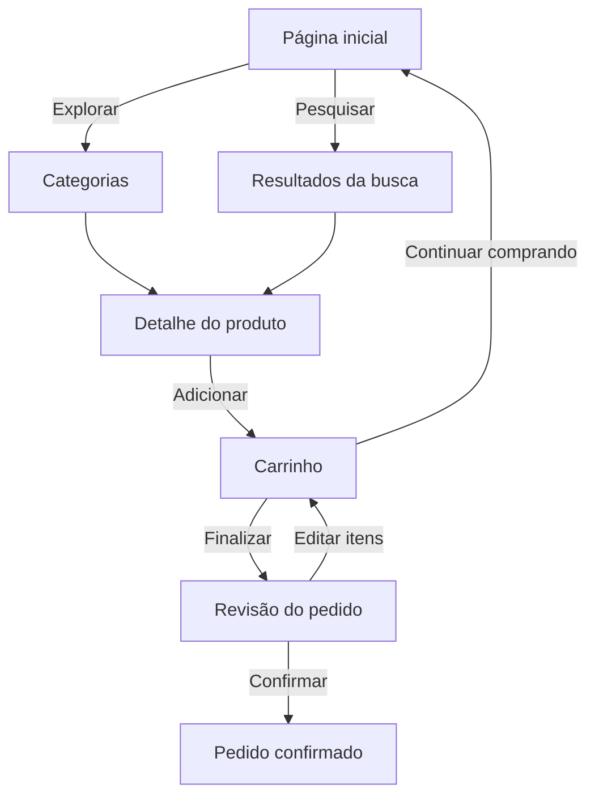

## O que é

**Interação humano-computador (IHC)** estuda como as pessoas usam sistemas computacionais e como projetar interfaces **úteis, usáveis e acessíveis**. Três conceitos centrais:

- **Usabilidade** (ISO 9241-11): grau em que um produto pode ser usado por usuários específicos para alcançar objetivos com **eficácia**, **eficiência** e **satisfação** em um contexto de uso.
- **Acessibilidade**: possibilidade de **todas as pessoas**, inclusive com deficiência (visual, auditiva, motora, cognitiva) ou idosas, perceberem, entenderem e interagirem com o sistema em igualdade de condições.
- **Comunicabilidade**: capacidade da interface de comunicar ao usuário a lógica de quem a projetou (o que é possível fazer e como).

## Para que serve

Um sistema correto, mas difícil de usar, gera erros, retrabalho, chamados de suporte e abandono. Em serviços públicos e comércio eletrônico, falta de acessibilidade **exclui pessoas** — e no Brasil a Lei Brasileira de Inclusão (Lei 13.146/2015) exige acessibilidade em sites.

## Como funciona

### Atributos de usabilidade (Nielsen)

**Facilidade de aprendizado**, **eficiência de uso**, **facilidade de memorização**, **baixa taxa de erros** (e recuperação fácil) e **satisfação subjetiva**.

### As 10 heurísticas de Nielsen

1. **Visibilidade do estado do sistema** — informar o que está acontecendo (barra de progresso, "salvando…").
2. **Correspondência com o mundo real** — linguagem e conceitos do usuário.
3. **Controle e liberdade do usuário** — desfazer, cancelar, "saída de emergência".
4. **Consistência e padrões** — mesma ação, mesmo nome e lugar.
5. **Prevenção de erros** — evitar o erro antes de acontecer (confirmações, campos com máscara).
6. **Reconhecer em vez de lembrar** — opções visíveis em vez de memorizar comandos.
7. **Flexibilidade e eficiência** — atalhos para experientes.
8. **Estética e design minimalista** — só o que é relevante.
9. **Ajudar a reconhecer, diagnosticar e recuperar erros** — mensagens claras com solução.
10. **Ajuda e documentação** — fácil de buscar e focada na tarefa.

### Questões clássicas de projeto de interface (Pressman)

Quatro questões aparecem em quase todo projeto: **tempo de resposta do sistema** (duração e **variabilidade**), **recursos de ajuda ao usuário**, **tratamento de informações de erro** e **rotulação de comandos** (nomes, ícones, atalhos consistentes).

### Acessibilidade na web (WCAG)

As diretrizes **WCAG** (W3C) organizam-se em quatro princípios — **POUR**: **Perceptível**, **Operável**, **Compreensível** e **Robusto**. Exemplos práticos:

- **Texto alternativo** (`alt`) em imagens com informação: leitores de tela leem o `alt`;
- **contraste** suficiente entre texto e fundo; não depender **só de cor**;
- navegação completa **pelo teclado** e foco visível;
- legendas e transcrições em vídeos;
- rótulos associados aos campos de formulário; mensagens de erro descritivas;
- texto redimensionável sem quebrar o layout (importante para idosos).

```html
<a href="/ingressos/show-42">
  
</a>
```

### Mapas de navegação

Diagramas em que cada **caixa** é uma página ou tela e cada **seta** é um caminho de navegação. Mostram como as pessoas **se movimentam** pelo site ou aplicação, ajudando a encontrar caminhos longos, becos sem saída e páginas órfãs. Não descrevem o conteúdo detalhado de cada página (isso é papel do **wireframe**).

### Avaliação de interfaces

- **Avaliação heurística** — especialistas inspecionam a interface usando as heurísticas (barata, rápida, sem usuários).
- **Percurso cognitivo** — especialistas simulam o usuário executando tarefas.
- **Teste de usabilidade** — usuários reais executam tarefas enquanto se observa (taxa de sucesso, tempo, erros, falar em voz alta).
- **Questionários** de satisfação (ex.: SUS).

A verificação e validação da interface acontece em três momentos: na **análise** (o modelo de interface atende às tarefas?), no **projeto** (protótipos avaliados) e no **teste** (com o sistema).

## Características principais

- Projeto **centrado no usuário**: conhecer perfis, tarefas e contexto antes de desenhar.
- **Iterativo**: protótipos → avaliação → ajustes.
- Usabilidade e acessibilidade são **requisitos não funcionais** e devem ser especificadas e testadas.

## Exemplos práticos

:::example Portal para a terceira idade
Para um portal de orientação a idosos: fonte grande e redimensionável, alto contraste, botões grandes, linguagem simples sem jargões, poucos passos por tarefa, instruções visíveis em cada tela, confirmação antes de ações importantes e compatibilidade com leitores de tela.
:::

## Representação visual



Fonte: adaptado de PRESSMAN; MAXIM (2016, cap. 17) — recriado pela equipe Stacklyst.

Cada caixa é uma tela e as setas indicam os caminhos que alguém pode percorrer. A compra pode começar por busca ou por categoria e voltar do carrinho para a loja. No ENADE, use o mapa para avaliar se uma tarefa é alcançável, se existe uma rota de retorno e quantos passos são necessários.

## Vantagens e desvantagens

| Método de avaliação | Vantagem | Limitação |
|---|---|---|
| Avaliação heurística | rápida e barata | não substitui usuários reais |
| Teste com usuários | revela problemas reais | mais caro, exige recrutamento |
| Questionários | mede satisfação em escala | percepção ≠ desempenho real |

## Diferenças entre conceitos semelhantes

| Conceito | Foco | Exemplo |
|---|---|---|
| **Usabilidade** | facilidade, eficiência e satisfação de uso | menos cliques para comprar |
| **Acessibilidade** | acesso por **todas** as pessoas, inclusive com deficiência | `alt` para leitores de tela |
| **Ergonomia** | adequação às características físicas e cognitivas, conforto | evitar fadiga visual |
| **Comunicabilidade** | a interface comunica sua lógica ao usuário | ícones e rótulos que explicam o que fazem |
| **Experiência do usuário (UX)** | percepção total antes, durante e depois do uso | emoção, confiança na marca |

## Como cai no ENADE

:::enade
Cenários com uma decisão de interface (imagens com `alt`, portal para idosos, mapas de navegação) pedindo **qual requisito/atributo** foi atendido, além das questões de projeto de interface de Pressman e da verificação e validação de interfaces em análise, projeto e teste.
:::

## Pegadinhas

:::trap `alt` é sobre acessibilidade
O texto alternativo existe para quem **não vê a imagem** (leitores de tela). A resposta esperada é **acessibilidade**, não "ergonomia" nem "segurança no uso".
:::

:::trap Mapa de navegação não é wireframe
Mapa mostra **ligações entre páginas**; wireframe mostra o **layout de uma página**.
:::

## Questões comentadas

::question 2017-objective-35 Links em imagem com atributo alt

O texto alternativo permite que pessoas com deficiência visual, usando leitores de tela, entendam a finalidade de cada link — isso é **acessibilidade**, que oferece igualdade de condições na interação (alternativa C). As demais alternativas descrevem outros atributos com justificativas que não decorrem do uso do `alt`.

## Resumo para memorizar

:::summary
- Usabilidade = **eficácia, eficiência e satisfação** (ISO 9241-11).
- 10 heurísticas de Nielsen: visibilidade do estado, mundo real, controle, consistência, prevenção de erros, reconhecer > lembrar, flexibilidade, minimalismo, recuperação de erros, ajuda.
- Questões de projeto: **tempo de resposta, ajuda, erros, rotulação de comandos**.
- Acessibilidade: WCAG **POUR**; `alt`, contraste, teclado, legendas.
- Mapa de navegação = como as pessoas se movem entre páginas.
:::

## Miniquestionário

:::quiz
[
  {
    "question": "Uma barra de progresso mostrando 'Enviando arquivo… 60%' atende a qual heurística de Nielsen?",
    "options": ["Prevenção de erros", "Visibilidade do estado do sistema", "Estética minimalista", "Ajuda e documentação"],
    "answer": 1,
    "explanation": "O usuário é informado do que está acontecendo — visibilidade do estado."
  },
  {
    "question": "Garantir que todo o site possa ser usado apenas com o teclado é exemplo de:",
    "options": ["Acessibilidade", "Portabilidade", "Interoperabilidade", "Confiabilidade"],
    "answer": 0,
    "explanation": "Pessoas que não usam mouse (por deficiência motora ou visual) dependem do teclado."
  },
  {
    "question": "Qual método avalia a interface com especialistas, sem usuários, usando princípios reconhecidos?",
    "options": ["Teste A/B", "Avaliação heurística", "Teste de carga", "Entrevista"],
    "answer": 1,
    "explanation": "Na avaliação heurística, especialistas inspecionam a interface com base nas heurísticas."
  }
]
:::

## Referências

- NIELSEN, J. *Usability Engineering*. Morgan Kaufmann, 1993; NIELSEN, J. *10 Usability Heuristics for User Interface Design*. Nielsen Norman Group, 2020.
- BARBOSA, S. D. J.; SILVA, B. S. *Interação Humano-Computador*. Rio de Janeiro: Elsevier, 2010.
- W3C. *Web Content Accessibility Guidelines (WCAG) 2.2*, 2023.
- ISO 9241-11:2018 — *Ergonomics of human-system interaction — Usability: definitions and concepts*.
- PRESSMAN, Roger S.; MAXIM, Bruce R. *Engenharia de software: uma abordagem profissional*. 8. ed. Porto Alegre: AMGH, 2016.
- BRASIL. Lei nº 13.146, de 6 de julho de 2015 (Lei Brasileira de Inclusão).
