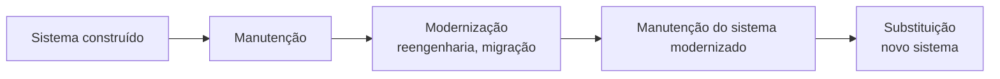

## O que é

**Manutenção de software** é toda modificação feita no software **depois que ele foi entregue** ao usuário: corrigir defeitos, adaptá-lo a mudanças no ambiente, melhorá-lo ou prevenir problemas futuros. É a fase **mais longa e mais cara** do ciclo de vida — estudos clássicos estimam entre 60% e 80% do custo total.

**Dívida técnica** (termo de Ward Cunningham) é o custo futuro de escolher hoje uma solução **mais rápida porém pior**: como uma dívida financeira, ela cobra **juros** — cada mudança futura fica mais lenta e arriscada até que a dívida seja "paga" (refatoração).

## Para que serve

Sistemas úteis precisam mudar: leis mudam, o negócio cresce, a tecnologia envelhece. Entender os tipos de manutenção ajuda a **planejar custo e esforço** e a classificar corretamente as demandas. Entender dívida técnica ajuda a decidir **quando vale a pena** tomar atalhos e quando é hora de pagá-los.

## Como funciona

### Tipos de manutenção

| Tipo | Motivo | Exemplo |
|---|---|---|
| **Corretiva** | corrigir **defeitos** descobertos após a entrega | o relatório soma errado os descontos |
| **Adaptativa** | adaptar o software a **mudanças no ambiente** externo: legislação, sistema operacional, banco, hardware, integrações | nova regra fiscal; migração para outro SGBD |
| **Perfectiva** (também chamada **evolutiva** ou de melhoria) | **novas funcionalidades** ou melhorias pedidas pelos usuários, desempenho, usabilidade | incluir relatório de comissões; acelerar uma consulta |
| **Preventiva** | aumentar a **manutenibilidade e a confiabilidade** antes que problemas surjam | refatorar um módulo confuso; atualizar dependências vulneráveis |

A norma **ISO/IEC 14764** (manutenção de software) organiza essas categorias e define um **processo de manutenção** (implementação do processo, análise do problema e da modificação, implementação da modificação, revisão/aceitação, migração e descontinuação). Ela classifica corretiva e preventiva como **correções** e adaptativa e perfectiva como **melhorias** (*enhancements*).

:::tip Como classificar em 5 segundos
Pergunte **"por que mudar?"**:
- algo **está errado** → corretiva;
- **o mundo lá fora mudou** (lei, plataforma) → adaptativa;
- **o usuário quer mais/melhor** → perfectiva/evolutiva;
- **nada quebrou ainda, mas vai** → preventiva.
:::

### Sistemas legados e evolução

**Sistemas legados** são sistemas antigos, ainda essenciais ao negócio, normalmente feitos com tecnologias ultrapassadas (Cobol, bancos hierárquicos, arquivos indexados) e com pouca documentação. As estratégias de evolução são:

1. **Manutenção** contínua (mudanças pequenas);
2. **Modernização** (mudanças estruturais significativas mantendo o sistema): **reengenharia**, migração de plataforma, encapsulamento por serviços/APIs;
3. **Substituição** por um novo sistema quando nem manutenção nem modernização atendem ao negócio.

- **Engenharia reversa:** analisar o sistema existente para recuperar seu projeto e especificação (do código para modelos).
- **Reengenharia:** engenharia reversa + reestruturação + reimplementação, para obter um sistema melhor com a mesma funcionalidade essencial.
- **Refatoração:** pequenas transformações que melhoram a estrutura do código **sem mudar o comportamento externo**.

### Leis de Lehman

Observações sobre a evolução de sistemas grandes: um sistema usado em ambiente real **precisa mudar continuamente** ou se torna progressivamente menos útil (mudança contínua), e sua **complexidade aumenta** a cada mudança, a menos que se trabalhe para reduzi-la (complexidade crescente).

### Dívida técnica

Tipos frequentes: código duplicado, ausência de testes automatizados, arquitetura acoplada, dependências desatualizadas, documentação inexistente. Pode ser **deliberada** ("vamos lançar agora e refatorar depois") ou **inadvertida** (falta de conhecimento). Gerenciar dívida técnica envolve **torná-la visível** (registrar no backlog), **medir** (ferramentas de análise estática, cobertura de testes) e **pagá-la** em parcelas (refatoração contínua, manutenção preventiva).

## Características principais

- Manutenção é **inevitável** em sistemas úteis.
- O custo da manutenção cresce com a **deterioração** da estrutura.
- Boa **documentação**, **testes automatizados** e **baixo acoplamento** reduzem o custo de manter.
- Toda manutenção deve passar por **gerência de configuração** (controle de versões e de mudanças).

## Exemplos práticos

:::example Classifique as demandas de um ERP
1. "Desde a atualização, o cálculo de férias arredonda errado." → **corretiva**.
2. "A Receita mudou o layout da nota fiscal; precisamos gerar o novo XML." → **adaptativa**.
3. "Queremos um relatório de comissão por vendedor." → **perfectiva/evolutiva**.
4. "O módulo de estoque tem 4 mil linhas numa classe só; vamos dividi-lo antes que dê problema." → **preventiva** (e pagamento de dívida técnica).
:::

## Representação visual

## Vantagens e desvantagens

| Escolha | Vantagem | Desvantagem |
|---|---|---|
| Manter o legado | baixo risco imediato; conhecimento existente | custo crescente; tecnologia obsoleta |
| Modernizar (reengenharia) | preserva regras de negócio validadas | projeto complexo; requer engenharia reversa |
| Substituir | tecnologia atual; chance de redesenhar processos | alto custo e risco de perder regras escondidas no código |
| Assumir dívida técnica | entrega mais rápida agora | "juros": mudanças futuras mais caras |

## Diferenças entre conceitos semelhantes

- **Adaptativa × perfectiva:** a adaptativa é motivada por **mudança externa** obrigatória (lei, plataforma); a perfectiva é **pedido de melhoria** do usuário/negócio.
- **Preventiva × corretiva:** a corretiva reage a um defeito que **já aconteceu**; a preventiva age **antes**.
- **Refatoração × reengenharia:** refatoração é contínua e pequena, no código; reengenharia é um projeto maior de reestruturação do sistema.
- **Engenharia reversa × reengenharia:** a reversa só **entende/recupera** o projeto; a reengenharia também **reconstrói**.

## Como cai no ENADE

:::enade
Cenários curtos pedindo o **tipo de manutenção**: mudança na legislação (**adaptativa**), relatório novo (**evolutiva/perfectiva**), defeito (**corretiva**). Também aparecem sistemas legados (Cobol, ADABAS) e estratégias de modernização. Atenção ao vocabulário da questão: algumas usam "evolutiva" no lugar de "perfectiva".
:::

## Pegadinhas

:::trap Mudança de lei não é corretiva
O sistema não tinha defeito; o ambiente mudou. É **adaptativa**.
:::

:::trap "Perfectiva" e "evolutiva" podem aparecer juntas
Algumas questões trazem ambas como alternativas. Leia qual vocabulário o enunciado adota (por exemplo, o texto-base de Seacord fala em evolução) e escolha a que descreve **acrescentar funcionalidade**.
:::

## Questões comentadas

::question 2008-objective-36 ERP e mudança na legislação

O ERP funcionava; o que mudou foi a **legislação** (ambiente externo). Ajustar o sistema a um requisito externo novo é manutenção **adaptativa** (alternativa B).

::question 2021-objective-23 Relatório novo em um ERP legado

A demanda acrescenta uma capacidade (relatório de comissão) para atender uma nova necessidade do negócio — não há defeito nem mudança de ambiente. No vocabulário adotado pela questão, é manutenção **evolutiva** (alternativa B).

## Resumo para memorizar

:::summary
- **Corretiva** = defeito. **Adaptativa** = ambiente mudou. **Perfectiva/evolutiva** = melhoria/nova função. **Preventiva** = evitar problemas futuros.
- ISO/IEC **14764** trata do processo e das categorias de manutenção.
- Legado → **manter, modernizar (reengenharia) ou substituir**.
- **Dívida técnica** = atalho de hoje que cobra juros amanhã; paga-se com **refatoração**.
:::

:::mnemonic CAPP
**C**orrige, **A**dapta, **P**erfeiçoa, **P**revine.
:::

## Miniquestionário

:::quiz
[
  {
    "question": "Um banco de dados será descontinuado pelo fornecedor e o sistema precisa migrar para outro SGBD. Que manutenção é essa?",
    "options": ["Corretiva", "Adaptativa", "Perfectiva", "Preventiva"],
    "answer": 1,
    "explanation": "A mudança é imposta pelo ambiente tecnológico, não por defeito nem por pedido de melhoria."
  },
  {
    "question": "Qual atividade melhora a estrutura interna do código sem alterar seu comportamento externo?",
    "options": ["Engenharia reversa", "Refatoração", "Substituição", "Manutenção corretiva"],
    "answer": 1,
    "explanation": "Refatoração preserva o comportamento e melhora a estrutura; é a forma usual de pagar dívida técnica."
  },
  {
    "question": "Sobre dívida técnica, é correto afirmar:",
    "options": ["É sempre fruto de desconhecimento", "Nunca deve ser assumida", "Pode ser deliberada e gera custos crescentes até ser paga", "Só existe em sistemas legados"],
    "answer": 2,
    "explanation": "Pode ser uma decisão consciente de curto prazo; o importante é torná-la visível e pagá-la."
  }
]
:::

## Referências

- ISO/IEC/IEEE 14764:2022 — *Software engineering — Software life cycle processes — Maintenance*.
- SOMMERVILLE, I. *Engenharia de Software*. 10. ed. Pearson, 2018 — cap. 9 (evolução de software).
- PRESSMAN, R. S.; MAXIM, B. R. *Engenharia de Software*. 8. ed. AMGH, 2016 — cap. 36.
- SEACORD, R. C.; PLAKOSH, D.; LEWIS, G. A. *Modernizing Legacy Systems*. Addison-Wesley, 2003.
- FOWLER, M. *Refatoração: aperfeiçoando o design de códigos existentes*. 2. ed. Novatec, 2020.
- CUNNINGHAM, W. The WyCash Portfolio Management System. *OOPSLA'92 Experience Report*, 1992.
