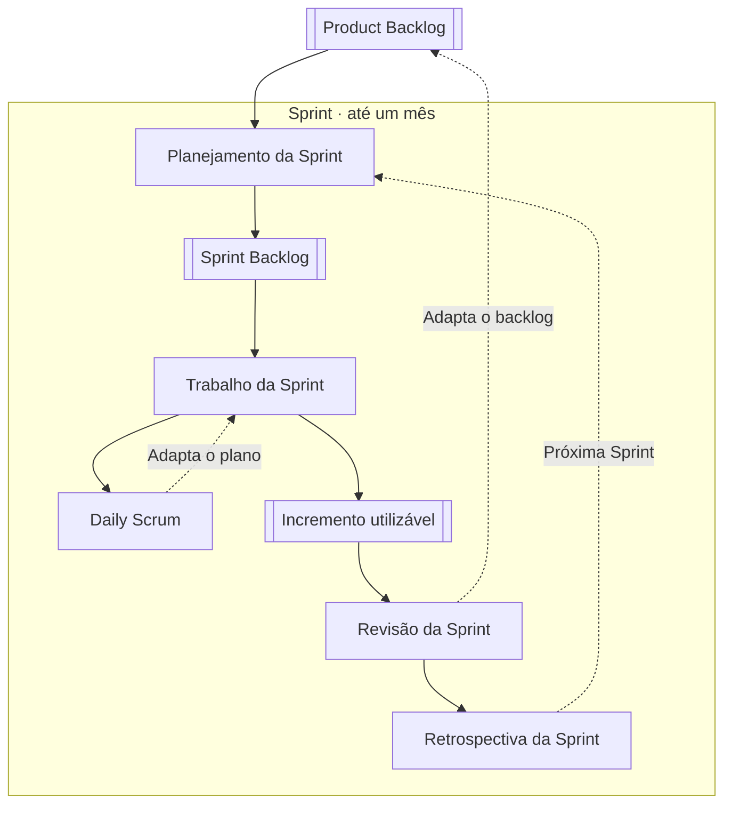
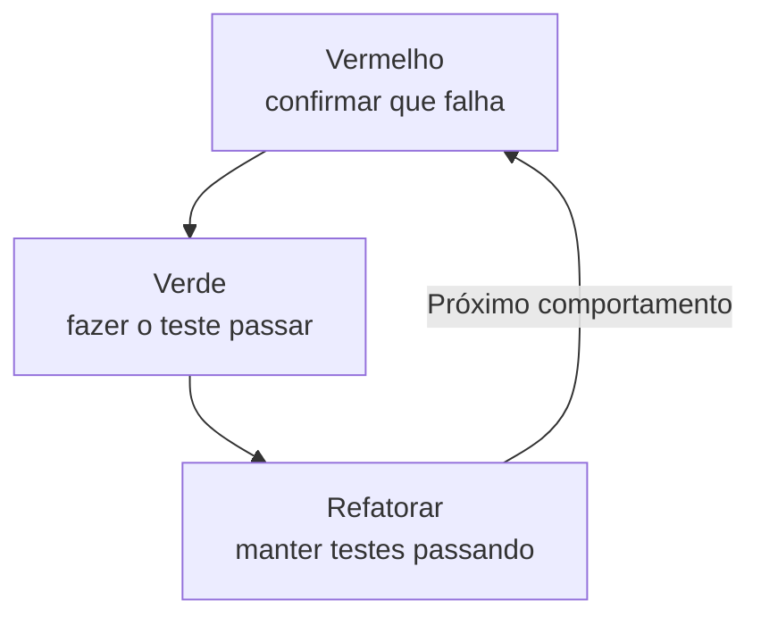

## O que é

**Desenvolvimento ágil** é uma família de métodos que entregam software em **ciclos curtos**, com **feedback frequente do cliente**, equipes **auto-organizadas** e disposição para **mudar o plano** quando aprendem algo novo. É uma resposta aos processos muito pesados e dirigidos por documentos.

Os métodos mais cobrados são o **Scrum** (gestão do trabalho), o **Kanban** (gestão do fluxo) e a **XP — Programação Extrema** (práticas técnicas de engenharia). Eles se combinam com frequência.

## Para que serve

Para contextos em que **requisitos mudam** e é melhor descobrir o produto aos poucos: startups, produtos digitais, sistemas de negócio que precisam acompanhar o mercado. Entregar cedo e com frequência reduz o risco de construir algo que ninguém quer.

## Como funciona

### Manifesto Ágil (2001)

Dezessete desenvolvedores publicaram **4 valores** e **12 princípios**. Os valores dizem que, **embora haja valor nos itens à direita, valorizamos mais os itens à esquerda**:

| Valorizamos mais | do que |
|---|---|
| **Indivíduos e interações** | processos e ferramentas |
| **Software em funcionamento** | documentação abrangente |
| **Colaboração com o cliente** | negociação de contratos |
| **Responder a mudanças** | seguir um plano |

Alguns dos 12 princípios: satisfazer o cliente com **entregas contínuas e adiantadas**; **aceitar mudanças** de requisitos, mesmo tardias; entregar software funcionando **com frequência** (semanas a poucos meses); pessoas de negócio e desenvolvedores trabalhando **juntos diariamente**; conversa **face a face**; software funcionando é a **principal medida de progresso**; ritmo **sustentável**; **excelência técnica**; **simplicidade** (maximizar o trabalho não feito); equipes **auto-organizáveis**; **reflexão** regular para melhorar.

:::trap O Manifesto não elimina documentação nem planejamento
"Mais valor à esquerda" não quer dizer "nada à direita". Documentação, processos, contratos e planos continuam existindo — só não são o centro.
:::

### Scrum

Arcabouço (*framework*) leve para desenvolver produtos complexos em **Sprints** de duração fixa (até um mês; normalmente duas semanas).

**Papéis (Scrum Team):**

- **Product Owner (PO):** maximiza o valor do produto; **é o responsável pelo Product Backlog** — cria, ordena e explica os itens.
- **Scrum Master:** garante que o Scrum seja entendido e praticado; remove impedimentos; serve a equipe como **líder servidor**. **Não** é gerente nem dono do backlog.
- **Developers:** quem constrói o incremento; auto-organizados; definem como transformar o backlog em produto.

**Eventos:**

1. **Sprint** — o contêiner de todos os eventos.
2. **Sprint Planning** — define o **objetivo da Sprint** e os itens que entram no Sprint Backlog.
3. **Daily Scrum** — 15 minutos por dia para os Developers inspecionarem o progresso rumo ao objetivo.
4. **Sprint Review** — inspeção do **incremento** com os stakeholders; adapta o Product Backlog.
5. **Sprint Retrospective** — a equipe inspeciona **como trabalhou** e planeja melhorias.

**Artefatos (e seus compromissos):**

- **Product Backlog** → compromisso: **Meta do Produto**. Lista ordenada de tudo que pode entrar no produto.
- **Sprint Backlog** → compromisso: **Objetivo da Sprint**. Itens selecionados + plano para entregá-los.
- **Incremento** → compromisso: **Definição de Pronto** (*Definition of Done*).

### Kanban

Método de gestão de **fluxo** baseado em um quadro visual com colunas (por exemplo, *A fazer → Em andamento → Em teste → Feito*). Princípios práticos:

- **Visualizar o trabalho** no quadro.
- **Limitar o trabalho em progresso (WIP)**: cada coluna tem um número máximo de cartões; só se puxa um novo item quando há espaço. Isso cria um sistema **puxado** (*pull*).
- **Gerenciar o fluxo** e medir *lead time* (do pedido à entrega) e *cycle time* (do início ao fim do trabalho).
- **Melhoria contínua** e políticas explícitas.

Kanban **não tem sprints nem papéis obrigatórios**; pode ser usado sozinho ou junto com Scrum ("Scrumban").

### XP — Programação Extrema

Criada por Kent Beck, foca em **qualidade técnica** e feedback rápido. Valores: comunicação, simplicidade, feedback, coragem e respeito. Práticas mais cobradas:

- **Programação em pares**: duas pessoas, um computador — um escreve, o outro revisa e pensa à frente; revezam.
- **Desenvolvimento guiado por testes (TDD)**: escrever o **teste automatizado antes** do código (ciclo vermelho → verde → refatorar).
- **Integração contínua**: integrar e testar o código várias vezes ao dia.
- **Refatoração**: melhorar a estrutura interna sem mudar o comportamento.
- **Releases pequenas**, **projeto simples**, **propriedade coletiva do código**, **padrões de codificação**, **cliente presente**, **ritmo sustentável** (40 horas), **jogo do planejamento** com histórias de usuário.

## Características principais

- Ciclos **iterativos e incrementais** curtos.
- Cliente **participa** do processo continuamente.
- Equipes pequenas, multifuncionais e auto-organizadas.
- Planejamento **adaptativo** (repriorização constante).
- Qualidade garantida por práticas técnicas (testes automatizados, integração contínua).

## Exemplos práticos

:::example Uma Sprint de duas semanas
Segunda-feira: Sprint Planning define o objetivo "permitir pagamento por Pix". O PO explica as histórias priorizadas; os Developers estimam e montam o Sprint Backlog. Todos os dias há Daily de 15 minutos. Na segunda sexta-feira, a Review mostra o Pix funcionando aos stakeholders, que pedem um comprovante por e-mail — o PO adiciona isso ao Product Backlog. Na Retrospectiva, a equipe decide automatizar o deploy de homologação.
:::

:::example Um quadro Kanban de suporte
Colunas: *Entrada → Análise (WIP 3) → Correção (WIP 2) → Verificação (WIP 2) → Concluído*. Quando "Correção" já tem 2 cartões, ninguém puxa um novo até liberar espaço — o gargalo fica visível e a equipe ajuda a destravá-lo.
:::

## Representação visual

Fonte: adaptado de SCHWABER; SUTHERLAND (2020, seções Eventos do Scrum e Artefatos do Scrum) — recriado pela equipe Stacklyst.

A Sprint contém os quatro eventos. O planejamento define o objetivo e o plano de trabalho, a Daily ajusta o plano, a revisão inspeciona o resultado com os interessados e a retrospectiva prepara melhorias no modo de trabalhar. No ENADE, associe cada evento ao que ele inspeciona. O Incremento atende à Definição de Pronto e pode ser entregue durante a Sprint.

Fonte: adaptado de BECK (2003, prefácio) — recriado pela equipe Stacklyst.

Escreva um teste para o comportamento novo e confirme a falha. Implemente o necessário para fazê-lo passar e melhore a estrutura do código com a suíte passando. No ENADE, reconheça o teste escrito antes do código e a refatoração que preserva o comportamento observável.

## Vantagens e desvantagens

| Vantagens | Desvantagens |
|---|---|
| entrega de valor cedo e frequente | depende de cliente disponível e engajado |
| adapta-se a mudanças | difícil em contratos de escopo fechado |
| problemas aparecem rápido | escala mal sem adaptações (equipes muito grandes) |
| qualidade técnica com testes e CI | documentação pode ficar insuficiente para sistemas regulados |

## Diferenças entre conceitos semelhantes

| | Scrum | Kanban | XP |
|---|---|---|---|
| Foco | gestão do trabalho em ciclos | fluxo contínuo | práticas de engenharia |
| Tempo | Sprints fixas | contínuo, sem iterações obrigatórias | iterações curtas |
| Papéis | PO, Scrum Master, Developers | não obrigatórios | cliente presente, coach |
| Controle | objetivo da Sprint | **limite de WIP** | testes, pares, CI |
| Mudança durante o ciclo | evitada na Sprint | a qualquer momento | aceita entre iterações |

- **Product Owner × Scrum Master:** o PO cuida do **o quê** e da ordem do backlog; o Scrum Master cuida do **processo** e remove impedimentos.
- **Sprint Review × Retrospectiva:** Review inspeciona o **produto**; Retrospectiva inspeciona o **processo/equipe**.
- **Lead time × cycle time:** lead time começa no pedido do cliente; cycle time começa quando o trabalho realmente inicia.

## Como cai no ENADE

:::enade
Itens I–IV que misturam práticas: o erro mais comum plantado pela banca é atribuir o **Product Backlog ao Scrum Master** (é do **Product Owner**). Também aparecem XP (testes antes do código, programação em pares, integração contínua) e Kanban (tornar o fluxo visível, limitar WIP).
:::

## Pegadinhas

:::trap Scrum Master não gerencia o backlog nem a equipe
Ele é facilitador e líder servidor. Quem ordena o Product Backlog é o **Product Owner**.
:::

:::trap Kanban não tem Sprint
Se a afirmativa fala em "Sprint do Kanban" ou em papéis obrigatórios do Kanban, está errada.
:::

:::trap Daily não é reunião de status para o gerente
É dos Developers, para inspecionar o progresso em direção ao objetivo da Sprint.
:::

## Questões comentadas

::question 2021-objective-12 Scrum, XP e Kanban numa entrevista de emprego

**I** correta: métodos ágeis são iterativos e incrementais, com foco em rapidez, flexibilidade e participação do cliente. **II** correta: em XP, testes automatizados são escritos **antes** da funcionalidade (TDD). **III** errada: atribui a gestão do Product Backlog ao Scrum Master, mas ela é do **Product Owner**. **IV** correta: o quadro Kanban torna o fluxo visível. Resposta: **I, II e IV**.

::question 2011-objective-10 Práticas da XP ligadas ao código

Refatoração, programação em pares e integração contínua são práticas da XP voltadas à qualidade do código. Em pares, o conhecimento se espalha, há revisão contínua e o risco de o código depender de uma única pessoa diminui.

## Resumo para memorizar

:::summary
- Manifesto: **indivíduos, software funcionando, colaboração, resposta a mudanças** (mais valor, não exclusividade).
- Scrum: 3 papéis (**PO, SM, Developers**), 5 eventos (**Sprint, Planning, Daily, Review, Retrospectiva**), 3 artefatos (**Product Backlog, Sprint Backlog, Incremento**).
- PO = dono do **Product Backlog**. SM = **facilitador**.
- Kanban: **visualizar** + **limitar WIP** + sistema **puxado**; sem sprints.
- XP: **pares, TDD, integração contínua, refatoração, releases pequenas**.
:::

## Miniquestionário

:::quiz
[
  {
    "question": "Quem é responsável por ordenar o Product Backlog no Scrum?",
    "options": ["Scrum Master", "Product Owner", "Developers", "Gerente de projeto"],
    "answer": 1,
    "explanation": "O Product Owner é o responsável pelo Product Backlog e por maximizar o valor do produto."
  },
  {
    "question": "Qual é o efeito de limitar o WIP em um quadro Kanban?",
    "options": ["Aumentar o número de tarefas em paralelo", "Criar um sistema puxado e expor gargalos", "Eliminar a necessidade de testes", "Definir a duração das sprints"],
    "answer": 1,
    "explanation": "Com limite de WIP, só se puxa trabalho quando há capacidade, o que evidencia gargalos."
  },
  {
    "question": "No Manifesto Ágil, 'software em funcionamento mais que documentação abrangente' significa que:",
    "options": ["não se deve documentar", "a documentação tem valor, mas software funcionando tem mais", "documentação é proibida em Scrum", "o código substitui todos os requisitos"],
    "answer": 1,
    "explanation": "Os itens da direita continuam tendo valor; os da esquerda têm prioridade."
  },
  {
    "question": "A prática da XP de escrever o teste automatizado antes do código é chamada de:",
    "options": ["Refatoração", "Integração contínua", "TDD", "Programação em pares"],
    "answer": 2,
    "explanation": "TDD — Test-Driven Development — segue o ciclo vermelho, verde, refatorar."
  }
]
:::

## Referências

- BECK, K. et al. *Manifesto para Desenvolvimento Ágil de Software*. 2001. Disponível em agilemanifesto.org.
- SCHWABER, Ken; SUTHERLAND, Jeff. *O guia do Scrum: o guia definitivo para o Scrum*. [S. l.]: Scrum Guides, 2020. Disponível em: https://scrumguides.org/docs/scrumguide/v2020/2020-Scrum-Guide-PortugueseBR-3.0.pdf. Acesso em: 25 nov. 2026.
- BECK, K. *Programação Extrema (XP) explicada*. Bookman, 2004.
- ANDERSON, D. J. *Kanban: mudança evolucionária de sucesso para seu negócio de tecnologia*. Blue Hole Press, 2011.
- SOMMERVILLE, I. *Engenharia de Software*. 10. ed. Pearson, 2018 — cap. 3.
- BECK, Kent. *Test-driven development: by example*. Boston: Addison-Wesley, 2003.
