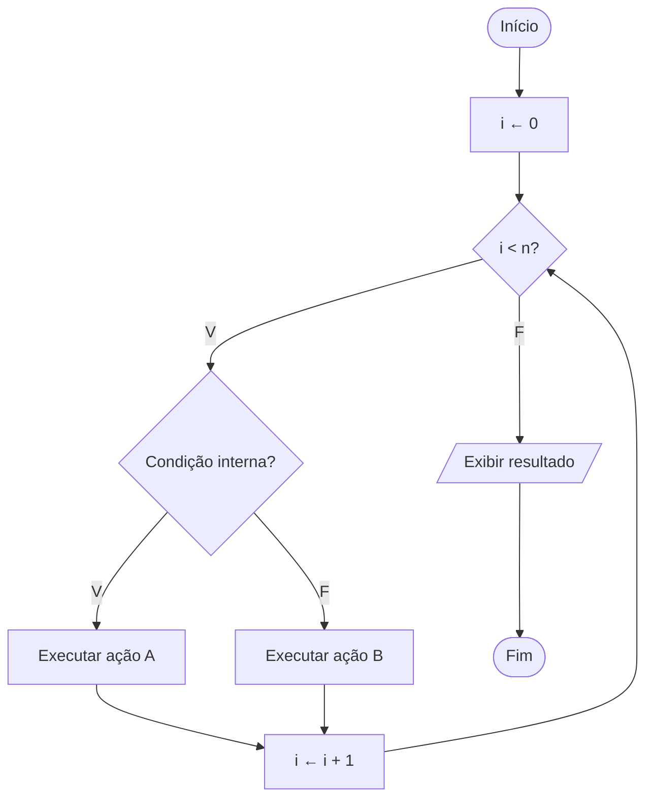

## O que é

Um **algoritmo** é uma **sequência finita e bem definida de passos** que recebe uma entrada e produz uma saída, resolvendo um problema (Cormen). **Lógica de programação** é a habilidade de organizar esses passos com **variáveis**, **operadores** e **estruturas de controle**. O ENADE usa muito **pseudocódigo** em português (Portugol), além de C, Java e Python.

## Para que serve

Quase toda questão de código pede para **simular** o algoritmo e descobrir uma saída, um erro ou a linha que falta. Dominar a leitura e o **teste de mesa** resolve questões de vetores, recursão, ordenação, pilhas e até complexidade ciclomática.

## Como funciona

### Variáveis e tipos

Uma **variável** é um espaço nomeado na memória que guarda um valor de um **tipo**:

| Tipo (Portugol) | Exemplos | Em C/Java |
|---|---|---|
| `inteiro` | −3, 0, 42 | `int`, `long` |
| `real` | 3.5, −0.25 | `float`, `double` |
| `lógico` | verdadeiro, falso | `boolean` (`int` em C) |
| `caractere`/`literal` | 'A', "1000" | `char`, `String` |

**Erros de atribuição de tipo** acontecem ao guardar um valor incompatível: `varA ← 3.5` com `varA: inteiro` (perde a parte decimal ou não compila, conforme a linguagem); `varS ← 10` com `varS: literal`; `varL ← "sim"` com `varL: lógico`. Atenção: `"1000"` entre aspas é **texto**, não número.

### Operadores

- **Aritméticos:** `+ − * /`, `div` (divisão inteira), `mod`/`%` (resto). `7 div 2 = 3`, `7 mod 2 = 1`.
- **Relacionais:** `= <> < <= > >=` (`==` e `!=` em C/Java).
- **Lógicos:** `e` (`&&`), `ou` (`||`), `não` (`!`). Veja [Proposições e conectivos](lib:proposicoes-e-conectivos).
- **Precedência:** `não` → aritméticos → relacionais → `e` → `ou`. Na dúvida, parênteses.

### Estruturas de controle

```text
// Condicional
se (nota >= 6) entao
    escreva("Aprovado")
senao
    escreva("Reprovado")
fim se

// Repetição com teste no início (pode executar 0 vezes)
enquanto (i < n) faca
    i ← i + 1
fim enquanto

// Repetição com contador
para i ← 1 ate 10 passo 1 faca
    soma ← soma + i
fim para

// Repetição com teste no fim (executa ao menos 1 vez)
repita
    leia(opcao)
ate (opcao = 0)
```

### Funções e procedimentos

- **Função**: recebe parâmetros e **retorna um valor** (`funcao media(a, b: real): real`).
- **Procedimento**: executa ações e **não retorna** valor.
- **Passagem por valor** (cópia) × **por referência** (a função altera a variável original).
- **Variável local** (existe só dentro da função) × **global** (visível em todo o programa).

### Teste de mesa

Técnica de **executar o algoritmo à mão**, linha a linha, anotando os valores das variáveis em uma tabela. É o método mais seguro para questões de código.

:::example Teste de mesa
```text
x ← 0
para i ← 1 ate 4 faca
    se (i mod 2 = 0) entao
        x ← x + i
    fim se
fim para
escreva(x)
```

| i | i mod 2 = 0? | x |
|---|---|---|
| — | — | 0 |
| 1 | não | 0 |
| 2 | sim | 2 |
| 3 | não | 2 |
| 4 | sim | 6 |

Saída: **6**.
:::

## Características principais

Um algoritmo deve ter **finitude** (termina), **definição** (cada passo é claro), **entradas**, **saídas** e **efetividade** (passos executáveis). Programas estruturados usam apenas **sequência, seleção e repetição** (teorema de Böhm-Jacopini).

## Exemplos práticos

:::example Função em C equivalente a um pseudocódigo
```c
char alternar(char atual) {
    return atual == 'B' ? 'P' : 'B';   // alterna branco e preto
}
```
Questões como a do quadriculado das toalhas (2021) pedem escolher qual função implementa corretamente uma regra de alternância.
:::

## Representação visual

Comece no oval e siga o losango do enquanto antes de executar o corpo. As alternativas do se convergem para um único incremento antes da volta ao teste. No ENADE, simule inclusive n = 0 e verifique quais comandos ainda são executados.



Fonte: adaptado de FORBELLONE; EBERSPÄCHER (2005, cap. 3) — recriado pela equipe Stacklyst.

## Vantagens e desvantagens

| Recurso | Vantagem | Cuidado |
|---|---|---|
| `enquanto` | flexível | laço infinito se a condição nunca ficar falsa |
| `para` | contador explícito | limites "um a mais"/"um a menos" |
| `repita…até` | garante uma execução | condição de saída invertida em relação ao `enquanto` |

## Diferenças entre conceitos semelhantes

- **`enquanto` × `repita…até`:** o primeiro testa **antes** (pode não executar); o segundo testa **depois** (executa pelo menos uma vez) e repete **até** a condição ficar **verdadeira**.
- **`/` × `div` × `mod`:** divisão real × quociente inteiro × resto.
- **`=` em pseudocódigo × `=` em C:** em Portugol, `=` compara e `←` atribui; em C, `=` atribui e `==` compara.
- **Função × procedimento:** retorna valor × não retorna.

## Como cai no ENADE

:::enade
Pseudocódigos para descobrir a saída (2021: soma de linhas de matriz = 22), identificar erros de tipo (2008), escolher a função correta entre alternativas de código (2021) e escrever um algoritmo em discursivas (2021: maior, menor e média de alturas).
:::

## Pegadinhas

:::trap Aspas transformam número em texto
`varS ← "1000"` é literal; usar `varS` em uma soma é erro de tipo.
:::

:::trap Limites do laço
`para i ← 0 ate 3` executa **4** vezes (0, 1, 2, 3). Conte com cuidado.
:::

## Questões comentadas

::question 2008-objective-21 Erros de atribuição de tipo

Leia a declaração de cada variável e confira cada atribuição: real em variável inteira, texto em variável numérica e valores não lógicos em variável lógica são **erros de atribuição de tipo**. Faça a verificação linha a linha antes de escolher a alternativa.

::question 2021-discursive-3 Maior, menor, média e quantos abaixo da média

Estratégia de resposta: (1) ler as 1 000 alturas em um vetor; (2) percorrer uma vez atualizando **maior**, **menor** e **soma**; (3) calcular a **média**; (4) percorrer **de novo** contando quem está abaixo da média — é preciso guardar os valores, pois a média só é conhecida no fim da primeira passada.

## Resumo para memorizar

:::summary
- Algoritmo = passos **finitos**, **definidos**, com entrada e saída.
- Tipos: inteiro, real, lógico, caractere/literal — atribuição incompatível é erro.
- Estruturas: **sequência, seleção (se), repetição (enquanto, para, repita)**.
- `div` = quociente inteiro; `mod` = resto.
- Use **teste de mesa** em toda questão de código.
:::

## Miniquestionário

:::quiz
[
  {
    "question": "Quanto vale x ao final? x ← 1; para i ← 1 ate 3 faca x ← x * 2 fim para",
    "options": ["3", "6", "8", "4"],
    "answer": 2,
    "explanation": "x vale 2, 4 e 8 ao fim das três iterações."
  },
  {
    "question": "Qual estrutura garante que o bloco seja executado pelo menos uma vez?",
    "options": ["enquanto … faça", "para … até", "repita … até", "se … então"],
    "answer": 2,
    "explanation": "repita…até testa a condição no fim."
  },
  {
    "question": "Quanto vale 17 mod 5?",
    "options": ["3", "2", "3,4", "12"],
    "answer": 1,
    "explanation": "17 = 5 × 3 + 2; o resto é 2."
  }
]
:::

## Referências

- FORBELLONE, André Luiz Villar; EBERSPÄCHER, Henri Frederico. *Lógica de programação: a construção de algoritmos e estruturas de dados*. 3. ed. São Paulo: Pearson Prentice Hall, 2005.
- MANZANO, J. A. N. G.; OLIVEIRA, J. F. *Algoritmos: lógica para desenvolvimento de programação de computadores*. 28. ed. Érica, 2016.
- CORMEN, T. H. et al. *Algoritmos: teoria e prática*. 3. ed. Elsevier, 2012 — cap. 1.
- INEP. ENADE TADS 2008 (questão 21) e 2021 (questões 10 e 29, discursiva 3).
