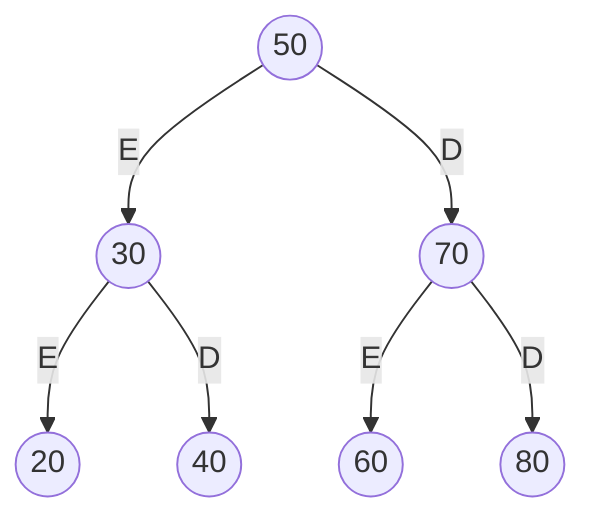

## O que é

Uma **árvore** é uma estrutura **hierárquica** formada por **nós** ligados por arestas, sem ciclos, com um nó especial no topo chamado **raiz**. Cada nó pode ter **filhos**; nós sem filhos são **folhas**.

Termos essenciais: **pai/filho/irmãos**, **subárvore** (um nó e todos os seus descendentes), **grau** (número de filhos de um nó), **nível/profundidade** (distância até a raiz — a raiz tem nível 0), **altura** (maior caminho da raiz até uma folha).

## Para que serve

Representar **hierarquias** (pastas, organogramas, DOM do HTML, expressões aritméticas) e organizar dados para **busca, inserção e remoção eficientes** (árvores de busca, índices de banco de dados, heaps de prioridade).

## Como funciona

### Árvore binária

Cada nó tem **no máximo dois filhos**: **esquerdo** e **direito**.

```c
typedef struct No {
    int dado;
    struct No *esq, *dir;
} No;
```

### Árvore binária de busca (ABB/BST)

Árvore binária com a **propriedade de ordem**: para todo nó, os valores da subárvore **esquerda** são **menores** e os da **direita**, **maiores**.

- **Busca:** compare com a raiz; menor → vá à esquerda; maior → à direita. Custo **O(h)**.
- **Inserção:** desça como na busca e insira como **folha**.
- **Remoção:** folha → remove; um filho → o filho sobe; dois filhos → substitui pelo **sucessor em ordem** (menor da subárvore direita) ou antecessor.
- Se balanceada, h ≈ log₂ n → **O(log n)**; se os dados chegarem ordenados, a árvore **degenera em lista** → **O(n)**.

::widget bst

### Percursos

| Percurso | Ordem | Uso típico |
|---|---|---|
| **Pré-ordem** (RED) | **raiz**, esquerda, direita | copiar a árvore, notação prefixa |
| **Em ordem** (ERD / *in-order*) | esquerda, **raiz**, direita | em uma ABB, lista os valores **ordenados** |
| **Pós-ordem** (EDR) | esquerda, direita, **raiz** | liberar memória, calcular tamanho de pastas |
| **Em nível** (largura) | nível a nível, da esquerda para a direita | usa **fila** |

```c
void emOrdem(No *r) {
    if (r != NULL) {
        emOrdem(r->esq);
        printf("%d ", r->dado);
        emOrdem(r->dir);
    }
}
void preOrdem(No *r) {
    if (r != NULL) {
        printf("%d ", r->dado);
        preOrdem(r->esq);
        preOrdem(r->dir);
    }
}
```

### Árvores balanceadas

- **AVL:** a diferença de altura entre as subárvores de qualquer nó é no máximo **1**; mantida por **rotações** após inserções e remoções. Garante O(log n).
- **Rubro-negra:** regras de cores que garantem altura O(log n) com menos rotações (usada em `TreeMap` do Java).

### Árvores multivias, B e B+

- **Árvore multivias (m-ária):** cada nó pode ter **mais de dois filhos** e **várias chaves**.
- **Árvore B:** multivias **balanceada** de ordem *m*: todas as folhas no **mesmo nível**, nós com entre ⌈m/2⌉ e m filhos (exceto a raiz). Como cada nó guarda muitas chaves, a árvore fica **baixa** — poucos acessos a **disco**. Usada em **sistemas de arquivos** e **índices de bancos de dados**.
- **Árvore B+:** variação em que **todos os dados ficam nas folhas**; os nós internos guardam só chaves de roteamento, e as folhas são **encadeadas** entre si, tornando **consultas por intervalo** (`BETWEEN`, `ORDER BY`) muito eficientes. É o tipo de índice padrão da maioria dos SGBDs.

### Heap

Árvore binária **completa** em que cada pai é maior (max-heap) ou menor (min-heap) que os filhos. Base da **fila de prioridade** e do **heapsort**.

## Características principais

- Uma árvore com *n* nós tem **n − 1 arestas**.
- Árvore binária **cheia**: todo nó tem 0 ou 2 filhos; **completa**: todos os níveis cheios, exceto talvez o último, preenchido da esquerda para a direita.
- Altura mínima de uma binária com n nós ≈ ⌊log₂ n⌋.

## Exemplos práticos

:::example Percursos de uma ABB com 50, 30, 70, 20, 40, 60, 80
- Pré-ordem: 50, 30, 20, 40, 70, 60, 80
- Em ordem: 20, 30, 40, 50, 60, 70, 80 (ordenado!)
- Pós-ordem: 20, 40, 30, 60, 80, 70, 50
- Em nível: 50, 30, 70, 20, 40, 60, 80
:::

## Representação visual

Em cada bifurcação, o ramo esquerdo contém chaves abaixo da chave do pai e o direito contém chaves acima. No ENADE, use essa relação para localizar uma chave e simule o percurso esquerda–raiz–direita para produzir a lista ordenada.



Fonte: adaptado de CORMEN et al. (2009, seção 12.1) — recriado pela equipe Stacklyst.

### Árvore B+ e varredura das folhas

Na raiz, os separadores 20 e 40 dividem as chaves em até 20, de mais de 20 até 40, e acima de 40. Para iniciar uma consulta em 35, desça até a folha do meio e siga os ponteiros tracejados enquanto as chaves permanecerem no intervalo. No ENADE, distinga a busca pelo separador no índice da leitura das referências aos registros nas folhas.

::widget arvore-b-mais

Fonte: adaptado de ELMASRI; NAVATHE (2016, seção 17.3) — recriado pela equipe Stacklyst.

## Vantagens e desvantagens

| Estrutura | Vantagem | Desvantagem |
|---|---|---|
| ABB simples | fácil de implementar; ordenada | pode degenerar para O(n) |
| AVL / rubro-negra | O(log n) garantido | rotações complexas |
| Árvore B/B+ | poucos acessos a disco; ótima para índices | implementação complexa; desperdício parcial dos nós |
| Heap | máximo/mínimo em O(1) | busca de valor arbitrário O(n) |

## Diferenças entre conceitos semelhantes

- **Árvore binária × ABB:** toda ABB é binária, mas a binária comum **não** precisa respeitar ordem. Em uma binária qualquer, o percurso em ordem **não** sai ordenado.
- **Árvore B × B+:** na B, dados podem estar em nós internos; na **B+**, só nas **folhas**, que são encadeadas.
- **Altura × nível:** nível é de um **nó**; altura é da **árvore** (maior nível).
- **Árvore × grafo:** árvore é um grafo **conexo e acíclico**.

## Como cai no ENADE

:::enade
Executar percursos recursivos (2014: em ordem/ERD; 2017: escolher o código correto de pré-ordem), propriedades de ABB e por que índices de banco usam árvores B/B+.
:::

## Pegadinhas

:::trap Não ordene os números de cabeça
Se a árvore **não** for de busca, o percurso em ordem não sai crescente: siga a estrutura desenhada (2014).
:::

:::trap Pré, em e pós referem-se à posição da RAIZ
Pré = raiz primeiro; em = raiz no meio; pós = raiz por último. Esquerda vem sempre antes da direita.
:::

## Questões comentadas

::question 2014-objective-20 Percurso esquerda-raiz-direita

Aplicando ERD recursivamente à árvore desenhada: subárvore esquerda dá 0, 3, 1; depois a raiz 5; depois a direita 7, 8, 2. Sequência: **0, 3, 1, 5, 7, 8, 2** (alternativa D). Não é uma ABB, então não se deve simplesmente ordenar os números.

::question 2017-objective-25 Código de pré-ordem em C++

Pré-ordem imprime o **dado antes** das chamadas recursivas: `if (raiz != NULL) { cout << raiz->dado; preorder(raiz->esquerda); preorder(raiz->direita); }`. Alternativas que imprimem entre ou depois das chamadas implementam em ordem ou pós-ordem.

## Resumo para memorizar

:::summary
- Raiz, folha, altura, nível, grau. *n* nós → *n − 1* arestas.
- **ABB**: esquerda < nó < direita; operações **O(h)** (log n balanceada, n degenerada).
- Percursos: **pré** (R-E-D), **em ordem** (E-R-D, ordenado na ABB), **pós** (E-D-R), **nível** (fila).
- **AVL**: |diferença de altura| ≤ 1 com rotações.
- **B**: multivias balanceada, folhas no mesmo nível. **B+**: dados só nas folhas encadeadas → índices de SGBD.
:::

## Miniquestionário

:::quiz
[
  {
    "question": "Qual percurso de uma árvore binária de busca produz os valores em ordem crescente?",
    "options": ["Pré-ordem", "Em ordem", "Pós-ordem", "Em nível"],
    "answer": 1,
    "explanation": "Esquerda (menores), raiz, direita (maiores)."
  },
  {
    "question": "Inserir 1, 2, 3, 4, 5 nessa ordem em uma ABB sem balanceamento resulta em:",
    "options": ["Uma árvore perfeitamente balanceada", "Uma árvore degenerada, semelhante a uma lista", "Uma árvore B", "Um heap"],
    "answer": 1,
    "explanation": "Cada valor vai para a direita do anterior; a altura vira n e a busca, O(n)."
  },
  {
    "question": "Por que bancos de dados usam árvores B+ em índices?",
    "options": ["Porque cada nó guarda uma única chave", "Porque são baixas (muitas chaves por nó) e as folhas encadeadas favorecem buscas por intervalo", "Porque não precisam de balanceamento", "Porque guardam dados nos nós internos"],
    "answer": 1,
    "explanation": "Poucos acessos a disco e varredura sequencial eficiente nas folhas."
  }
]
:::

## Referências

- CORMEN, T. H. et al. *Algoritmos: teoria e prática*. 3. ed. Elsevier, 2012 — caps. 12, 13 e 18.
- SZWARCFITER, J. L.; MARKENZON, L. *Estruturas de Dados e seus Algoritmos*. 3. ed. LTC, 2010.
- ELMASRI, R.; NAVATHE, S. B. *Sistemas de Banco de Dados*. 7. ed. Pearson, 2018 — cap. 17 (índices B e B+).
- INEP. ENADE TADS 2014 (questão 20) e 2017 (questão 25).
- CORMEN, Thomas H. et al. *Introduction to algorithms*. 3. ed. Cambridge, MA: MIT Press, 2009.
- ELMASRI, Ramez; NAVATHE, Shamkant B. *Fundamentals of database systems*. 7. ed. Hoboken: Pearson, 2016.
