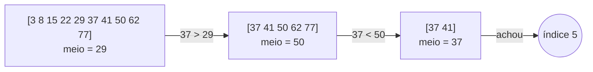

## O que é

- **Busca:** encontrar se (e onde) um valor está em uma coleção.
- **Ordenação:** rearranjar os elementos em ordem (crescente ou decrescente) segundo uma chave.

Ordenar é útil por si só (relatórios, rankings) e também porque torna possível **buscar muito mais rápido** (busca binária).

## Para que serve

Bancos de dados, mecanismos de busca, sistemas de arquivos e qualquer listagem ordenada dependem desses algoritmos. No ENADE, aparecem como **pseudocódigo para completar, corrigir ou simular**.

## Como funciona

### Busca sequencial (linear)

Compara o valor com cada elemento, do início ao fim. Funciona em qualquer vetor (ordenado ou não). **O(n)**.

### Busca binária

Exige vetor **ordenado**. Compara com o elemento **do meio**; se for menor, descarta a metade direita; se for maior, a esquerda; repete. A cada passo o espaço cai pela metade: **O(log n)** (1 milhão de elementos → ~20 comparações).

```text
funcao busca(V[0..9], K): inteiro
    C ← 0                      // início
    F ← 9                      // fim
    M ← (C + F) div 2          // meio
    enquanto (V[M] <> K) e (C <= F) faca
        se (K < V[M]) entao
            F ← M - 1          // fica com a metade esquerda
        senao
            C ← M + 1          // fica com a metade direita
        fim se
        M ← (C + F) div 2
    fim enquanto
    ...
```

As três peças-chave: **C começa em 0**, **M = (C + F)/2** e, quando a chave está à direita, **C ← M + 1**.

### Ordenação por bolha (bubble sort)

Compara **pares vizinhos** e troca se estiverem fora de ordem; a cada passada, o **maior** "borbulha" para o fim. **O(n²)**; com parada antecipada (se uma passada não trocar nada), O(n) no melhor caso. Estável.

### Ordenação por seleção (selection sort)

Procura o **menor** elemento do trecho não ordenado e o coloca na primeira posição desse trecho. Sempre **O(n²)** comparações, mas no máximo n − 1 **trocas**. Não estável.

### Ordenação por inserção (insertion sort)

Como ordenar cartas na mão: pega o próximo elemento e o **insere** na posição correta da parte já ordenada, **deslocando** os maiores uma posição para a direita.

```text
para i ← 2 ate n faca
    valor ← vetor[i]
    j ← i - 1
    enquanto (j >= 1) e (valor < vetor[j]) faca
        vetor[j + 1] ← vetor[j]      // desloca para a direita
        j ← j - 1
    fim enquanto
    vetor[j + 1] ← valor              // insere no lugar
fim para
```

**O(n²)** no pior caso, **O(n)** se o vetor já estiver quase ordenado. Estável e in-place — ótimo para vetores pequenos.

### Merge sort (intercalação)

**Divisão e conquista:** divide o vetor ao meio, ordena cada metade recursivamente e **intercala** as duas metades ordenadas. **O(n log n)** sempre; estável; precisa de **memória extra** O(n).

### Quicksort

Escolhe um **pivô**, **particiona** (menores à esquerda, maiores à direita) e ordena cada lado recursivamente. **O(n log n)** em média, **O(n²)** no pior caso (pivô ruim, como vetor já ordenado com pivô no extremo). In-place, não estável; costuma ser o mais rápido na prática.

::widget sorting

## Características principais

| Algoritmo | Melhor | Médio | Pior | Estável? | Memória extra |
|---|---|---|---|---|---|
| Bolha | O(n)* | O(n²) | O(n²) | sim | O(1) |
| Seleção | O(n²) | O(n²) | O(n²) | não | O(1) |
| Inserção | **O(n)** | O(n²) | O(n²) | sim | O(1) |
| Merge sort | O(n log n) | O(n log n) | **O(n log n)** | sim | O(n) |
| Quicksort | O(n log n) | O(n log n) | **O(n²)** | não | O(log n) |
| Heapsort | O(n log n) | O(n log n) | O(n log n) | não | O(1) |

*com parada antecipada. **Estável** = mantém a ordem relativa de elementos com chaves iguais.

## Exemplos práticos

:::example Bolha passo a passo em {2, 0, 4, 3, 1}
Passada 1 (I = 0): J=0 troca 2/0 → 0,2,4,3,1; **J=1** não troca → **0,2,4,3,1**; J=2 troca 4/3 → 0,2,3,4,1; J=3 troca 4/1 → 0,2,3,1,4.
Passada 2 (I = 1): **J=0** não troca → **0,2,3,1,4**; J=1 não troca; **J=2** troca 3/1 → **0,2,1,3,4**.
As três sequências do ENADE 2008 aparecem exatamente nesses pontos.
:::

## Representação visual



## Vantagens e desvantagens

| Algoritmo | Use quando | Evite quando |
|---|---|---|
| Inserção | poucos elementos ou quase ordenado | muitos elementos aleatórios |
| Merge sort | precisa de garantia O(n log n) e estabilidade | memória é escassa |
| Quicksort | uso geral, em memória | pior caso é inaceitável sem pivô aleatório |
| Busca binária | dados ordenados e muitas buscas | dados mudam o tempo todo sem ordenação |

## Diferenças entre conceitos semelhantes

- **Busca sequencial × binária:** O(n) em qualquer vetor × O(log n) só em vetor **ordenado**.
- **Seleção × inserção:** seleção **procura o menor** no restante; inserção **encaixa** o próximo na parte ordenada.
- **Merge × quick:** merge **divide pela metade** e faz o trabalho na **intercalação**; quick faz o trabalho na **partição** e divide conforme o pivô.

## Como cai no ENADE

:::enade
Completar lacunas da **busca binária** (2008), simular o **bubble sort** com prints intermediários (2008), achar o erro em um **insertion sort** (2017) e comparar complexidades.
:::

## Pegadinhas

:::trap Busca binária exige vetor ordenado
Sem ordenação, descartar metades leva a resultados errados.
:::

:::trap No insertion sort, o deslocamento é para vetor[j + 1]
Escrever sempre em `vetor[i]` apaga elementos (erro da questão de 2017).
:::

:::trap Quicksort tem pior caso quadrático
"Quicksort é sempre O(n log n)" é falso.
:::

## Questões comentadas

::question 2008-objective-22 Lacunas da busca binária

O limite inferior começa em **0** (`C ← 0`), o meio é **(C + F)/2** e, quando a chave é maior que `V[M]`, o novo início é **M + 1** — alternativa A.

::question 2008-objective-20 Bolha com saídas intermediárias

Seguindo as passadas, as três sequências citadas (I=0/J=1, I=1/J=0, I=1/J=2) são exatamente 0,2,4,3,1; 0,2,3,1,4; 0,2,1,3,4. Todos os itens estão certos (alternativa E).

::question 2017-objective-33 Erro no insertion sort

A linha que desloca os maiores precisa ser `vetor[j + 1] ← vetor[j]` (alternativa D); depois do laço, o valor é inserido em `vetor[j + 1]`.

## Resumo para memorizar

:::summary
- Sequencial **O(n)**; binária **O(log n)** com vetor **ordenado** (C=0, M=(C+F)/2, C=M+1 / F=M−1).
- **Bolha**: troca vizinhos, maior vai ao fim. **Seleção**: menor vai ao início. **Inserção**: encaixa na parte ordenada.
- Quadráticos: bolha, seleção, inserção. **O(n log n)**: merge (sempre), quick (médio), heap.
- Estáveis: bolha, inserção, merge.
:::

## Miniquestionário

:::quiz
[
  {
    "question": "Qual algoritmo tem melhor caso O(n) quando o vetor já está ordenado?",
    "options": ["Seleção", "Inserção", "Quicksort com pivô no último elemento", "Merge sort"],
    "answer": 1,
    "explanation": "Com o vetor ordenado, cada elemento é comparado uma vez e não há deslocamentos."
  },
  {
    "question": "Quantas comparações, no máximo, a busca binária faz em um vetor ordenado de 1.024 elementos?",
    "options": ["1.024", "512", "cerca de 10 a 11", "32"],
    "answer": 2,
    "explanation": "log₂ 1024 = 10; com o último teste, cerca de 11."
  },
  {
    "question": "Qual algoritmo garante O(n log n) mesmo no pior caso?",
    "options": ["Quicksort", "Merge sort", "Bolha", "Inserção"],
    "answer": 1,
    "explanation": "O merge sort sempre divide ao meio; o quicksort pode cair para O(n²)."
  }
]
:::

## Referências

- CORMEN, T. H. et al. *Algoritmos: teoria e prática*. 3. ed. Elsevier, 2012 — caps. 2, 6 e 7.
- ZIVIANI, N. *Projeto de Algoritmos*. 3. ed. Cengage, 2010 — cap. 4.
- SEDGEWICK, R.; WAYNE, K. *Algorithms*. 4. ed. Addison-Wesley, 2011 — cap. 2.
- INEP. ENADE TADS 2008 (questões 20 e 22) e 2017 (questão 33).
