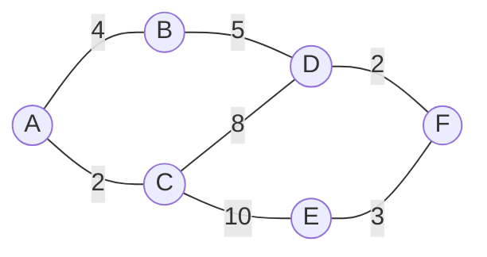

## O que é

Um **grafo** G = (V, E) é um conjunto de **vértices** (nós) V ligados por **arestas** E. Ele modela **relações**: cidades e estradas, pessoas e amizades, páginas e links, tarefas e dependências.

- **Não dirigido:** a aresta {u, v} vale nos dois sentidos (amizade).
- **Dirigido (dígrafo):** a aresta (u → v) tem sentido (seguir alguém, dependência de tarefa).
- **Ponderado:** cada aresta tem um **peso** (distância, custo, tempo).

## Para que serve

Rotas em mapas (caminho mínimo), redes de computadores (roteamento), redes sociais (recomendação), dependências de tarefas e de compilação (ordenação topológica, caminho crítico), detecção de fraudes e de ciclos.

## Como funciona

### Conceitos

- **Grau** de um vértice: número de arestas incidentes (em dígrafos: grau de **entrada** e de **saída**). Soma dos graus = 2 × |E|.
- **Caminho:** sequência de vértices ligados por arestas; **ciclo:** caminho que volta ao início.
- **Conexo:** existe caminho entre quaisquer dois vértices. **Árvore** = grafo conexo e acíclico.
- **Completo:** todos os pares ligados (n(n−1)/2 arestas).

### Representações

| | Matriz de adjacência | Lista de adjacência |
|---|---|---|
| Ideia | matriz V × V; `m[u][v] = 1` (ou peso) se há aresta | para cada vértice, a lista de vizinhos |
| Memória | O(V²) | O(V + E) |
| Existe aresta (u, v)? | **O(1)** | O(grau de u) |
| Melhor para | grafos **densos** | grafos **esparsos** (maioria dos casos reais) |

### Busca em largura (BFS)

Visita os vértices **por camadas** de distância a partir da origem, usando uma **fila**. Encontra o **menor número de arestas** até cada vértice em grafos não ponderados. Custo O(V + E).

### Busca em profundidade (DFS)

Vai **o mais fundo possível** antes de voltar, usando **pilha** (ou recursão). Útil para detectar ciclos, componentes conexos e **ordenação topológica**. Custo O(V + E).

::widget graph-traversal

```python
from collections import deque

def bfs(grafo, inicio):
    visitados, fila, ordem = {inicio}, deque([inicio]), []
    while fila:
        v = fila.popleft()
        ordem.append(v)
        for w in sorted(grafo[v]):
            if w not in visitados:
                visitados.add(w)
                fila.append(w)
    return ordem

def dfs(grafo, v, visitados=None):
    visitados = visitados if visitados is not None else []
    visitados.append(v)
    for w in sorted(grafo[v]):
        if w not in visitados:
            dfs(grafo, w, visitados)
    return visitados
```

### Algoritmos clássicos

- **Dijkstra:** caminho mínimo de uma origem para todos, com pesos **não negativos** (guloso, usa fila de prioridade).
- **Bellman-Ford:** caminho mínimo aceitando pesos negativos.
- **Prim** e **Kruskal:** **árvore geradora mínima** (conectar todos os vértices com custo total mínimo).
- **Ordenação topológica:** ordem linear de um dígrafo **acíclico** respeitando dependências.

## Características principais

- Grafos generalizam listas e árvores.
- A escolha de representação afeta muito o desempenho.
- Muitos problemas de grafos são resolvidos com BFS/DFS adaptados.

## Exemplos práticos

:::example Rede de tarefas
As dependências de um projeto formam um **dígrafo acíclico**; a ordenação topológica dá uma ordem válida de execução, e o **caminho mais longo** (somando durações) é o **caminho crítico** — veja [Gerência de projetos](lib:gerencia-de-projetos-e-riscos).
:::

## Representação visual



## Vantagens e desvantagens

| Representação | Vantagem | Desvantagem |
|---|---|---|
| Matriz | teste de aresta O(1), simples | O(V²) de memória |
| Lista | economiza memória em grafos esparsos | teste de aresta mais lento |

## Diferenças entre conceitos semelhantes

- **BFS × DFS:** largura usa **fila** e acha menor número de arestas; profundidade usa **pilha/recursão** e explora ramos inteiros.
- **Caminho mínimo × árvore geradora mínima:** o primeiro liga **dois** vértices pelo menor custo; a segunda liga **todos** com custo total mínimo.
- **Grafo × árvore:** árvore é um grafo conexo sem ciclos com n − 1 arestas.

## Como cai no ENADE

:::enade
Grafos aparecem em questões de caminho crítico de projetos, roteamento em redes e como base de estruturas (árvores, listas). Saiba representar, percorrer e aplicar BFS/DFS.
:::

## Pegadinhas

:::trap BFS não serve para pesos diferentes
Com arestas de pesos diferentes, o menor número de arestas não é o menor custo; use Dijkstra.
:::

:::trap Dijkstra falha com pesos negativos
Para pesos negativos, use Bellman-Ford.
:::

## Questões comentadas

::question 2014-objective-34 Caminho crítico como caminho mais longo em um grafo

A rede de tarefas é um **dígrafo acíclico** ponderado pelas durações. O prazo mínimo é o **caminho mais longo** do início ao fim (20 dias), calculado somando as durações de cada caminho.

## Resumo para memorizar

:::summary
- G = (V, E); dirigido × não dirigido; ponderado.
- Soma dos graus = **2|E|**.
- **Matriz** O(V²) (densos) × **lista** O(V + E) (esparsos).
- **BFS** = fila, camadas, menor número de arestas. **DFS** = pilha/recursão, profundidade.
- Dijkstra (mínimo, pesos ≥ 0), Prim/Kruskal (árvore geradora mínima), ordenação topológica (DAG).
:::

## Miniquestionário

:::quiz
[
  {
    "question": "Qual estrutura auxiliar a busca em largura (BFS) utiliza?",
    "options": ["Pilha", "Fila", "Árvore B", "Tabela hash obrigatoriamente"],
    "answer": 1,
    "explanation": "A fila garante a visita por camadas de distância."
  },
  {
    "question": "Um grafo não dirigido tem 5 arestas. Quanto vale a soma dos graus dos vértices?",
    "options": ["5", "10", "25", "Depende do número de vértices"],
    "answer": 1,
    "explanation": "Cada aresta contribui com 2 para a soma dos graus."
  },
  {
    "question": "Para um grafo com 1 milhão de vértices e poucas arestas por vértice, a melhor representação é:",
    "options": ["Matriz de adjacência", "Lista de adjacência", "Vetor ordenado", "Pilha"],
    "answer": 1,
    "explanation": "Grafo esparso: a lista usa O(V + E) de memória."
  }
]
:::

## Referências

- CORMEN, T. H. et al. *Algoritmos: teoria e prática*. 3. ed. Elsevier, 2012 — caps. 22 a 24.
- SZWARCFITER, J. L. *Teoria Computacional de Grafos*. Elsevier, 2018.
- GOLDBARG, M.; GOLDBARG, E. *Grafos: conceitos, algoritmos e aplicações*. Elsevier, 2012.
