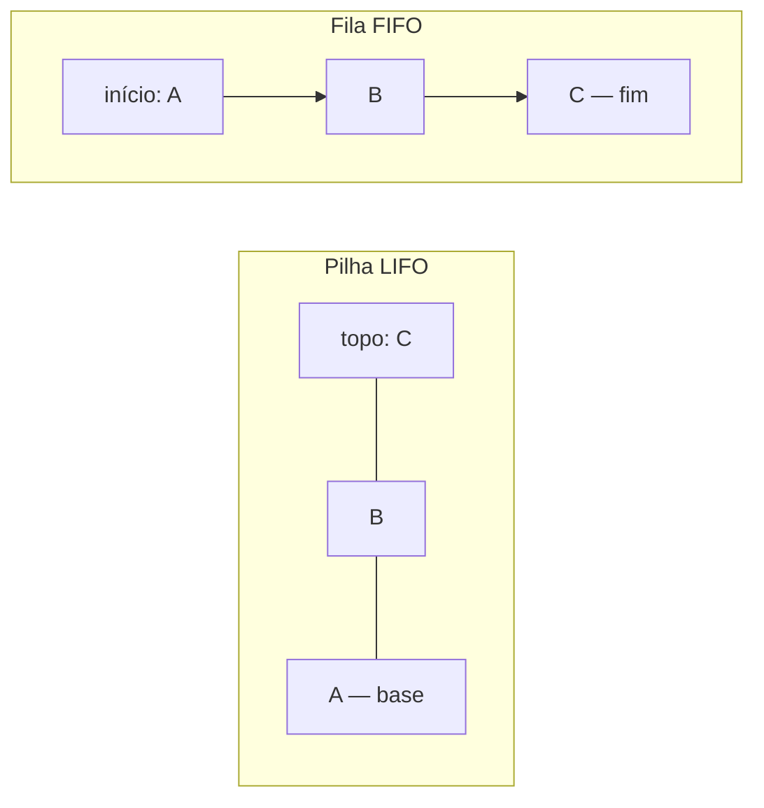

## O que é

- **Pilha (stack):** coleção em que o **último a entrar é o primeiro a sair** — **LIFO** (*Last In, First Out*). Só se mexe no **topo**, como uma pilha de pratos.
- **Fila (queue):** coleção em que o **primeiro a entrar é o primeiro a sair** — **FIFO** (*First In, First Out*). Entra-se pelo **fim**, sai-se pelo **início**, como a fila de um banco.

## Para que serve

- Pilhas: **desfazer** (Ctrl+Z), voltar no navegador, avaliar expressões, verificar parênteses, **inverter** sequências, controlar **chamadas de função** (pilha de execução e recursão), busca em profundidade.
- Filas: atendimento por ordem de chegada, **impressão**, **escalonamento** de processos, buffers de rede, mensageria, busca em largura.

## Como funciona

| Operação | Pilha | Fila |
|---|---|---|
| Inserir | `push(x)` — no **topo** | `enqueue(x)` — no **fim** |
| Remover | `pop()` — remove e devolve o **topo** | `dequeue()` — remove e devolve o **início** |
| Consultar sem remover | `top()`/`peek()` | `front()`/`peek()` |
| Vazia? | `isEmpty()` | `isEmpty()` |

Todas são **O(1)** em implementações adequadas. Remover de estrutura vazia é **underflow**; inserir em estrutura cheia (com vetor de tamanho fixo) é **overflow**.

::widget stack-queue

### Implementações

**Pilha com vetor:** um índice `topo` aponta para o último elemento; `push` incrementa e grava, `pop` lê e decrementa.

**Pilha encadeada (Java):**

```java
public class Pilha {
    private No topo;                     // nó com dado e prox
    public void push(int elemento) {
        No novo = new No(elemento);
        novo.prox = topo;                // o novo aponta para o antigo topo
        topo = novo;                     // e vira o topo
    }
    public int pop() {
        if (topo == null) throw new RuntimeException("Pilha vazia");
        int valor = topo.dado;
        topo = topo.prox;
        return valor;
    }
}
```

**Fila circular com vetor:** índices `inicio` e `fim` avançam com `(indice + 1) % capacidade`, reaproveitando as posições liberadas.

**Fila de prioridade:** sai primeiro o de **maior prioridade** (não necessariamente o mais antigo); implementada com **heap** (O(log n)). Ex.: triagem hospitalar.

**Deque:** permite inserir e remover nas **duas pontas**.

## Características principais

- Pilha e fila são **tipos abstratos de dados**: definidos pelas operações, não pela implementação.
- Acesso **restrito**: não se busca nem se remove do meio.

## Exemplos práticos

:::example Simulando uma pilha (ENADE 2011)
PUSH 10, 5, 3, 40 → [10, 5, 3, 40]; POP retira **40** → [10, 5, 3]; PUSH 11, 4, 7 → [10, 5, 3, 11, 4, 7]; POP, POP retiram **7** e **4** → [10, 5, 3, 11]. Topo = **11**, soma = 10 + 5 + 3 + 11 = **29**.
:::

:::example Invertendo uma palavra com pilha
Empilhe F-E-L-I-C-I-D-A-D-E e desempilhe tudo: sai **EDADICILEF**.
:::

## Representação visual



## Vantagens e desvantagens

| Estrutura | Vantagem | Limitação |
|---|---|---|
| Pilha | operações O(1), simples | só acessa o topo |
| Fila | justiça por ordem de chegada | só acessa as pontas |
| Fila de prioridade | atende o mais urgente | O(log n) por operação |
| Versão com vetor | rápida, sem ponteiros | tamanho fixo (overflow) |
| Versão encadeada | cresce à vontade | memória extra de ponteiros |

## Diferenças entre conceitos semelhantes

- **pop × top:** `pop` **remove** o topo; `top` só **consulta**. Essa diferença decide muitas questões.
- **dequeue × front:** `dequeue` remove o início; `front` consulta.
- **Fila × fila de prioridade:** FIFO puro × ordem por prioridade.
- **Pilha × recursão:** toda recursão usa a **pilha de chamadas**; algoritmos recursivos podem ser convertidos em iterativos com uma pilha explícita.

## Como cai no ENADE

:::enade
Sequências de operações para descobrir o estado final (2011, 2021), escolha da implementação correta de `push` em uma pilha encadeada (2021), discursivas com fila de caminhões e pilha para inverter palavras (2014, 2017).
:::

## Pegadinhas

:::trap top() não remove
Em `fila.enqueue(pilha.top())` duas vezes, o **mesmo** elemento (o topo) vai duas vezes para a fila e continua na pilha.
:::

:::trap Escreva o estado a cada passo
Monte uma tabela com a pilha (base → topo) e a fila (início → fim) após cada operação.
:::

## Questões comentadas

::question 2011-objective-29 PUSH e POP

Após as operações restam 10, 5, 3, 11 (base → topo): topo **11**, soma **29** (alternativa A).

::question 2021-objective-13 Pilha e fila combinadas

`push` A, B, C → pilha [A, B, C]. `enqueue(top)` duas vezes → fila [C, C]; `enqueue('D')` → [C, C, D]. `push(dequeue())` → sai C da fila e entra na pilha: pilha [A, B, C, C], fila [C, D]. `enqueue(dequeue())` → fila [D, C]. `enqueue(pop())` → sai C da pilha: pilha [A, B, C], fila [D, C, C]. `push('E')` → pilha [A, B, C, E]; `enqueue('E')` → fila [D, C, C, E]; `pop()` remove E. Resultado: **pilha topo → C → B → A** e **fila início → D → C → C → E** (alternativa C).

## Resumo para memorizar

:::summary
- **Pilha = LIFO**: push/pop/top no **topo**.
- **Fila = FIFO**: enqueue no **fim**, dequeue no **início**.
- Operações **O(1)**. `top`/`front` **consultam**; `pop`/`dequeue` **removem**.
- Pilha: desfazer, chamadas de função, parênteses, DFS. Fila: atendimento, impressão, BFS, escalonamento.
:::

:::mnemonic
**L**IFO = **L**ast in = pilha de **L**ivros. **F**IFO = **F**ila do banco.
:::

## Miniquestionário

:::quiz
[
  {
    "question": "Pilha vazia: push(1), push(2), pop(), push(3), push(4), pop(). Qual é o topo?",
    "options": ["1", "2", "3", "4"],
    "answer": 2,
    "explanation": "Sobram [1, 3] (base → topo); o topo é 3."
  },
  {
    "question": "Fila vazia: enqueue(A), enqueue(B), dequeue(), enqueue(C). Quem está no início?",
    "options": ["A", "B", "C", "A fila está vazia"],
    "answer": 1,
    "explanation": "A sai primeiro; restam B (início) e C (fim)."
  },
  {
    "question": "Qual estrutura o navegador usa para o botão 'Voltar'?",
    "options": ["Fila", "Pilha", "Árvore B", "Hash"],
    "answer": 1,
    "explanation": "A última página visitada é a primeira a voltar: LIFO."
  }
]
:::

## Referências

- CELES, W.; CERQUEIRA, R.; RANGEL, J. L. *Introdução a Estruturas de Dados*. Elsevier, 2004 — caps. 11 e 12.
- CORMEN, T. H. et al. *Algoritmos: teoria e prática*. 3. ed. Elsevier, 2012 — seção 10.1.
- GOODRICH, M. T.; TAMASSIA, R. *Estruturas de Dados e Algoritmos em Java*. 5. ed. Bookman, 2013.
- INEP. ENADE TADS 2011 (questão 29), 2014 (discursiva 4), 2017 (discursiva 4) e 2021 (questões 11 e 13).
