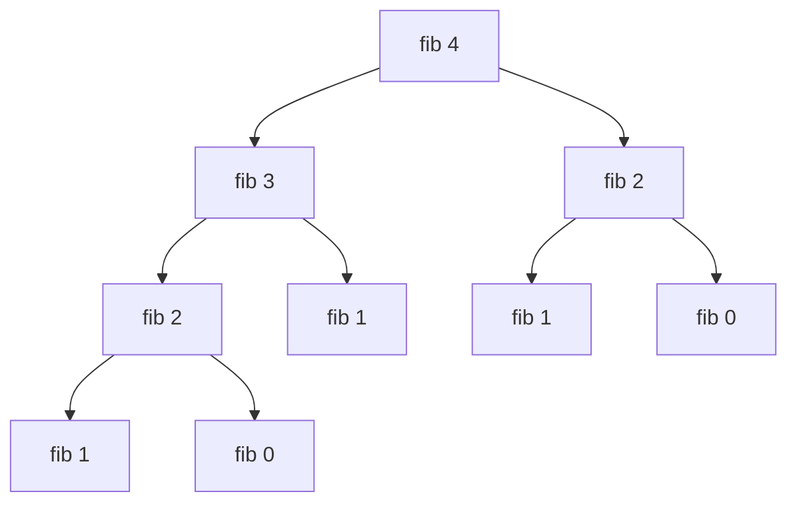

## O que é

Uma função é **recursiva** quando **chama a si mesma**, direta ou indiretamente, para resolver uma versão **menor** do mesmo problema. Toda recursão correta tem:

1. **Caso base (condição de parada):** situação simples resolvida **sem** nova chamada.
2. **Passo recursivo:** reduz o problema e chama a função para a parte menor, combinando o resultado.

## Para que serve

Problemas com estrutura **autossimilar**: percorrer árvores e grafos, divisão e conquista (merge sort, quicksort, busca binária), fractais, combinações e permutações, expressões. Muitas vezes a solução recursiva é **mais clara** que a iterativa.

## Como funciona

### Pilha de chamadas

Cada chamada empilha um **registro de ativação** (parâmetros, variáveis locais, ponto de retorno). Quando o caso base é atingido, as chamadas **retornam em ordem inversa** (LIFO), combinando resultados na "volta". Sem caso base (ou se ele nunca é atingido), a pilha cresce até estourar: **stack overflow**.

```python
def fatorial(n: int) -> int:
    if n <= 1:            # caso base
        return 1
    return n * fatorial(n - 1)   # passo recursivo
```

Rastreando `fatorial(4)`:

| Ida (empilha) | Volta (desempilha) |
|---|---|
| fatorial(4) → 4 * fatorial(3) | 4 * 6 = **24** |
| fatorial(3) → 3 * fatorial(2) | 3 * 2 = 6 |
| fatorial(2) → 2 * fatorial(1) | 2 * 1 = 2 |
| fatorial(1) → **1** (caso base) | 1 |

### Fibonacci: o perigo da recursão ingênua

```c
long fib(int n) {
    if (n == 0 || n == 1) return n;     // casos base
    return fib(n - 1) + fib(n - 2);     // duas chamadas
}
```

`fib(n)` recalcula os mesmos subproblemas muitas vezes: o número de chamadas cresce **exponencialmente** (~O(2ⁿ)). `fib(40)` faz centenas de milhões de chamadas. Soluções: **iteração** (O(n)) ou **memoização** (guardar resultados já calculados — programação dinâmica).

```python
from functools import lru_cache

@lru_cache(maxsize=None)
def fib(n: int) -> int:
    return n if n < 2 else fib(n - 1) + fib(n - 2)   # agora O(n)
```

### Soma recursiva com condição (ENADE 2014)

```c
int f(int v[], int n) {
    if (n == 0) return 0;
    int s = f(v, n - 1);
    if (v[n - 1] > 0) s = s + v[n - 1];
    return s;
}
```

Com `{2, -4, 7, 0, -1, 4}` e n = 6, a volta soma apenas os **positivos**: 2 + 7 + 4 = **13**.

## Características principais

- Elegante para estruturas recursivas (árvores).
- Consome memória de pilha O(profundidade).
- **Recursão de cauda** (a chamada recursiva é a última operação) pode ser otimizada por alguns compiladores em um laço.
- Toda recursão pode ser reescrita como **iteração** com uma pilha explícita.

## Exemplos práticos

:::example Contar arquivos em pastas
`contar(pasta) = arquivos diretos + soma de contar(subpasta) para cada subpasta`. O caso base é uma pasta sem subpastas.
:::

## Representação visual



## Vantagens e desvantagens

| Vantagens | Desvantagens |
|---|---|
| código curto e próximo da definição matemática | consumo de pilha; risco de stack overflow |
| natural para árvores, grafos, divisão e conquista | pode recalcular subproblemas (Fibonacci) |
| facilita provas de correção por indução | geralmente um pouco mais lenta que a iteração |

## Diferenças entre conceitos semelhantes

- **Recursão × iteração:** a recursão usa a pilha de chamadas; a iteração usa laços e variáveis.
- **Divisão e conquista × programação dinâmica:** D&C divide em subproblemas **independentes** (merge sort); PD resolve subproblemas que **se repetem**, guardando resultados (Fibonacci com memoização).
- **Caso base × condição de parada:** sinônimos.

## Como cai no ENADE

:::enade
Calcular o valor de retorno de uma função recursiva (2014: 13), avaliar afirmações sobre Fibonacci recursivo (2008: não é o método mais eficiente) e implementar percursos recursivos em árvores (2014, 2017).
:::

## Pegadinhas

:::trap "Duas chamadas mais simples" não significa eficiente
A recursão ingênua de Fibonacci é **exponencial** por recalcular termos. A iterativa ou memoizada é muito melhor.
:::

:::trap A soma acontece na volta
Em `s = f(v, n-1); if (...) s += v[n-1];`, os elementos são somados **depois** que as chamadas internas retornam — do primeiro ao último elemento.
:::

## Questões comentadas

::question 2014-objective-16 Função recursiva que soma positivos

A recursão desce até n = 0 e, na volta, soma só os elementos maiores que zero: 2, 7 e 4 → **13** (alternativa C).

::question 2008-objective-27 Afirmação incorreta sobre Fibonacci recursivo

A incorreta é a **C**: o método recursivo **não** é o mais eficiente — recalcula termos repetidos e gera explosão de chamadas. As demais estão corretas (o número de chamadas cresce com n, ordem de avaliação, casos base 0 e 1, não indicado para n grande).

## Resumo para memorizar

:::summary
- Recursão = **caso base** + **passo recursivo** que reduz o problema.
- Usa a **pilha de chamadas**; sem caso base → **stack overflow**.
- Fibonacci recursivo ingênuo = **exponencial**; com memoização/iteração = **O(n)**.
- Resultados são combinados **na volta** das chamadas.
:::

## Miniquestionário

:::quiz
[
  {
    "question": "O que acontece se uma função recursiva não tiver caso base alcançável?",
    "options": ["Ela retorna 0", "Ela entra em chamadas infinitas até estourar a pilha", "O compilador cria o caso base", "Ela vira iterativa"],
    "answer": 1,
    "explanation": "Sem parada, as chamadas se acumulam até o stack overflow."
  },
  {
    "question": "Quanto retorna g(3) se g(0) = 1 e g(n) = 2 * g(n − 1)?",
    "options": ["6", "8", "4", "3"],
    "answer": 1,
    "explanation": "g(1) = 2, g(2) = 4, g(3) = 8."
  },
  {
    "question": "Qual técnica torna o Fibonacci recursivo eficiente?",
    "options": ["Aumentar a pilha", "Memoização", "Usar duas chamadas a mais", "Trocar por busca binária"],
    "answer": 1,
    "explanation": "Guardar resultados já calculados evita recomputações."
  }
]
:::

## Referências

- CELES, W.; CERQUEIRA, R.; RANGEL, J. L. *Introdução a Estruturas de Dados*. Elsevier, 2004 — cap. 4.
- CORMEN, T. H. et al. *Algoritmos: teoria e prática*. 3. ed. Elsevier, 2012 — caps. 4 e 15.
- INEP. ENADE TADS 2008 (questão 27) e 2014 (questão 16).
