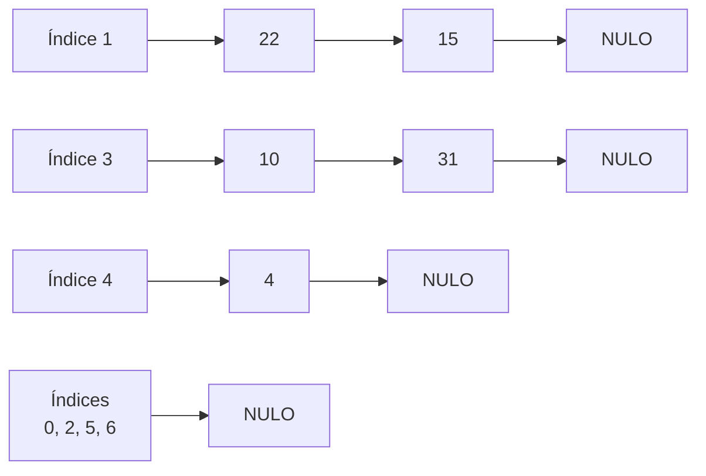

## O que é

Uma **tabela hash** guarda pares **chave → valor** em um vetor, usando uma **função hash** para calcular **em qual posição** cada chave deve ficar. Em vez de procurar a chave elemento por elemento, calcula-se onde ela está.

$$h(k) = k \bmod m$$

em que *m* é o tamanho da tabela (de preferência um número **primo**).

## Para que serve

É a estrutura por trás de **dicionários** (`dict` em Python, `HashMap` em Java, objetos/`Map` em JavaScript), **caches**, **índices hash** em bancos de dados, **conjuntos** (`HashSet`) e detecção de duplicatas. Busca, inserção e remoção custam **O(1) em média**.

## Como funciona

1. Calcula-se `h(chave)` → índice.
2. O valor é guardado naquela posição.
3. Para buscar, recalcula-se `h(chave)` e vai-se direto à posição.

### Colisões

Duas chaves diferentes podem ter o **mesmo hash** (com m = 7, `h(10) = 3` e `h(31) = 3`). Estratégias:

- **Encadeamento separado (chaining):** cada posição guarda uma **lista** das chaves que caíram ali.
- **Endereçamento aberto:** tudo fica no próprio vetor; em colisão, procura-se outra posição:
  - **sondagem linear:** tenta h, h+1, h+2… (gera **agrupamento primário**);
  - **sondagem quadrática:** h, h+1², h+2²…;
  - **duplo hash:** passo dado por uma segunda função.

::widget hash-table

### Fator de carga e rehash

**Fator de carga** α = n / m (elementos ÷ posições). Quanto maior, mais colisões. Quando α passa de um limite (por exemplo, 0,75 no `HashMap` do Java), a tabela é **redimensionada** (geralmente dobrando) e todas as chaves são **reinseridas** (*rehash*).

### Boa função hash

Rápida de calcular, **distribui uniformemente** as chaves e é **determinística** (mesma chave → mesmo índice). Para textos, combina os caracteres (ex.: polinômio com base 31).

## Características principais

| Operação | Caso médio | Pior caso |
|---|---|---|
| Buscar | **O(1)** | O(n) (todas colidem) |
| Inserir | **O(1)** | O(n) |
| Remover | **O(1)** | O(n) |
| Listar em ordem | não suportado | — |

## Exemplos práticos

:::example Inserindo 10, 22, 31, 4, 15 com h(k) = k mod 7
- 10 → 3; 22 → 1; 31 → 3 (**colisão** com 10); 4 → 4; 15 → 1 (**colisão** com 22).
- **Encadeamento:** [1] → 22 → 15; [3] → 10 → 31; [4] → 4.
- **Sondagem linear:** 31 tenta 3 (ocupado) → vai para 4; depois 4 tenta 4 (ocupado) → vai para 5; 15 tenta 1 (ocupado) → 2.
:::

## Representação visual

Calcule h(k) = k mod 7 e siga apenas a lista do índice obtido. As chaves 22 e 15 colidem porque o resto da divisão de ambas é 1. No ENADE, distinga uma colisão entre chaves de um erro de busca e conte quantas comparações a lista pode exigir.

Fonte: adaptado de CORMEN et al. (2009, seção 11.2) — recriado pela equipe Stacklyst.

## Vantagens e desvantagens

| Vantagens | Desvantagens |
|---|---|
| operações O(1) em média | não mantém ordem |
| simples de usar (dicionários) | pior caso O(n) com hash ruim |
| ótima para pertencimento e contagem | desperdiça memória com fator de carga baixo |

## Diferenças entre conceitos semelhantes

- **Tabela hash × ABB:** hash é O(1) médio sem ordem; ABB balanceada é O(log n) **com ordem** (permite intervalos e mínimo/máximo).
- **Hash de tabela × hash criptográfico:** o primeiro só precisa espalhar bem e ser rápido; o criptográfico (SHA-256) precisa ser **resistente a colisões e irreversível** — veja [Segurança da informação](lib:seguranca-da-informacao).
- **Encadeamento × endereçamento aberto:** listas por posição × procurar outra posição no próprio vetor.

## Como cai no ENADE

:::enade
Hash aparece em questões de estruturas de dados (cálculo de posições com mod e colisões), índices de bancos e, com outro sentido, em segurança (integridade e senhas).
:::

## Pegadinhas

:::trap O(1) é caso médio
Com função hash ruim ou fator de carga alto, o desempenho degrada até O(n).
:::

:::trap Tabela hash não ordena
Para listar ordenado, use árvore ou ordene à parte.
:::

## Questões comentadas

::question 2021-objective-11 Estruturas encadeadas como base

Questões de implementação encadeada (pilha com nós) usam o mesmo raciocínio do encadeamento separado em tabelas hash: cada posição/topo aponta para um nó, que aponta para o próximo.

## Resumo para memorizar

:::summary
- h(k) = k mod m → posição; m primo ajuda a espalhar.
- **Colisão**: chaves diferentes, mesmo índice → **encadeamento** ou **endereçamento aberto** (linear, quadrática, duplo hash).
- **Fator de carga** α = n/m; acima do limite → **rehash**.
- Busca/inserção/remoção **O(1) médio**, O(n) pior caso; **sem ordem**.
:::

## Miniquestionário

:::quiz
[
  {
    "question": "Com h(k) = k mod 10, em que posição fica a chave 47?",
    "options": ["4", "7", "47", "0"],
    "answer": 1,
    "explanation": "47 mod 10 = 7."
  },
  {
    "question": "Na sondagem linear, se a posição calculada estiver ocupada, a chave:",
    "options": ["é descartada", "vai para a próxima posição livre, em sequência", "substitui a antiga", "vai para uma lista na mesma posição"],
    "answer": 1,
    "explanation": "Testa h+1, h+2… até achar espaço."
  },
  {
    "question": "Uma tabela com 8 posições e 6 elementos tem fator de carga:",
    "options": ["0,75", "1,33", "6", "48"],
    "answer": 0,
    "explanation": "α = 6 / 8 = 0,75."
  }
]
:::

## Referências

- CORMEN, T. H. et al. *Algoritmos: teoria e prática*. 3. ed. Elsevier, 2012 — cap. 11.
- SEDGEWICK, R.; WAYNE, K. *Algorithms*. 4. ed. Addison-Wesley, 2011 — seção 3.4.
- ZIVIANI, N. *Projeto de Algoritmos*. 3. ed. Cengage, 2010 — cap. 5.
- CORMEN, Thomas H. et al. *Introduction to algorithms*. 3. ed. Cambridge, MA: MIT Press, 2009.
