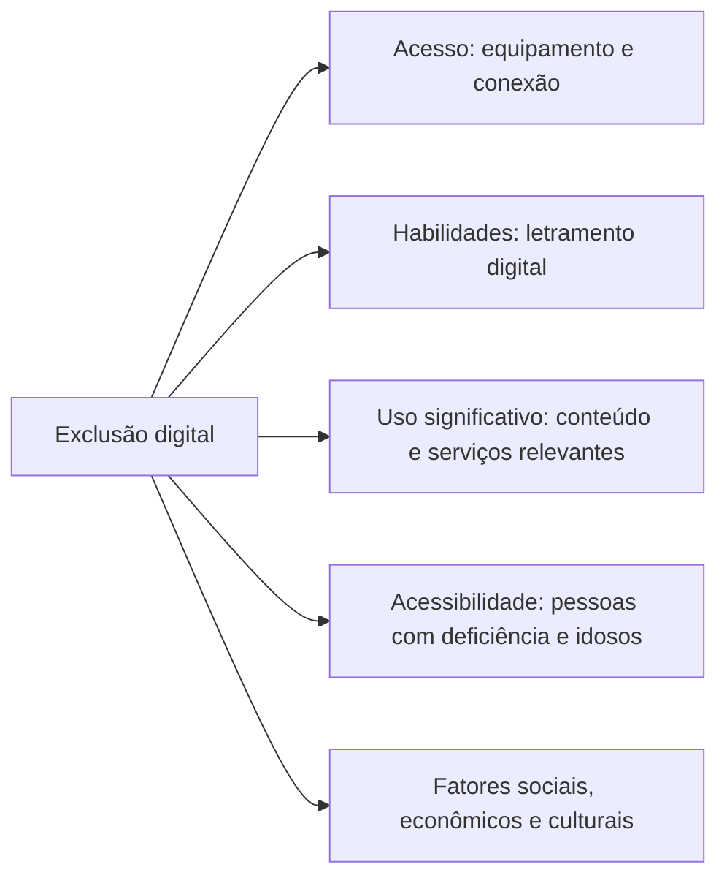

## O que é

**Ciência, Tecnologia e Sociedade (CTS)** estuda como a ciência e a tecnologia **influenciam e são influenciadas** pela sociedade. Tecnologia não é neutra: ela distribui benefícios e riscos de forma desigual e depende de escolhas políticas, econômicas e éticas.

## Para que serve

Profissionais de TI tomam decisões que afetam milhões de pessoas — o que coletar de dados, como ordenar um feed, quem consegue usar um serviço. A formação geral avalia a capacidade de pensar essas consequências.

## Como funciona

### Sociedade da informação e exclusão digital

Na **sociedade da informação**, conhecimento e dados são centrais para produtividade, inovação e riqueza. **Exclusão digital** é a falta de acesso às vantagens das tecnologias de informação e comunicação por motivos **sociais, econômicos, políticos ou culturais** — não só falta de equipamento, mas também de **conectividade de qualidade**, **letramento digital**, acessibilidade e conteúdo relevante. **Mapear** a exclusão ajuda gestores a definir o público-alvo de políticas de **inclusão digital**; o acesso às TICs pode ampliar oportunidades e o exercício da cidadania.

### Cibercultura

Conjunto de práticas, valores e modos de pensar que surgem com o ciberespaço (Pierre Lévy). Valoriza a **participação**, a comunicação em rede e a **inteligência coletiva** — vista como herdeira (ainda que distante) do projeto progressista do Iluminismo, de difundir conhecimento e emancipar as pessoas.

### Redes sociais, algoritmos e privacidade

Redes conectam bilhões de pessoas e transformam marketing, política e relações. Empresas monitoram o que se diz sobre suas marcas. Riscos: **bolhas e câmaras de eco** (algoritmos que mostram mais do mesmo), polarização, vício em engajamento, coleta massiva de dados pessoais (veja a [LGPD](lib:seguranca-da-informacao)), discurso de ódio.

### Desinformação e infodemia

**Desinformação** é conteúdo falso ou enganoso que circula, intencionalmente ou não. Em saúde, a busca de informações na internet pode **esclarecer**, mas também levar a **autodiagnóstico e automedicação** perigosos. Durante a pandemia, a OMS falou em **infodemia** (excesso de informações, verdadeiras e falsas). Critérios para avaliar uma informação: **fonte** confiável, data, autoria, evidências, checagem em mais de uma fonte, cuidado com títulos sensacionalistas.

### Cidades inteligentes

Cidades que usam **tecnologia** (sensores, IoT, dados abertos, plataformas digitais) para **melhorar infraestrutura e serviços** — mobilidade, energia, saneamento, segurança, saúde —, tornando a administração mais eficiente, **com participação cidadã** e foco na qualidade de vida e na sustentabilidade. Desafios: privacidade, exclusão de quem não tem acesso digital, dependência de fornecedores.

### Educação a distância (EaD)

Modalidade em que a construção do conhecimento ocorre com estudantes e professores em **locais e/ou tempos diferentes**, mediada por tecnologias. Amplia o acesso, mas exige infraestrutura, autonomia do estudante, qualidade de materiais e mediação pedagógica — e pode aprofundar desigualdades se o acesso for desigual (como mostrou o ensino remoto na pandemia).

### Inovação e ética

Inovações tecnológicas simples podem salvar vidas (dispositivos médicos de baixo custo) e reduzir impactos ambientais (hidrogéis que retêm água no solo). Ao mesmo tempo, a **inteligência artificial** levanta questões de **viés**, transparência, responsabilidade e impacto no trabalho.

## Características principais

- Tecnologia pode **incluir** ou **excluir**, conforme como é distribuída e projetada.
- Os temas CTS pedem **análise crítica**: benefícios **e** riscos.

## Exemplos práticos

:::example Avaliando uma notícia de saúde
Um post afirma que "chá X cura a doença Y". Verifique: quem publicou? Há estudo científico citado? Órgãos de saúde (Ministério da Saúde, OMS, Fiocruz) confirmam? Agências de checagem já analisaram? Sem evidência, **não compartilhe** e não se automedique.
:::

## Representação visual

## Diferenças entre conceitos semelhantes

- **Inclusão digital × acesso à internet:** a inclusão envolve também **habilidades** e uso significativo.
- **Desinformação × má informação:** falso × verdadeiro usado fora de contexto para enganar.
- **Cidade inteligente × cidade conectada:** a inteligente usa tecnologia **para melhorar a vida** com participação; só ter sensores não basta.
- **EaD × ensino remoto emergencial:** modalidade planejada × adaptação às pressas em uma crise.

## Como cai no ENADE

:::enade
Exclusão digital (2011), cibercultura (2011), EaD (2011, discursiva), redes sociais e marcas (2014), inovação em saúde (2014), hidrogéis (2017), busca de informações de saúde na internet (2021) e cidades inteligentes (2021, discursiva).
:::

## Pegadinhas

:::trap Exclusão digital não é só falta de tecnologia
Renda, cultura, idade, escolaridade e território também importam.
:::

:::trap Tecnologia não é neutra nem automaticamente boa
Alternativas que tratam a tecnologia como solução única para problemas sociais tendem a ser extrapolações.
:::

## Questões comentadas

::question 2011-objective-2 Exclusão digital

**I** (mapear a exclusão ajuda a escolher o público das políticas) e **II** (as TICs podem ampliar oportunidades) estão corretas; as demais separam rigidamente informação e direitos sociais ou reduzem a exclusão à qualidade da tecnologia. Resposta: **I e II**.

::question 2021-objective-7 Busca de informações de saúde na internet

Os textos defendem **critérios** para avaliar informações e reconhecem que a divulgação pode esclarecer a população (I e II); não há defesa irrestrita da busca sem critério, que pode levar a autodiagnóstico e automedicação. Resposta: **I e II**.

## Resumo para memorizar

:::summary
- Exclusão digital: acesso + **habilidades** + uso significativo + fatores sociais.
- Cibercultura (Lévy): participação, rede, inteligência coletiva.
- Redes sociais: conexão e mercado × bolhas, polarização, privacidade.
- Desinformação: confira **fonte, evidência e checagem**; infodemia.
- Cidades inteligentes: tecnologia **a serviço** da qualidade de vida, com participação.
- EaD amplia acesso, mas depende de infraestrutura e mediação.
:::

## Miniquestionário

:::quiz
[
  {
    "question": "Qual iniciativa enfrenta a exclusão digital de forma mais completa?",
    "options": ["Apenas doar computadores", "Oferecer acesso à internet, formação em letramento digital e serviços acessíveis", "Proibir celulares nas escolas", "Cobrar mais pela banda larga"],
    "answer": 1,
    "explanation": "Inclusão envolve acesso, habilidades e uso significativo."
  },
  {
    "question": "O que caracteriza uma cidade inteligente?",
    "options": ["Ter o maior número de sensores", "Usar tecnologia para melhorar serviços e qualidade de vida, com participação cidadã", "Substituir servidores públicos por robôs", "Proibir carros"],
    "answer": 1,
    "explanation": "A tecnologia é meio, não fim."
  },
  {
    "question": "Ao receber uma notícia alarmante sobre saúde, a atitude mais adequada é:",
    "options": ["compartilhar imediatamente", "verificar a fonte e confirmar em órgãos oficiais e agências de checagem", "acreditar se tiver muitas curtidas", "se automedicar"],
    "answer": 1,
    "explanation": "Checagem de fonte e evidência combate a desinformação."
  }
]
:::

## Referências

- LÉVY, P. *Cibercultura*. 3. ed. Editora 34, 2010.
- CASTELLS, M. *A Sociedade em Rede*. 6. ed. Paz e Terra, 2002.
- CETIC.br. *TIC Domicílios* (pesquisa anual sobre uso das TICs no Brasil). Disponível em cetic.br.
- OMS. *Managing the COVID-19 infodemic*, 2020.
- INEP. ENADE — formação geral, 2011, 2014, 2017 e 2021.
