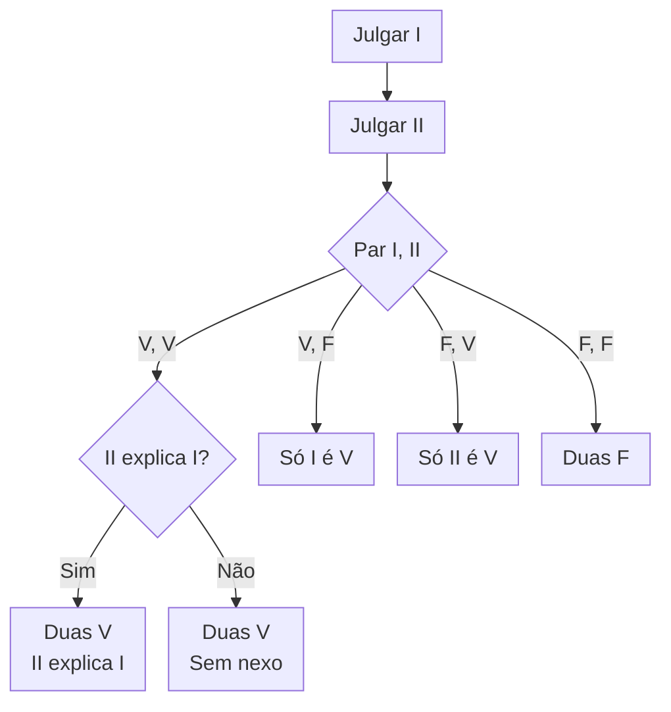

## O que é

O **ENADE** (Exame Nacional de Desempenho dos Estudantes), aplicado pelo **Inep**, integra o Sinaes e avalia o desempenho dos estudantes em relação às diretrizes curriculares do curso. A prova de ADS analisada aqui (edições 2008, 2011, 2014, 2017 e 2021) tem **40 questões em 4 horas**:

| Parte | Objetivas | Discursivas | Peso típico |
|---|---|---|---|
| **Formação geral** | 8 | 2 | 25% |
| **Componente específico** | 27 | 3 | 75% |

Há ainda um **questionário de percepção da prova** e o **questionário do estudante**, respondido antes.

## Para que serve

Entender o **formato** das questões vale pontos: muitos erros não vêm de falta de conteúdo, mas de interpretar mal a relação entre asserções, de não perceber uma palavra absoluta ou de gastar tempo demais em uma questão.

## Como funciona

### Questões de asserção-razão

Formato: "**I. [afirmação] PORQUE II. [afirmação]**". As alternativas são sempre as mesmas:

| | Significado |
|---|---|
| **A** | I e II verdadeiras, e **II justifica** I |
| **B** | I e II verdadeiras, mas II **não** justifica I |
| **C** | I verdadeira, II falsa |
| **D** | I falsa, II verdadeira |
| **E** | I e II falsas |

**Método em três passos:**
1. Avalie **I sozinha**: verdadeira ou falsa?
2. Avalie **II sozinha**: verdadeira ou falsa?
3. **Só se as duas forem verdadeiras**, teste a relação: leia "**I porque II**" e também "**II, logo I**". Se II é a **causa/explicação** de I, é A; se são apenas duas verdades sobre o mesmo tema, é B.

:::tip Teste do "logo"
Reescreva como "**II, portanto I**". Se a frase faz sentido como explicação ("as revisões fornecem informações sobre defeitos, portanto produtos de trabalho são revisados"), a justificativa é válida.
:::

### Questões de múltiplas afirmativas (I, II, III, IV)

1. Julgue **cada afirmativa isoladamente** (V ou F), anotando ao lado.
2. Comece pela que você tem **mais certeza** e **elimine** as alternativas incompatíveis.
3. Desconfie de palavras **absolutas**: *sempre, nunca, somente, invariavelmente, todo, qualquer, exclusivamente, garante*. Elas costumam tornar a afirmativa falsa.
4. Atenção a **trocas de conceitos vizinhos** (include × extend, Product Owner × Scrum Master, adaptativa × evolutiva, caixa branca × caixa preta).

### Questões com texto-base e imagens

Leia o **comando** (a pergunta) **antes** do texto: assim você sabe o que procurar. Volte ao texto para confirmar cada alternativa. Veja [Interpretação de texto](lib:interpretacao-de-texto) e [Leitura de imagens e charges](lib:leitura-de-imagens-e-charges).

### Discursivas

As discursivas são corrigidas por um **padrão de resposta** publicado pelo Inep, que lista os **itens esperados**. Para pontuar:

- **Responda exatamente o que foi pedido** — cada letra (a, b, c) costuma valer pontos separados.
- Use os **conceitos técnicos corretos** (nomes de diagramas, comandos SQL, estruturas de dados).
- Em código/pseudocódigo: declare variáveis, mostre a lógica completa, use estruturas corretas.
- Em formação geral: **texto dissertativo-argumentativo** curto, com tese, argumentos e, quando pedido, **proposta de intervenção** respeitando os direitos humanos.
- Escreva com letra legível, dentro das linhas, sem rascunho na folha final.

### Gestão do tempo

4 horas para 40 questões ≈ **6 minutos por questão**. Sugestão:
1. Primeira passada: resolva as que você sabe (2–3 min cada).
2. Faça as discursivas com calma (15–20 min cada), garantindo pontuação parcial.
3. Volte às difíceis; nunca deixe objetivas em branco (não há penalidade por erro no cálculo de acertos).
4. Reserve 15 minutos para revisar e marcar o cartão.

## Características principais

- As questões são **contextualizadas**: partem de um cenário real (empresa, sistema, notícia).
- Exigem **aplicação** de conceitos, não só memorização.
- O gabarito definitivo pode **anular** questões; o Inep publica cadernos, gabaritos e padrões de resposta.

## Exemplos práticos

:::example Aplicando o método à asserção-razão
"O cascata acrescenta aspectos gerenciais ao processo PORQUE é composto por etapas sistemáticas e sequenciais."
1. I: o que caracteriza o cascata é a sequência, não "acrescentar" planejamento e decisão — **falsa** segundo o gabarito.
2. II: definição correta do cascata — **verdadeira**.
3. Não é preciso testar a relação: resposta **D** (I falsa, II verdadeira).
:::

## Representação visual

Registre V ou F para I e II separadamente, na ordem indicada. Só avalie a justificativa quando ambas forem verdadeiras. No ENADE, combine o par obtido com a relação explicativa e procure a opção com esse significado.

Fonte: adaptado de INEP (2014, questão 13) — recriado pela equipe Stacklyst.

## Diferenças entre conceitos semelhantes

- **Verdadeira × justificativa:** duas frases podem ser verdadeiras sem que uma explique a outra.
- **Proposição falsa × fora de contexto:** a afirmativa precisa ser julgada no contexto do enunciado.
- **Padrão de resposta × gabarito:** o primeiro orienta a correção das discursivas; o segundo é a letra correta das objetivas.

## Como cai no ENADE

:::enade
Asserção-razão aparece em praticamente todas as edições (por exemplo, 2008 sobre RUP, 2011 sobre cascata, revisões técnicas e plano de negócios, 2014 sobre o Marco Civil, 2021 sobre gig economy e pandemia). Múltiplas afirmativas dominam o componente específico.
:::

## Pegadinhas

:::trap "Ambas verdadeiras" não é automaticamente A
Verifique a **relação de causa**. Muitas questões têm duas verdades independentes (alternativa B).
:::

:::trap Palavras absolutas
"Invariavelmente", "sempre", "nunca", "garante": confira se o conceito realmente admite isso.
:::

## Questões comentadas

::question 2014-objective-13 Marco Civil: duas verdades sem relação de causa

A manutenção da qualidade contratada e a vedação de suspensão (salvo débito) são garantias distintas da lei: ambas verdadeiras, mas a II não justifica a I — alternativa **B**.

::question 2011-objective-30 Revisões técnicas: verdade com justificativa

Revisa-se o produto de trabalho **porque** isso gera informação sobre defeitos e permite controlar a qualidade: as duas verdadeiras e a II justifica a I — alternativa **A**.

## Resumo para memorizar

:::summary
- Prova: **8 + 2** de formação geral, **27 + 3** do componente específico, 4 horas.
- Asserção-razão: julgue **I**, julgue **II**, só então a **relação** (teste "II, portanto I").
- Afirmativas: julgue uma a uma, elimine alternativas, desconfie de **absolutos**.
- Discursiva: responda **cada item pedido** com os termos técnicos corretos.
- ≈ 6 min por questão; não deixe objetivas em branco.
:::

## Miniquestionário

:::quiz
[
  {
    "question": "Em uma asserção-razão, I é verdadeira e II é falsa. Qual alternativa?",
    "options": ["A", "B", "C", "D"],
    "answer": 2,
    "explanation": "C = primeira verdadeira, segunda falsa."
  },
  {
    "question": "I e II são verdadeiras, mas tratam de aspectos diferentes do tema, sem relação de causa. Qual alternativa?",
    "options": ["A", "B", "D", "E"],
    "answer": 1,
    "explanation": "B = ambas verdadeiras, sem justificativa."
  },
  {
    "question": "Qual palavra, em uma afirmativa, deve acender o alerta de possível generalização indevida?",
    "options": ["pode", "geralmente", "invariavelmente", "contribui"],
    "answer": 2,
    "explanation": "Termos absolutos costumam tornar afirmativas falsas."
  }
]
:::

## Referências

- INEP. *Enade — provas e gabaritos*. Disponível em gov.br/inep.
- INEP. *Manual do Estudante — Enade*. Edições anuais.
- BRASIL. Lei nº 10.861, de 14 de abril de 2004 (institui o Sinaes).
- INSTITUTO NACIONAL DE ESTUDOS E PESQUISAS EDUCACIONAIS ANÍSIO TEIXEIRA. *Enade 2014: tecnologia em análise e desenvolvimento de sistemas*. Brasília, DF: Inep, 2014. Disponível em: [Caderno de prova](https://download.inep.gov.br/educacao_superior/enade/provas/2014/40_tecnologia_analise_desenv_sistemas.pdf). Acesso em: 25 nov. 2026.
