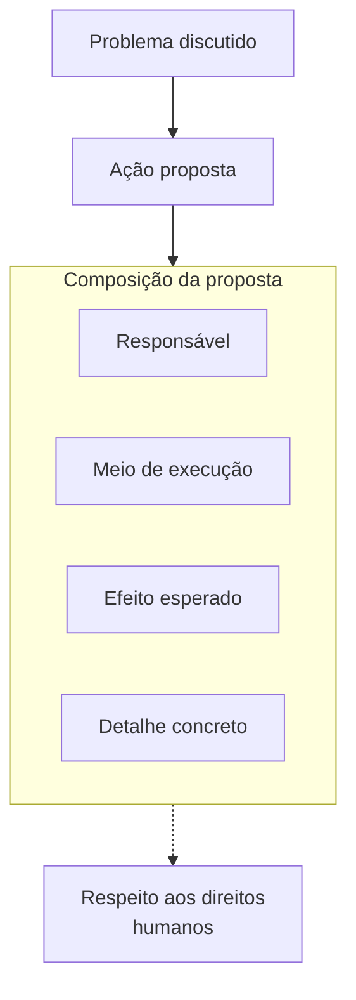

## O que é

- **Ética:** reflexão filosófica sobre **valores e princípios** que orientam a ação humana (o que é certo, justo, bom), com pretensão de validade universal.
- **Moral:** conjunto de **normas e costumes** de um grupo em determinado tempo e lugar.
- **Cidadania:** condição de quem tem **direitos e deveres** em uma comunidade política e participa dela.
- **Direitos humanos:** direitos **inerentes a toda pessoa**, por sua dignidade, **universais, indivisíveis, interdependentes e inalienáveis**.

## Para que serve

Esses temas sustentam as discursivas de formação geral e as escolhas profissionais em tecnologia: privacidade, acessibilidade, vieses em algoritmos, inclusão digital, combate à desinformação e respeito à diversidade nas equipes e nos produtos.

## Como funciona

### Gerações (dimensões) de direitos

| Dimensão | Valores | Exemplos |
|---|---|---|
| 1ª — **civis e políticos** | liberdade | vida, liberdade de expressão, voto, propriedade |
| 2ª — **sociais, econômicos e culturais** | igualdade | educação, saúde, trabalho, moradia, previdência |
| 3ª — **difusos e coletivos** | fraternidade/solidariedade | meio ambiente equilibrado, paz, desenvolvimento |

Marcos: **Declaração Universal dos Direitos Humanos** (ONU, 1948) e **Constituição Federal de 1988**, que tem a **dignidade da pessoa humana** como fundamento (art. 1º, III) e prevê direitos fundamentais (art. 5º) e sociais (art. 6º). O caráter **universal** dos direitos humanos é prático: eles são **invocados** para proteger pessoas concretas contra violações.

### Democracia

Para além de "governo do povo, pelo povo e para o povo", há tensões quando o povo discorda (Arend Lijphart):

- **Democracia majoritária:** governa-se segundo a **maioria**.
- **Democracia consensual:** busca **incluir o maior número possível de pessoas** e construir consensos amplos; exige lideranças maduras no governo e na oposição.
- O **bem comum** e o Estado de Direito exigem **proteger minorias** e limitar o poder; democratas rejeitam o totalitarismo.

### Diversidade e inclusão

- **Igualdade formal** (todos iguais perante a lei) × **igualdade material** (tratar desigualmente os desiguais, na medida da desigualdade) — base de **ações afirmativas** como cotas.
- Temas frequentes: **igualdade de gênero** (desigualdade salarial, dupla jornada), **racismo** e desigualdades raciais, direitos de **pessoas LGBTQIA+** (como o direito de pessoas trans ao **nome social** e à autodeclaração de identidade de gênero), **povos indígenas** (saúde, território, cultura), **pessoas com deficiência** (Lei Brasileira de Inclusão), **pessoas em situação de rua**, **migrantes e refugiados** (acolhimento × xenofobia).

### Ética profissional em tecnologia

Responsabilidade com dados pessoais (LGPD), segurança, acessibilidade, honestidade sobre limitações do software, respeito à propriedade intelectual, combate a vieses e discriminação algorítmica, transparência.

### Proposta de intervenção (discursivas)

Uma boa proposta responde: **o que** fazer, **quem** faz (agente: Estado, escolas, empresas, ONGs, mídia), **como** (meio/ação concreta), **para quê** (finalidade) e **detalhamento** — sempre **respeitando os direitos humanos**.

## Características principais

- Direitos humanos são **universais**, mas sua efetivação depende de **políticas públicas**.
- A ética questiona normas morais vigentes; nem tudo que é legal é ético, e vice-versa.

## Exemplos práticos

:::example Proposta de intervenção bem estruturada
"Para reduzir a violência contra pessoas em situação de rua (**finalidade**), o poder público municipal (**agente**) deve ampliar abrigos e serviços de assistência (**ação**), articulados com campanhas educativas nas escolas sobre direitos humanos e empatia (**meio**), com acompanhamento por conselhos de direitos (**detalhamento**)."
:::

## Representação visual

Parta do problema e use a ação como centro da proposta. O detalhamento especifica um dos elementos, e o respeito aos direitos humanos se aplica à proposta inteira. Use este roteiro de escrita quando o enunciado discursivo do ENADE pedir ações ou soluções.

Fonte: adaptado de INEP (2025, p. 34) — recriado pela equipe Stacklyst.

## Diferenças entre conceitos semelhantes

- **Ética × moral:** reflexão sobre princípios × normas de um grupo.
- **Igualdade formal × material:** perante a lei × considerando as desigualdades reais.
- **Democracia majoritária × consensual:** maioria decide × incluir o maior número possível.
- **Tolerância × respeito à diversidade:** suportar a diferença × reconhecê-la como valor e garantir direitos.

## Como cai no ENADE

:::enade
Direitos humanos em discursiva (2008), leis de proteção às mulheres (2008), violência contra jovens em situação de rua (2014, discursiva), identidade de pessoas trans (2017, discursiva), saúde indígena (2021) e democracia majoritária × consensual (2021).
:::

## Pegadinhas

:::trap Democracia não é só a vontade da maioria
Proteger minorias e direitos fundamentais faz parte do bem comum.
:::

:::trap Proposta que viola direitos humanos
Nas discursivas, propostas punitivas que desrespeitam direitos (violência, discriminação) são penalizadas.
:::

## Questões comentadas

::question 2021-objective-8 Democracia majoritária e consensual

As afirmações corretas reconhecem que o bem comum pode exigir proteger minorias e que a democracia consensual busca incluir o máximo de pessoas; reduzi-la a um "acordo entre governo e oposição" (II) é insuficiente. Resposta: **I, III e IV**.

::question 2021-objective-5 Saúde da população indígena

A resposta correta sustenta a necessidade de ações voltadas aos direitos fundamentais dessa população, considerando suas particularidades culturais; alternativas que propõem soluções genéricas ou negam a proteção constitucional estão erradas.

## Resumo para memorizar

:::summary
- Ética (reflexão) × moral (normas). Cidadania = direitos + deveres + participação.
- Direitos: civis e políticos (liberdade), sociais (igualdade), difusos (solidariedade).
- DUDH (1948) e CF/1988 (dignidade da pessoa humana).
- Democracia: majoritária × **consensual**; proteger minorias.
- Proposta de intervenção: **agente, ação, meio, finalidade, detalhamento**, respeitando direitos humanos.
:::

## Miniquestionário

:::quiz
[
  {
    "question": "Educação, saúde e trabalho são direitos de qual dimensão?",
    "options": ["Primeira — civis e políticos", "Segunda — sociais", "Terceira — difusos", "Nenhuma"],
    "answer": 1,
    "explanation": "Direitos sociais ligados ao valor da igualdade."
  },
  {
    "question": "Cotas em universidades são justificadas principalmente pelo princípio da:",
    "options": ["igualdade formal", "igualdade material", "democracia majoritária", "livre concorrência"],
    "answer": 1,
    "explanation": "Tratar desigualmente os desiguais para promover igualdade real."
  },
  {
    "question": "Qual é um fundamento da República previsto no art. 1º da Constituição de 1988?",
    "options": ["A dignidade da pessoa humana", "A religião oficial", "O voto censitário", "A monarquia"],
    "answer": 0,
    "explanation": "A dignidade da pessoa humana está no art. 1º, III."
  }
]
:::

## Referências

- ONU. *Declaração Universal dos Direitos Humanos*, 1948.
- BRASIL. *Constituição da República Federativa do Brasil de 1988*.
- BOBBIO, N. *A Era dos Direitos*. Elsevier, 2004.
- LIJPHART, A. *Modelos de Democracia*. 3. ed. Civilização Brasileira, 2019.
- CHAUI, M. *Convite à Filosofia*. 14. ed. Ática, 2012 — unidade sobre ética.
- INEP. ENADE — formação geral, 2008, 2014, 2017 e 2021.
- INSTITUTO NACIONAL DE ESTUDOS E PESQUISAS EDUCACIONAIS ANÍSIO TEIXEIRA. *A redação do Enem 2025: cartilha do participante*. Brasília, DF: Inep, 2025. Disponível em: [Cartilha](https://download.inep.gov.br/publicacoes/institucionais/avaliacoes_e_exames_da_educacao_basica/a_redacao_no_enem_2025_cartilha_do_participante.pdf). Acesso em: 25 nov. 2026.
