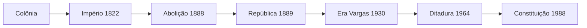

## O que é

A formação geral usa **textos literários, obras de arte e episódios históricos** como ponto de partida para avaliar leitura, contextualização e senso crítico. Não se exige memorizar datas, mas **reconhecer contextos** e relacioná-los ao texto apresentado.

## Para que serve

Entender o contexto histórico e cultural ajuda a interpretar a intenção de um autor, reconhecer críticas sociais e conectar passado e presente — habilidades de cidadania e de comunicação profissional.

## Como funciona

### História do Brasil — períodos-chave

| Período | Marcos para contextualizar |
|---|---|
| **Colônia (1500–1822)** | economia açucareira e mineradora, escravidão de indígenas e africanos, ocupação do território |
| **Império (1822–1889)** | Independência, Primeiro e Segundo Reinados (D. Pedro I e II), **Abolição (1888)** sem políticas de integração dos libertos |
| **República Velha (1889–1930)** | **Proclamação da República** (Deodoro da Fonseca), oligarquias, política do café com leite, educação pública como pauta |
| **Era Vargas (1930–1945)** | industrialização, leis trabalhistas (CLT), Estado Novo autoritário |
| **República de 1946–1964** | desenvolvimentismo, Brasília |
| **Ditadura militar (1964–1985)** | censura, repressão, "milagre econômico" e crise |
| **Redemocratização** | Diretas Já, **Constituição de 1988** ("Constituição Cidadã"), direitos sociais |

Fenômenos do século XX muito cobrados: **industrialização e êxodo rural**, **urbanização** acelerada, formação de periferias.

### Literatura brasileira — escolas e autores

- **Romantismo:** nacionalismo, indianismo (José de Alencar).
- **Realismo:** crítica social e análise psicológica — **Machado de Assis** (*Dom Casmurro*, *Memórias póstumas de Brás Cubas*, *Esaú e Jacó*, que retrata o fim do Império e a República).
- **Modernismo (Semana de Arte Moderna, 1922):** ruptura com padrões acadêmicos, valorização da cultura brasileira, **antropofagia** (Oswald de Andrade); poesia de Manuel Bandeira, Carlos Drummond de Andrade; romance regionalista de 1930 (Graciliano Ramos, Rachel de Queiroz).
- **Teatro e cultura popular:** **Ariano Suassuna** (*Auto da Compadecida*), com personagens como João Grilo e Chicó, mistura humor, crítica social e tradição nordestina.

### Movimentos artísticos

| Movimento | Características | Exemplo |
|---|---|---|
| Renascimento | proporção, perspectiva, racionalidade | Da Vinci |
| **Barroco** | contraste de luz e sombra, dramaticidade | Caravaggio; Aleijadinho no Brasil |
| Impressionismo | luz, pinceladas soltas, ar livre | Monet |
| **Expressionismo** | **deformação, cores intensas, angústia**, subjetividade | **Munch — *O grito*** |
| Cubismo | formas geométricas, múltiplos pontos de vista | Picasso |
| **Modernismo brasileiro** | temas e cores nacionais, antropofagia | **Tarsila do Amaral — *Abaporu*** |
| Arte contemporânea | conceito, instalação, interação | — |

**Cultura popular e patrimônio:** saberes tradicionais (como a produção de **panelas de barro** no Espírito Santo, registrada como patrimônio imaterial) unem técnica, identidade e economia local.

### Filosofia (ideias que aparecem nos textos-base)

- **Iluminismo (séc. XVII–XVIII):** razão, ciência, progresso, direitos — base de ideias modernas de cidadania e da própria "cibercultura" como herdeira do projeto progressista.
- **Nietzsche:** crítica à moral tradicional e ao racionalismo, influência sobre o Expressionismo.
- **Ética e política:** ver [Ética, cidadania e direitos humanos](lib:etica-cidadania-e-direitos-humanos).

## Características principais

- A prova **fornece** o texto ou a imagem; o conhecimento de contexto serve para **interpretar**, não para substituir a leitura.
- Literatura e arte frequentemente **criticam** a sociedade de sua época.

## Exemplos práticos

:::example Machado de Assis e a Proclamação da República
No trecho de *Esaú e Jacó*, os gêmeos Pedro e Paulo reagem de modo oposto à Proclamação: Paulo exalta Deodoro; Pedro considera o movimento um crime contra o imperador. A questão pede relacionar esse contraste aos **símbolos** do Império e da República.
:::

## Representação visual

## Diferenças entre conceitos semelhantes

- **Realismo × Modernismo:** análise crítica e psicológica com linguagem tradicional × ruptura formal e valorização do nacional.
- **Expressionismo × Impressionismo:** emoção interior e deformação × impressão de luz e cor do mundo exterior.
- **Patrimônio material × imaterial:** bens físicos (edifícios) × saberes, celebrações, formas de expressão.

## Como cai no ENADE

:::enade
Machado de Assis e a República (2008), Expressionismo e Nietzsche (2008), educação na República (2011), música e arte popular (2014), panelas de barro como patrimônio (2017), *Auto da Compadecida* em uma questão de modelagem de dados (2017) e censura à arte (2021, discursiva).
:::

## Pegadinhas

:::trap Conhecimento prévio contra o texto
Se o texto-base diz algo, a resposta deve se apoiar nele, mesmo que você conheça outra versão do tema.
:::

## Questões comentadas

::question 2008-objective-1 Esaú e Jacó e os símbolos da Pátria

Relacione o contraste entre os gêmeos (República × Império) às imagens apresentadas: as figuras corretas são as que correspondem às referências históricas do diálogo (alternativa C, II e III).

::question 2017-objective-7 Panelas de barro capixabas

A questão trata a produção artesanal como expressão de cultura popular e patrimônio, ligando tradição, identidade e economia.

## Resumo para memorizar

:::summary
- Brasil: Colônia → Império → Abolição (1888) → República (1889) → Vargas → ditadura (1964–85) → **Constituição de 1988**.
- Machado de Assis (Realismo, crítica social); Modernismo de 1922 (antropofagia); Suassuna (cultura nordestina).
- Expressionismo = angústia e deformação (*O grito*); Modernismo brasileiro = *Abaporu*.
- Use o contexto para **interpretar**, sem trocar o texto pelo que você sabe.
:::

## Miniquestionário

:::quiz
[
  {
    "question": "Qual documento é conhecido como 'Constituição Cidadã'?",
    "options": ["Constituição de 1824", "Constituição de 1937", "Constituição de 1988", "Lei Áurea"],
    "answer": 2,
    "explanation": "A Constituição de 1988 marcou a redemocratização e ampliou direitos."
  },
  {
    "question": "A Semana de Arte Moderna de 1922 está associada a:",
    "options": ["valorização dos padrões acadêmicos europeus", "ruptura estética e valorização da cultura brasileira", "o Barroco mineiro", "o Romantismo indianista"],
    "answer": 1,
    "explanation": "Foi o marco do Modernismo brasileiro."
  },
  {
    "question": "*Auto da Compadecida* é obra de:",
    "options": ["Machado de Assis", "Ariano Suassuna", "José de Alencar", "Graciliano Ramos"],
    "answer": 1,
    "explanation": "Peça de Ariano Suassuna, com João Grilo e Chicó."
  }
]
:::

## Referências

- FAUSTO, B. *História do Brasil*. 14. ed. Edusp, 2012.
- BOSI, A. *História concisa da literatura brasileira*. 50. ed. Cultrix, 2017.
- GOMBRICH, E. H. *A história da arte*. 16. ed. LTC, 2013.
- IPHAN. *Patrimônio imaterial*. Disponível em portal.iphan.gov.br.
- INEP. ENADE — formação geral, 2008, 2011, 2014, 2017 e 2021.
