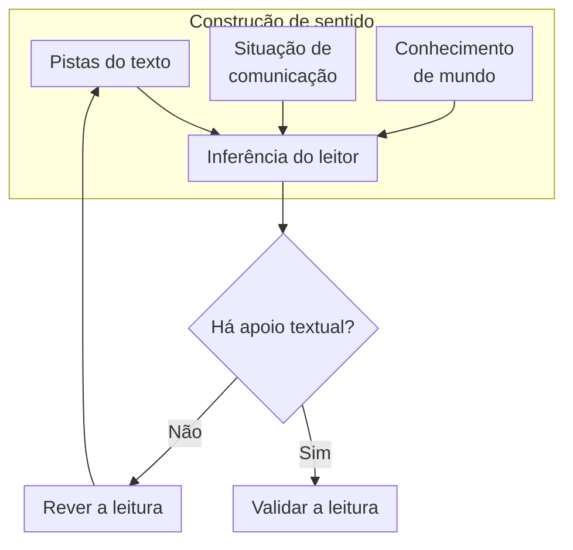

## O que é

**Interpretar** um texto é compreender **o que ele diz** (sentido literal) e **o que ele permite concluir** (sentidos implícitos), reconhecendo a **intenção** do autor, a **tese** defendida e os **argumentos** usados.

- **Informação explícita:** está escrita no texto.
- **Informação implícita:** não está escrita, mas é **sustentada** pelo texto:
  - **pressuposto** — decorre necessariamente das palavras ("Ele **parou** de fumar" pressupõe que fumava);
  - **subentendido** — sugestão que depende do contexto ("Está frio aqui", pedindo para fechar a janela).
- **Inferência:** conclusão **logicamente apoiada** nas informações do texto.
- **Extrapolação:** conclusão que **vai além** do que o texto autoriza — é o erro mais explorado pelas bancas.

## Para que serve

Todas as questões do ENADE, inclusive as técnicas, partem de textos. Na formação geral, a competência de leitura é o próprio objeto de avaliação: entender artigos, reportagens, poemas, dados e charges e relacioná-los.

## Como funciona

### Método de leitura em cinco passos

1. **Leia o comando primeiro** — o que a questão quer (a ideia central? uma inferência? a relação entre textos?).
2. **Identifique o gênero e a fonte** — reportagem, artigo de opinião, poema, relatório; quem escreveu e quando.
3. **Encontre a tese** (o ponto de vista) e os **argumentos** (dados, exemplos, autoridade, causa e consequência).
4. **Marque conectivos**: *porém, contudo* (oposição); *portanto, logo* (conclusão); *porque, pois* (causa); *embora* (concessão); *além disso* (adição).
5. **Teste cada alternativa** voltando ao texto: "onde isso está escrito ou é necessariamente sugerido?"

### Os três erros clássicos das alternativas

| Erro | O que faz | Exemplo |
|---|---|---|
| **Extrapolação** | conclui além do texto | o texto fala de associação; a alternativa afirma causa ou garantia |
| **Redução** | toma uma parte como o todo | o texto aponta três fatores; a alternativa cita só um como única causa |
| **Contradição** | afirma o contrário | o texto critica; a alternativa diz que o autor defende |

### Tipos de argumento

- **Por dados/estatísticas** (relatórios do IBGE, Ipea, ONU);
- **Por autoridade** (citação de especialista);
- **Por exemplificação** (casos concretos);
- **Por causa e consequência**;
- **Por comparação/analogia**.

Na **análise crítica**, pergunte: os dados sustentam a conclusão? Há generalização indevida? Que interesses ou pontos de vista estão presentes?

### Relação entre textos (intertextualidade)

Quando a questão traz **Texto I** e **Texto II**, identifique se eles **concordam, se complementam ou se opõem** — e se um ilustra, critica ou contextualiza o outro.

## Características principais

- Leitura atenta vale mais que conhecimento prévio: a resposta deve estar **apoiada no texto**.
- Coesão (ligações gramaticais) e coerência (lógica do sentido) ajudam a seguir o raciocínio.

## Exemplos práticos

:::example Inferência válida × extrapolação
Texto: "A chance de uma criança de baixa renda ter um futuro melhor está relacionada à escolaridade e ao nível de renda dos pais, ao acesso à saúde, à educação de qualidade e a empregos com melhores salários."
- **Inferência válida:** a mobilidade social depende de fatores de acesso a oportunidades, que podem ser influenciados por políticas públicas.
- **Extrapolação:** "a pobreza é hereditária e políticas públicas são inúteis".
:::

## Representação visual

A figura reúne o que está escrito, o contexto e o conhecimento que o leitor mobiliza para construir sentido. No ENADE, confronte a interpretação com o comando da questão e busque no texto uma pista que sustente a inferência.

Fonte: adaptado de KOCH; ELIAS (2006, cap. 1) — recriado pela equipe Stacklyst.

## Diferenças entre conceitos semelhantes

- **Compreensão × interpretação:** entender o que está escrito × perceber implicações e intenções.
- **Inferência × extrapolação:** apoiada no texto × além dele.
- **Pressuposto × subentendido:** marcado na linguagem (não se nega) × depende do contexto (pode ser negado).
- **Tema × tese:** assunto × posição defendida sobre o assunto.

## Como cai no ENADE

:::enade
Textos sobre mobilidade social, desinformação em saúde, democracia, trabalho por aplicativos e meio ambiente, com afirmativas que testam inferência × extrapolação (2021), poemas e literatura (2011) e relações entre dois textos.
:::

## Pegadinhas

:::trap Concordar com a alternativa não basta
A pergunta é se **o texto** sustenta a afirmação, não se ela é verdadeira no mundo.
:::

:::trap "Sempre", "apenas", "garante"
Generalizações costumam indicar extrapolação.
:::

## Questões comentadas

::question 2021-objective-1 Mobilidade social e oportunidades

A resposta correta reconhece que a baixa mobilidade está ligada ao acesso desigual a saúde, educação e emprego; alternativas que tratam a condição como hereditária ou imutável **extrapolam** e **contradizem** o texto.

::question 2011-objective-1 Poema "Retrato de uma princesa desconhecida"

A leitura de poemas exige atenção a **imagens** e **ironias**: o texto sugere o custo humano por trás da beleza da princesa; alternativas que tomam a descrição literalmente perdem o sentido crítico.

## Resumo para memorizar

:::summary
- Leia o **comando** primeiro; ache **tese** e **argumentos**.
- Explícito (está escrito) × implícito (pressuposto/subentendido) × **inferência** (apoiada) × **extrapolação** (além).
- Erros das alternativas: **extrapolação, redução, contradição**.
- Volte ao texto para confirmar cada alternativa.
:::

## Miniquestionário

:::quiz
[
  {
    "question": "'O Brasil reduziu o desmatamento em 2011' permite concluir que:",
    "options": ["o desmatamento acabou", "houve diminuição do desmatamento naquele ano", "o desmatamento nunca mais aumentará", "todos os estados reduziram igualmente"],
    "answer": 1,
    "explanation": "As outras extrapolam o que foi dito."
  },
  {
    "question": "'Ela voltou a estudar' pressupõe que:",
    "options": ["ela nunca estudou", "ela já estudou antes e havia parado", "ela é professora", "ela vai se formar"],
    "answer": 1,
    "explanation": "'Voltar a' pressupõe que a ação ocorreu antes e foi interrompida."
  },
  {
    "question": "Uma alternativa que toma um dos três fatores citados pelo texto como única causa comete:",
    "options": ["inferência válida", "redução", "intertextualidade", "coesão"],
    "answer": 1,
    "explanation": "Reduz o todo a uma parte."
  }
]
:::

## Referências

- KOCH, Ingedore Villaça; ELIAS, Vanda Maria. *Ler e compreender: os sentidos do texto*. São Paulo: Contexto, 2006.
- FIORIN, J. L.; SAVIOLI, F. P. *Para entender o texto: leitura e redação*. 17. ed. Ática, 2007.
- PLATÃO, F.; FIORIN, J. L. *Lições de texto: leitura e redação*. 5. ed. Ática, 2006.
- INEP. ENADE — formação geral, edições 2008 a 2021.
