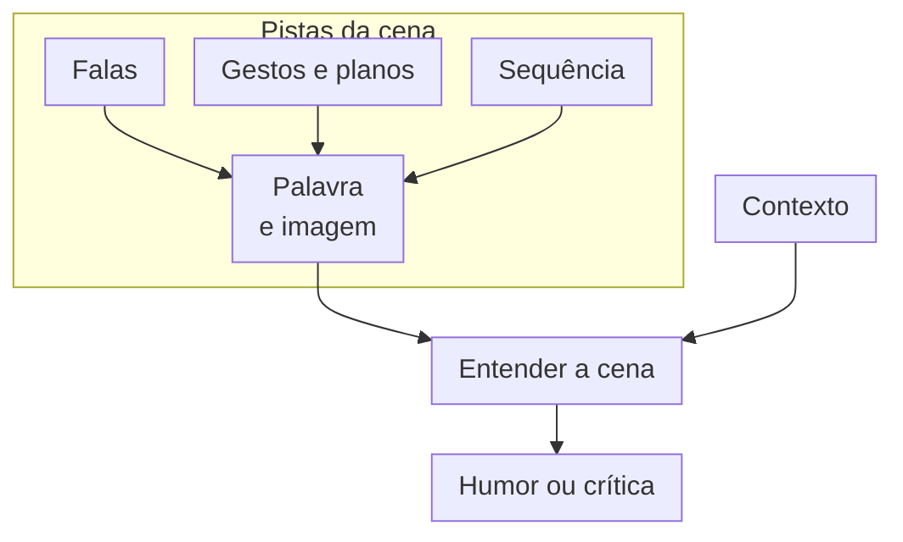

## O que é

A **linguagem não verbal** comunica por **imagens, cores, formas, expressões e disposição espacial**. No ENADE, aparece em:

- **Charge:** desenho de humor crítico sobre um **fato atual** e específico (política, sociedade);
- **Cartum:** humor sobre situações **universais**, sem data;
- **Tirinha:** sequência de quadros com pequena narrativa, muitas vezes com reviravolta final;
- **Fotografia/fotojornalismo:** registro que funciona como **documento** de uma época;
- **Obras de arte:** pinturas e esculturas ligadas a movimentos artísticos;
- **Infográficos e mapas:** dados representados visualmente.

## Para que serve

Imagens condensam críticas e contextos que exigiriam páginas de texto. Saber lê-las é competência de cidadania (mídias, redes sociais, publicidade) e de vários itens da formação geral.

## Como funciona

### Roteiro de leitura de uma imagem

1. **Descreva** o que se vê: personagens, cenário, objetos, cores, expressões, textos (balões, legendas).
2. **Contextualize:** fonte, data, autor; a que fato ou época se refere?
3. **Identifique o recurso expressivo:** exagero (caricatura), contraste, ironia, metáfora visual, quebra de expectativa.
4. **Interprete a crítica ou a mensagem:** o que o autor quer denunciar ou provocar?
5. **Relacione** com o texto-base da questão.

### Ironia e humor

A **ironia** diz uma coisa para significar o contrário; o **humor crítico** expõe contradições sociais. Em tirinhas, o último quadro costuma inverter o sentido dos anteriores — é ali que está a crítica.

### Fotografia como documento

Uma foto histórica (por exemplo, as filas de desempregados na **Grande Depressão**, fotografadas por Margaret Bourke-White) carrega informações sobre o contexto e muitas vezes **contrastes** (cartazes otimistas atrás de pessoas em dificuldade) que revelam a crítica.

### Obras de arte

Associe as características visuais ao **movimento**: deformação e angústia (Expressionismo — *O grito*, de Munch), formas geométricas (Cubismo), cores e figuras brasileiras com antropofagia (Modernismo — *Abaporu*, de Tarsila do Amaral), luz e sombra dramáticas (Barroco — Caravaggio). Veja [História, arte e literatura](lib:historia-arte-e-literatura).

### Infográficos e mapas

Leia a **legenda**, a **escala** e as **unidades**; compare regiões e períodos sem extrapolar (veja [Funções e gráficos](lib:funcoes-e-graficos)).

## Características principais

- Imagens têm **intencionalidade**: o enquadramento e a composição orientam o olhar.
- A mesma imagem pode ter leituras diferentes; a prova pede a leitura **sustentada pelos elementos visuais e pelo contexto dado**.

## Exemplos práticos

:::example Tirinha sobre televisão (ENADE 2017)
A tirinha e o texto descrevem a TV como um fluxo contínuo de imagens em que telejornal, anúncio, novela e futebol se misturam. A crítica: esse tempo de recepção estimula a **fragmentação** e o **excesso de informação superficial**, não a reflexão concentrada.
:::

## Representação visual

Leia as falas, os elementos visuais e a relação entre quadros antes de formular a interpretação. No ENADE, associe o efeito de humor ou crítica a uma escolha observável, como o contraste entre a fala e a expressão da personagem.

Fonte: adaptado de RAMOS (2009) — recriado pela equipe Stacklyst.

## Diferenças entre conceitos semelhantes

- **Charge × cartum:** fato atual e datado × tema atemporal.
- **Tirinha × charge:** narrativa em quadros × geralmente um quadro só.
- **Ilustração × documento:** a ilustração acompanha o texto; a foto histórica é **fonte**.

## Como cai no ENADE

:::enade
Fotografia da Grande Depressão (2008), obras de arte e Expressionismo (2008), tirinha sobre televisão (2017), mapas de desmatamento e de ODS (2011, 2017) e imagens associadas a símbolos nacionais em textos literários (2008).
:::

## Pegadinhas

:::trap Ler só o texto e ignorar a imagem
Muitas questões dependem justamente do contraste entre texto e imagem.
:::

:::trap Confundir o que a personagem diz com o que o autor defende
Na ironia, o autor costuma criticar justamente a fala da personagem.
:::

## Questões comentadas

::question 2017-objective-4 Tirinha e texto sobre a televisão

A leitura conjunta mostra a crítica à sequência vertiginosa de imagens: a alternativa correta fala em **fragmentação e excesso de informação superficial** (B).

::question 2008-objective-8 Expressionismo

Deformação, tensão e angústia caracterizam o Expressionismo; *O grito*, de Edvard Munch, é a obra que corresponde ao enfoque descrito (C).

## Resumo para memorizar

:::summary
- Descrever → contextualizar → recurso expressivo → crítica → relação com o texto.
- Charge (fato atual) × cartum (atemporal) × tirinha (narrativa com virada final).
- Foto histórica = documento; obras de arte → movimento pelas características visuais.
- Ironia: o sentido real é o oposto do literal.
:::

## Miniquestionário

:::quiz
[
  {
    "question": "Um desenho de humor sobre uma votação específica no Congresso desta semana é uma:",
    "options": ["charge", "cartum", "infográfico", "fotografia documental"],
    "answer": 0,
    "explanation": "Charge comenta um fato atual e datado."
  },
  {
    "question": "Na leitura de uma tirinha, onde normalmente está a crítica principal?",
    "options": ["No título", "No primeiro quadro", "Na virada do último quadro", "Na assinatura do autor"],
    "answer": 2,
    "explanation": "A quebra de expectativa final revela o sentido."
  },
  {
    "question": "Deformação das figuras e expressão de angústia são marcas de qual movimento?",
    "options": ["Barroco", "Expressionismo", "Renascimento", "Realismo"],
    "answer": 1,
    "explanation": "O Expressionismo privilegia a experiência subjetiva e a angústia."
  }
]
:::

## Referências

- SANTAELLA, L. *Leitura de imagens*. Melhoramentos, 2012.
- RAMOS, Paulo. *A leitura dos quadrinhos*. São Paulo: Contexto, 2009.
- GOMBRICH, E. H. *A história da arte*. 16. ed. LTC, 2013.
- INEP. ENADE — formação geral, 2008 (questões 5 e 8) e 2017 (questão 4).
