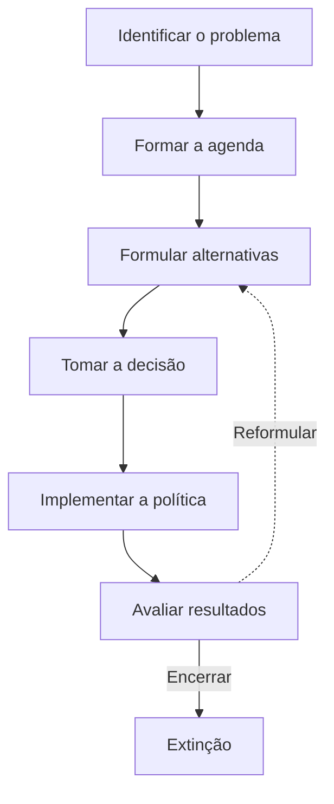

## O que é

A formação geral cobra a capacidade de **analisar fenômenos sociais** a partir de textos e dados: como a economia global, o mercado de trabalho, as cidades e as políticas públicas afetam a vida das pessoas — e por que os impactos são **desiguais** entre grupos sociais.

## Para que serve

Profissionais de tecnologia criam produtos que mudam relações de trabalho (aplicativos), acesso a serviços (governo digital) e informação. Entender a sociedade ajuda a projetar soluções inclusivas e a escrever discursivas com argumentos sólidos.

## Como funciona

### Globalização

Intensificação dos fluxos de **mercadorias, capitais, informações, pessoas e cultura** entre países, impulsionada pelas tecnologias de informação e transporte. Efeitos: integração de mercados, cadeias produtivas globais, difusão cultural — e também **concentração de riqueza**, precarização, crises que se espalham (2008, pandemia) e reações como o **Brexit** (saída do Reino Unido da União Europeia, aprovada em referendo em 2016).

### Desigualdade e mobilidade social

- O Brasil tem desigualdade de renda historicamente elevada (veja [Curva de Lorenz e Gini](lib:curva-de-lorenz-e-gini)).
- **Mobilidade social** é a chance de mudar de posição socioeconômica; ela depende de acesso a **educação de qualidade, saúde e bons empregos**, que não estão igualmente distribuídos — não é uma característica "hereditária" que torne políticas públicas inúteis.
- Desigualdades se **cruzam** (interseccionalidade): **gênero** (mulheres estudam mais, mas ganham menos e acumulam trabalho doméstico), **raça** (desigualdades de renda, violência e acesso), **território** (centro × periferia, regiões).
- **Educação** está associada a menor desemprego e maior renda; o **analfabetismo** ainda atinge sobretudo idosos, população rural e regiões mais pobres.

### Urbanização e mobilidade urbana

A **industrialização** do século XX provocou o **êxodo rural** e uma urbanização rápida, sem planejamento suficiente: periferias distantes dos empregos, moradias irregulares e **longos tempos de deslocamento** para a população de baixa renda. Políticas como **bilhete único**, integração tarifária, **VLT**, corredores de ônibus e ciclovias reduzem custo e tempo de transporte.

### Transformações do trabalho

- **Informalidade:** trabalho sem carteira assinada e sem proteção social.
- **Gig economy / uberização:** trabalho intermediado por **plataformas digitais**, sob demanda, frequentemente com jornadas longas, custos assumidos pelo trabalhador e pouca proteção.
- Automação e novas profissões; necessidade de qualificação contínua.

### Pandemia de covid-19

Impactos **desproporcionais** sobre grupos vulneráveis: quem não podia trabalhar remotamente, morava em domicílios superlotados ou dependia de transporte lotado esteve mais exposto; aumentaram desemprego, informalidade e desigualdade educacional.

### Migrações

Migrantes e refugiados (como a imigração **haitiana** para o Brasil após o terremoto de 2010) enfrentam barreiras de idioma, documentação e **xenofobia**; políticas de acolhimento e integração são essenciais.

### Políticas públicas

**Ciclo:** identificação do problema → formação da agenda → formulação de alternativas → tomada de decisão → **implementação** → **avaliação** (com indicadores). Podem ser **universais** (SUS, educação pública) ou **focalizadas** (transferência de renda para famílias pobres). Dados como os da **PNAD/IBGE** e da **Síntese de Indicadores Sociais** orientam essas políticas.

## Características principais

- Fenômenos sociais têm **múltiplas causas**; desconfie de alternativas com causa única.
- Dados (IBGE, Ipea, ONU) são usados como **argumentos**; leia-os com atenção.

## Exemplos práticos

:::example Argumentando com dados
"Segundo a tabela, em São Paulo e no Rio de Janeiro mais de 20% dos trabalhadores gastam de uma a duas horas no trajeto casa-trabalho, contra cerca de 10% na média nacional. Isso reflete a concentração de empregos nas áreas centrais e de moradias de baixa renda nas periferias; políticas de integração tarifária e transporte de massa podem reduzir esse custo."
:::

## Representação visual

Siga o ciclo analítico desde o reconhecimento do problema até a avaliação de resultados. A avaliação informa ajustes nas alternativas ou a eventual extinção da política. No ENADE, localize em que fase se encontra o caso e diferencie o que foi decidido do que foi implantado e medido.

Fonte: adaptado de SECCHI (2013, cap. 3) — recriado pela equipe Stacklyst.

## Diferenças entre conceitos semelhantes

- **Desigualdade × pobreza:** distribuição relativa × falta absoluta de recursos.
- **Mobilidade social × mobilidade urbana:** mudança de posição socioeconômica × deslocamento nas cidades.
- **Política universal × focalizada:** para todos × para grupos específicos.
- **Informalidade × gig economy:** ausência de vínculo formal × trabalho mediado por plataformas (que pode ser informal).

## Como cai no ENADE

:::enade
Mobilidade social (2021), gig economy (2021), pandemia e vulnerabilidade (2021), desigualdade de gênero (2014), deslocamento casa-trabalho (2014), êxodo rural (2014), imigração haitiana (2017), protestos e classe trabalhadora (2011), analfabetismo (2011, discursiva) e educação e renda (2011).
:::

## Pegadinhas

:::trap Causa única
"A pobreza decorre apenas de…" — fenômenos sociais raramente têm uma única causa.
:::

:::trap Associação não é garantia
Mais escolaridade está associada a melhores salários, mas não os **garante** individualmente.
:::

## Questões comentadas

::question 2021-objective-4 Trabalho por plataformas

As duas asserções descrevem a gig economy (informalidade mediada por plataformas e condições desgastantes), mas a segunda descreve consequências do arranjo e **não explica** a definição da primeira.

::question 2021-objective-6 Pandemia e expectativa de vida

No raciocínio da questão, condições precárias de trabalho aumentam a exposição ao contágio, explicando por que grupos vulneráveis sofreram mais: as duas asserções são verdadeiras e a II justifica a I.

## Resumo para memorizar

:::summary
- Globalização = fluxos globais com ganhos **e** desigualdades.
- Mobilidade social depende de **acesso** a educação, saúde e emprego.
- Urbanização rápida → periferias e longos deslocamentos → políticas de **transporte integrado**.
- **Gig economy**: plataformas, sob demanda, pouca proteção.
- Políticas públicas: agenda → formulação → decisão → implementação → **avaliação**.
:::

## Miniquestionário

:::quiz
[
  {
    "question": "Qual fator NÃO explica, por si só, a baixa mobilidade social segundo análises usuais?",
    "options": ["Acesso desigual à educação de qualidade", "Acesso desigual à saúde", "Uma suposta herança genética da pobreza", "Mercado de trabalho com poucos empregos bem pagos"],
    "answer": 2,
    "explanation": "A pobreza não é hereditária biologicamente; ela é reproduzida por desigualdades de acesso."
  },
  {
    "question": "Transporte por aplicativo em que o motorista assume os custos do veículo e não tem vínculo empregatício é exemplo de:",
    "options": ["economia de plataforma (gig economy)", "servidor público", "economia de subsistência", "trabalho escravo legalizado"],
    "answer": 0,
    "explanation": "Trabalho sob demanda mediado por plataforma digital."
  },
  {
    "question": "Qual etapa do ciclo de políticas públicas mede se os objetivos foram alcançados?",
    "options": ["Agenda", "Formulação", "Implementação", "Avaliação"],
    "answer": 3,
    "explanation": "A avaliação usa indicadores para medir resultados e orientar ajustes."
  }
]
:::

## Referências

- IBGE. *Síntese de Indicadores Sociais* e *PNAD Contínua*. Disponíveis em ibge.gov.br.
- IPEA. *Retrato das desigualdades de gênero e raça*. Disponível em ipea.gov.br.
- SANTOS, M. *Por uma outra globalização*. 6. ed. Record, 2001.
- ANTUNES, R. *O privilégio da servidão: o novo proletariado de serviços na era digital*. Boitempo, 2018.
- SECCHI, Leonardo. *Políticas públicas: conceitos, esquemas de análise, casos práticos*. 2. ed. São Paulo: Cengage Learning, 2013.
- INEP. ENADE — formação geral, 2011, 2014, 2017 e 2021.
