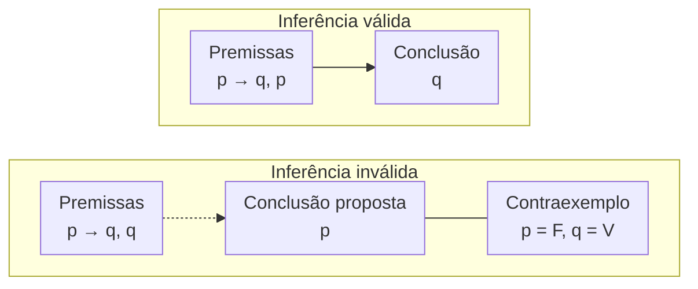

## O que é

Um **argumento** é um conjunto de **premissas** que pretendem justificar uma **conclusão**. Um argumento é **válido** quando é **impossível** as premissas serem verdadeiras e a conclusão falsa — a conclusão **decorre necessariamente** das premissas.

**Lógica de predicados** (ou de primeira ordem) amplia a proposicional com **predicados** (propriedades e relações sobre objetos, como `I(x)`: "x é maior de idade") e **quantificadores**: **∀** (para todo) e **∃** (existe pelo menos um).

## Para que serve

Para avaliar raciocínios (em textos, debates e questões), provar propriedades de programas e escrever **especificações precisas** de regras de negócio ("existe um parente com seguro" → `∃y (S(y) ∧ P(x, y))`).

## Como funciona

### Validade × verdade

- **Validade** é sobre a **forma** do argumento.
- **Verdade** é sobre o **conteúdo** das proposições.
Um argumento pode ser válido com premissas falsas ("Todo peixe voa; o tubarão é peixe; logo o tubarão voa") — válido na forma, conclusão falsa porque uma premissa é falsa.

### Regras de inferência válidas

| Regra | Forma |
|---|---|
| **Modus ponens** | p → q; p; **logo q** |
| **Modus tollens** | p → q; ¬q; **logo ¬p** |
| **Silogismo hipotético** | p → q; q → r; **logo p → r** |
| **Silogismo disjuntivo** | p ∨ q; ¬p; **logo q** |
| Simplificação | p ∧ q; logo p |
| Conjunção | p; q; logo p ∧ q |
| Dilema construtivo | p → q; r → s; p ∨ r; logo q ∨ s |

### Falácias formais (inválidas)

- **Afirmação do consequente:** p → q; q; logo p. ✗ ("Se chove, a rua molha; a rua está molhada; logo choveu" — pode ter sido o caminhão-pipa.)
- **Negação do antecedente:** p → q; ¬p; logo ¬q. ✗

### Silogismos categóricos

Argumentos com duas premissas e uma conclusão sobre categorias: "**Todo** A é B; **todo** B é C; logo **todo** A é C." Use **diagramas de Venn** para testar: se o desenho das premissas força a conclusão, é válido. Tipos de proposição: universal afirmativa (todo A é B), universal negativa (nenhum A é B), particular afirmativa (algum A é B), particular negativa (algum A não é B).

### Quantificadores

| Quantificador | Símbolo | Exemplo | Negação |
|---|---|---|---|
| Universal | ∀x P(x) | todo aluno estudou | **∃x ¬P(x)** — algum aluno não estudou |
| Existencial | ∃x P(x) | algum aluno faltou | **∀x ¬P(x)** — nenhum aluno faltou |

Ordem importa: ∀x ∃y Ama(x, y) ("todos amam alguém") ≠ ∃y ∀x Ama(x, y) ("existe alguém amado por todos").

## Características principais

- Validade se verifica pela **forma** (tabela-verdade ou regras).
- Um argumento é válido se **(premissas) → conclusão** é tautologia.
- Predicados com variáveis livres são **sentenças abertas**; quantificar todas as variáveis gera uma proposição.

## Exemplos práticos

:::example Critérios de seguro com predicados (ENADE 2021)
- `I(x)`: x é maior de idade; `R(x)`: tem residência própria; `P(x, y)`: x e y são parentes; `S(y)`: y tem seguro.
- "Adulto, com residência própria e com algum parente segurado": **I(x) ∧ R(x) ∧ ∃y (S(y) ∧ P(x, y))**.
- Se as linhas da tabela se sobrepõem (um menor satisfaz duas condições), um programa com `if / else if` executa só o **primeiro** ramo verdadeiro.
:::

## Representação visual

Leia as premissas de cada grupo antes da conclusão. As duas premissas do modus ponens sustentam a conclusão. No ENADE, para refutar a afirmação do consequente, procure o cenário em que q vale e p é falso. As premissas dessa segunda forma são verdadeiras nesse cenário, enquanto sua conclusão é falsa.

Fonte: adaptado de ROSEN (2019, cap. 1) — recriado pela equipe Stacklyst.

## Diferenças entre conceitos semelhantes

- **Modus tollens × negação do antecedente:** o tollens nega o **consequente** (válido); a falácia nega o **antecedente** (inválido).
- **Válido × verdadeiro:** forma × conteúdo. "Sólido" (*sound*) = válido **e** com premissas verdadeiras.
- **"Algum A é B" × "algum A não é B":** podem ser verdadeiras ao mesmo tempo.

## Como cai no ENADE

:::enade
Modelagem com predicados e quantificadores (2021), conjuntos descritos por expressões lógicas em código C (2017) e, na formação geral, avaliação de argumentos e conclusões em textos.
:::

## Pegadinhas

:::trap Conclusão verdadeira não torna o argumento válido
Verifique se ela **decorre** das premissas.
:::

:::trap Negar o universal não dá "nenhum"
¬∀x P(x) ≡ ∃x ¬P(x).
:::

## Questões comentadas

::question 2021-objective-35 Viabilidade de seguro com lógica de predicados

**I** correta: a tabela tem sobreposição — um menor satisfaz ¬I(x) e também a última condição. **II** correta: com `if/else if`, só o primeiro ramo satisfeito executa. **III** e **IV** erradas: há critério para adultos sem residência própria e menores são barrados no primeiro `if`. Resposta: **I e II**.

::question 2017-objective-29 Conjuntos e condições em C

`x ∈ A ∧ x ∉ (B ∪ C)` ≡ `x ∈ A ∧ x ∉ B ∧ x ∉ C` (De Morgan) ≡ `x ∈ A − (B ∪ C)`. Assim, a condição 1 e as expressões 1 e 2 representam o mesmo subconjunto (alternativa D); a condição 2, com OU, representa união, não interseção.

## Resumo para memorizar

:::summary
- Válido = premissas V **forçam** conclusão V.
- Válidas: **modus ponens**, **modus tollens**, silogismo **hipotético** e **disjuntivo**.
- Falácias: **afirmar o consequente**, **negar o antecedente**.
- ∀ (todo) e ∃ (existe); ¬∀P ≡ ∃¬P; ¬∃P ≡ ∀¬P.
:::

## Miniquestionário

:::quiz
[
  {
    "question": "'Se o servidor cair, o site sai do ar. O site não saiu do ar. Logo, o servidor não caiu.' Qual regra?",
    "options": ["Modus ponens", "Modus tollens", "Afirmação do consequente", "Silogismo disjuntivo"],
    "answer": 1,
    "explanation": "p → q; ¬q; logo ¬p."
  },
  {
    "question": "'Se estudar, passo. Passei. Logo, estudei.' Esse argumento é:",
    "options": ["Válido por modus ponens", "Inválido: afirmação do consequente", "Válido por modus tollens", "Uma tautologia"],
    "answer": 1,
    "explanation": "Passar pode ter outras causas; a forma é inválida."
  },
  {
    "question": "A negação de '∃x (x é aluno ∧ x faltou)' é:",
    "options": ["∃x (x é aluno ∧ x não faltou)", "∀x (x é aluno → x não faltou)", "∀x (x faltou)", "∃x ¬(x é aluno)"],
    "answer": 1,
    "explanation": "Negar 'algum aluno faltou' é 'nenhum aluno faltou': para todo x, se é aluno, não faltou."
  }
]
:::

## Referências

- COPI, I. M. *Introdução à Lógica*. 2. ed. Mestre Jou, 1978.
- GERSTING, J. L. *Fundamentos Matemáticos para a Ciência da Computação*. 7. ed. LTC, 2017 — caps. 1 e 2.
- ROSEN, Kenneth H. *Discrete mathematics and its applications*. 8. ed. New York: McGraw-Hill Education, 2019.
- INEP. ENADE TADS 2017 (questão 29) e 2021 (questão 35).
