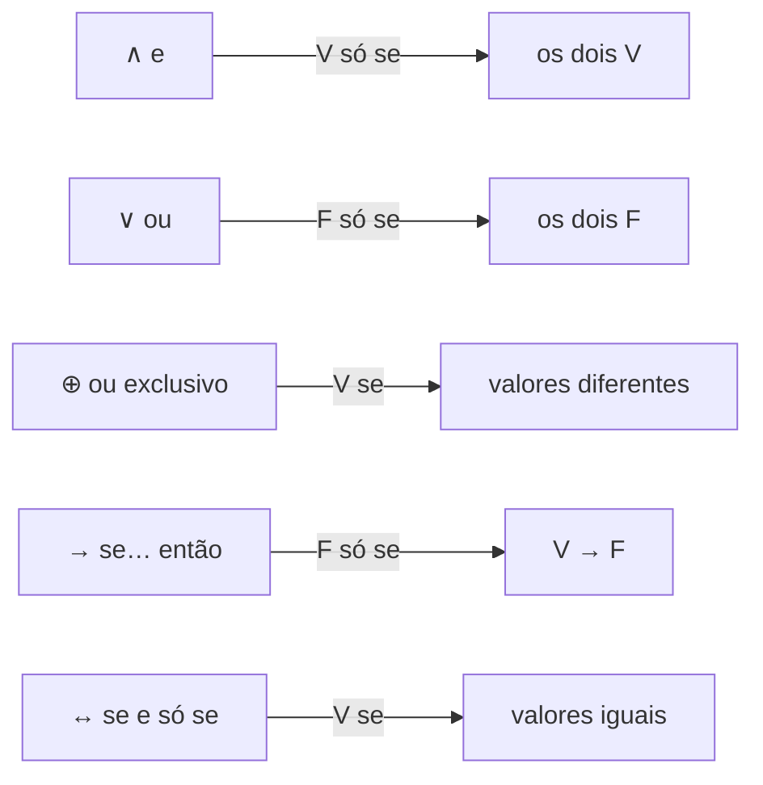

## O que é

Uma **proposição** é uma **sentença declarativa** que pode ser classificada como **verdadeira (V)** ou **falsa (F)** — nunca as duas ao mesmo tempo (princípio da não contradição) e sempre uma delas (terceiro excluído).

- "Brasília é a capital do Brasil." → proposição (V).
- "2 + 2 = 5." → proposição (F).
- "Que horas são?", "Feche a porta!", "x > 3" → **não** são proposições (pergunta, ordem, sentença aberta).

Proposições **simples** são representadas por letras (p, q, r); **compostas** combinam simples por meio de **conectivos**.

## Para que serve

A lógica proposicional é a base de **condições em programas** (`if`, `while`), **circuitos digitais**, **consultas** em bancos de dados, **especificação** de regras de negócio e das questões de raciocínio lógico do ENADE.

## Como funciona

### Conectivos

| Conectivo | Símbolo | Leitura | É verdadeiro quando… |
|---|---|---|---|
| Negação | ¬p, ~p | não p | p é **falso** |
| Conjunção | p ∧ q | p **e** q | **ambos** são V |
| Disjunção (inclusiva) | p ∨ q | p **ou** q | **pelo menos um** é V |
| Disjunção exclusiva | p ⊕ q, p ⊻ q | **ou** p **ou** q | **exatamente um** é V |
| Condicional | p → q | **se** p **então** q | **só é F quando p é V e q é F** |
| Bicondicional | p ↔ q | p **se e somente se** q | p e q têm o **mesmo** valor |

### Tabela-verdade completa

| p | q | ¬p | p ∧ q | p ∨ q | p ⊕ q | p → q | p ↔ q |
|---|---|---|---|---|---|---|---|
| V | V | F | V | V | F | **V** | V |
| V | F | F | F | V | V | **F** | F |
| F | V | V | F | V | V | **V** | F |
| F | F | V | F | F | F | **V** | V |

Com *n* proposições simples, a tabela tem **2ⁿ linhas**.

:::tip Condicional: a promessa
"Se chover, levo guarda-chuva." Só há **mentira** se **chover e eu não levar**. Se não chover, a promessa não foi quebrada, leve eu o guarda-chuva ou não. Por isso p → q é verdadeira sempre que p é falsa.
:::

Na condicional p → q, **p** é o **antecedente** (condição suficiente) e **q** o **consequente** (condição necessária).

### Precedência

**¬** → **∧** → **∨** (e ⊕) → **→** → **↔**. Assim, `¬p ∨ q ∧ r` = `(¬p) ∨ (q ∧ r)`. Na álgebra booleana: `~` (NÃO), `*` (E), `+` (OU), com a mesma precedência.

### Formalização

1. Identifique as proposições simples e dê letras a elas.
2. Encontre os conectivos ("e", "mas" = ∧; "ou"; "se… então"; "somente se"; "se e somente se").
3. Use parênteses conforme a estrutura da frase.

"Se Maria for ao aniversário, João irá e ficará feliz" → p: Maria vai; q: João vai; r: João fica feliz → **p → (q ∧ r)**.

:::warning "Mas" é conjunção
"Ele estudou, mas não passou" = estudou ∧ ¬passou.
:::

## Características principais

- Toda proposição composta tem valor determinado pelos valores das simples (função de verdade).
- Conectivos ∧, ∨, ⊕, ↔ são **comutativos**; a condicional **não é** (p → q ≠ q → p).

## Exemplos práticos

Monte qualquer tabela no simulador. Experimente `p -> q`, `~q -> ~p` e `~p | q` e compare as últimas colunas.

::widget truth-table expr="(p -> q) & (q -> r)"

## Representação visual

## Diferenças entre conceitos semelhantes

- **Disjunção inclusiva × exclusiva:** "ou" inclusivo aceita ambos verdadeiros; "ou… ou…" exclusivo exige **exatamente um**.
- **Condicional × bicondicional:** → só garante o sentido de ida; ↔ garante ida **e** volta.
- **"p somente se q" × "p se q":** "p somente se q" = **p → q**; "p se q" = **q → p**.
- **Proposição × sentença aberta:** "x > 3" depende de x — só vira proposição com um valor ou com um **quantificador** (veja [Argumentação e quantificadores](lib:argumentacao-e-quantificadores)).

## Como cai no ENADE

:::enade
Formalizar frases longas (2008), identificar a fórmula booleana equivalente a uma tabela-verdade (2017), avaliar condições de programas com E/OU (2017, 2021) e usar a falsidade da condicional (2014).
:::

## Pegadinhas

:::trap A condicional só é falsa em V → F
Se a questão diz que "se p, então q" é **falsa**, conclua com certeza: **p é V e q é F**.
:::

:::trap Precedência na álgebra booleana
`~p + q * r` significa `(~p) + (q * r)`, não `(~p + q) * r`.
:::

## Questões comentadas

::question 2017-objective-10 Fórmula com a mesma tabela-verdade de G

Quando p é falso, G é verdadeira em todas as linhas (sugere **~p** em uma disjunção). Quando p é verdadeiro, G só é V se q e r forem V (**q * r**). Logo G = **~p + q * r** (alternativa C).

::question 2014-objective-35 A declaração do José era falsa

"Se X venceu, então Y é campeão" é falsa somente quando o antecedente é V e o consequente é F: **X venceu e Y não é campeão** (alternativa B).

::question 2008-objective-29 Formalizar uma sentença composta

Atribua letras às proposições simples, troque "e/mas" por ∧, "ou" por ∨ e "se… então" por →, respeitando os agrupamentos indicados pelas vírgulas.

## Resumo para memorizar

:::summary
- Proposição = declarativa, **V ou F**.
- ∧ (V se ambos V), ∨ (F se ambos F), ⊕ (V se diferentes), → (**F só em V → F**), ↔ (V se iguais).
- 2ⁿ linhas. Precedência: ¬, ∧, ∨, →, ↔.
- "Mas" = e; "somente se" indica o consequente.
:::

:::mnemonic Condicional
"**V**ai **F**alhar": a única linha falsa de p → q é **V → F** — a promessa feita (V) e não cumprida (F).
:::

## Miniquestionário

:::quiz
[
  {
    "question": "Se p é falsa e q é verdadeira, qual é o valor de p → q?",
    "options": ["Verdadeiro", "Falso", "Indeterminado", "Depende de r"],
    "answer": 0,
    "explanation": "Com antecedente falso, a condicional é verdadeira."
  },
  {
    "question": "Quantas linhas tem a tabela-verdade de uma proposição com p, q, r e s?",
    "options": ["4", "8", "16", "32"],
    "answer": 2,
    "explanation": "2⁴ = 16."
  },
  {
    "question": "Qual sentença é uma proposição?",
    "options": ["Estude lógica!", "x + 1 = 5", "O Sol é uma estrela.", "Você vai à aula?"],
    "answer": 2,
    "explanation": "É declarativa e tem valor lógico definido. 'x + 1 = 5' é sentença aberta."
  },
  {
    "question": "p ⊕ q é verdadeira quando:",
    "options": ["p e q são ambas verdadeiras", "p e q têm valores diferentes", "p e q são ambas falsas", "sempre"],
    "answer": 1,
    "explanation": "Disjunção exclusiva: exatamente uma é verdadeira."
  }
]
:::

## Referências

- ALENCAR FILHO, E. *Iniciação à Lógica Matemática*. Nobel, 2002.
- GERSTING, J. L. *Fundamentos Matemáticos para a Ciência da Computação*. 7. ed. LTC, 2017 — cap. 1.
- ROSEN, K. H. *Matemática Discreta e suas Aplicações*. 6. ed. McGraw-Hill, 2009 — cap. 1.
- INEP. ENADE TADS 2008 (questão 29), 2014 (questão 35) e 2017 (questão 10).
