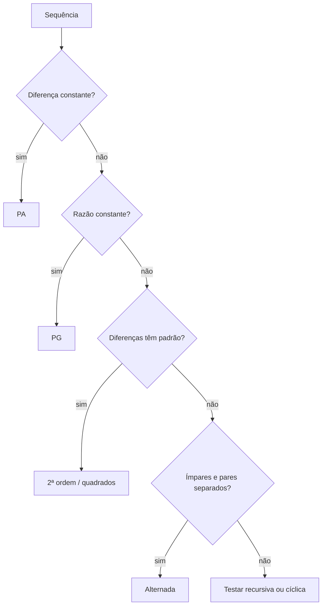

## O que é

Uma **sequência lógica** é uma lista ordenada de elementos (números, letras, figuras) gerada por uma **regra**. O desafio é **descobrir a regra** e prever o próximo termo ou um termo distante.

## Para que serve

Treina o raciocínio indutivo usado em programação (laços, recursões), análise de dados (tendências) e é recorrente em questões de raciocínio lógico de concursos e da formação geral.

## Como funciona

### Método em cinco perguntas

1. **Diferenças** entre termos vizinhos são constantes? → **PA**.
2. **Razões** (divisões) entre vizinhos são constantes? → **PG**.
3. As diferenças formam **outra sequência** com padrão? → diferenças de segunda ordem (ex.: quadrados).
4. Os termos de posição **ímpar** e **par** seguem regras separadas? → sequência **alternada**.
5. Cada termo depende dos **anteriores**? → **recursiva** (Fibonacci).

### Progressão aritmética (PA)

Soma-se sempre a mesma **razão r**: 3, 7, 11, 15… (r = 4).

$$a_n = a_1 + (n - 1) r \qquad S_n = \frac{(a_1 + a_n)\, n}{2}$$

### Progressão geométrica (PG)

Multiplica-se sempre pela mesma **razão q**: 2, 6, 18, 54… (q = 3).

$$a_n = a_1 \cdot q^{\,n-1} \qquad S_n = a_1 \frac{q^n - 1}{q - 1}$$

### Outras famílias

- **Quadrados/cubos:** 1, 4, 9, 16, 25 (n²); diferenças 3, 5, 7, 9 (segunda diferença constante = 2).
- **Fibonacci:** 0, 1, 1, 2, 3, 5, 8, 13 — cada termo é a soma dos dois anteriores.
- **Alternadas:** 2, 10, 4, 20, 6, 30 — ímpares 2, 4, 6 (+2); pares 10, 20, 30 (+10).
- **Letras:** converta em posições do alfabeto (A = 1, B = 2…). A, C, F, J, O → 1, 3, 6, 10, 15 (+2, +3, +4, +5).
- **Cíclicas:** padrões que se repetem; use o **resto da divisão** pelo tamanho do ciclo para achar termos distantes (o 100º termo de um ciclo de 7 é o de posição 100 mod 7 = 2).

## Características principais

- A mesma sequência curta pode admitir mais de uma regra; escolha a **mais simples** que explique todos os termos dados.
- Verifique a regra em **todos** os termos, não só nos dois primeiros.

## Exemplos práticos

:::example Termo distante de uma PA
Em 5, 8, 11, 14…, qual é o 50º termo? a₅₀ = 5 + 49 × 3 = **152**.
:::

:::example Ciclo de dias
Hoje é segunda-feira. Que dia será daqui a 100 dias? 100 mod 7 = 2 → **quarta-feira**.
:::

## Representação visual

## Diferenças entre conceitos semelhantes

- **PA × PG:** soma constante × multiplicação constante.
- **Sequência recursiva × termo geral:** a recursiva define a partir dos anteriores; o termo geral calcula diretamente pela posição.

## Como cai no ENADE

:::enade
Na formação geral e nas questões de raciocínio, sequências aparecem em leitura de dados (crescimento linear × exponencial) e em algoritmos que geram séries (Fibonacci recursivo).
:::

## Pegadinhas

:::trap Não pare no segundo termo
2, 4, 8 pode ser PG (×2 → 16) ou diferenças crescentes (+2, +4 → 14). Procure mais pistas no enunciado.
:::

## Questões comentadas

::question 2008-objective-27 Fibonacci como sequência recursiva

A sequência de Fibonacci é definida recursivamente (F(n) = F(n−1) + F(n−2)); a questão explora o custo dessa definição quando implementada de forma recursiva ingênua.

## Resumo para memorizar

:::summary
- PA: aₙ = a₁ + (n − 1)r; Sₙ = (a₁ + aₙ)n/2.
- PG: aₙ = a₁·qⁿ⁻¹.
- Teste: diferenças → razões → segunda ordem → alternada → recursiva/cíclica.
- Letras → posições no alfabeto; ciclos → resto da divisão.
:::

## Miniquestionário

:::quiz
[
  {
    "question": "Qual é o próximo termo de 1, 4, 9, 16, 25, ...?",
    "options": ["30", "36", "35", "49"],
    "answer": 1,
    "explanation": "São quadrados perfeitos: 6² = 36."
  },
  {
    "question": "Qual é o 10º termo da PA 2, 5, 8, ...?",
    "options": ["29", "32", "30", "27"],
    "answer": 0,
    "explanation": "a₁₀ = 2 + 9 × 3 = 29."
  },
  {
    "question": "Qual é o próximo termo de 3, 6, 12, 24, ...?",
    "options": ["36", "48", "30", "27"],
    "answer": 1,
    "explanation": "PG de razão 2."
  }
]
:::

## Referências

- IEZZI, G.; HAZZAN, S. *Fundamentos de Matemática Elementar 4: sequências, matrizes, determinantes e sistemas*. 8. ed. Atual, 2013.
- MORGADO, A. C.; CARVALHO, P. C. P. *Matemática Discreta*. 2. ed. SBM, 2015 (Coleção PROFMAT).
