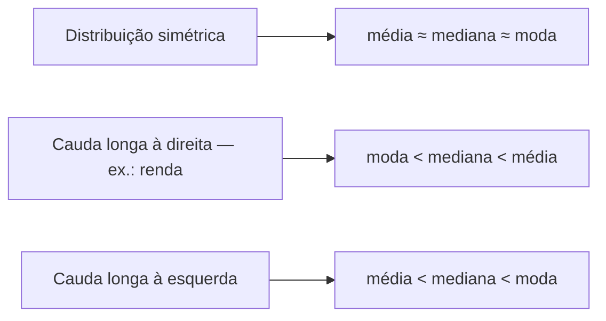

## O que é

**Estatística descritiva** resume conjuntos de dados com números e gráficos. Dois tipos de medida:

- **Tendência central:** onde os dados "se concentram" — **média**, **mediana**, **moda**.
- **Dispersão:** o quanto os dados "se espalham" — **amplitude**, **variância**, **desvio padrão**, **quartis**.

## Para que serve

Interpretar pesquisas, avaliações de satisfação, indicadores de desempenho, tempos de resposta de sistemas e notas — e evitar conclusões enganosas (uma média alta pode esconder grande desigualdade).

## Como funciona

### Média aritmética

$$\bar{x} = \frac{\sum x_i}{n}$$

**Média ponderada** (com frequências ou pesos): $\bar{x} = \frac{\sum x_i \cdot f_i}{\sum f_i}$.

### Mediana

Valor **central** dos dados **ordenados**. Com *n* ímpar, é o termo da posição (n + 1)/2; com *n* par, é a **média dos dois centrais**. Não é afetada por valores extremos (*outliers*).

### Moda

Valor **mais frequente**. Pode não existir (**amodal**), ser única ou haver várias (**bimodal**, multimodal).

### Quartis e amplitude

- **Q1** (25%), **Q2 = mediana** (50%), **Q3** (75%) dividem os dados ordenados em quatro partes.
- **Amplitude total** = máximo − mínimo. **Intervalo interquartil** = Q3 − Q1.

### Variância e desvio padrão

$$\sigma^2 = \frac{\sum (x_i - \bar{x})^2}{n} \quad \text{(populacional)} \qquad s^2 = \frac{\sum (x_i - \bar{x})^2}{n - 1} \quad \text{(amostral)}$$

$$\sigma = \sqrt{\sigma^2}$$

O desvio padrão está na **mesma unidade** dos dados e indica a distância típica até a média.

::widget stats-calculator values="7 8 6 9 7 10 5 7"

## Características principais

| Medida | Sensível a extremos? | Quando preferir |
|---|---|---|
| Média | **sim** | dados simétricos, sem outliers |
| Mediana | não | renda, preços de imóveis, dados assimétricos |
| Moda | não | dados categóricos (cor mais vendida) |
| Desvio padrão | sim | comparar dispersão em torno da média |

## Exemplos práticos

:::example Pesquisa de satisfação (ENADE 2017)
| Nota | 3 | 4 | 5 | 6 | 7 | 8 | 9 |
|---|---|---|---|---|---|---|---|
| Clientes | 1 | 2 | 2 | 2 | 2 | 2 | 1 |

- n = 12; soma = 3 + 8 + 10 + 12 + 14 + 16 + 9 = 72 → **média = 6,0**.
- Ordenados, os 6º e 7º valores são 6 e 6 → **mediana = 6,0**.
- Notas 4, 5, 6, 7 e 8 empatam com 2 clientes → **multimodal**, não amodal.
- Desvios ao quadrado: 9 + 2·4 + 2·1 + 0 + 2·1 + 2·4 + 9 = 38 → σ² = 38/12 ≈ 3,17 → **σ ≈ 1,78** (< 3).
- A nota 3 é a menor: está no **1º quartil**.
:::

## Representação visual

## Vantagens e desvantagens

| Medida | Vantagem | Limitação |
|---|---|---|
| Média | usa todos os valores | distorcida por outliers |
| Mediana | robusta | ignora a magnitude dos extremos |
| Desvio padrão | interpretável na unidade dos dados | também sensível a outliers |

## Diferenças entre conceitos semelhantes

- **Populacional × amostral:** divide por **n** (todos os elementos) × **n − 1** (amostra, para não subestimar a variância).
- **Variância × desvio padrão:** o desvio é a **raiz quadrada** da variância e volta à unidade original.
- **Amodal × multimodal:** nenhum valor se repete mais × vários empatados no topo.

## Como cai no ENADE

:::enade
Tabelas de frequência com itens sobre média, mediana, moda, desvio padrão e quartis (2017), além de leitura de dados na formação geral.
:::

## Pegadinhas

:::trap Ordene antes da mediana
A mediana é do conjunto **ordenado**, não do valor do meio da tabela.
:::

:::trap "Amodal" exige nenhuma repetição dominante
Se há valores empatados no topo, o conjunto é bimodal/multimodal.
:::

## Questões comentadas

::question 2017-objective-9 Notas de satisfação

O gabarito definitivo do Inep é **B (I, II e V)**: média 6,0, mediana 6,0 e a nota 3 no 1º quartil. **Atenção:** pelos dados impressos, o desvio padrão populacional ≈ 1,78 também é menor que 3, o que tornaria III verdadeira — nenhuma alternativa reúne I, II, III e V. O simulado mantém a resposta oficial, mas vale conhecer essa inconsistência.

## Resumo para memorizar

:::summary
- Média = soma ÷ n (ponderada com frequências). Mediana = centro dos **ordenados**. Moda = mais frequente.
- Q1, Q2 (mediana), Q3; amplitude = máx − mín.
- σ² = Σ(xᵢ − média)² ÷ n (amostra: ÷ (n − 1)); σ = √σ².
- Renda e dados assimétricos → prefira a **mediana**.
:::

## Miniquestionário

:::quiz
[
  {
    "question": "Qual a mediana de 3, 9, 1, 7, 5?",
    "options": ["5", "7", "9", "4"],
    "answer": 0,
    "explanation": "Ordenados: 1, 3, 5, 7, 9 → o central é 5."
  },
  {
    "question": "Qual medida é menos afetada por um valor muito alto (outlier)?",
    "options": ["Média", "Mediana", "Variância", "Desvio padrão"],
    "answer": 1,
    "explanation": "A mediana depende só da posição central."
  },
  {
    "question": "Dados 2, 4, 6 (população). Qual é a variância?",
    "options": ["2", "8/3 ≈ 2,67", "4", "1,63"],
    "answer": 1,
    "explanation": "Média 4; desvios² 4, 0, 4 → 8/3."
  }
]
:::

## Referências

- BUSSAB, W. O.; MORETTIN, P. A. *Estatística Básica*. 9. ed. Saraiva, 2017.
- TRIOLA, M. F. *Introdução à Estatística*. 12. ed. LTC, 2017.
- INEP. ENADE TADS 2017, questão 9.
