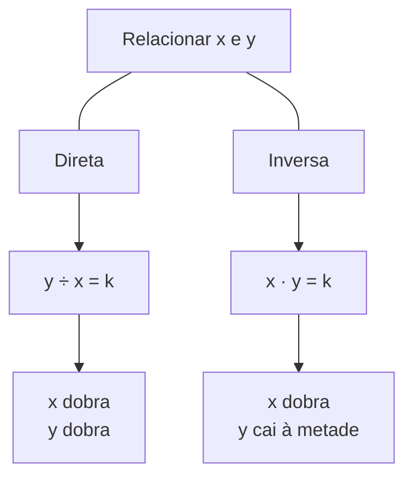

## O que é

- **Fração** a/b: parte de um todo dividido em *b* partes iguais.
- **Porcentagem** (%): fração de denominador 100 — 25% = 25/100 = 0,25.
- **Razão**: comparação entre duas grandezas por divisão (a : b).
- **Proporção**: igualdade entre duas razões: a/b = c/d (⇔ a·d = b·c).
- **Regra de três**: método para achar um valor desconhecido em grandezas proporcionais.

## Para que serve

Estão em quase toda questão de formação geral com dados (taxas, crescimento, consumo de energia, distribuição de renda) e em problemas de negócio (descontos, margens, ROI).

## Como funciona

### Porcentagem como fator multiplicativo

- *x*% **de** um valor: valor × x/100. 15% de 240 = 0,15 × 240 = **36**.
- **Aumento** de *x*%: multiplique por (1 + x/100). +20% → × 1,20.
- **Desconto** de *x*%: multiplique por (1 − x/100). −20% → × 0,80.
- **Variações sucessivas multiplicam:** +10% e depois −10% → 1,10 × 0,90 = 0,99 → **−1%** (não volta ao original!).
- **Variação percentual:** (final − inicial) ÷ inicial × 100.

### Ponto percentual (p.p.)

Diferença entre duas porcentagens: a taxa passou de 10% para 12% → aumento de **2 p.p.**, que é um aumento **relativo** de **20%**.

### Frações e decimais

Simplifique (6/8 = 3/4), transforme (3/4 = 0,75 = 75%), compare pondo no mesmo denominador. Para dividir por uma fração, multiplique pelo inverso.

### Grandezas proporcionais

- **Diretamente proporcionais:** uma dobra, a outra dobra (consumo e tempo de uso).
- **Inversamente proporcionais:** uma dobra, a outra cai pela metade (número de máquinas e tempo para terminar o serviço).

### Regra de três simples

1. Monte a tabela com as grandezas em colunas.
2. Verifique se são direta ou inversamente proporcionais.
3. Direta: multiplique **em cruz**. Inversa: **inverta** uma das razões antes.

:::example Regra de três inversa
6 pedreiros fazem um muro em 10 dias. Em quantos dias 4 pedreiros fazem o mesmo muro? Menos pedreiros → **mais** dias (inversa): 6 × 10 = 4 × x → **x = 15 dias**.
:::

### Regra de três composta

Com três ou mais grandezas: compare cada grandeza com a incógnita, ajuste as razões inversas e multiplique.

## Características principais

- Sempre identifique **o todo** de referência da porcentagem ("% de quê?").
- Aumentos e descontos sucessivos não se somam; **multiplicam**.

## Exemplos práticos

:::example Fator de proteção solar (ENADE 2008)
Um protetor que **retém 95%** deixa passar 5% = 0,05 = 1/20. Pela definição (FPS 10 deixa passar 1/10), o **FPS é 20**.
:::

:::example Conta de luz (ENADE 2017)
Lâmpada incandescente (0,300 kWh/dia) × LED (0,040 kWh/dia): diferença de 0,260 kWh/dia. Em 30 dias: 7,8 kWh. Com tarifa de R$ 0,50/kWh: 7,8 × 0,50 = **R$ 3,90** de economia por mês.
:::

## Representação visual

O fator multiplicativo aplica a variação percentual à base sobre a qual a taxa foi definida.

| Situação | Fator |
|---|---|
| Aumento de 5% | × 1,05 |
| Aumento de 50% | × 1,50 |
| Redução de 30% | × 0,70 |
| Dobrar | × 2 |
| Reduzir à metade | × 0,50 |

Escolha a razão ou o produto que permanece constante para os pares de valores. No ENADE, use essa constante para determinar o valor desconhecido e confirme se, para grandezas positivas, dobrar uma grandeza deve dobrar ou reduzir à metade a outra.

Fonte: adaptado de ABRAMSON (2021, seção 5.8) — recriado pela equipe Stacklyst.

## Diferenças entre conceitos semelhantes

- **Porcentagem × ponto percentual:** relativo × diferença absoluta entre taxas.
- **Razão × proporção:** uma comparação × igualdade de duas comparações.
- **Desconto de 50% + 50% ≠ 100%:** 0,5 × 0,5 = 0,25 → desconto total de 75%.

## Como cai no ENADE

:::enade
Formação geral com tabelas e gráficos (consumo, renda, deslocamento, desmatamento) exigindo porcentagens, comparação de proporções e cálculos de consumo e custo.
:::

## Pegadinhas

:::trap Reter × deixar passar
"Retém 95%" significa que **passa 5%**; o cálculo usa o que passa.
:::

:::trap Porcentagem de grupos diferentes não se soma
30% dos homens e 40% das mulheres não dão 70% da população.
:::

## Questões comentadas

::question 2008-objective-3 FPS de um protetor que retém 95%

Passam 5% = 1/20 dos raios; FPS = **20** (alternativa D).

::question 2017-objective-3 Bandeiras tarifárias e consumo

Calcule a diferença diária em kWh, multiplique por 30 dias e pela tarifa: trocar a lâmpada incandescente pela de LED economiza **R$ 3,90** por mês (afirmação III, a única correta).

## Resumo para memorizar

:::summary
- x% = x/100; aumento × (1 + x/100); desconto × (1 − x/100).
- Variações sucessivas **multiplicam**.
- p.p. = diferença entre taxas.
- Regra de três: direta → cruz; inversa → inverta antes.
:::

## Miniquestionário

:::quiz
[
  {
    "question": "Um produto de R$ 200 sobe 10% e depois cai 10%. Qual o preço final?",
    "options": ["R$ 200", "R$ 198", "R$ 202", "R$ 180"],
    "answer": 1,
    "explanation": "200 × 1,10 × 0,90 = 198."
  },
  {
    "question": "A taxa de desemprego passou de 8% para 10%. Houve aumento de:",
    "options": ["2%", "2 pontos percentuais (25% relativos)", "20 pontos percentuais", "10%"],
    "answer": 1,
    "explanation": "10 − 8 = 2 p.p.; em termos relativos, 2/8 = 25%."
  },
  {
    "question": "3 impressoras imprimem um lote em 12 horas. Quantas horas levam 4 impressoras iguais?",
    "options": ["16", "9", "8", "15"],
    "answer": 1,
    "explanation": "Inversa: 3 × 12 = 4 × x → x = 9."
  }
]
:::

## Referências

- IEZZI, G.; HAZZAN, S.; DEGENSZAJN, D. *Fundamentos de Matemática Elementar 11: matemática comercial, financeira e estatística descritiva*. 2. ed. Atual, 2013.
- DANTE, L. R. *Matemática: contexto e aplicações*. Ática, 2016.
- INEP. ENADE TADS 2008 (questão 3) e 2017 (questão 3).
- ABRAMSON, Jay. *College algebra*. 2. ed. Houston: OpenStax, 2021. Disponível em: [OpenStax](https://openstax.org/details/books/college-algebra-2e). Acesso em: 25 nov. 2026.
