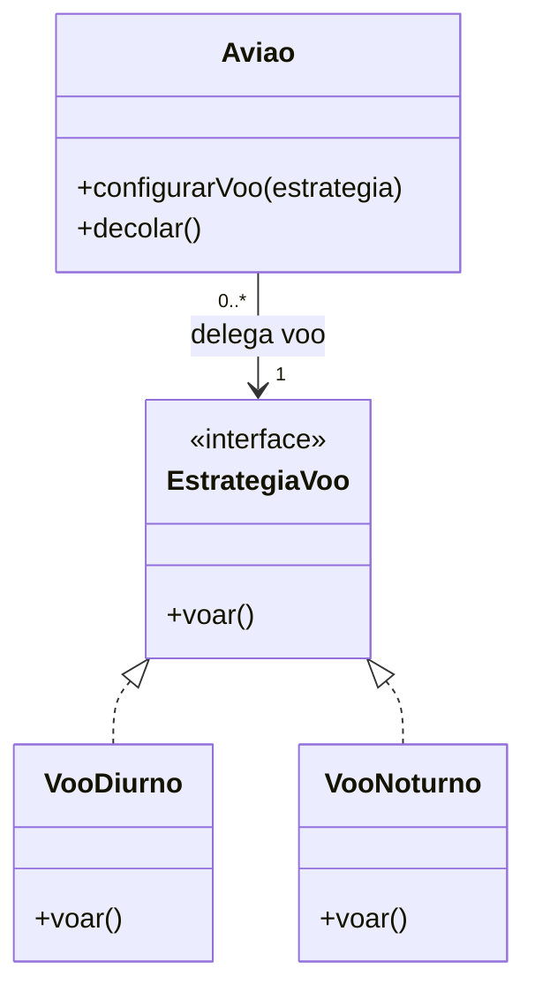
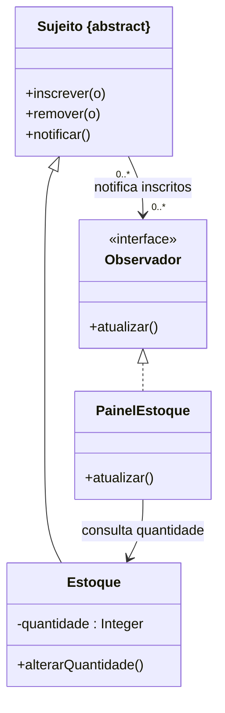

## O que é

Um **padrão de projeto** é uma **solução reutilizável, nomeada e documentada** para um **problema recorrente** de design orientado a objetos, em um determinado contexto. Não é código pronto: é uma **receita de estrutura** (classes, interfaces e colaborações).

O catálogo clássico é o livro *Design Patterns* (1994), de Gamma, Helm, Johnson e Vlissides — a **"Gangue dos Quatro" (GoF)** — com **23 padrões** em três famílias:

| Família | Propósito | Padrões |
|---|---|---|
| **Criacionais** | **como objetos são criados** | Abstract Factory, Builder, Factory Method, Prototype, Singleton |
| **Estruturais** | **como classes e objetos se compõem** | Adapter, Bridge, Composite, Decorator, Facade, Flyweight, Proxy |
| **Comportamentais** | **como objetos interagem e distribuem responsabilidades** | Chain of Responsibility, Command, Interpreter, Iterator, Mediator, Memento, Observer, State, Strategy, Template Method, Visitor |

## Para que serve

- **Vocabulário comum** ("aqui usamos um Observer") que acelera a comunicação;
- Soluções **testadas** que respeitam princípios como "programe para uma interface" e "prefira composição a herança";
- Código mais **flexível** e **extensível**.

## Como funciona

### Criacionais

**Singleton** — garante **uma única instância** de uma classe com **ponto de acesso global**.
```java
public final class Configuracao {
    private static final Configuracao INSTANCIA = new Configuracao();
    private Configuracao() {}                       // construtor privado
    public static Configuracao getInstancia() { return INSTANCIA; }
}
```

**Factory Method** — define uma interface para criar um objeto, mas deixa as **subclasses decidirem** qual classe concreta instanciar (usa **herança**).

**Abstract Factory** — interface para criar **famílias de objetos relacionados** sem especificar as classes concretas; o sistema fica **independente de como seus produtos são criados, compostos e representados** (ex.: fábrica de componentes de tela "Windows" × "Mac").

**Builder** — separa a **construção** de um objeto complexo da sua **representação**, montando-o **passo a passo** (`new Pedido.Builder().cliente(c).item(i).frete(f).build()`).

**Prototype** — cria novos objetos **clonando** um protótipo existente.

### Estruturais

**Adapter** — converte a interface de uma classe em outra que o cliente espera (um "adaptador de tomada" entre uma biblioteca de pagamentos e o seu sistema).

**Facade** — oferece uma **interface simplificada** para um subsistema complexo (`CheckoutFacade.finalizar()` chama estoque, pagamento e nota fiscal).

**Composite** — compõe objetos em **árvores** e trata objetos individuais e composições **da mesma forma** (arquivos e pastas; itens e combos).

**Decorator** — acrescenta responsabilidades a um objeto **dinamicamente**, envolvendo-o (streams de E/S em Java: `new BufferedReader(new FileReader(...))`).

**Proxy** — substituto que **controla o acesso** a outro objeto (carregamento preguiçoso, cache, segurança).

### Comportamentais

**Strategy** — define uma **família de algoritmos**, encapsula cada um e os torna **intercambiáveis**; o algoritmo varia independentemente de quem o usa.
```typescript
interface EstrategiaVoo { voar(): string }
class VoarDia implements EstrategiaVoo { voar() { return 'Voar durante o dia.' } }
class VoarNoite implements EstrategiaVoo { voar() { return 'Voar durante a noite.' } }
class Aviao {
  constructor(private voo: EstrategiaVoo) {}
  setVoar(voo: EstrategiaVoo) { this.voo = voo }   // troca em tempo de execução
  decolar() { return this.voo.voar() }
}
```

**Observer** — quando um objeto (sujeito) muda de estado, todos os **observadores inscritos são notificados** automaticamente (eventos de interface, assinaturas).

**Template Method** — define o **esqueleto de um algoritmo** em um método da superclasse e deixa **subclasses** redefinirem alguns passos.

**Command** — encapsula uma **requisição como objeto**, permitindo filas, histórico e **desfazer**.

**State** — o objeto muda seu comportamento quando seu **estado interno** muda (cada estado é uma classe).

**Iterator** — percorre uma coleção sem expor sua estrutura interna.

## Características principais

Cada padrão é descrito por: **nome**, **problema** (quando aplicar), **solução** (estrutura e colaborações) e **consequências** (custos e benefícios). Padrões de **classe** usam herança (Factory Method, Template Method); padrões de **objeto** usam composição/delegação (Abstract Factory, Strategy, Decorator).

## Exemplos práticos

:::example Reconhecendo padrões pela intenção
| Situação | Padrão |
|---|---|
| "só pode existir um pool de conexões" | Singleton |
| "trocar o algoritmo de cálculo de frete em tempo de execução" | Strategy |
| "integrar uma biblioteca com interface incompatível" | Adapter |
| "notificar várias telas quando o estoque mudar" | Observer |
| "montar um objeto com muitos parâmetros opcionais" | Builder |
| "criar uma família de componentes de UI por tema" | Abstract Factory |
| "uma API simples na frente de vários serviços" | Facade |
:::

## Representação visual



Fonte: adaptado de GAMMA et al. (2000, cap. 5) — recriado pela equipe Stacklyst.

Comece pelo avião, que delega a operação de voo ao contrato da estratégia. Troque a estratégia concreta e observe que a chamada continua a mesma. No ENADE, essa delegação é a pista para reconhecer uma família de algoritmos intercambiáveis.



Fonte: adaptado de GAMMA et al. (2000, cap. 5) — recriado pela equipe Stacklyst.

A classe Estoque especializa o sujeito e guarda o estado. Ao notificar, o sujeito chama o contrato comum dos observadores inscritos. No ENADE, observe como a mudança em um sujeito aciona a atualização de vários observadores.

## Vantagens e desvantagens

| Vantagens | Desvantagens |
|---|---|
| soluções comprovadas e vocabulário comum | aplicar sem necessidade aumenta a complexidade |
| flexibilidade e extensão | mais classes e indireção |
| aplicam bons princípios (SOLID) | Singleton em excesso vira estado global difícil de testar |

## Diferenças entre conceitos semelhantes

| Confusão | Diferença |
|---|---|
| Factory Method × Abstract Factory | o primeiro cria **um produto** via **subclasse**; o segundo cria **famílias** de produtos via **objeto fábrica** |
| Builder × Abstract Factory | Builder monta **um objeto complexo passo a passo**; Abstract Factory cria **vários objetos relacionados** |
| Strategy × State | ambos trocam objetos internos; no State a troca é **dirigida pelo próprio estado**; no Strategy, pelo **cliente** |
| Adapter × Facade | Adapter **converte** uma interface existente; Facade **simplifica** um subsistema |
| Decorator × herança | Decorator acrescenta comportamento **em tempo de execução** e combina camadas |

## Como cai no ENADE

:::enade
"O padrão X é usado quando…" (2011: **Abstract Factory** — sistema independente de como produtos são criados, compostos e representados) e interpretação de diagramas/código com **Strategy** (2017).
:::

## Pegadinhas

:::trap Cada alternativa costuma descrever outro padrão
Em "Abstract Factory é usado quando…", as erradas descrevem **Builder** (algoritmo de criação independente das partes), **Singleton** (instância única), **Factory Method** (delegar a subclasses) e **Prototype** (classes definidas em execução).
:::

:::trap Classes que implementam interfaces não viram interfaces
`VoarDia implements Voar` é uma **classe concreta**.
:::

## Questões comentadas

::question 2011-objective-20 Quando usar Abstract Factory

Correta a **A**: quando o sistema deve ser **independente da maneira como seus produtos são criados, relacionados e representados**. B descreve Builder; C, Singleton; D, Factory Method; E, Prototype.

::question 2017-objective-27 Strategy no simulador de voo

`setVoar` e `setPousar` substituem as estratégias de dia pelas de noite em tempo de execução, mudando as saídas sem alterar a classe `Boeing757` (alternativa D). As classes `VoarDia`/`VoarNoite` implementam interfaces, mas **não são** interfaces.

## Resumo para memorizar

:::summary
- GoF = **23 padrões**: 5 criacionais, 7 estruturais, 11 comportamentais.
- Criacionais: **Singleton** (uma instância), **Factory Method** (subclasse decide), **Abstract Factory** (famílias), **Builder** (passo a passo), **Prototype** (clone).
- Estruturais: **Adapter** (converte), **Facade** (simplifica), **Composite** (árvore), **Decorator** (embrulha), **Proxy** (controla acesso).
- Comportamentais: **Strategy** (algoritmos intercambiáveis), **Observer** (notificação), **Template Method** (esqueleto), **Command** (requisição como objeto), **State**.
:::

## Miniquestionário

:::quiz
[
  {
    "question": "Qual padrão garante uma única instância de uma classe com acesso global?",
    "options": ["Prototype", "Singleton", "Facade", "Observer"],
    "answer": 1,
    "explanation": "Singleton: construtor privado e um método estático de acesso."
  },
  {
    "question": "Quando o estoque muda, cinco telas precisam ser atualizadas automaticamente. Qual padrão?",
    "options": ["Observer", "Builder", "Adapter", "Template Method"],
    "answer": 0,
    "explanation": "Observadores inscritos são notificados quando o sujeito muda."
  },
  {
    "question": "Uma biblioteca de pagamento tem interface diferente da que o sistema espera. Qual padrão resolve?",
    "options": ["Decorator", "Adapter", "Singleton", "Composite"],
    "answer": 1,
    "explanation": "O Adapter converte a interface existente na esperada pelo cliente."
  }
]
:::

## Referências

- GAMMA, E.; HELM, R.; JOHNSON, R.; VLISSIDES, J. *Padrões de projeto*: soluções reutilizáveis de software orientado a objetos. Porto Alegre: Bookman, 2000.
- FREEMAN, E.; ROBSON, E. *Use a Cabeça! Padrões de Projetos*. 2. ed. Alta Books, 2021.
- LARMAN, C. *Utilizando UML e Padrões*. 3. ed. Bookman, 2007.
- REFACTORING.GURU. *Padrões de projeto*. Disponível em refactoring.guru/pt-br/design-patterns.
- INEP. ENADE TADS 2011 (questão 20) e 2017 (questão 27).
