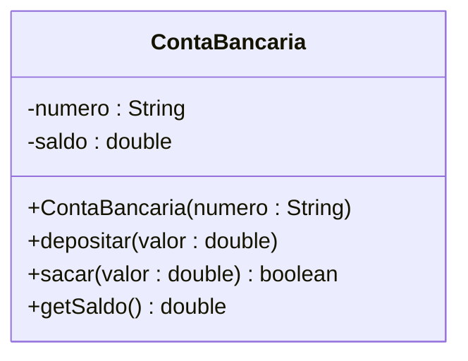

## O que é

**Programação orientada a objetos (POO)** é um paradigma em que o programa é organizado em **objetos** que **guardam dados (estado)** e **oferecem comportamentos (métodos)**, e que colaboram **trocando mensagens**. Os quatro pilares mais citados são **abstração, encapsulamento, herança e polimorfismo** (os dois últimos estão em [Herança e polimorfismo](lib:heranca-e-polimorfismo)).

:::definition Classe × objeto
- **Classe**: o **molde** — define quais atributos e métodos os objetos terão. Ex.: `ContaBancaria`.
- **Objeto (instância)**: uma **ocorrência concreta** criada a partir da classe, com valores próprios. Ex.: a conta nº 123 da Ana, com saldo R$ 500.
:::

## Para que serve

- **Modelar** o problema com conceitos do mundo real (Cliente, Pedido, Produto), aproximando código e negócio;
- **Proteger** dados contra uso indevido (encapsulamento);
- **Reutilizar** e **estender** código (herança, composição);
- **Facilitar manutenção**: mudanças ficam localizadas em classes com responsabilidades claras.

## Como funciona

### Atributos e métodos

- **Atributos** (campos, propriedades): os **dados** que descrevem o estado do objeto (`saldo`, `titular`).
- **Métodos** (operações): o **comportamento** — o que o objeto sabe fazer (`depositar`, `sacar`).
- **Mensagem**: a chamada de um método em um objeto (`conta.depositar(100)`). Um programa OO em execução é uma troca de mensagens; o **método** determina como o objeto reage.
- **Atributos/métodos de classe (static)**: pertencem à classe, não a cada objeto (`Conta.taxaPadrao`).

### Construtores

Método especial executado **na criação** do objeto para colocá-lo em um **estado inicial válido**. Tem o nome da classe (Java), `constructor` (TypeScript) ou `__init__` (Python). Uma classe pode ter **vários construtores** (sobrecarga) em linguagens como Java.

### Abstração

Representar apenas as características **relevantes** para o problema, ignorando detalhes. Uma `ContaBancaria` em um sistema de banco tem número e saldo; não precisa da cor do cartão. Também é abstração esconder **como** algo é feito e mostrar só **o que** faz (a interface pública).

### Encapsulamento

**Esconder o estado interno** e permitir acesso apenas por **métodos** que garantem as regras. Assim ninguém deixa o saldo negativo "por fora".

| Modificador (Java) | Acesso |
|---|---|
| `private` | só dentro da **própria classe** |
| *(padrão / package)* | classes do **mesmo pacote** |
| `protected` | mesmo pacote **e subclasses** |
| `public` | **qualquer** classe |

### Em três linguagens

```java
public class ContaBancaria {
    private final String numero;
    private double saldo;                      // encapsulado

    public ContaBancaria(String numero) {     // construtor
        this.numero = numero;
    }
    public ContaBancaria(String numero, double saldoInicial) { // sobrecarga
        this(numero);
        depositar(saldoInicial);
    }
    public void depositar(double valor) {
        if (valor <= 0) throw new IllegalArgumentException("Valor inválido");
        saldo += valor;
    }
    public boolean sacar(double valor) {
        if (valor > saldo) return false;      // regra protegida
        saldo -= valor;
        return true;
    }
    public double getSaldo() { return saldo; } // leitura controlada
}
```

```typescript
class ContaBancaria {
  #saldo = 0; // campo privado real (ES2022)
  constructor(private readonly numero: string) {}
  depositar(valor: number) {
    if (valor <= 0) throw new Error('Valor inválido');
    this.#saldo += valor;
  }
  get saldo() {
    return this.#saldo;
  }
}
const conta = new ContaBancaria('123');
conta.depositar(100);
```

```python
class ContaBancaria:
    def __init__(self, numero: str):
        self._numero = numero
        self.__saldo = 0.0          # "privado" por convenção/name mangling

    def depositar(self, valor: float) -> None:
        if valor <= 0:
            raise ValueError("Valor inválido")
        self.__saldo += valor

    @property
    def saldo(self) -> float:
        return self.__saldo
```

## Características principais

- **Identidade**: dois objetos com os mesmos valores continuam sendo objetos distintos.
- **Estado + comportamento** juntos, na mesma unidade.
- **Interface pública** pequena e **detalhes privados**.
- Objetos se comunicam por **mensagens**, não mexendo diretamente nos dados uns dos outros.

## Exemplos práticos

:::example Por que encapsular
Se `saldo` fosse público, qualquer parte do sistema poderia fazer `conta.saldo = -1000`. Com `private` e o método `sacar`, a regra "não pode sacar mais que o saldo" fica em **um só lugar** e é sempre respeitada.
:::

## Representação visual



::widget uml diagram=object

## Vantagens e desvantagens

| Vantagens | Desvantagens |
|---|---|
| código organizado em torno do domínio | hierarquias mal pensadas complicam |
| proteção do estado | mais "cerimônia" que scripts simples |
| reuso e extensão | desempenho levemente menor em alguns casos |

## Diferenças entre conceitos semelhantes

- **Classe × objeto × instância:** objeto e instância são sinônimos; classe é o molde.
- **Atributo × instância:** as **propriedades** de um objeto são **atributos** — não "instâncias" (pegadinha de 2011).
- **Abstração × encapsulamento:** abstração decide **o que** mostrar/modelar; encapsulamento **protege** como isso é guardado e alterado.
- **Método × mensagem:** a mensagem é a **chamada**; o método é o **código** que responde a ela.
- **Construtor × método comum:** o construtor só roda na **criação** e não tem tipo de retorno.

## Como cai no ENADE

:::enade
Itens conceituais: "propriedades de um objeto são chamadas de instâncias" (**falso**: são atributos), "private só é acessível na própria classe" (**verdadeiro**), "uma classe deve ter um único construtor" (**falso**: pode haver sobrecarga), encapsulamento e mensagens.
:::

## Pegadinhas

:::trap Uma classe pode ter vários construtores
Em Java, C++ e C#, construtores podem ser sobrecarregados (parâmetros diferentes).
:::

:::trap Encapsular não é só criar getters e setters
Getters/setters para tudo expõem o estado do mesmo jeito. Encapsular é oferecer **operações com significado** (`sacar`, `depositar`) que preservam as regras.
:::

## Questões comentadas

::question 2011-objective-35 Objetos, mensagens, herança e encapsulamento

**I** errada: propriedades de um objeto são **atributos**; instância é o próprio objeto. **II** correta: mensagens acionam métodos. **III** correta: herança permite programar só as diferenças. **IV** correta: encapsulamento restringe o acesso aos dados pelos métodos do objeto. Resposta: **II, III e IV**.

::question 2008-objective-32 Modificadores, construtores, classes abstratas e polimorfismo

**I** correta (private é acessível só na própria classe). **II** errada (construtores podem ser sobrecarregados). **III** errada (classe abstrata não tem instância direta). **IV** correta (polimorfismo substitui cadeias de `switch`). Resposta: **I e IV**.

## Resumo para memorizar

:::summary
- **Classe** = molde; **objeto/instância** = ocorrência concreta.
- **Atributos** = estado; **métodos** = comportamento; **mensagem** = chamada de método.
- **Construtor** inicializa o objeto; pode ser **sobrecarregado**.
- **Abstração** = só o essencial. **Encapsulamento** = estado privado + operações públicas.
- `private` < pacote < `protected` < `public`.
:::

## Miniquestionário

:::quiz
[
  {
    "question": "Como se chamam os dados que descrevem o estado de um objeto?",
    "options": ["Instâncias", "Atributos", "Mensagens", "Construtores"],
    "answer": 1,
    "explanation": "Atributos guardam o estado; instância é o objeto em si."
  },
  {
    "question": "Qual modificador em Java permite acesso apenas dentro da própria classe?",
    "options": ["public", "protected", "private", "default (pacote)"],
    "answer": 2,
    "explanation": "private restringe o acesso à classe que declara o membro."
  },
  {
    "question": "O que garante o encapsulamento em uma classe ContaBancaria bem projetada?",
    "options": ["Que todos os atributos sejam públicos", "Que o saldo só mude por operações que validam as regras", "Que a classe não tenha métodos", "Que existam setters para todos os atributos"],
    "answer": 1,
    "explanation": "Estado privado alterado apenas por métodos que preservam as regras de negócio."
  }
]
:::

## Referências

- DEITEL, P.; DEITEL, H. *Java: como programar*. 10. ed. Pearson, 2017 — caps. 3 e 8.
- SEBESTA, R. W. *Conceitos de Linguagens de Programação*. 11. ed. Bookman, 2018 — cap. 12.
- RAMALHO, L. *Python Fluente*. 2. ed. Novatec, 2023.
- MICROSOFT. *TypeScript Handbook — Classes*. Disponível em typescriptlang.org.
- INEP. ENADE TADS 2008 (questão 32) e 2011 (questão 35).
