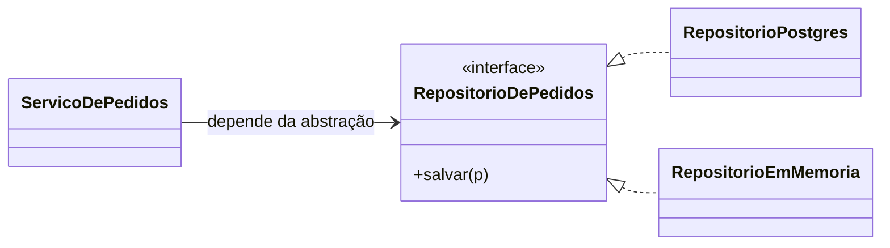

## O que é

**SOLID** é um acrônimo, popularizado por Robert C. Martin, para **cinco princípios de projeto orientado a objetos** que tornam o código mais fácil de manter, testar e estender:

| Letra | Princípio | Ideia |
|---|---|---|
| **S** | Single Responsibility (Responsabilidade Única) | uma classe deve ter **um único motivo para mudar** |
| **O** | Open/Closed (Aberto/Fechado) | aberta para **extensão**, fechada para **modificação** |
| **L** | Liskov Substitution (Substituição de Liskov) | subtipos devem poder **substituir** seus tipos base sem quebrar o programa |
| **I** | Interface Segregation (Segregação de Interfaces) | muitas interfaces **específicas** são melhores que uma interface "gorda" |
| **D** | Dependency Inversion (Inversão de Dependência) | dependa de **abstrações**, não de implementações concretas |

## Para que serve

Os princípios combatem os sintomas de um design ruim: **rigidez** (difícil mudar), **fragilidade** (uma mudança quebra outras partes), **imobilidade** (difícil reaproveitar) e **viscosidade** (é mais fácil fazer gambiarra do que o certo).

## Como funciona

### S — Responsabilidade Única

```java
// Violação: três motivos para mudar (regra, formato, persistência)
class Relatorio {
    double calcularTotal() { ... }
    String gerarPdf() { ... }
    void salvarNoBanco() { ... }
}
// Correção: uma responsabilidade por classe
class CalculadoraDoRelatorio { double calcularTotal() { ... } }
class ExportadorPdf { byte[] exportar(Relatorio r) { ... } }
class RelatorioRepository { void salvar(Relatorio r) { ... } }
```

### O — Aberto/Fechado

```typescript
// Violação: cada novo frete exige editar esta função
function frete(tipo: string, peso: number) {
  if (tipo === 'sedex') return peso * 12;
  if (tipo === 'pac') return peso * 7;
  throw new Error('tipo desconhecido');
}
// Correção: novos fretes são novas classes; o código existente não muda
interface Frete { calcular(peso: number): number }
class Sedex implements Frete { calcular(p: number) { return p * 12 } }
class Pac implements Frete { calcular(p: number) { return p * 7 } }
const total = (f: Frete, peso: number) => f.calcular(peso);
```

### L — Substituição de Liskov

Se `S` é subtipo de `T`, objetos `T` podem ser trocados por `S` **sem alterar a correção** do programa. O exemplo clássico de violação: `Quadrado extends Retangulo` — alterar a largura de um quadrado muda também a altura, quebrando quem esperava um retângulo comum. Sinais de violação: subclasse que lança exceção em método herdado, que ignora métodos ou que **enfraquece** garantias do pai.

### I — Segregação de Interfaces

```java
// Violação: impressora simples obrigada a implementar fax e scanner
interface Multifuncional { void imprimir(); void digitalizar(); void enviarFax(); }
// Correção: interfaces pequenas, combinadas conforme a necessidade
interface Impressora { void imprimir(); }
interface Scanner { void digitalizar(); }
class ImpressoraSimples implements Impressora { public void imprimir() { ... } }
class Multifuncional implements Impressora, Scanner { ... }
```

### D — Inversão de Dependência

Módulos de **alto nível** (regras de negócio) não devem depender de módulos de **baixo nível** (banco, e-mail); **ambos** dependem de **abstrações**. Na prática, usa-se **injeção de dependência**:

```python
from typing import Protocol

class RepositorioDePedidos(Protocol):
    def salvar(self, pedido: "Pedido") -> None: ...

class ServicoDePedidos:
    def __init__(self, repo: RepositorioDePedidos):   # depende da abstração
        self.repo = repo
    def fechar(self, pedido):
        pedido.validar()
        self.repo.salvar(pedido)

# Em produção: ServicoDePedidos(RepositorioPostgres())
# Nos testes:  ServicoDePedidos(RepositorioEmMemoria())
```

## Características principais

- São **princípios**, não regras absolutas; aplicá-los em excesso gera complexidade desnecessária.
- Estão por trás de vários **padrões de projeto** (Strategy aplica OCP e DIP; Adapter ajuda ISP).
- Resultam em **alta coesão** (S, I) e **baixo acoplamento** (O, D).

## Exemplos práticos

:::example Um checkout que respeita SOLID
`Checkout` (regra) recebe por injeção um `GatewayDePagamento` (interface — **D**). Novos meios de pagamento são novas implementações (**O**), todas substituíveis entre si (**L**). Notificações ficam em `Notificador` separado (**S**), e quem só consulta pedidos usa a interface `ConsultaDePedidos`, não a interface completa de escrita (**I**).
:::

## Representação visual



## Vantagens e desvantagens

| Vantagens | Desvantagens |
|---|---|
| código testável (dependências substituíveis) | mais classes e interfaces |
| extensão sem mexer em código estável | abstrações prematuras atrapalham |
| menos efeitos colaterais | exige experiência para dosar |

## Diferenças entre conceitos semelhantes

- **Inversão de dependência × injeção de dependência:** a **inversão** é o **princípio** (depender de abstrações); a **injeção** é uma **técnica** (passar a dependência por construtor/parâmetro).
- **SRP × coesão:** SRP é uma forma prática de buscar **alta coesão**.
- **OCP × polimorfismo:** o polimorfismo é o **mecanismo** que torna o OCP possível.
- **ISP × SRP:** SRP fala de **classes**; ISP fala de **interfaces** vistas pelos clientes.

## Como cai no ENADE

:::enade
SOLID aparece associado a **padrões de projeto** (Strategy e "programar para uma interface, não para uma implementação", 2017) e a afirmações sobre arquitetura e acoplamento. Reconheça o princípio pela descrição.
:::

## Pegadinhas

:::trap "Fechada para modificação" não é "nunca alterar o código"
Significa poder **acrescentar** comportamento sem **editar** o que já funciona; correções de defeitos continuam necessárias.
:::

:::trap Liskov não é sobre "herdar tudo"
É sobre **substituibilidade comportamental**: o filho deve honrar o contrato do pai.
:::

## Questões comentadas

::question 2017-objective-27 Strategy no simulador de voo

O padrão Strategy aplica "programar para uma interface": `Boeing757` depende das interfaces `Voar` e `Pousar` e recebe implementações intercambiáveis (`VoarDia`/`VoarNoite`) — isso é **OCP** e **DIP** em ação. `setVoar` e `setPousar` trocam as estratégias em tempo de execução, mudando as saídas para "noite" sem alterar a classe (alternativa D).

## Resumo para memorizar

:::summary
- **S**: um motivo para mudar. **O**: estender sem modificar. **L**: subtipo substitui o tipo base. **I**: interfaces pequenas. **D**: dependa de abstrações.
- Resultado: **alta coesão, baixo acoplamento**, código testável.
:::

:::mnemonic
"**S**ó **O** **L**ivro **I**nteressa **D**ecorar": Single, Open/Closed, Liskov, Interface segregation, Dependency inversion.
:::

## Miniquestionário

:::quiz
[
  {
    "question": "Uma subclasse que lança exceção em um método herdado que o pai executa normalmente viola qual princípio?",
    "options": ["Responsabilidade Única", "Substituição de Liskov", "Segregação de Interfaces", "Aberto/Fechado"],
    "answer": 1,
    "explanation": "O subtipo não pode substituir o tipo base sem quebrar o programa."
  },
  {
    "question": "Receber um repositório por construtor, tipado por interface, aplica principalmente:",
    "options": ["Inversão de Dependência", "Segregação de Interfaces", "Liskov", "Encapsulamento"],
    "answer": 0,
    "explanation": "O serviço depende de uma abstração; a implementação concreta é injetada."
  },
  {
    "question": "Adicionar um novo tipo de desconto criando uma nova classe, sem editar o cálculo existente, segue:",
    "options": ["SRP", "OCP", "ISP", "LSP"],
    "answer": 1,
    "explanation": "Aberto para extensão, fechado para modificação."
  }
]
:::

## Referências

- MARTIN, R. C. *Arquitetura Limpa*. Alta Books, 2019 — parte III (princípios de design).
- MARTIN, R. C. *Agile Software Development: Principles, Patterns, and Practices*. Prentice Hall, 2002.
- LISKOV, B.; WING, J. A Behavioral Notion of Subtyping. *ACM TOPLAS*, v. 16, n. 6, 1994.
- INEP. ENADE TADS 2017, questão 27.
