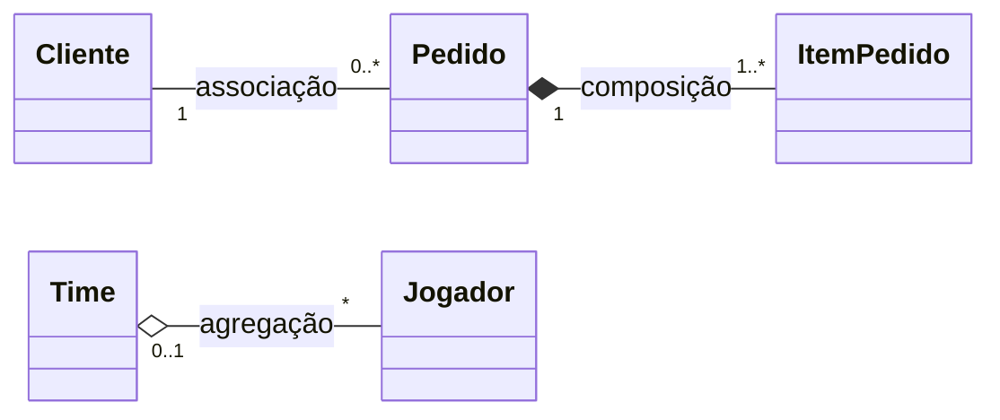

## O que é

- **Associação**: um objeto **conhece** outro e pode enviar mensagens a ele (Cliente conhece seus Pedidos).
- **Agregação**: associação **todo-parte fraca** — a parte tem vida própria e pode pertencer a mais de um todo.
- **Composição**: associação **todo-parte forte** — a parte **pertence a um único todo** e **não existe sem ele**.
- **Coesão**: o quanto as responsabilidades **dentro** de um módulo/classe estão **relacionadas** entre si.
- **Acoplamento**: o quanto um módulo/classe **depende** de outros.

## Para que serve

Esses conceitos guiam **onde colocar cada responsabilidade**. Sistemas com **alta coesão** e **baixo acoplamento** são mais fáceis de entender, testar, reutilizar e modificar: uma mudança fica contida em poucos lugares.

## Como funciona

### Associação, agregação e composição em código

```java
// Associação: o pedido conhece o cliente, que existe independentemente
class Pedido {
    private Cliente cliente;
    // Composição: os itens são criados e controlados pelo pedido
    private final List<ItemPedido> itens = new ArrayList<>();
    void adicionar(Produto p, int qtd) { itens.add(new ItemPedido(p, qtd)); }
}

// Agregação: o time reúne jogadores que existem fora dele
class Time {
    private final List<Jogador> jogadores = new ArrayList<>();
    void contratar(Jogador j) { jogadores.add(j); }   // recebido pronto, de fora
}
```

Sinais de **composição**: o todo **cria** as partes, elas **não são compartilhadas** e **somem** junto com o todo (ItemPedido sem Pedido não faz sentido). Sinais de **agregação**: as partes são **recebidas prontas**, podem estar em vários todos e **sobrevivem** a ele (o jogador continua existindo se o time acabar).

### Coesão

Uma classe **coesa** tem um **propósito único e claro**; todos os seus métodos trabalham com os mesmos dados para a mesma finalidade.

- **Alta coesão** (desejável): `CalculadoraDeFrete` só calcula frete.
- **Baixa coesão** (problema): `Utilitarios` que envia e-mail, calcula imposto, gera PDF e valida CPF.

### Acoplamento

**Acoplamento** mede a dependência entre módulos. Quanto mais uma classe sabe sobre os **detalhes internos** de outra, maior o acoplamento.

- **Baixo acoplamento** (desejável): depender de **interfaces/abstrações** e de poucas classes.
- **Alto acoplamento**: acessar atributos de outra classe diretamente, depender de classes concretas, cadeias como `pedido.getCliente().getEndereco().getCidade().getNome()` (violação da **Lei de Deméter**).

Técnicas para reduzir: **interfaces**, **injeção de dependência**, **eventos/mensageria**, **camadas**, padrões como Strategy e Facade.

```typescript
// Alto acoplamento: a classe cria e conhece a implementação concreta
class RelatorioAcoplado {
  private envio = new EmailSmtp('smtp.empresa.com');
  enviar(texto: string) { this.envio.mandar(texto); }
}

// Baixo acoplamento: depende de uma abstração recebida de fora
interface Notificador { notificar(texto: string): void }
class Relatorio {
  constructor(private readonly notificador: Notificador) {}
  enviar(texto: string) { this.notificador.notificar(texto); }
}
```

### Reutilização de código

Formas de reutilizar, da mais simples à mais elaborada: **funções e bibliotecas**, **herança**, **composição** (um objeto usa outro), **componentes** com interfaces, **frameworks**, **padrões de projeto** (reuso de **ideias** de design) e **serviços** (APIs). Regra prática: **prefira composição a herança** — composição gera acoplamento menor e pode ser trocada em tempo de execução.

## Características principais

| | Desejável | Por quê |
|---|---|---|
| Coesão | **alta** | classes focadas, fáceis de entender e reutilizar |
| Acoplamento | **baixo** | mudanças não se propagam em cascata |

## Exemplos práticos

:::example Refatorando para alta coesão
Uma classe `Pedido` que calcula total, envia e-mail e grava no banco tem **baixa coesão** e **alto acoplamento** com e-mail e banco. Separando em `Pedido` (regras e total), `NotificadorDePedidos` (e-mail) e `PedidoRepository` (persistência), cada classe tem um motivo único para mudar.
:::

## Representação visual



## Vantagens e desvantagens

| Escolha | Vantagem | Desvantagem |
|---|---|---|
| Composição | encapsulamento forte do todo | partes não reaproveitáveis em outros todos |
| Agregação | partes compartilháveis | ciclo de vida mais difícil de controlar |
| Herança para reuso | rápido | acoplamento alto ao pai |
| Composição para reuso | flexível, troca em execução | um pouco mais de código |

## Diferenças entre conceitos semelhantes

- **Agregação × composição:** a pergunta é "**a parte sobrevive sem o todo?**" Sim → agregação; não → composição.
- **Coesão × acoplamento:** coesão é **interna** (dentro do módulo); acoplamento é **externo** (entre módulos).
- **Dependência × associação:** dependência é uso **temporário** (parâmetro); associação é vínculo **duradouro** (atributo).

## Como cai no ENADE

:::enade
Diagramas e discursivas pedem identificar associações, agregações e composições a partir de um cenário (2014, discursiva sobre associações de classes) e afirmações sobre coesão e acoplamento em arquitetura (2021).
:::

## Pegadinhas

:::trap Alta coesão é bom; alto acoplamento é ruim
A meta é **alta coesão e baixo acoplamento**. Bancas invertem os adjetivos.
:::

:::trap Composição não é "herança"
Composição é um relacionamento **todo-parte** entre objetos; herança é "é um" entre classes.
:::

## Questões comentadas

::question 2014-discursive-3 Associações entre classes

A discursiva parte da ideia de que classes colaboram por **associações** que permitem compartilhar informações. Uma boa resposta identifica as classes, nomeia as associações, define **multiplicidades** e decide entre **agregação** e **composição** pelo critério de ciclo de vida das partes.

## Resumo para memorizar

:::summary
- **Associação** = conhece. **Agregação** ◇ = todo-parte fraca (parte sobrevive). **Composição** ◆ = todo-parte forte (parte morre com o todo).
- **Coesão alta** = responsabilidades relacionadas. **Acoplamento baixo** = poucas dependências, de preferência em abstrações.
- Reduza acoplamento com **interfaces, injeção de dependência e camadas**.
- **Prefira composição a herança** para reutilizar.
:::

## Miniquestionário

:::quiz
[
  {
    "question": "Uma Nota Fiscal e seus Itens: os itens não existem sem a nota e pertencem a uma só nota. Qual relacionamento?",
    "options": ["Agregação", "Composição", "Dependência", "Generalização"],
    "answer": 1,
    "explanation": "Parte exclusiva e sem existência independente: composição."
  },
  {
    "question": "Uma classe 'Utilitarios' que gera PDF, valida CPF e envia SMS tem:",
    "options": ["Alta coesão", "Baixa coesão", "Baixo acoplamento", "Polimorfismo"],
    "answer": 1,
    "explanation": "Responsabilidades sem relação entre si indicam baixa coesão."
  },
  {
    "question": "Qual prática reduz o acoplamento?",
    "options": ["Instanciar classes concretas dentro de cada método", "Depender de interfaces e receber as dependências por injeção", "Acessar atributos públicos de outras classes", "Encadear muitos getters"],
    "answer": 1,
    "explanation": "Dependências abstratas e injetadas podem ser trocadas sem alterar a classe cliente."
  }
]
:::

## Referências

- LARMAN, C. *Utilizando UML e Padrões*. 3. ed. Bookman, 2007 — padrões GRASP (Alta Coesão, Baixo Acoplamento).
- PRESSMAN, R. S.; MAXIM, B. R. *Engenharia de Software*. 8. ed. AMGH, 2016 — cap. 12 (conceitos de projeto).
- BLOCH, J. *Java Efetivo*. 3. ed. Alta Books, 2019 — item 18.
- INEP. ENADE TADS 2014, discursiva 3.
