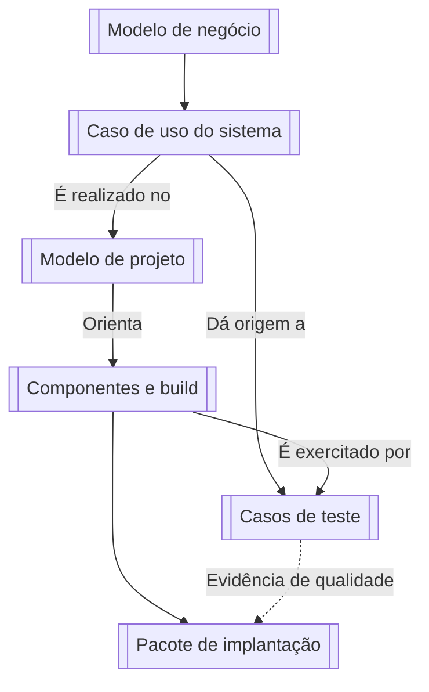

## O que é

Uma **disciplina** (nas versões antigas, **fluxo de trabalho** ou *workflow*) é um conjunto de **atividades relacionadas** a uma mesma área de interesse, executadas por **papéis** (trabalhadores) e que produzem **artefatos**. O RUP define **nove**: seis de **engenharia** (produzem o software) e três de **suporte** (organizam o trabalho).

:::definition Elementos da dimensão estática
- **Papel (worker/role):** quem faz — analista de sistemas, arquiteto, designer, implementador, testador, gerente de projeto.
- **Atividade:** o que é feito — "detalhar um caso de uso", "projetar uma classe".
- **Artefato:** o que é produzido ou alterado — modelos, documentos, código, executáveis.
- **Disciplina:** agrupa atividades, papéis e artefatos de uma área.
:::

## Para que serve

As disciplinas dizem **que tipo de trabalho** existe no projeto e **quem é responsável**. Junto com as fases, elas formam uma matriz: em cada iteração, a equipe olha para cada disciplina e decide quanto esforço ela merece naquele momento.

## Como funciona

### Disciplinas de engenharia

**1. Modelagem de negócios.** Entende a organização em que o sistema vai operar: processos de negócio, problemas, regras e oportunidades de melhoria. Produz o *modelo de casos de uso de negócio* e o *modelo de objetos de negócio*. Pico: **Concepção**.

**2. Requisitos.** Estabelece e mantém o acordo com os envolvidos sobre o que o sistema deve fazer. Atividades: entender necessidades, definir o sistema, gerenciar o escopo, detalhar casos de uso. Artefatos: **documento de visão**, **modelo de casos de uso**, **especificações de casos de uso**, **especificação suplementar** (requisitos não funcionais), **glossário**. Pico: **Elaboração**.

**3. Análise e design.** Transforma requisitos em um projeto que possa ser implementado: define a arquitetura, as classes, os subsistemas e as interfaces. Artefatos: **modelo de análise**, **modelo de design** (**diagramas de classes**, **de sequência/comunicação**), **documento de arquitetura de software**, modelo de dados. Pico: **fim da Elaboração**, continuando na Construção.

**4. Implementação.** Organiza o código em subsistemas, implementa classes e componentes, faz **testes de unidade** e integra o resultado em *builds*. Pico: **Construção** (já presente na Elaboração com o protótipo arquitetural).

**5. Teste.** Avalia a qualidade: verifica a interação e integração dos componentes, se todos os requisitos foram implementados e encontra defeitos antes da entrega. Artefatos: plano de testes, casos de teste, scripts, resultados. Presente em **todas** as fases, crescente na Construção.

**6. Implantação.** Produz releases externas e entrega o software ao usuário: empacotamento, distribuição, instalação, migração, testes beta, treinamento e suporte. Pico: **Transição**.

### Disciplinas de suporte

**7. Gerência de configuração e mudança.** Controla os artefatos e suas versões (**baselines**), gerencia **solicitações de mudança** e mantém a integridade do produto ao longo das iterações. Contínua e crescente conforme o número de artefatos aumenta. Veja também [Gerência de configuração](lib:gerencia-de-configuracao).

**8. Gerência de projeto.** Planeja o projeto e cada iteração, gerencia **riscos**, monitora progresso, custos e qualidade. Presente do início ao fim.

**9. Ambiente.** Fornece à equipe o processo adaptado (*development case*), as **ferramentas**, guias e padrões. Mais forte no começo do projeto.

::widget rup-whale

Fonte: adaptado de KRUCHTEN (2004, cap. 2) — recriado pela equipe Stacklyst.

A altura de cada faixa indica ênfase relativa naquela fase. No ENADE, compare os picos de Implementação e Implantação e observe que atividades de suporte atravessam as fases.

## Características principais

| Disciplina | Tipo | Papéis típicos | Artefatos-chave | Ênfase |
|---|---|---|---|---|
| Modelagem de negócios | engenharia | analista de processos de negócio | modelo de negócio | Concepção |
| Requisitos | engenharia | analista de sistemas | visão, casos de uso, especificação suplementar | Elaboração |
| Análise e design | engenharia | arquiteto, designer | arquitetura, diagramas de classes e interação | Elaboração |
| Implementação | engenharia | implementador, integrador | código, componentes, builds | Construção |
| Teste | engenharia | analista e projetista de testes | plano e casos de teste | crescente |
| Implantação | engenharia | gerente de implantação | release, material de treinamento | Transição |
| Config. e mudança | suporte | gerente de configuração | baselines, solicitações de mudança | contínua |
| Gerência de projeto | suporte | gerente de projeto | plano de projeto, lista de riscos | contínua |
| Ambiente | suporte | engenheiro de processo | caso de desenvolvimento, ferramentas | início |

## Exemplos práticos

:::example "Em que disciplina isso acontece?"
- Entrevistar a secretaria para entender como é feita hoje a matrícula → **Modelagem de negócios** (o processo da organização) e **Requisitos** (o que o sistema deve fazer).
- Escrever o fluxo principal do caso de uso "Realizar matrícula" → **Requisitos**.
- Decidir que o sistema terá três camadas e um serviço de integração com o financeiro → **Análise e design** (arquitetura).
- Criar o diagrama de sequência da matrícula → **Análise e design**.
- Escrever a classe `MatriculaService` e seus testes unitários → **Implementação**.
- Testar se o sistema aguenta 2 mil alunos simultâneos → **Teste**.
- Registrar o pedido do cliente de incluir um novo tipo de bolsa → **Gerência de configuração e mudança**.
- Reavaliar riscos ao fim da iteração → **Gerência de projeto**.
- Configurar o repositório Git e o servidor de integração contínua → **Ambiente**.
:::

## Representação visual

Fonte: adaptado de KRUCHTEN (2004, cap. 6) e JACOBSON; BOOCH; RUMBAUGH (1999, cap. 1) — recriado pela equipe Stacklyst.

Siga o caso de uso em duas direções. Uma leva ao projeto e à implementação. A outra leva a testes que exercitam o comportamento previsto. No ENADE, use essas ligações para identificar quais artefatos podem ser afetados por uma mudança e a qual disciplina pertencem.

## Diferenças entre conceitos semelhantes

- **Modelagem de negócios × Requisitos:** a primeira olha a **organização** (como o negócio funciona, com ou sem sistema); a segunda olha o **sistema** (o que ele deve fazer).
- **Análise × Design:** análise descreve *o que* o sistema precisa resolver em termos do domínio, independente de tecnologia; design decide *como* implementar (classes concretas, banco, frameworks).
- **Teste (disciplina) × testes de unidade:** testes de unidade são feitos pelo implementador na disciplina de **Implementação**; a disciplina de **Teste** cuida da avaliação de integração, sistema e aceitação.
- **Gerência de configuração × Gerência de projeto:** configuração controla **artefatos e versões**; projeto controla **prazo, custo, escopo e riscos**.

## Como cai no ENADE

:::enade
As questões pedem a **disciplina responsável** por um artefato (diagrama de classes → Análise e design; especificação de casos de uso → Requisitos) ou combinam disciplina e fase. Também aparecem nomes antigos: "fluxo de trabalho de Análise e Projeto" é a mesma disciplina de Análise e design.
:::

## Pegadinhas

:::trap Nove, não sete
Algumas listas antigas mostram seis fluxos centrais + três de suporte. Se a questão falar em "fluxos de engenharia", são seis; o total de disciplinas é **nove**.
:::

:::trap Implantação ≠ Implementação
**Implementação** é escrever o código. **Implantação** (*deployment*) é colocar o software em produção para o usuário. Bancas trocam as palavras de propósito.
:::

## Questões comentadas

::question 2014-objective-24 Diagramas de classes e de interação

Pergunta pelo "fluxo de trabalho" e pela fase. Diagramas de classes e de interação são **artefatos de design**, logo **Análise e Design**; o momento de maior ênfase é a **Elaboração** (alternativa B).

::question 2008-objective-23 Requisitos no RUP

A disciplina de Requisitos existe em todas as fases, mas **a maior parte** da análise acontece na **Elaboração** — alternativa C.

## Resumo para memorizar

:::summary
- 6 de engenharia: **Negócio, Requisitos, Análise e design, Implementação, Teste, Implantação**.
- 3 de suporte: **Configuração e mudança, Projeto, Ambiente**.
- Classe/sequência → **Análise e design**. Casos de uso → **Requisitos**. Release/treinamento → **Implantação**. Baselines → **Configuração**.
- Todas atravessam todas as fases.
:::

:::mnemonic As seis de engenharia, na ordem do fluxo
"**N**unca **R**ecuse **A**nalisar, **I**mplementar, **T**estar e **I**mplantar" — Negócio, Requisitos, Análise e design, Implementação, Teste, Implantação.
:::

## Miniquestionário

:::quiz
[
  {
    "question": "A especificação suplementar, que reúne requisitos não funcionais, é artefato de qual disciplina?",
    "options": ["Análise e design", "Requisitos", "Ambiente", "Implantação"],
    "answer": 1,
    "explanation": "Requisitos produz visão, modelo e especificações de casos de uso, especificação suplementar e glossário."
  },
  {
    "question": "Configurar ferramentas e adaptar o processo para a equipe é responsabilidade de:",
    "options": ["Ambiente", "Gerência de projeto", "Implementação", "Modelagem de negócios"],
    "answer": 0,
    "explanation": "A disciplina de Ambiente provê processo, ferramentas, guias e padrões."
  },
  {
    "question": "Qual par está corretamente associado?",
    "options": ["Implantação — escrever o código das classes", "Gerência de configuração — controlar baselines e solicitações de mudança", "Teste — definir o caso de negócio", "Requisitos — diagrama de componentes"],
    "answer": 1,
    "explanation": "Configuração e mudança controla versões, baselines e pedidos de mudança. As demais associações estão trocadas."
  }
]
:::

## Referências

- KRUCHTEN, Philippe. *The Rational Unified Process: an introduction*. 3. ed. Boston: Addison-Wesley, 2004.
- IBM Rational. *RUP — Rational Unified Process* (base de conhecimento do processo, versão 7).
- PRESSMAN, R. S.; MAXIM, B. R. *Engenharia de Software: uma abordagem profissional*. 8. ed. AMGH, 2016.
- INEP. ENADE TADS 2008 (questões 16 e 23) e 2014 (questão 24).
- JACOBSON, Ivar; BOOCH, Grady; RUMBAUGH, James. *The unified software development process*. Reading: Addison-Wesley, 1999.
