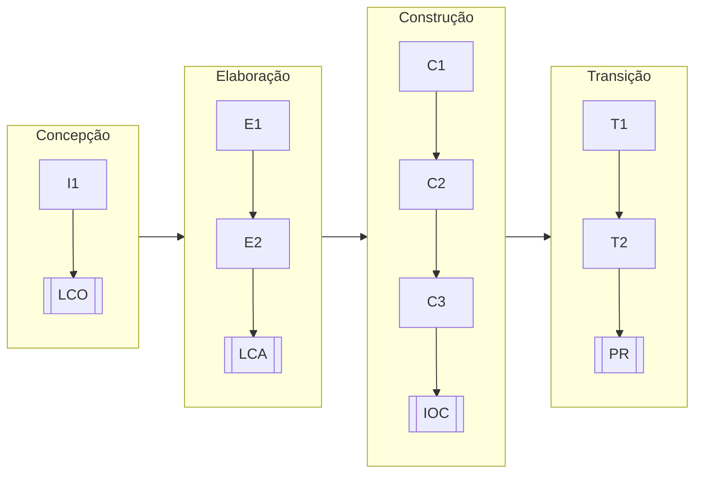

## O que é

No RUP, o tempo de um projeto é dividido em **quatro fases sequenciais**. Cada fase tem um **objetivo**, uma ou mais **iterações** e termina em um **marco** — um ponto de verificação em que gestores e clientes decidem se o projeto continua, muda de rumo ou é cancelado.

:::definition Termos
- **Ciclo**: as quatro fases completas, que geram uma *geração* do produto (versão 1.0, 2.0...).
- **Fase**: intervalo entre dois marcos principais.
- **Iteração**: uma passagem completa pelas disciplinas que gera um incremento executável (*release* interna ou externa).
- **Marco (milestone)**: momento de decisão com critérios de avaliação definidos.
:::

## Para que serve

Dividir o tempo em fases permite **mudar o foco** do projeto conforme o conhecimento aumenta: primeiro entender o problema, depois resolver os riscos técnicos, depois produzir em escala e, por fim, entregar. Os marcos evitam que o projeto avance "no escuro".

## Como funciona

### Concepção (Inception)

**Pergunta central:** *vale a pena fazer este sistema?*

- Define a **visão** do produto e o **escopo** (o que entra e o que não entra).
- Identifica **atores** e os **casos de uso mais importantes** (normalmente 10 a 20% descritos em detalhe).
- Faz o **caso de negócio** (*business case*): custos, benefícios, retorno esperado.
- Lista os **riscos críticos** e uma estimativa inicial de prazo e custo.
- Pode incluir um protótipo conceitual (de tela, não arquitetural).

**Artefatos típicos:** documento de visão, caso de negócio, lista de riscos, modelo de casos de uso inicial, glossário, plano de desenvolvimento de software preliminar.

**Marco: LCO — Lifecycle Objectives (Objetivos do Ciclo de Vida).** Os envolvidos concordam com escopo, custo, prazo e riscos?

### Elaboração (Elaboration)

**Pergunta central:** *conseguimos construir isso com uma arquitetura estável?*

- Detalha a **maior parte dos requisitos** — em torno de 80% dos casos de uso.
- Projeta e **valida a arquitetura** com um **protótipo arquitetural executável** (não descartável): ele implementa os cenários mais arriscados de ponta a ponta.
- **Elimina os maiores riscos** técnicos.
- Refina o plano de projeto e as estimativas para a Construção.

**Artefatos típicos:** modelo de casos de uso (quase completo), especificação suplementar (requisitos não funcionais), **documento de arquitetura de software**, modelo de design (**diagramas de classes e de interação**), protótipo arquitetural executável, plano de iterações.

**Marco: LCA — Lifecycle Architecture (Arquitetura do Ciclo de Vida).** A arquitetura está estável e os riscos principais foram resolvidos?

:::tip Por que a Elaboração é a fase mais cobrada
É nela que se concentram duas coisas que o ENADE adora: **requisitos** (maior volume de análise) e **arquitetura/design** (classes, interações, componentes). Se a questão pergunta "quando são feitos os diagramas de classes?", a resposta esperada é **Elaboração**, disciplina de **Análise e design**.
:::

### Construção (Construction)

**Pergunta central:** *conseguimos produzir o sistema completo com qualidade?*

- Implementa os casos de uso restantes em **várias iterações** (geralmente é a fase mais longa).
- Integra e testa continuamente; foco em custo, prazo e qualidade de produção.
- Prepara manuais e material de usuário.

**Artefatos típicos:** código e componentes, builds integrados, casos e resultados de teste, versão beta, manuais.

**Marco: IOC — Initial Operational Capability (Capacidade Operacional Inicial).** O produto está pronto para ser usado por usuários em um ambiente de teste (beta)?

### Transição (Transition)

**Pergunta central:** *os usuários conseguem usar o sistema de verdade?*

- **Teste beta** com usuários reais, correção de defeitos e ajustes finos.
- **Implantação**: instalação, migração/conversão de dados, operação em paralelo com o sistema antigo.
- **Treinamento** de usuários e equipe de suporte.
- Aceite do cliente.

**Artefatos típicos:** versão final, notas de release, material de treinamento, plano de implantação.

**Marco: PR — Product Release (Liberação do Produto).** Os objetivos foram atingidos e o cliente aceita o produto? Um novo ciclo pode começar para a próxima versão.

### Iterações dentro das fases

Uma distribuição típica é **1** iteração na Concepção, **2** na Elaboração, **3** na Construção e **2** na Transição (a notação I1, E1, E2, C1, C2, C3, T1, T2 aparece no gráfico). Em cada iteração todas as disciplinas podem atuar; o que muda é a proporção.

::widget rup-whale

Fonte: adaptado de KRUCHTEN (2004, cap. 2) — recriado pela equipe Stacklyst.

Compare a posição das iterações com a concentração de esforço em cada disciplina. No ENADE, a presença de uma atividade antes do pico ajuda a explicar por que modelagem e testes já podem ocorrer nas primeiras fases.

## Características principais

| Fase | Foco | Duração típica* | Marco |
|---|---|---|---|
| Concepção | escopo e viabilidade | ~10% do tempo | LCO |
| Elaboração | requisitos e arquitetura | ~30% | LCA |
| Construção | produção do software | ~50% | IOC |
| Transição | entrega ao usuário | ~10% | PR |

*Proporções aproximadas citadas por Kruchten; variam por projeto.

## Exemplos práticos

:::example Onde está cada atividade
| Atividade | Fase de maior ênfase | Disciplina |
|---|---|---|
| Escrever o documento de visão | Concepção | Requisitos (e Gerência de projeto) |
| Detalhar os casos de uso | **Elaboração** | Requisitos |
| Desenhar diagramas de classes e de sequência | **Elaboração** | Análise e design |
| Construir o protótipo arquitetural | Elaboração | Implementação |
| Programar a maior parte das funcionalidades | Construção | Implementação |
| Fazer teste beta com usuários | Transição | Teste / Implantação |
| Treinar usuários e migrar dados | Transição | Implantação |
| Controlar versões e baselines | todas | Gerência de configuração e mudança |
:::

## Representação visual

Fonte: adaptado de KRUCHTEN (2004, cap. 4) — recriado pela equipe Stacklyst.

Leia as fases da esquerda para a direita e percorra as iterações dentro de cada grupo. A quantidade de iterações é ilustrativa, e o marco fecha a fase depois de verificar seus objetivos. No ENADE, associe LCA à validação da arquitetura e IOC à disponibilidade operacional inicial para a Transição.

## Diferenças entre conceitos semelhantes

- **Protótipo da Concepção × protótipo da Elaboração:** o primeiro costuma ser conceitual (telas, para validar a ideia e pode ser descartado); o segundo é **arquitetural e executável**, evolui até virar o produto.
- **Marco de fase × fim de iteração:** toda fase termina em um marco principal; cada iteração termina em um marco menor (uma *release* interna).
- **Beta (IOC) × release final (PR):** IOC = pronto para testes com usuários; PR = aceito e liberado.

## Como cai no ENADE

:::enade
Espere alternativas que combinam **fase + disciplina** ("na fase de Elaboração, no fluxo de Análise e Design") e assertivas sobre **o objetivo de cada fase**. A Elaboração é a resposta mais comum para requisitos detalhados, arquitetura e diagramas de design.
:::

## Pegadinhas

:::trap A Construção não é "só programar"
Testes, gerência de configuração e até ajustes de requisitos continuam na Construção. E a programação começa antes, no protótipo arquitetural da Elaboração.
:::

:::trap A Transição não é "manutenção"
A Transição entrega o produto (beta, implantação, treinamento). A manutenção de versões futuras começa um **novo ciclo** com as quatro fases.
:::

## Questões comentadas

::question 2014-objective-24 Fase e fluxo dos diagramas de classes e de interação

A questão separa claramente **fase** (quando) e **fluxo de trabalho** (o quê). Diagramas de classes e de interação entre objetos são modelos de design, portanto da disciplina **Análise e Design**. A fase em que o design e a arquitetura ganham mais esforço é a **Elaboração**. Alternativa **B**. As alternativas com "Concepção" erram o momento; a D erra o fluxo (Requisitos produz casos de uso, não classes de design).

## Resumo para memorizar

:::summary
- **Concepção** → visão, escopo, caso de negócio, riscos → marco **LCO**.
- **Elaboração** → ~80% dos requisitos, **arquitetura validada**, protótipo executável → marco **LCA**.
- **Construção** → produzir e testar o sistema em várias iterações → marco **IOC** (beta).
- **Transição** → beta, implantação, treinamento, aceite → marco **PR**.
:::

:::mnemonic Marcos
**L**ogo **O**bjetivos, **L**ogo **A**rquitetura, **I**nício da **O**peração, **P**roduto **R**eleased — LCO, LCA, IOC, PR.
:::

## Miniquestionário

:::quiz
[
  {
    "question": "Em qual fase do RUP se espera ter a arquitetura estável e os principais riscos técnicos resolvidos?",
    "options": ["Concepção", "Elaboração", "Construção", "Transição"],
    "answer": 1,
    "explanation": "O marco LCA, ao fim da Elaboração, exige arquitetura estável validada por protótipo executável."
  },
  {
    "question": "O caso de negócio (business case) e o documento de visão são artefatos característicos de qual fase?",
    "options": ["Concepção", "Elaboração", "Construção", "Transição"],
    "answer": 0,
    "explanation": "A Concepção decide se o projeto vale a pena: visão, escopo e caso de negócio."
  },
  {
    "question": "Treinamento de usuários e migração de dados são típicos de qual fase?",
    "options": ["Concepção", "Elaboração", "Construção", "Transição"],
    "answer": 3,
    "explanation": "A Transição coloca o produto nas mãos dos usuários: beta, implantação, treinamento e conversão de dados."
  }
]
:::

## Referências

- KRUCHTEN, Philippe. *The Rational Unified Process: an introduction*. 3. ed. Boston: Addison-Wesley, 2004.
- KROLL, P.; KRUCHTEN, P. *The Rational Unified Process Made Easy*. Addison-Wesley, 2003.
- SOMMERVILLE, I. *Engenharia de Software*. 10. ed. Pearson, 2018.
- INEP. ENADE 2014 — Tecnologia em Análise e Desenvolvimento de Sistemas, questão 24.
