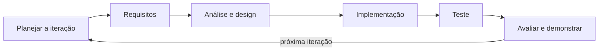
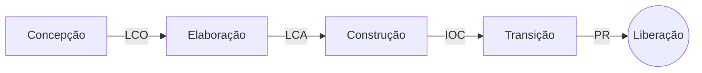

Muitos estudantes chegam ao ENADE sem nunca ter estudado o RUP — e ele aparece com frequência, quase sempre com a mesma armadilha: confundir **fase** (tempo) com **disciplina** (tipo de trabalho). Esta página constrói o RUP do zero; as subpáginas detalham as [fases e marcos](lib:rup-fases-e-marcos) e as [nove disciplinas](lib:rup-disciplinas).

## O que é

O **RUP (Rational Unified Process)** é um **processo de engenharia de software** criado pela Rational Software (depois adquirida pela IBM) a partir do *Processo Unificado* descrito por Jacobson, Booch e Rumbaugh — os mesmos autores da UML.

Um processo de software responde a quatro perguntas: **quem** faz (papéis, chamados de *trabalhadores*), **o quê** (artefatos: documentos, modelos, código), **como** (atividades) e **quando** (fases e iterações). O RUP organiza tudo isso em uma estrutura que pode ser **adaptada** ao tamanho de cada projeto — não é obrigatório produzir todos os artefatos que ele descreve.

:::definition RUP em uma frase
Processo de desenvolvimento **iterativo e incremental**, **dirigido por casos de uso** e **centrado na arquitetura**, organizado em **4 fases** no tempo e **9 disciplinas** de trabalho.
:::

## Para que serve

O RUP foi pensado para projetos médios e grandes, em que o modelo cascata falhava por descobrir problemas tarde demais. Ele serve para:

- **reduzir riscos cedo**: os riscos mais graves (técnicos e de negócio) são atacados nas primeiras iterações;
- **entregar valor aos poucos**: cada iteração termina com uma versão executável, ainda que parcial;
- **controlar mudanças**: requisitos podem mudar, e o processo prevê disciplinas de gerência de configuração e de mudanças;
- **padronizar o trabalho**: define papéis, artefatos e atividades para equipes grandes, usando a UML como linguagem de modelagem.

## Como funciona

O RUP é descrito em **duas dimensões**, e é isso que o famoso gráfico de baleias mostra:

| Dimensão | Eixo do gráfico | O que contém | Aspecto |
|---|---|---|---|
| **Tempo** | horizontal | ciclos, **fases**, **iterações** e **marcos** | **dinâmico** |
| **Conteúdo** | vertical | **disciplinas** (fluxos de trabalho), atividades, artefatos e papéis | **estático** |

### Os três princípios

**1. Iterativo e incremental.** O projeto é dividido em várias **iterações** curtas (tipicamente de 2 a 6 semanas). Cada iteração passa por um pouco de requisitos, análise, implementação e testes — como um "minicascata" — e produz um **incremento** executável. *Iterativo* = repetir o ciclo; *incremental* = cada repetição acrescenta funcionalidade.

**2. Dirigido por casos de uso.** Os [casos de uso](lib:uml-casos-de-uso) descrevem o que o usuário precisa e guiam tudo: o planejamento das iterações (quais casos de uso entram em cada uma), o design, a implementação e os **casos de teste**, que verificam se cada caso de uso funciona.

**3. Centrado na arquitetura.** A arquitetura (a estrutura principal do sistema: componentes, camadas, interfaces) é definida e **validada com um protótipo executável** cedo, na fase de Elaboração. Depois, a construção acontece sobre essa base estável.

### Fases × disciplinas

- As **4 fases** são sequenciais no tempo: **Concepção → Elaboração → Construção → Transição**. Cada fase termina em um **marco** (*milestone*), um ponto de decisão.
- As **9 disciplinas** são tipos de trabalho que acontecem **em todas as fases**, com intensidade variável: Modelagem de negócios, Requisitos, Análise e design, Implementação, Teste, Implantação (engenharia) e Gerência de configuração e mudança, Gerência de projeto e Ambiente (suporte).

Explore o gráfico abaixo: clique em uma disciplina para ver quando ela pesa mais, e em uma fase para ver o objetivo e o marco.

::widget rup-whale

:::warning Nenhuma disciplina pertence a uma única fase
Requisitos não "acontecem na Concepção" e programação não "acontece só na Construção". O que muda entre as fases é a **ênfase**. Por isso o gráfico tem formato de baleias: cada disciplina cresce e diminui, mas raramente some.
:::

## Características principais

- **Dimensão dinâmica e estática** separadas (tempo × conteúdo).
- **Iterações planejadas por risco e por casos de uso**: primeiro o que é mais arriscado e mais importante.
- **Marcos de fase** com critérios objetivos de passagem (LCO, LCA, IOC, PR).
- **Uso intensivo da UML** para modelar negócio, requisitos e design.
- **Configurável**: é um *framework* de processo; cada organização escolhe papéis e artefatos necessários (existe até uma versão enxuta, o OpenUP).
- **Gestão de mudanças** como disciplina explícita, não como improviso.

## Exemplos práticos

:::example Um sistema de matrícula universitária no RUP
- **Concepção (1 iteração):** visão do produto, atores (Aluno, Secretaria, Professor), casos de uso principais listados, estimativa e riscos (integração com o sistema financeiro é o maior risco). Marco: decide-se seguir com o projeto.
- **Elaboração (2 iterações):** a maioria dos casos de uso detalhada; arquitetura em três camadas definida; protótipo executável que já faz uma matrícula ponta a ponta integrando com o financeiro (o risco principal foi atacado). Diagramas de classes e de sequência produzidos na disciplina de Análise e design.
- **Construção (3 iterações):** cada iteração implementa e testa um grupo de casos de uso (trancar, rematricular, emitir histórico). Termina com uma versão beta.
- **Transição (2 iterações):** beta com uma turma piloto, correções, treinamento da secretaria, migração dos dados antigos e implantação.
:::

## Representação visual

## Vantagens e desvantagens

| Vantagens | Desvantagens |
|---|---|
| Riscos atacados cedo, com protótipo arquitetural | Pesado para projetos pequenos se não for adaptado |
| Entregas executáveis a cada iteração | Exige equipe experiente para escolher artefatos e papéis |
| Rastreabilidade de casos de uso até os testes | Muita documentação quando aplicado "de manual" |
| Absorve mudanças de requisitos de forma controlada | Planejamento de iterações é mais complexo que no cascata |

## Diferenças entre conceitos semelhantes

| Conceito | RUP | Cascata | Scrum |
|---|---|---|---|
| Organização do tempo | 4 fases com várias iterações | etapas sequenciais únicas | sprints de duração fixa |
| Requisitos | evoluem; maior parte detalhada na Elaboração | definidos e congelados no início | backlog repriorizado a cada sprint |
| Arquitetura | validada cedo com protótipo | definida no projeto, testada no fim | emerge ao longo das sprints |
| Documentação | muitos artefatos (adaptáveis) | muitos documentos por etapa | mínima, foco em software funcionando |
| Papéis | dezenas de papéis definidos | por etapa | Product Owner, Scrum Master, Developers |

- **Fase** é *quando*; **disciplina** (ou fluxo de trabalho) é *o quê*.
- **Iteração** é uma volta completa pelo ciclo de disciplinas; **incremento** é o resultado dela.
- **Processo Unificado (UP)** é o modelo genérico do livro; **RUP** é o produto comercial da Rational/IBM baseado nele.

## Como cai no ENADE

:::enade Padrão das questões
O ENADE costuma (1) perguntar **em qual fase e em qual disciplina** um artefato é produzido, (2) testar se você sabe que a **maior parte dos requisitos** é trabalhada na **Elaboração**, e (3) cobrar os princípios **iterativo**, **dirigido por casos de uso** e **centrado na arquitetura**, muitas vezes em questões de asserção-razão.
:::

## Pegadinhas

:::trap "Requisitos acontecem só na Concepção"
Falso. A Concepção levanta a visão, o escopo e os casos de uso principais. A **maior parte** da análise de requisitos acontece na **Elaboração**, e ajustes continuam depois.
:::

:::trap "Uma iteração pode não gerar artefato nenhum"
Falso. Toda iteração produz ou atualiza artefatos e termina com um resultado avaliável. O que varia é **quais** artefatos, conforme a ênfase das disciplinas naquela fase.
:::

:::trap "Diagramas de classes são feitos na disciplina de Requisitos"
Diagramas de classes e de interação pertencem à disciplina de **Análise e design**. Requisitos produz modelo de casos de uso, especificações suplementares e glossário.
:::

## Questões comentadas

::question 2008-objective-16 Asserção-razão sobre artefatos a cada iteração

A primeira asserção diz que, a cada iteração, "geram-se ou não" artefatos — isso é **falso**: iterações sempre produzem ou atualizam artefatos (pelo menos um incremento executável e o plano da próxima iteração). A segunda diz que os artefatos produzidos dependem da ênfase dada a cada disciplina — **verdadeiro**, é exatamente o que o gráfico de baleias mostra. Resposta: primeira falsa, segunda verdadeira (**D**).

::question 2008-objective-23 Onde acontece a maior parte da análise de requisitos

As alternativas exploram a ideia errada de que requisitos têm fase exclusiva. A correta é **C**: a maior parte da análise de requisitos ocorre durante a **Elaboração**. A alternativa E é um retrato do cascata (requisitos congelados), incompatível com um processo iterativo.

## Resumo para memorizar

:::summary
- RUP = **iterativo e incremental** + **dirigido por casos de uso** + **centrado na arquitetura**.
- **Dimensão dinâmica** (horizontal): ciclos, **fases**, iterações e marcos.
- **Dimensão estática** (vertical): **disciplinas**, atividades, artefatos e papéis.
- 4 fases: **Concepção, Elaboração, Construção, Transição** (marcos LCO, LCA, IOC, PR).
- 9 disciplinas: 6 de engenharia + 3 de suporte; **todas atravessam todas as fases**.
- Requisitos: pico na **Elaboração**. Arquitetura: estabilizada no fim da **Elaboração**.
:::

:::mnemonic Fases na ordem
**C**omeça, **E**strutura, **C**onstrói, **T**ransfere — Concepção, Elaboração, Construção, Transição.
:::

## Miniquestionário

:::quiz
[
  {
    "question": "No RUP, qual afirmação descreve corretamente a relação entre fases e disciplinas?",
    "options": ["Cada disciplina pertence a uma única fase", "As disciplinas acontecem em todas as fases, com intensidades diferentes", "As fases são executadas em paralelo, e as disciplinas em sequência", "Fases e disciplinas são sinônimos"],
    "answer": 1,
    "explanation": "As fases organizam o tempo; as disciplinas, o tipo de trabalho. Todas as disciplinas podem ocorrer em todas as fases, e o gráfico de baleias mostra a variação de esforço."
  },
  {
    "question": "O que significa dizer que o RUP é 'centrado na arquitetura'?",
    "options": ["A arquitetura é definida só na Transição", "A arquitetura é validada cedo, com um protótipo executável, e serve de base para a construção", "O processo dispensa casos de uso", "Só arquitetos participam do projeto"],
    "answer": 1,
    "explanation": "A Elaboração estabiliza a arquitetura com um protótipo executável; a Construção se apoia nessa base."
  },
  {
    "question": "Qual elemento pertence à dimensão dinâmica do RUP?",
    "options": ["Artefato", "Papel (trabalhador)", "Marco", "Disciplina"],
    "answer": 2,
    "explanation": "A dimensão dinâmica (tempo) tem ciclos, fases, iterações e marcos. Artefatos, papéis e disciplinas são estáticos."
  },
  {
    "question": "'Dirigido por casos de uso' quer dizer que os casos de uso:",
    "options": ["são escritos apenas no final, para documentar", "orientam o planejamento das iterações, o design, a implementação e os testes", "substituem o código", "só são usados na Concepção"],
    "answer": 1,
    "explanation": "Os casos de uso costuram o processo inteiro: definem o que entra em cada iteração e viram casos de teste."
  }
]
:::

## Referências

- KRUCHTEN, P. *Introdução ao RUP — Rational Unified Process*. Rio de Janeiro: Ciência Moderna, 2003.
- JACOBSON, I.; BOOCH, G.; RUMBAUGH, J. *The Unified Software Development Process*. Addison-Wesley, 1999.
- SOMMERVILLE, I. *Engenharia de Software*. 10. ed. São Paulo: Pearson, 2018 — seção sobre o Rational Unified Process.
- IBM. *Rational Unified Process: Best Practices for Software Development Teams* (white paper TP026B).
- INEP. Provas e gabaritos do ENADE de Tecnologia em Análise e Desenvolvimento de Sistemas (2008, 2014).
