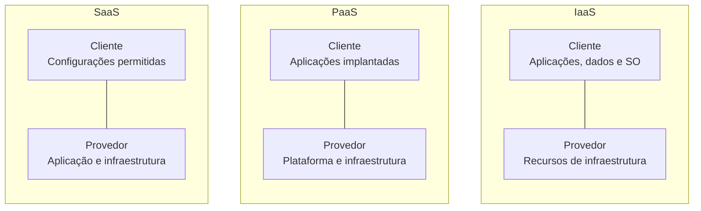
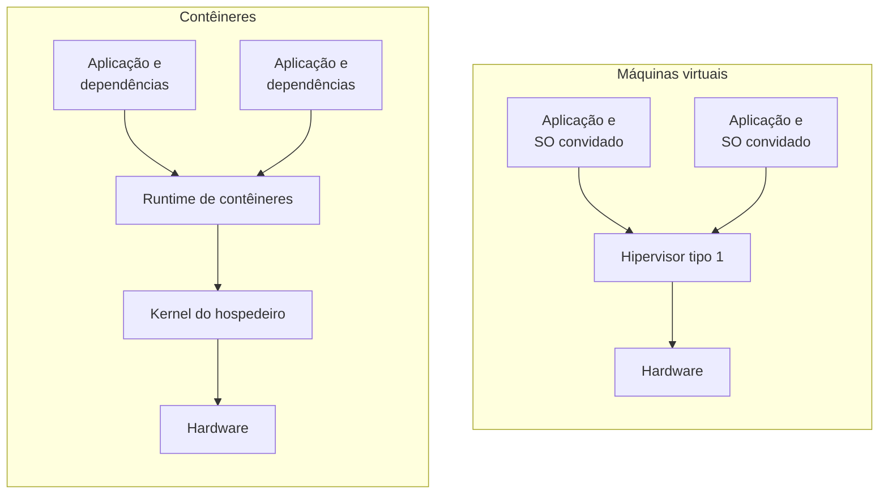

## O que é

**Computação em nuvem** é um modelo de oferta de recursos computacionais (servidores, armazenamento, bancos, redes, software) **sob demanda, pela rede**, de forma **elástica** e **pagando pelo uso** (NIST SP 800-145).

**Virtualização** é a tecnologia que permite a um único computador físico executar **várias máquinas virtuais (VMs)**, cada uma com seu próprio sistema operacional, isoladas entre si. É a base técnica da nuvem.

## Para que serve

Evitar comprar e manter data centers próprios, **escalar** rapidamente em picos (Black Friday), testar em vários ambientes, reduzir tempo de lançamento e transformar investimento (CAPEX) em custo operacional (OPEX).

## Como funciona

### Cinco características essenciais (NIST)

1. **Autoatendimento sob demanda** — o cliente provisiona sozinho, sem falar com o fornecedor.
2. **Amplo acesso pela rede** — por dispositivos variados.
3. **Pool de recursos** — recursos compartilhados entre clientes (*multitenancy*).
4. **Elasticidade rápida** — aumenta e diminui conforme a demanda.
5. **Serviço medido** — uso monitorado e cobrado (*pay-as-you-go*).

### Modelos de serviço

| Modelo | O provedor entrega | O cliente gerencia | Exemplos |
|---|---|---|---|
| **IaaS** — Infraestrutura | servidores virtuais, rede, armazenamento | **SO**, middleware, aplicação, dados | AWS EC2, Azure VMs, Google Compute Engine |
| **PaaS** — Plataforma | ambiente de execução, banco gerenciado, escalonamento | **aplicação e dados** | Heroku, Google App Engine, Azure App Service, Vercel |
| **SaaS** — Software | **aplicação pronta** para usar | só dados/configurações | Gmail, Microsoft 365, Salesforce, Google Workspace |
| **FaaS/Serverless** | executa **funções** sob demanda | o código das funções | AWS Lambda, Cloud Functions |

**Responsabilidade compartilhada:** segurança "**da** nuvem" (data center, hardware, hipervisor) é do provedor; segurança "**na** nuvem" (dados, acessos, configurações; e, no IaaS, o SO) é do cliente — quanto mais alto o modelo, menos o cliente gerencia.

### Modelos de implantação

**Pública** (recursos do provedor, compartilhados), **privada** (exclusiva de uma organização), **híbrida** (combinação, com portabilidade entre elas) e **comunitária** (compartilhada por organizações com interesses comuns).

### Virtualização

- **Hipervisor (VMM)** cria e gerencia as VMs, dividindo CPU, memória e disco do hospedeiro: cada VM usa **um subconjunto** dos recursos reais.
  - **Tipo 1 (bare metal):** roda direto no hardware (VMware ESXi, Hyper-V, KVM, Xen) — usado em data centers.
  - **Tipo 2 (hospedado):** roda sobre um SO (VirtualBox, VMware Workstation) — usado em desktops e testes.
- O conceito existe desde os mainframes **IBM System/370** (anos 70).
- **Transparência:** o SO convidado "acha" que está em uma máquina real.
- Desempenho: há algum **overhead**; uma VM **não** é mais rápida que o mesmo SO rodando direto no hardware.
- Aplicações: **consolidação** de servidores, **testes** em vários SOs, isolamento, recuperação de desastres, laboratórios.

### Contêineres

Isolam **processos** compartilhando o **kernel** do hospedeiro (Docker); são mais **leves** e iniciam em segundos. **Kubernetes** orquestra contêineres em cluster (escala, recuperação, implantação).

## Características principais

- Elasticidade + pagamento por uso = custo acompanha a demanda.
- Abstração crescente: IaaS → PaaS → SaaS.
- Virtualização não é exclusiva de Linux (Windows, macOS e outros também hospedam e são hospedados).

## Exemplos práticos

:::example Escolhendo o modelo
- Uma startup quer só publicar sua API sem cuidar de servidores → **PaaS** (ou serverless).
- Um banco precisa de controle total do SO para requisitos de auditoria → **IaaS** (ou nuvem privada).
- Um escritório precisa de e-mail e planilhas colaborativas → **SaaS**.
:::

## Representação visual

Fonte: adaptado de MELL; GRANCE (2011, seção 2) — recriado pela equipe Stacklyst.

Leia cada coluna como uma fronteira de controle. O cliente controla o sistema convidado na IaaS, a aplicação implantada na PaaS e configurações restritas na SaaS. No ENADE, classifique o serviço pela camada que o consumidor pode configurar.

Fonte: adaptado de TANENBAUM; BOS (2016, cap. 7) e IRWIN (2026) — recriado pela equipe Stacklyst.

Leia a pilha de baixo para cima. No exemplo de hipervisor tipo 1, cada VM inclui um sistema convidado. Os contêineres isolam processos que usam o kernel do hospedeiro. No ENADE, identifique o que muda entre as duas formas de isolamento.

## Vantagens e desvantagens

| Vantagens | Desvantagens |
|---|---|
| elasticidade e pagamento por uso | dependência do fornecedor (*lock-in*) |
| sem investimento em hardware | custos podem fugir do controle |
| alta disponibilidade e alcance global | exige internet; latência |
| serviços gerenciados prontos | questões de soberania e LGPD sobre dados |

## Diferenças entre conceitos semelhantes

- **IaaS × PaaS × SaaS:** infraestrutura (você instala o SO) × plataforma (você só sobe o código) × software pronto.
- **VM × contêiner:** VM virtualiza **hardware** (SO completo); contêiner virtualiza o **SO** (compartilha kernel).
- **Hipervisor tipo 1 × tipo 2:** direto no hardware × sobre um SO.
- **Elasticidade × escalabilidade:** elasticidade é ajustar **automaticamente** para cima e para baixo; escalabilidade é a **capacidade** de crescer.

## Como cai no ENADE

:::enade
Virtualização em afirmações (2008: transparência e uso em data centers; 2011: VM usa subconjunto da memória, aplicação em testes, não é exclusiva de Linux, não é mais rápida que a máquina real) e modelos de serviço em nuvem.
:::

## Pegadinhas

:::trap VM não é mais rápida que a máquina real
Há sempre algum overhead em relação à execução direta no mesmo hardware.
:::

:::trap SaaS não é "hospedar sua aplicação"
No SaaS você **usa** uma aplicação pronta; hospedar o próprio código é IaaS/PaaS.
:::

## Questões comentadas

::question 2011-objective-28 Afirmações sobre virtualização

**I** correta (a VM usa um subconjunto da memória real). **II** correta (testar vários SOs é aplicação típica). **III** errada (não é exclusiva de Linux). **IV** errada (não é mais rápida que a execução direta). Resposta: **I e II**.

::question 2008-objective-15 Máquinas virtuais em data centers

O conceito de VM vem do IBM System/370 e hoje sustenta data centers; as afirmações exploram **transparência**, isolamento e controle dos recursos pelas VMs.

## Resumo para memorizar

:::summary
- NIST: **autoatendimento, amplo acesso, pool de recursos, elasticidade, serviço medido**.
- **IaaS** (infra, você gerencia o SO) · **PaaS** (plataforma, você gerencia o código) · **SaaS** (software pronto).
- Implantação: pública, privada, híbrida, comunitária.
- Hipervisor **tipo 1** (bare metal) × **tipo 2** (hospedado). VM usa parte dos recursos e tem overhead.
- Contêiner compartilha o kernel; é mais leve que a VM.
:::

## Miniquestionário

:::quiz
[
  {
    "question": "Uma empresa usa um CRM acessado pelo navegador, sem instalar nada e sem administrar servidores. É qual modelo?",
    "options": ["IaaS", "PaaS", "SaaS", "Nuvem privada"],
    "answer": 2,
    "explanation": "Software pronto entregue como serviço."
  },
  {
    "question": "Qual característica do NIST permite aumentar e reduzir recursos rapidamente conforme a demanda?",
    "options": ["Pool de recursos", "Elasticidade rápida", "Amplo acesso à rede", "Serviço medido"],
    "answer": 1,
    "explanation": "Elasticidade acompanha a variação da demanda."
  },
  {
    "question": "Qual é a principal diferença entre VM e contêiner?",
    "options": ["Contêineres têm um SO completo cada", "VMs incluem um SO convidado completo; contêineres compartilham o kernel do hospedeiro", "VMs não isolam aplicações", "Não há diferença"],
    "answer": 1,
    "explanation": "Por isso contêineres são mais leves e iniciam mais rápido."
  }
]
:::

## Referências

- MELL, P.; GRANCE, T. *The NIST definition of cloud computing*. Gaithersburg: National Institute of Standards and Technology, 2011. NIST Special Publication 800-145. DOI 10.6028/NIST.SP.800-145.
- TANENBAUM, A. S.; BOS, H. *Sistemas operacionais modernos*. 4. ed. São Paulo: Pearson Education do Brasil, 2016.
- VERAS, M. *Cloud Computing: nova arquitetura da TI*. Brasport, 2012.
- INEP. ENADE TADS 2008 (questão 15) e 2011 (questão 28).
- IRWIN, M. *What is a container?* [S. l.]: Docker, 2026. Disponível em: https://docs.docker.com/learn/content/what-is-a-container/. Acesso em: 25 nov. 2026.
