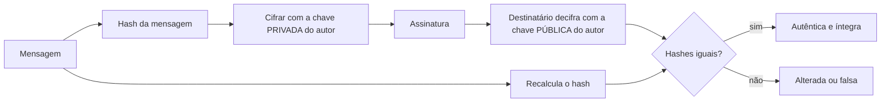

## O que é

**Segurança da informação** é a proteção da informação contra ameaças, para garantir a continuidade do negócio e minimizar riscos (ISO/IEC 27001/27002). Seus pilares formam a tríade **CID**:

- **Confidencialidade:** só quem é **autorizado** acessa a informação.
- **Integridade:** a informação **não é alterada** indevidamente (e alterações são detectáveis).
- **Disponibilidade:** a informação e os serviços estão **acessíveis quando necessário**.

Complementos frequentes: **autenticidade** (a origem é quem diz ser), **não repúdio** (o autor não pode negar a autoria) e **legalidade**.

## Para que serve

Proteger dados pessoais, financeiros e estratégicos; manter sistemas funcionando; cumprir leis (LGPD, Marco Civil); preservar a reputação. Incidentes custam multas, processos e perda de clientes.

## Como funciona

### Autenticação × autorização

- **Autenticação:** **quem é você?** — comprovar identidade por algo que se **sabe** (senha), se **tem** (token, celular) ou se **é** (biometria). **MFA** combina dois ou mais fatores.
- **Autorização:** **o que você pode fazer?** — permissões após a autenticação (perfis, RBAC, princípio do **menor privilégio**).
- **Auditoria/registro (accounting):** registrar quem fez o quê.

### Criptografia

| Tipo | Chaves | Exemplos | Uso |
|---|---|---|---|
| **Simétrica** | **uma mesma chave** cifra e decifra | AES, ChaCha20 | cifrar grandes volumes (rápida) |
| **Assimétrica** | **par de chaves**: pública e privada | RSA, ECC | troca de chaves, assinaturas digitais |

- Para **confidencialidade**, cifra-se com a **chave pública do destinatário**; só a **privada** dele decifra.
- **Assinatura digital:** o autor cifra o **hash** da mensagem com sua **chave privada**; qualquer um verifica com a **pública** → garante **autenticidade, integridade e não repúdio**.
- **Certificado digital** (ICP-Brasil, X.509): documento emitido por uma **Autoridade Certificadora** que associa uma chave pública a uma identidade. O HTTPS/TLS usa certificados e combina assimétrica (estabelecer chave) com simétrica (dados).

### Hashing

Uma **função hash criptográfica** (SHA-256, SHA-3) transforma qualquer entrada em um resumo de tamanho fixo; é **unidirecional** (não se reverte), **determinística** e **resistente a colisões**; mudar um bit muda o resumo inteiro. Usos: verificar **integridade** de arquivos, assinaturas, e **guardar senhas** — com funções lentas e **sal** (bcrypt, scrypt, Argon2), nunca em texto puro nem com MD5/SHA-1.

:::warning Hash não é criptografia
Criptografia é reversível com a chave; hash não tem "chave para desfazer".
:::

### Ameaças e ataques comuns

| Ataque | O que faz | Pilar atingido |
|---|---|---|
| **DoS / DDoS** | sobrecarrega o alvo com requisições; no DDoS, a partir de muitas máquinas **zumbis** (botnet) | **disponibilidade** |
| **Phishing / engenharia social** | engana pessoas para obter senhas e dados | confidencialidade |
| **SQL injection** | injeta comandos SQL via entradas não tratadas | confidencialidade e integridade |
| **XSS** | injeta scripts em páginas vistas por outros usuários | confidencialidade |
| **Ransomware** | cifra dados e cobra resgate | disponibilidade (e confidencialidade) |
| **Man-in-the-middle** | intercepta a comunicação | confidencialidade e integridade |
| **Malware** (vírus, worm, trojan, spyware) | código malicioso | vários |

Defesas: atualização de sistemas, **firewall**, IDS/IPS, antivírus/EDR, **backup** (regra 3-2-1), criptografia, MFA, validação de entradas e **consultas parametrizadas**, conscientização, gestão de vulnerabilidades e resposta a incidentes.

### Políticas de segurança

Documentos que definem **direitos e responsabilidades**: política de **senhas**, de **backup**, de **privacidade**, de **uso aceitável** (o que se pode fazer com os recursos da organização — e-mail, internet, equipamentos), de **confidencialidade**, de classificação da informação.

### LGPD — Lei nº 13.709/2018

Regula o **tratamento de dados pessoais** por pessoas e empresas, públicas e privadas, inclusive nos meios digitais, para proteger **liberdade, privacidade e o livre desenvolvimento da personalidade**.

- **Fundamentos (art. 2º):** respeito à **privacidade**; **autodeterminação informativa**; liberdade de expressão, de informação, de comunicação e de opinião; inviolabilidade da **intimidade, da honra e da imagem**; **desenvolvimento econômico e tecnológico e a inovação**; **livre iniciativa, livre concorrência e defesa do consumidor**; **direitos humanos**, livre desenvolvimento da personalidade, dignidade e exercício da cidadania.
- **Princípios (art. 6º):** finalidade, adequação, **necessidade** (mínimo de dados), livre acesso, qualidade dos dados, transparência, segurança, prevenção, não discriminação, responsabilização e prestação de contas.
- **Bases legais** (art. 7º): consentimento é **uma** delas, ao lado de cumprimento de obrigação legal, execução de contrato, legítimo interesse, proteção da vida, entre outras.
- **Dados sensíveis:** origem racial, convicção religiosa, opinião política, saúde, vida sexual, genética, biometria.
- **Agentes:** **controlador** (decide), **operador** (executa), **encarregado/DPO** (canal de comunicação). Fiscalização: **ANPD**.
- **Direitos do titular:** acesso, correção, anonimização, portabilidade, eliminação, revogação do consentimento.

### Marco Civil da Internet — Lei nº 12.965/2014

Princípios, garantias, direitos e deveres para o uso da internet no Brasil: **neutralidade de rede**, proteção da **privacidade** e dos registros, **liberdade de expressão**, e direitos do usuário como a **não suspensão** da conexão, salvo por débito decorrente de sua utilização, e a **manutenção da qualidade contratada** da conexão.

## Características principais

- Segurança é **processo contínuo** (ciclo PDCA da ISO 27001), não um produto.
- **Defesa em profundidade:** várias camadas de proteção.
- O elo mais fraco costuma ser o **humano**.

## Exemplos práticos

:::example Guardando senhas corretamente
```python
import bcrypt
hash_salvo = bcrypt.hashpw(senha.encode(), bcrypt.gensalt())   # no cadastro
bcrypt.checkpw(tentativa.encode(), hash_salvo)                 # no login
```
O banco guarda só o **hash com sal**; nem o administrador vê a senha.
:::

:::example Prevenindo SQL injection
```java
PreparedStatement ps = conn.prepareStatement("SELECT * FROM usuario WHERE login = ?");
ps.setString(1, loginDigitado);   // o valor nunca é interpretado como SQL
```
:::

## Representação visual



## Vantagens e desvantagens

| Controle | Benefício | Custo/limitação |
|---|---|---|
| MFA | barra a maioria dos roubos de senha | atrito para o usuário |
| Criptografia | protege dados em trânsito e em repouso | gestão de chaves |
| Backup | recupera de ransomware e falhas | precisa de testes de restauração |
| Políticas | definem responsabilidades | inúteis sem treinamento e fiscalização |

## Diferenças entre conceitos semelhantes

- **Autenticação × autorização:** identidade × permissões.
- **Simétrica × assimétrica:** uma chave compartilhada × par pública/privada.
- **Hash × criptografia:** irreversível × reversível com chave.
- **DoS × DDoS:** uma origem × muitas origens (zumbis).
- **Fundamentos × princípios da LGPD:** art. 2º (bases valorativas da lei) × art. 6º (regras para o tratamento).
- **LGPD × Marco Civil:** proteção de dados pessoais em geral × uso da internet (neutralidade, registros, direitos do usuário).

## Como cai no ENADE

:::enade
DDoS e o pilar da disponibilidade (2011), políticas de segurança (2017 — questão anulada, mas o conceito de **uso aceitável** é cobrado), **fundamentos do art. 2º da LGPD** (2021) e direitos do Marco Civil em asserção-razão (2014).
:::

## Pegadinhas

:::trap Zumbis não precisam roubar senhas
No DDoS, as máquinas comprometidas apenas **enviam requisições** em massa.
:::

:::trap Consentimento não é a única base legal da LGPD
Afirmações de "obrigatoriedade do consentimento" para todo tratamento estão erradas.
:::

:::trap Duas verdades sem relação de causa
No Marco Civil, manter a qualidade contratada e não suspender a conexão (salvo débito) são garantias **diferentes**: uma não justifica a outra.
:::

## Questões comentadas

::question 2011-objective-31 Rede derrubada por milhares de IPs zumbis

**I** correta (é DDoS) e **II** correta (ameaça a **disponibilidade**). **III** errada (zumbis não precisam roubar senhas). **IV** errada (afirmação absoluta; o código pode ser detectado). Resposta: **I e II**.

::question 2021-objective-26 Fundamentos da LGPD (art. 2º)

A alternativa **E** reproduz os fundamentos: privacidade, autodeterminação informativa, liberdades de expressão, informação, comunicação e opinião, inviolabilidade da intimidade, honra e imagem, desenvolvimento econômico e tecnológico e inovação, livre iniciativa, concorrência e defesa do consumidor, e direitos humanos. As outras misturam direitos do titular, órgãos e procedimentos.

::question 2014-objective-13 Qualidade da conexão e Marco Civil

As duas asserções são verdadeiras — a lei garante a qualidade contratada e a não suspensão salvo débito —, mas a segunda **não justifica** a primeira (alternativa B).

## Resumo para memorizar

:::summary
- **CID**: confidencialidade, integridade, disponibilidade (+ autenticidade, não repúdio).
- Autenticação (**quem**) × autorização (**o quê**); MFA.
- Simétrica (1 chave, rápida) × assimétrica (pública/privada). Assinatura = hash + chave **privada** do autor.
- Hash é **irreversível**; senhas com **bcrypt/Argon2 + sal**.
- DDoS ataca a **disponibilidade**.
- **LGPD** (13.709/2018): fundamentos art. 2º, princípios art. 6º, ANPD, controlador/operador/encarregado. **Marco Civil** (12.965/2014): neutralidade, privacidade, qualidade e não suspensão.
:::

## Miniquestionário

:::quiz
[
  {
    "question": "Ransomware que cifra os arquivos de uma empresa afeta principalmente qual pilar?",
    "options": ["Confidencialidade", "Integridade", "Disponibilidade", "Não repúdio"],
    "answer": 2,
    "explanation": "Os dados ficam inacessíveis aos usuários legítimos."
  },
  {
    "question": "Para enviar uma mensagem que só Maria consiga ler, cifra-se com:",
    "options": ["a chave privada do remetente", "a chave pública de Maria", "a chave privada de Maria", "um hash MD5"],
    "answer": 1,
    "explanation": "Só a chave privada de Maria decifra o que foi cifrado com a pública dela."
  },
  {
    "question": "Na LGPD, o consentimento do titular é:",
    "options": ["obrigatório para qualquer tratamento", "uma das bases legais, ao lado de outras como obrigação legal e execução de contrato", "proibido", "exigido apenas para dados públicos"],
    "answer": 1,
    "explanation": "O art. 7º lista várias bases legais; consentimento é uma delas."
  },
  {
    "question": "Qual é a forma adequada de armazenar senhas?",
    "options": ["Texto puro", "Criptografia simétrica com chave no código", "Hash lento com sal (bcrypt, Argon2)", "MD5 sem sal"],
    "answer": 2,
    "explanation": "Hash lento e com sal dificulta ataques de dicionário e força bruta."
  }
]
:::

## Referências

- BRASIL. Lei nº 13.709, de 14 de agosto de 2018 (Lei Geral de Proteção de Dados Pessoais).
- BRASIL. Lei nº 12.965, de 23 de abril de 2014 (Marco Civil da Internet).
- ABNT. NBR ISO/IEC 27001:2022 e 27002:2022 — Segurança da informação.
- STALLINGS, W. *Criptografia e Segurança de Redes*. 6. ed. Pearson, 2015.
- CERT.br. *Cartilha de Segurança para Internet*. Disponível em cartilha.cert.br.
- OWASP. *OWASP Top 10*. Disponível em owasp.org.
- INEP. ENADE TADS 2011 (questão 31), 2014 (questão 13), 2017 (questão 15, anulada) e 2021 (questão 26).
