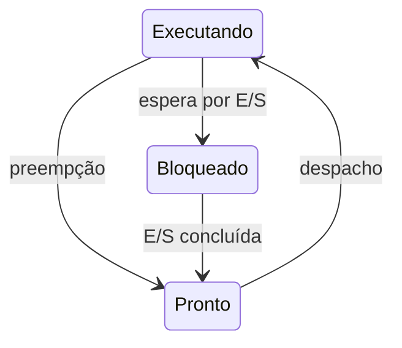

## O que é

O **sistema operacional (SO)** é o software que **gerencia os recursos** do computador (CPU, memória, armazenamento, dispositivos de E/S) e oferece uma **interface** simplificada para programas e usuários. Duas visões clássicas (Tanenbaum): **máquina estendida** (abstrai o hardware) e **gerenciador de recursos** (concede, nega e **isola** o acesso aos recursos).

Componentes: **núcleo (kernel)**, gerência de **processos**, de **memória**, de **arquivos** e de **E/S**, além de interfaces (chamadas de sistema, shell, GUI).

## Para que serve

Permite que vários programas rodem **ao mesmo tempo** sem interferirem uns nos outros, protege o sistema de programas defeituosos ou maliciosos e torna o hardware utilizável sem que cada programa precise conhecer seus detalhes.

## Como funciona

### Processos

Um **processo** é um **programa em execução**, com seu código, dados, pilha, registradores e recursos. O SO guarda suas informações no **PCB** (bloco de controle do processo).

**Estados:** **novo → pronto → executando → (bloqueado/esperando) → pronto … → terminado**.
- *pronto → executando*: o escalonador escolhe o processo;
- *executando → pronto*: fim do quantum (preempção);
- *executando → bloqueado*: espera por E/S;
- *bloqueado → pronto*: a E/S terminou.

A **troca de contexto** salva o estado do processo atual e carrega o de outro.

### Multiprogramação × multiprocessamento

- **Multiprogramação:** vários processos **na memória**, e a CPU **alterna** rapidamente entre eles (pseudoparalelismo) — cada processo "parece" ter sua própria CPU virtual. Aproveita a CPU enquanto um processo espera E/S.
- **Multiprocessamento:** **mais de uma CPU/núcleo**, com paralelismo real.
- **Tempo compartilhado (time-sharing):** multiprogramação com fatias de tempo, para interação com usuários.

### Threads

Uma **thread** é uma **linha de execução dentro de um processo**. Threads do mesmo processo **compartilham** memória e recursos (código, dados, arquivos abertos), mas cada uma tem **sua pilha e seus registradores**. Criar e trocar threads é mais barato que processos; em compensação, exige **sincronização** no acesso aos dados compartilhados.

### Escalonamento da CPU

| Algoritmo | Regra | Preemptivo? | Observação |
|---|---|---|---|
| **FCFS** (FIFO) | ordem de chegada | não | simples; "efeito comboio" |
| **SJF** | menor tempo de execução primeiro | não | menor espera média; exige estimar o tempo |
| **SRTF** | menor tempo **restante** | sim | versão preemptiva do SJF |
| **Round-Robin** | fila circular com **quantum** | sim | justo para sistemas interativos |
| **Prioridade** | maior prioridade primeiro | ambos | risco de **inanição** (solução: envelhecimento) |
| Múltiplas filas | filas por tipo de processo | — | combina políticas |

Métricas: **turnaround** = término − chegada; **tempo de espera** = turnaround − tempo de CPU; **tempo de resposta**; **vazão** (*throughput*).

::widget scheduling

Fonte: adaptado de TANENBAUM; BOS (2016, cap. 2) e SILBERSCHATZ; GALVIN; GAGNE (2015) — recriado pela equipe Stacklyst.

Leia os intervalos de execução e os instantes de chegada e término. No ENADE, aplique a política indicada antes de calcular a espera média ou o tempo de retorno.

### Sincronização

Quando processos/threads acessam dados compartilhados ao mesmo tempo, pode ocorrer **condição de corrida**. O trecho que acessa o recurso é a **região crítica**, protegida por **exclusão mútua**: **mutex**, **semáforos** (Dijkstra), **monitores**.

### Deadlock (impasse)

Conjunto de processos **bloqueados para sempre**, cada um esperando um recurso que outro detém. **Quatro condições necessárias (Coffman)** — todas simultâneas:

1. **Exclusão mútua** — recurso usado por um de cada vez;
2. **Posse e espera** — segura um recurso enquanto espera outro;
3. **Não preempção** — recurso não pode ser tomado à força;
4. **Espera circular** — P1 espera P2, que espera P1.

Estratégias: **prevenir** (quebrar uma condição, ex.: ordenar recursos), **evitar** (algoritmo do **banqueiro**), **detectar e recuperar** (abortar processos), **ignorar** (algoritmo do avestruz).

## Características principais

- O SO roda em **modo núcleo** (privilegiado); programas em **modo usuário**, acessando recursos por **chamadas de sistema**.
- Isolamento entre processos é responsabilidade da gerência de memória (espaços de endereçamento separados).

## Exemplos práticos

:::example Calculando espera no FCFS
Processos P1 (chega 0, dura 6), P2 (1, 3), P3 (2, 8), P4 (3, 2). FCFS: P1 de 0–6, P2 6–9, P3 9–17, P4 17–19. Esperas: 0, 5, 7, 14 → média **6,5**. Com SJF a média cai — confira no simulador.
:::

## Representação visual

Fonte: adaptado de TANENBAUM; BOS (2016, cap. 2) — recriado pela equipe Stacklyst.

O recorte foca os três estados durante a vida do processo. A conclusão da E/S leva de bloqueado a pronto. Depois, o escalonador concede a CPU. No ENADE, confira se o processo está esperando um evento ou somente sua vez de executar.

## Vantagens e desvantagens

| Recurso | Vantagem | Custo |
|---|---|---|
| Threads | leves, compartilham memória | exigem sincronização |
| Round-Robin | resposta rápida e justa | trocas de contexto se o quantum for pequeno |
| SJF | menor espera média | inanição de processos longos; tempo precisa ser estimado |
| Prevenção de deadlock | elimina o risco | restringe o uso de recursos |

## Diferenças entre conceitos semelhantes

- **Programa × processo:** programa é **estático** (arquivo); processo é a **execução**.
- **Processo × thread:** processos têm espaços de memória **separados**; threads do mesmo processo **compartilham**.
- **Multiprogramação × multiprocessamento:** alternância em uma CPU × várias CPUs.
- **Preemptivo × não preemptivo:** o SO pode **interromper** o processo em execução × o processo roda até bloquear ou terminar.
- **Deadlock × inanição (starvation):** deadlock = espera circular permanente; inanição = um processo nunca é escolhido, embora o sistema progrida.

## Como cai no ENADE

:::enade
Definições a partir de citações do Tanenbaum (2017: CPU virtual e alternância → **multiprogramação**), o SO como gerenciador de recursos e o isolamento de memória (2021), além de escalonamento e deadlocks.
:::

## Pegadinhas

:::trap Thread não é o nome do pseudoparalelismo entre processos
A alternância da CPU entre **processos** é multiprogramação.
:::

:::trap Deadlock precisa das quatro condições
Basta quebrar **uma** delas para preveni-lo.
:::

## Questões comentadas

::question 2017-objective-19 Cada processo com sua CPU virtual

A CPU alterna entre processos, dando a impressão de execução paralela: **multiprogramação** (alternativa C). Multiprocessador exige várias CPUs; thread é unidade de execução dentro de um processo.

::question 2021-objective-28 Programas interferindo na memória uns dos outros

Impedir que um programa escreva no espaço de outro (ou do SO) é função do **gerenciamento de memória**, que isola os espaços de endereçamento (alternativa B).

## Resumo para memorizar

:::summary
- SO = **gerenciador de recursos** + máquina estendida.
- Processo: novo → pronto ⇄ executando ⇄ bloqueado → terminado.
- **Multiprogramação** = alternância em uma CPU; **multiprocessamento** = várias CPUs.
- Thread = execução dentro do processo, compartilha memória.
- FCFS, SJF, SRTF, Round-Robin (quantum), prioridade. Turnaround = fim − chegada; espera = turnaround − CPU.
- Deadlock: **exclusão mútua, posse e espera, não preempção, espera circular**.
:::

## Miniquestionário

:::quiz
[
  {
    "question": "Qual algoritmo de escalonamento usa fatias de tempo (quantum) em uma fila circular?",
    "options": ["FCFS", "SJF", "Round-Robin", "Prioridade não preemptiva"],
    "answer": 2,
    "explanation": "Round-Robin dá a cada processo um quantum e o recoloca no fim da fila."
  },
  {
    "question": "Threads de um mesmo processo compartilham:",
    "options": ["a pilha e os registradores", "o espaço de memória e os arquivos abertos", "o PCB de outros processos", "nada"],
    "answer": 1,
    "explanation": "Cada thread tem pilha e registradores próprios, mas compartilha a memória do processo."
  },
  {
    "question": "Ordenar os recursos e exigir que todos sejam pedidos nessa ordem previne deadlock quebrando qual condição?",
    "options": ["Exclusão mútua", "Espera circular", "Não preempção", "Posse e espera"],
    "answer": 1,
    "explanation": "Com ordem global, não se forma um ciclo de espera."
  }
]
:::

## Referências

- TANENBAUM, A. S.; BOS, H. *Sistemas operacionais modernos*. 4. ed. São Paulo: Pearson Education do Brasil, 2016.
- SILBERSCHATZ, A.; GALVIN, P. B.; GAGNE, G. *Fundamentos de sistemas operacionais*. 9. ed. Rio de Janeiro: LTC, 2015.
- MACHADO, F. B.; MAIA, L. P. *Arquitetura de Sistemas Operacionais*. 5. ed. LTC, 2013.
- INEP. ENADE TADS 2017 (questão 19) e 2021 (questão 28).
