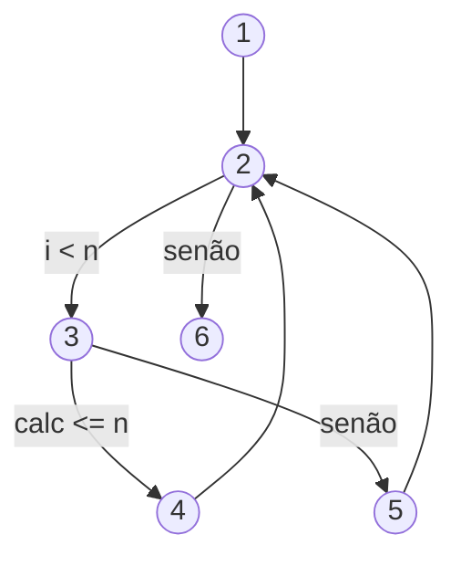

## O que é

A **complexidade ciclomática** V(G), proposta por **Thomas McCabe** (1976), é uma métrica que indica **quantos caminhos linearmente independentes** existem no fluxo de controle de um programa. Ela fornece:

- o **número mínimo de casos de teste** para executar todos os caminhos básicos (e, assim, cobrir todos os comandos e todas as decisões);
- um **indicador de complexidade** do código (valores altos sugerem dificuldade de entender, testar e manter).

## Para que serve

É a base do **teste do caminho básico**, técnica de **caixa branca**: em vez de testar todos os caminhos possíveis (que podem ser infinitos com laços), testa-se um **conjunto básico** de caminhos independentes, cujo tamanho é V(G).

## Como funciona

### 1. Montar o grafo de fluxo de controle

- Cada **nó** representa um comando ou um bloco de comandos sequenciais (sem desvios internos).
- Cada **aresta** representa o fluxo de controle de um nó para outro.
- **Nós predicados (de decisão):** nós de onde saem **duas ou mais** arestas (`if`, `while`, `for`, `case`).
- **Regiões:** áreas delimitadas pelo grafo no plano, **contando a área externa**.

Condições compostas (`a && b`) devem ser separadas em **um nó por condição simples** para o cálculo pelo grafo.

### 2. Calcular V(G) — três fórmulas equivalentes

$$V(G) = E - N + 2P$$

em que **E** = arestas, **N** = nós e **P** = componentes conexos (1 para um único programa/função).

$$V(G) = P_{\text{predicados}} + 1$$

(número de nós de decisão binários + 1; um `switch` com *k* saídas conta como *k − 1* decisões).

$$V(G) = \text{número de regiões}$$

### 3. Encontrar os caminhos independentes

Um **caminho independente** introduz **pelo menos uma aresta nova** (ou um novo conjunto de comandos) em relação aos caminhos já escolhidos. Estratégia prática: escolha um **caminho base** (o mais comum) e, para cada decisão, crie um novo caminho **invertendo apenas aquela decisão**.

### 4. Projetar os casos de teste

Para cada caminho, escolha entradas que forcem a execução por ele e defina o resultado esperado.

::widget cyclomatic preset=while-if

## Características principais

| V(G) | Interpretação usual |
|---|---|
| 1–10 | código simples, baixo risco |
| 11–20 | moderadamente complexo |
| 21–50 | complexo, alto risco |
| > 50 | praticamente intestável — refatorar |

- Pela contagem de decisões no código: **cada `if`, `while`, `for`, `case`, `catch`, `&&`, `||` e `?:` soma 1**; V(G) = decisões + 1.
- V(G) é **um limite superior** para o número de testes necessários para cobertura de decisões e o **número exato** de caminhos do conjunto básico.

## Exemplos práticos

:::example Calculando passo a passo
```text
1  i ← 0
2  enquanto (i < n) faca
3      i ← i + 1
       se (calc(i) <= n) entao
4          f1(i)
       senao
5          f2(i)
       fim se
   fim enquanto
6  imprimir("ok")
```
Grafo: nós 1, 2, 3, 4, 5, 6; arestas 1→2, 2→3, 2→6, 3→4, 3→5, 4→2, 5→2 (**7 arestas**).
- V(G) = E − N + 2 = 7 − 6 + 2 = **3**
- Predicados: nó 2 (enquanto) e nó 3 (se) → 2 + 1 = **3**
- Caminhos independentes: **1-2-6** (não entra no laço), **1-2-3-4-2-6** (entra e toma o *então*), **1-2-3-5-2-6** (entra e toma o *senão*).
:::

## Representação visual



## Vantagens e desvantagens

| Vantagens | Desvantagens |
|---|---|
| métrica objetiva, fácil de calcular automaticamente | não mede complexidade de dados nem de legibilidade |
| define o mínimo de testes para os caminhos básicos | caminhos básicos não garantem todas as combinações |
| funciona em qualquer código com fluxo de controle, inclusive métodos de classes | grafos manuais são trabalhosos em código grande |

## Diferenças entre conceitos semelhantes

- **Caminhos possíveis × caminhos independentes:** com laços, os possíveis podem ser infinitos; os independentes são exatamente **V(G)**.
- **Cobertura de comandos × de decisões:** a primeira executa cada linha ao menos uma vez; a segunda exige cada decisão tomada como **verdadeira e falsa**. Decisões ⇒ comandos, não o contrário.
- **Nó × região:** nó é um bloco de código; região é uma área delimitada pelas arestas (inclui a externa).
- **Complexidade ciclomática × complexidade de algoritmos (Big O):** a primeira mede a **estrutura de decisões** do código; Big O mede **crescimento do custo** com a entrada.

## Como cai no ENADE

:::enade
Fluxogramas pedindo para avaliar um **conjunto de caminhos independentes** e o significado da complexidade ciclomática (2014), cálculo de V(G) e a aplicabilidade do teste do caminho básico a programas **orientados a objetos** (também se aplica!).
:::

## Pegadinhas

:::trap Caminhos básicos valem para OO também
Métodos de classes têm fluxo de controle como qualquer código procedural; afirmar o contrário é falso (2014).
:::

:::trap Conte a região externa
V(G) = número de regiões **incluindo** a de fora do grafo.
:::

:::trap Condições compostas
`se (a e b)` tem **duas** decisões para McCabe, não uma.
:::

## Questões comentadas

::question 2014-objective-31 Caixa branca sobre um fluxograma

**I** correta: os quatro caminhos formam um conjunto independente (cada um acrescenta arestas novas). **II** correta: a complexidade ciclomática fornece a **quantidade de caminhos independentes** a testar. **III** errada: o teste de caminhos se aplica também a programas OO. Resposta: **I e II** (alternativa C).

## Resumo para memorizar

:::summary
- **V(G) = E − N + 2P = predicados + 1 = regiões**.
- V(G) = número de **caminhos independentes** = mínimo de testes do **caminho básico**.
- Cada decisão (if, while, for, case, &&, ||) soma 1.
- Técnica de **caixa branca**, aplicável a código procedural e OO.
:::

:::mnemonic
"**E**le **N**unca **2**" → E − N + 2. E confira com "decisões + 1".
:::

## Miniquestionário

:::quiz
[
  {
    "question": "Um grafo de fluxo tem 9 arestas e 7 nós. Qual é V(G)?",
    "options": ["2", "4", "16", "3"],
    "answer": 1,
    "explanation": "V(G) = 9 − 7 + 2 = 4."
  },
  {
    "question": "Um método tem três 'if' independentes em sequência. Qual é V(G)?",
    "options": ["3", "4", "8", "1"],
    "answer": 1,
    "explanation": "3 decisões + 1 = 4 caminhos independentes (embora existam 8 caminhos possíveis)."
  },
  {
    "question": "O que a complexidade ciclomática indica para o teste do caminho básico?",
    "options": ["O número de linhas do código", "O número de caminhos independentes, ou seja, o mínimo de casos de teste do conjunto básico", "O tempo de execução", "O número de classes"],
    "answer": 1,
    "explanation": "Cada caminho independente vira pelo menos um caso de teste."
  }
]
:::

## Referências

- McCABE, T. J. A Complexity Measure. *IEEE Transactions on Software Engineering*, SE-2, n. 4, p. 308–320, 1976.
- PRESSMAN, R. S.; MAXIM, B. R. *Engenharia de Software*. 8. ed. AMGH, 2016 — cap. 23 (teste do caminho básico).
- DELAMARO, M. E.; MALDONADO, J. C.; JINO, M. *Introdução ao Teste de Software*. 2. ed. Elsevier, 2016 — cap. 4.
- INEP. ENADE TADS 2014, questão 31.
