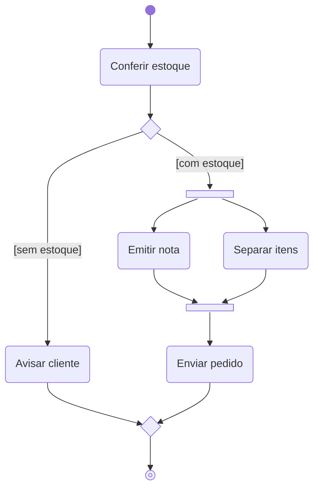
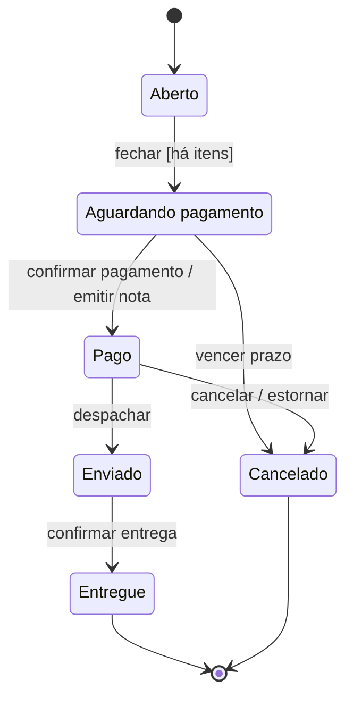

## O que é

São dois diagramas **comportamentais** com propósitos diferentes:

- **Diagrama de atividades** — modela um **fluxo de controle** (e de dados) entre **ações**: processos de negócio, algoritmos, o passo a passo de um caso de uso. Parece um fluxograma, mas com **paralelismo** e **responsáveis** (raias).
- **Diagrama de máquina de estados** — modela o **ciclo de vida de um objeto** (ou sistema): os **estados** possíveis e as **transições** disparadas por **eventos**.

## Para que serve

- Atividades: entender e melhorar **processos**, detalhar **fluxos** de casos de uso, documentar **algoritmos**, mostrar o que pode acontecer **em paralelo**.
- Estados: especificar objetos com comportamento que **depende do estado** (pedido, conta, semáforo, conexão, urna eletrônica), garantindo que eventos inválidos sejam tratados.

## Como funciona

### Elementos do diagrama de atividades

| Elemento | Notação | Significado |
|---|---|---|
| **Nó inicial** | círculo **preenchido** | início do fluxo |
| **Ação** | retângulo de cantos **arredondados** | um passo executado |
| **Fluxo de controle** | seta | ordem entre ações |
| **Decisão** | **losango** com uma entrada e várias saídas com **guardas** `[cond]` | escolha de **um** caminho |
| **Junção (merge)** | losango com várias entradas e uma saída | reúne caminhos alternativos |
| **Bifurcação (fork)** | **barra** grossa com uma entrada e várias saídas | inicia fluxos **paralelos** |
| **Sincronização (join)** | barra com várias entradas e uma saída | **espera todos** os fluxos paralelos chegarem |
| **Nó final de atividade** | círculo com ponto (olho de boi) | encerra **toda** a atividade |
| **Nó final de fluxo** | círculo com **X** | encerra só aquele fluxo |
| **Raias (partições)** | colunas/linhas com nome | **quem** executa cada ação |
| **Nó de objeto** | retângulo | dado que flui entre ações |

### Elementos da máquina de estados

- **Estado** — retângulo de cantos arredondados com o nome; pode ter compartimento interno com `entry / ação`, `do / atividade`, `exit / ação`.
- **Pseudoestado inicial** — círculo preenchido; **estado final** — olho de boi.
- **Transição** — seta rotulada com **`evento [guarda] / ação`**:
  - **evento**: o que dispara (`pagar`, `timeout`);
  - **guarda**: condição booleana que precisa ser verdadeira;
  - **ação**: o que é executado na transição.
- **Estado composto** — estado que contém subestados.
- **Escolha** (losango), **junção**, **histórico** (H) — pseudoestados auxiliares.

## Características principais

| | Atividades | Máquina de estados |
|---|---|---|
| Pergunta | **como o trabalho flui?** | **em que estado o objeto está e o que muda?** |
| Foco | ações e processos | um objeto e seus estados |
| Paralelismo | fork/join | regiões ortogonais em estados compostos |
| Gatilho | término da ação anterior | **eventos** |

## Exemplos práticos

:::example Interpretando um fork/join
Após a Atividade 02, uma decisão: se **[não]**, volta para a Atividade 01; se **[sim]**, segue para um **fork** que inicia 03 e 04 **ao mesmo tempo**. Elas **não precisam terminar juntas**; o **join** espera **as duas** antes de começar a 05. Uma vez seguido o [sim], a Atividade 02 não é executada de novo naquele fluxo.
:::

## Representação visual

Fonte: adaptado de OMG (2017, seção 15) e BOOCH; RUMBAUGH; JACOBSON (2006, cap. 20) — recriado pela equipe Stacklyst.

Siga as setas desde o ponto inicial. As guardas do primeiro losango escolhem uma saída, o fork libera as duas ações e o join retém o fluxo até que ambas terminem. O segundo losango reúne os caminhos alternativos. O ENADE costuma perguntar quando uma ação pode começar.

:::note Sobre a notação no Mermaid
As barras representam bifurcação e sincronização. Os dois losangos têm funções distintas, identificadas pela quantidade de entradas e saídas.
:::

Fonte: adaptado de OMG (2017, seção 14) e BOOCH; RUMBAUGH; JACOBSON (2006, caps. 22 e 25) — recriado pela equipe Stacklyst.

Em cada seta, leia o evento, a guarda entre colchetes quando houver e o efeito após a barra. No ENADE, determine o estado atual antes de aplicar um evento. Cancelar um pedido pago, por exemplo, dispara o estorno.

## Vantagens e desvantagens

| Diagrama | Vantagem | Limitação |
|---|---|---|
| Atividades | intuitivo, mostra paralelismo e responsáveis | não mostra quem chama quem (objetos) |
| Estados | previne transições inválidas, ótimo para lógica de status | um diagrama por objeto relevante; explode em sistemas grandes |

## Diferenças entre conceitos semelhantes

- **Decisão × fork:** decisão escolhe **um** caminho (losango, com guardas); fork inicia **todos** os caminhos **em paralelo** (barra).
- **Merge × join:** merge reúne caminhos **alternativos** (não espera); join **sincroniza** caminhos paralelos (espera todos).
- **Final de atividade × final de fluxo:** o primeiro encerra **tudo**; o segundo encerra apenas **um** fluxo paralelo.
- **Atividades × estados:** atividades = **processo**; estados = **ciclo de vida de um objeto**.
- **Fluxograma × atividades:** o diagrama de atividades acrescenta **paralelismo**, **raias** e **fluxo de objetos**.

## Como cai no ENADE

:::enade
Identificar o diagrama a partir da figura (2008: "fluxo de controle de ações sequenciais e paralelas partindo de um estado inicial" → **atividades**) e interpretar decisões, fork e join (2011).
:::

## Pegadinhas

:::trap Fork não garante término simultâneo
As ações iniciam juntas, mas podem terminar em momentos diferentes; quem sincroniza é o **join**.
:::

:::trap "Estado inicial" não define o diagrama de estados
Os dois diagramas têm nó/pseudoestado inicial. O que define a máquina de estados é mostrar **estados de um objeto** e **transições por eventos**.
:::

## Questões comentadas

::question 2008-objective-24 Que diagrama é este?

A figura mostra um fluxo que parte de um nó inicial e organiza **ações** sequenciais e **paralelas** — característica do **diagrama de atividades** (alternativa E). Um diagrama de estados mostraria estados de **um objeto** e eventos de transição.

::question 2011-objective-14 Fork, join e decisão

**III** correta: 03 e 04 começam juntas (fork), mas não terminam necessariamente juntas. **IV** correta: com [sim], a atividade 02 não volta a ser executada. **I** errada: a 05 espera **ambas** (join), não "03 **ou** 04". **II** errada: o [não] não exige necessariamente repetir 01 e 02 conforme o desenho. Resposta: **III e IV** (alternativa C).

## Resumo para memorizar

:::summary
- Atividades: nó inicial ●, ação (arredondado), decisão/merge (losango), **fork/join (barra)**, final ◉, final de fluxo ⊗, **raias**.
- Estados: estado (arredondado), transição **evento [guarda] / ação**, entry/do/exit, estado composto.
- Decisão = **um** caminho; fork = **todos** em paralelo; join = **espera todos**.
:::

## Miniquestionário

:::quiz
[
  {
    "question": "Qual elemento do diagrama de atividades espera que todos os fluxos paralelos terminem antes de continuar?",
    "options": ["Decisão", "Merge", "Join (sincronização)", "Nó final de fluxo"],
    "answer": 2,
    "explanation": "O join sincroniza; o merge apenas reúne caminhos alternativos."
  },
  {
    "question": "Na transição 'pagar [saldo >= valor] / debitar()', o que é '[saldo >= valor]'?",
    "options": ["Evento", "Guarda", "Ação", "Estado"],
    "answer": 1,
    "explanation": "Entre colchetes fica a condição de guarda; 'pagar' é o evento e 'debitar()' a ação."
  },
  {
    "question": "Para modelar os status de um chamado (Aberto, Em atendimento, Resolvido, Fechado) e o que dispara cada mudança, o diagrama mais adequado é:",
    "options": ["Atividades", "Máquina de estados", "Implantação", "Pacotes"],
    "answer": 1,
    "explanation": "Ciclo de vida de um objeto com transições por eventos: máquina de estados."
  }
]
:::

## Referências

- OBJECT MANAGEMENT GROUP. *Unified Modeling Language (UML)*. Versão 2.5.1. [S. l.]: OMG, 2017. Disponível em: https://www.omg.org/spec/UML/2.5.1. Acesso em: 25 nov. 2026.
- BOOCH, G.; RUMBAUGH, J.; JACOBSON, I. *UML: guia do usuário*. 2. ed. Rio de Janeiro: Elsevier, 2006.
- GUEDES, G. T. A. *UML 2: uma abordagem prática*. 3. ed. Novatec, 2018.
- INEP. ENADE TADS 2008 (questão 24) e 2011 (questão 14).
