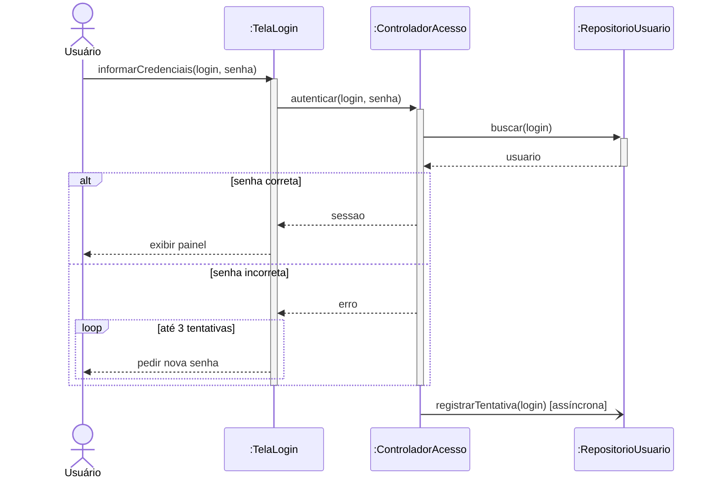

## O que é

**Diagramas de interação** mostram como **objetos colaboram trocando mensagens** para realizar um comportamento (normalmente um cenário de caso de uso). A UML 2.5 tem quatro: **sequência**, **comunicação**, **tempo** e **visão geral de interação**.

## Para que serve

- Detalhar **como** um caso de uso é realizado pelas classes do design;
- Descobrir **operações** que as classes precisam ter (cada mensagem recebida vira um método);
- Mostrar responsabilidades entre camadas (interface → controle → domínio → persistência);
- Documentar protocolos entre sistemas e restrições de tempo.

## Como funciona

### Diagrama de sequência

- **Linha de vida (lifeline):** retângulo com `nome : Classe` (ou ator) no topo e uma **linha tracejada vertical** para baixo. O **tempo corre de cima para baixo**.
- **Barra de ativação (ocorrência de execução):** retângulo estreito sobre a linha de vida, indicando o período em que o objeto está **executando** uma operação.
- **Mensagens:**

| Tipo | Notação | Significado |
|---|---|---|
| **Síncrona** | linha cheia, **seta cheia (preenchida)** | quem envia **espera** a resposta (chamada de método comum) |
| **Assíncrona** | linha cheia, **seta aberta** | quem envia **não espera** e continua (evento, fila, thread) |
| **Retorno** | linha **tracejada**, seta aberta | resposta de uma síncrona |
| **Criação** | tracejada com «create» até o retângulo do novo objeto | instancia o objeto (que aparece mais abaixo) |
| **Destruição** | **X** no fim da linha de vida | o objeto deixa de existir |
| **Automensagem** | seta que volta para a própria linha de vida | o objeto chama um método dele mesmo |

- **Fragmentos combinados:** molduras retangulares com um **operador** no canto:

| Operador | Significado | Equivale a |
|---|---|---|
| **alt** | alternativas com **guardas** `[condição]`, separadas por linha tracejada; só uma executa | `if / else` |
| **opt** | executa **só se** a guarda for verdadeira | `if` sem else |
| **loop** | repete enquanto a guarda for verdadeira (ou `loop(1,n)`) | `for / while` |
| **par** | trechos executados em **paralelo** | threads |
| **ref** | referência a outro diagrama de interação | chamada de sub-rotina |
| break, critical, neg, assert, seq, strict, ignore, consider | outros operadores menos cobrados | — |

No Mermaid: `->>` é síncrona (seta cheia), `-)` é assíncrona (seta aberta), `-->>` é retorno (tracejada); `+`/`-` ativam e desativam as barras de ativação.

### Diagrama de comunicação

Mostra os **mesmos objetos e mensagens**, mas organizados pelos **vínculos** entre objetos (como um grafo). A ordem vem da **numeração hierárquica** (1, 1.1, 1.2, 2…). Útil para ver **quem conhece quem** (acoplamento).

::widget uml diagram=communication

### Diagrama de tempo (timing)

Mostra **mudanças de estado** de uma ou mais linhas de vida ao longo de um **eixo horizontal de tempo**, com **restrições de duração** (`{t ≤ 4 s}`). Usado em sistemas embarcados e de tempo real.

::widget uml diagram=timing

### Diagrama de visão geral de interação

Combina a estrutura de um **diagrama de atividades** (nó inicial, decisões, fluxos, nó final) com **quadros de interação** (`sd`) e **referências** (`ref`) a diagramas de sequência. Dá a visão do **fluxo entre várias interações**.

::widget uml diagram=overview

## Características principais

- Todos são **comportamentais** e mostram **instâncias** (objetos), não classes.
- O diagrama de sequência é o mais usado e o mais cobrado.
- Cada mensagem recebida corresponde a uma **operação** na classe do receptor.

## Exemplos práticos

:::example Lendo um diagrama de sequência
Se a linha de vida `:ControladorAcesso` começa com uma mensagem «create» vinda do Aplicativo e termina com um **X** logo após a leitura, então **a cada leitura** um objeto ControladorAcesso é **criado e destruído** — ele não existe permanentemente.
:::

## Representação visual

Os diagramas acima são a representação visual desta página: sequência (Mermaid), comunicação, tempo e visão geral (SVG em notação UML).

## Vantagens e desvantagens

| Diagrama | Vantagem | Limitação |
|---|---|---|
| Sequência | ordem temporal clara, fragmentos para lógica | fica largo com muitos objetos |
| Comunicação | mostra vínculos e acoplamento | ordem só pela numeração |
| Tempo | restrições temporais precisas | nicho (tempo real) |
| Visão geral | conecta várias interações | alto nível, sem detalhes das mensagens |

## Diferenças entre conceitos semelhantes

- **Síncrona × assíncrona:** síncrona **bloqueia** o emissor até o retorno (seta **cheia**); assíncrona **não bloqueia** (seta **aberta**).
- **alt × opt:** **alt** tem duas ou mais alternativas mutuamente exclusivas; **opt** tem uma só, que pode não ocorrer.
- **Sequência × comunicação:** ênfase em **tempo** × ênfase em **estrutura dos vínculos**.
- **Sequência × atividades:** sequência mostra **quem envia mensagem a quem**; atividades mostram **fluxo de ações** sem foco em objetos.
- **Linha de vida × barra de ativação:** a linha de vida é a **existência** do objeto; a barra é o período em que ele está **processando**.

## Como cai no ENADE

:::enade
Interpretação de diagramas de sequência (2008: criação e destruição de objetos, retornos, repetições), fluxos principal, alternativo e de exceção modelados com **alt/opt**, e identificação do tipo de diagrama.
:::

## Pegadinhas

:::trap Mensagens numeradas não são necessariamente paralelas
Números consecutivos indicam **ordem**. Paralelismo exige fragmento **par** (ou numeração com letras, como 3a e 3b, no diagrama de comunicação).
:::

:::trap Retorno é tracejado
Seta tracejada = retorno. Seta cheia com ponta aberta = mensagem assíncrona.
:::

:::trap Não se "mesclam" retornos de chamadas diferentes
Cada retorno pertence à chamada que o originou, no seu momento.
:::

## Questões comentadas

::question 2008-objective-13 Diagrama de sequência do Controlador de Acesso

A linha de vida de `Controlador Acesso` **começa** com a mensagem de criação e **termina** com a destruição durante a leitura: logo, **sempre que o Aplicativo fizer uma leitura, um objeto Controlador Acesso será construído e destruído** (alternativa D). As demais alternativas inventam repetições, paralelismo ou fusão de mensagens que o diagrama não mostra.

## Resumo para memorizar

:::summary
- Sequência: **linha de vida** (tracejada), **ativação** (retângulo), mensagens **síncrona** (seta cheia), **assíncrona** (seta aberta), **retorno** (tracejada), **create** e **X** de destruição.
- Fragmentos: **alt** (if/else), **opt** (if), **loop** (repetição), **par** (paralelo), **ref** (referência).
- Comunicação: vínculos + **numeração** 1, 1.1, 2…
- Tempo: estados × **eixo de tempo**. Visão geral: **atividades + quadros de interação**.
:::

## Miniquestionário

:::quiz
[
  {
    "question": "Qual fragmento combinado representa um trecho que executa apenas se a condição for verdadeira, sem alternativa?",
    "options": ["alt", "opt", "loop", "par"],
    "answer": 1,
    "explanation": "opt = opcional (if sem else). alt tem duas ou mais alternativas."
  },
  {
    "question": "Uma seta de linha cheia com ponta aberta, em que o emissor continua sem esperar resposta, é uma mensagem:",
    "options": ["síncrona", "assíncrona", "de retorno", "de criação"],
    "answer": 1,
    "explanation": "Assíncrona: o emissor não fica bloqueado."
  },
  {
    "question": "Qual diagrama de interação organiza as mensagens pelos vínculos entre objetos, usando numeração para a ordem?",
    "options": ["Sequência", "Tempo", "Comunicação", "Visão geral de interação"],
    "answer": 2,
    "explanation": "O diagrama de comunicação enfatiza a estrutura dos vínculos."
  }
]
:::

## Referências

- OMG. *UML 2.5.1 Specification*, 2017 — cláusula 17 (Interactions).
- FOWLER, M. *UML Essencial*. 3. ed. Bookman, 2005 — cap. 4.
- BOOCH, G.; RUMBAUGH, J.; JACOBSON, I. *UML: Guia do Usuário*. 2. ed. Elsevier, 2006 — caps. 18 e 19.
- INEP. ENADE TADS 2008, questão 13.
