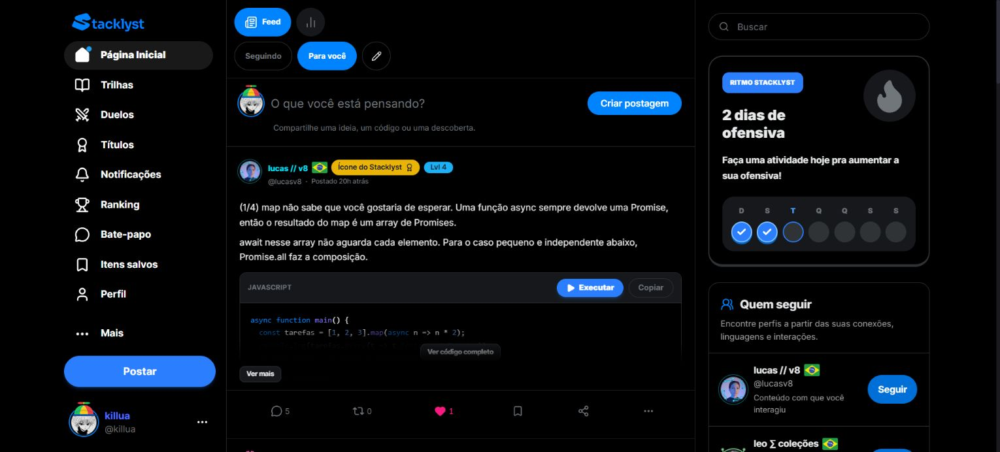
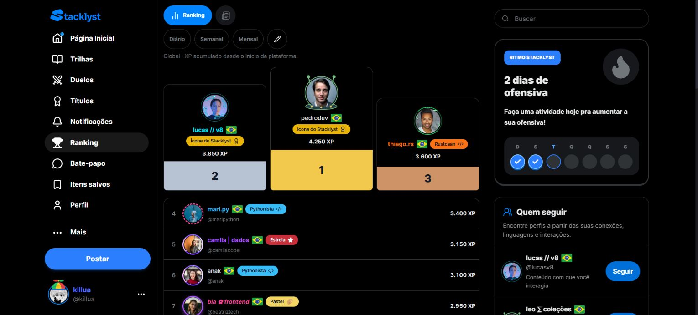
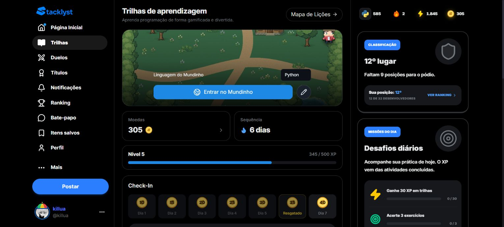
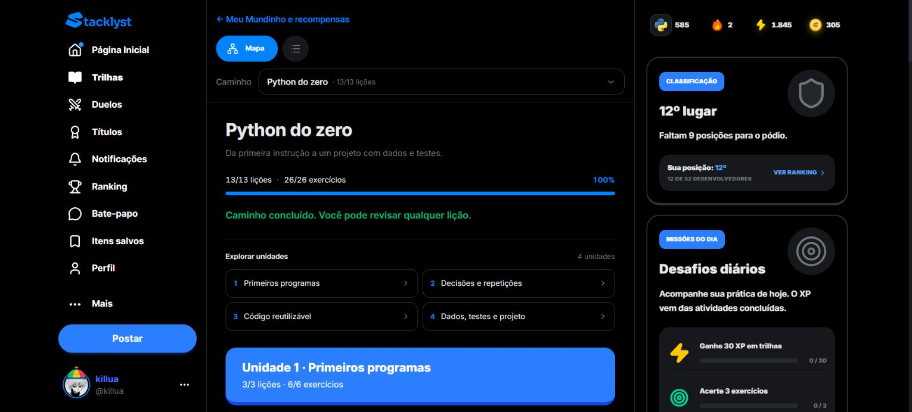

# Stacklyst

Documento de visão do sistema

Laboratório de Engenharia de Software
Revisão de 3 de novembro de 2026
Base de código 6a2bfce e documentação local revisada

Pedro Antonio Silvestre Tescaro
Guilherme Alves de Campos
Paulo Henrique Leal dos Santos

Esta edição atualiza os modelos e a especificação do sistema. Os diagramas de atividades do negócio aprovados permanecem no documento 02, preservado integralmente. Os modelos revisados são editáveis no Astah UML. Cadastro e acesso usam o ator Usuário e declaram as pré-condições de sessão em cada caso.

As afirmações descrevem a fonte de implementação. Credenciais, infraestrutura externa, dispositivos e migrations dependem das verificações de ambiente indicadas. Esta revisão documental não representa execução de todos os fluxos em produção.


## Roteiro de leitura

O sumário é atualizado na exportação pelo Word. As fontes editáveis e a matriz de rastreabilidade acompanham o pacote.


## Visão do sistema e do negócio


### Problema e proposta

O Stacklyst integra estudo de programação, prática com avaliação de respostas, troca de conhecimento, duelos e oportunidades profissionais. O problema atendido é a dispersão entre material de estudo, exercícios, evidências de progresso e espaços para aplicar e compartilhar o aprendizado.

A proposta central é um percurso de aprendizagem por linguagem, com lições, exemplos e atividades. O sistema distingue leitura, tentativa, execução de teste, submissão e primeira conclusão. O progresso confirmado alimenta XP, níveis, classificação e reconhecimentos elegíveis.


### Visão do produto

Para pessoas que aprendem programação e desejam praticar de forma contínua, o Stacklyst oferece um ambiente de estudo com retorno sobre atividades e histórico de evolução. A rede de publicações amplia a troca de conhecimento. Duelos, eventos e recrutamento conectam a prática a contextos de competição e oportunidade.


### Necessidades e capacidades

| Parte interessada | Necessidade | Capacidade do produto |
| --- | --- | --- |
| Estudante | Organizar o estudo e compreender erros | Trilhas, lições, exercícios, ajuda e desempenho |
| Comunidade de desenvolvedores | Compartilhar experiências e manter referências | Publicações, interações, itens salvos e mensagens |
| Recrutador e empresa | Divulgar oportunidades e acompanhar candidatos | Empresas, vagas, etapas e candidaturas |
| Avaliador | Emitir pareceres com critérios e autorização | Credenciamento e avaliação de duelos |
| Administrador | Manter o acesso e tratar ocorrências | Gestão de usuários, denúncias e recursos autorizados |


### Escopo e critérios de sucesso

O núcleo de aprendizagem deve permitir consultar o percurso, estudar uma lição, resolver uma atividade e consultar o resultado confirmado. A mesma conclusão não deve duplicar recompensas. Recursos de conteúdo, competição e oportunidades devem manter autoria, participação e autorização por recurso.

A modelagem acadêmica desta edição usa os 26 casos da vista Caso de Uso Geral. Recursos complementares da plataforma, como Mundinho e clientes móveis, continuam descritos no manual técnico sem criar outros casos numerados.


### Atores

| Ator | O que representa | Limite relevante |
| --- | --- | --- |
| Usuário | Pessoa que cadastra conta, autentica-se e utiliza os recursos permitidos. | Acesso depende da rota; a existência de uma URL não torna o recurso público |
| Usuário | Pessoa que cadastra conta, autentica-se e utiliza os recursos permitidos. | Opera seus próprios dados e os recursos cuja audiência permite acesso |
| Participante de duelo | Usuário comprometido com uma partida | Deve pertencer ao duelo; conhecer o ID não permite enviar solução |
| Amigo mútuo | Duas contas que se seguem nas duas direções | É relação social, não papel administrativo |
| Avaliador | Usuário aprovado no fluxo específico | Status, tecnologia e conflitos ainda são conferidos |
| Recrutador | Papel que permite ações de recrutamento | Precisa de acesso à empresa correspondente |
| Administrador | Papel de gestão da plataforma | Operações sensíveis continuam sujeitas às regras e auditoria |
| Provedor de autenticação | Supabase Auth | Identifica sessão; os dados de domínio também precisam existir no banco |
| Executor de código | Sandbox local de JS/TS e provedores configurados | Pode estar indisponível; falha operacional não demonstra erro do aluno |
| Serviço de push | Canal de entrega para dispositivos registrados | É diferente do registro persistido da notificação |

Os quatro valores de UserRole são USER, EVALUATOR, ADMIN e RECRUITER. Amizade, inscrição, dono de empresa e participante são relações e condições adicionais. Não se pode resolver todas as permissões por um único if (role).


### Jornada principal

A jornada principal reúne organização do estudo, prática, consulta do resultado e planejamento da próxima etapa. Publicar, competir e buscar oportunidades são caminhos disponíveis conforme as permissões. Os diagramas das atividades do negócio estão no documento 02.


### Principais objetos de informação

Conta: identidade, papel, perfil, preferências e relações sociais.

Conteúdo pedagógico: curso, lição, etapa, nó, caminho, exercício e caso de teste.

Evidência pedagógica: tentativa, execução, submissão, conclusão e evento de aprendizagem.

Reconhecimento: XP, nível, faixa, título e credencial com snapshot verificável.

Comunidade: publicação, resposta encadeada, reação, enquete, mídia, salvamento e mensagem.

Competição: convite, duelo, submissão, solução, decisão e parecer.

Mundinho: jogador RPG, inventário, equipamento, saldo, extrato, batalha e sala multiplayer.

Oportunidade: empresa, vaga, etapa, candidatura, evento, desafio e participação.

O schema relaciona esses objetos, mas não contém sozinho todas as regras: algumas estão em Zod, nos serviços, nos repositórios e nas funções puras.


### Fronteiras importantes


#### Aprendizagem versus competição

Executar uma solução de exercício verifica o contrato daquele exercício. Comparar duas soluções de duelo aplica política competitiva. No Mundinho, o código precisa produzir o traço e cumprir estruturas do cenário. Aprovação em um desses contextos não implica aprovação automática nos outros.


#### Aparência versus autoridade

Nome colorido, moldura, roupa e título são apresentação. Não concedem papel de administrador ou avaliador. Na coleção editorial, os perfis são fictícios e identificados como demonstração; títulos e XP ilustrativos não equivalem a credenciais de formação.


#### Interface versus confirmação

Um botão pode mostrar carregamento ou atualizar estado temporariamente. Confirmação de compra, XP, resgate ou candidatura depende da resposta do servidor e do commit. Atualizar um número na tela não basta para provar persistência.


#### Web versus mobile

A aplicação web usa Next.js. O aplicativo está em apps/mobile, com Expo/React Native e pontes autenticadas. O Mundinho embarca interface e arte; operar sem carregar a arte da rede não torna duelos, saldo e presença multiplayer independentes do servidor.


### O que não concluir a partir do produto

Uma posição no ranking representa a métrica e o período selecionados, não uma certificação absoluta de competência. Tempo estimado de aula não é medição de horas estudadas. Uma assinatura desenhada em PDF não é uma assinatura digital criptográfica. Uma estimativa de Big-O não é demonstração formal de complexidade.

Essas fronteiras ajudam tanto na apresentação acadêmica quanto na manutenção: cada afirmação deve ser sustentada pelo fluxo implementado e pela evidência adequada.


## Guia para entender a programação


### Linguagens e ferramentas, sem misturar seus papéis

| Tecnologia | Papel no repositório | O que não significa |
| --- | --- | --- |
| TypeScript | Tipos, regras, serviços, rotas, componentes e scripts | Não valida automaticamente um JSON recebido |
| TSX / JSX | Composição de interface React | Um componente não é uma tabela do banco |
| JavaScript / MJS | Execução no navegador, ferramentas e geradores | Não deve ser confundido com código submetido pelo aluno |
| CSS / Tailwind | Apresentação, estados, temas e responsividade | Ocultar controle não implementa autorização |
| Prisma Schema | Contrato dos modelos persistidos e geração do cliente | Não comprova que a migration foi aplicada |
| SQL / PostgreSQL | Dados, restrições, índices, transações e bloqueios | Uma transação não engloba automaticamente chamadas a provedores |
| Python / PowerShell | Ferramentas presentes de documentação, arte e operação | Não são o backend principal da plataforma |
| JSON / Markdown | Catálogos, dados estruturados e documentação | Não são código confiável apenas por estarem bem formatados |
| React Native / Expo | Cliente mobile e integração nativa | Não usa o mesmo DOM de uma página web |

Python, JavaScript, TypeScript, Java, Rust, Go, Kotlin, Swift e C++ também aparecem como linguagens de estudo/execução. A lista de conteúdos, a lista de runtimes configurados e as linguagens usadas para implementar a plataforma são conjuntos diferentes. Veja o inventário dos manifests [../referencias/tecnologias.md].


### Estrutura das pastas

| Pasta | Pergunta que ela ajuda a responder |
| --- | --- |
| src/app | Qual URL entrega esta tela ou esta API? |
| src/components | Como a experiência é composta e como reage a interações? |
| src/contexts / src/hooks | Qual estado ou efeito é compartilhado? |
| src/services | Qual caso de uso coordena regras e efeitos? |
| src/lib/learning | Como currículo, progresso, XP e rankings pedagógicos funcionam? |
| src/lib/exercises | Como exercícios são avaliados e persistidos? |
| src/lib/duels | Como convites, julgamento e resolução competitiva funcionam? |
| src/lib/mundinho | Como economia, mapa, combate e multiplayer funcionam? |
| src/lib/credentials | Como critérios, snapshots, verificação e PDF funcionam? |
| prisma | Como o estado é representado e evolui no banco? |
| apps/mobile | Como o cliente nativo usa o domínio e a ponte do Mundinho? |
| scripts | Como gerar, conferir ou operar artefatos do projeto? |
| docs | Onde estão manuais, decisões e evidências históricas? |


### Convenções de arquivo

page.tsx é a entrada de uma página. layout.tsx compõe descendentes. route.ts implementa métodos HTTP. Um arquivo com 'use client' define uma fronteira de componente interativo; isso não quer dizer que todo dado disponível nele é privado. server-only impede importações indevidas de módulos de servidor no cliente.

@/ resolve para src/. Para scripts executados por ts-node, o projeto usa configuração própria e tsconfig-paths/register quando precisa resolver esses imports fora do Next.js. O importador editorial [../../../scripts/publish-demo-community.ts] é um exemplo.


### Como ler uma função

Faça seis perguntas, nesta ordem:

1. Entrada: os argumentos vieram de sessão, banco, catálogo ou cliente?

2. Contrato: tipos estáticos e validação em runtime conferem quais propriedades?

3. Permissão: quem pode acessar este recurso específico?

4. Decisão: qual condição muda o resultado ou produz erro?

5. Efeito: quais linhas são gravadas, quais chamadas externas acontecem e em que transação?

6. Saída: o retorno é público? Há gabarito, dado privado ou detalhe interno a remover?

Na função saveLessonAssessment, por exemplo, o ID do usuário vem da sessão resolvida pela rota, o tipo de etapa vem do catálogo, a correção vem do avaliador, e a própria persistência decide se a conclusão rende XP pela primeira vez. O cliente não escolhe diretamente esse crédito.


### Sintaxe recorrente


```
// Exemplo didático; não é um endpoint adicional do projeto.
type Entrada = { id: string; action?: 'run' | 'submit' };
async function exemplo(entrada: Entrada) {
  const action = entrada.action ?? 'submit';
  return { action, id: entrada.id };
}
```

type descreve uma estrutura para o compilador. ? torna a propriedade opcional. Uma união com | limita alternativas no tipo. ?? usa o segundo valor apenas quando o primeiro é null ou undefined; não equivale a ||, que trata todos os valores falsy como ausência. async devolve uma Promise. await espera sua resolução naquele fluxo.

?. permite acessar condicionalmente uma propriedade; não demonstra que a propriedade existe. ! depois de uma expressão é uma asserção ao compilador e não insere checagem em runtime. as também não converte magicamente um payload. Por isso Zod e verificações de domínio continuam necessários.

map transforma uma coleção; filter seleciona; find procura um elemento; some verifica existência; every exige todos; reduce acumula. Um map(async ...) produz Promises: a coordenação exige aguardar o conjunto quando a operação admite concorrência. Não se deve paralelizar gravações que dependem da ordem.


### React: estado, referência e efeitos

useState guarda um estado cuja alteração agenda nova renderização.

useRef conserva uma referência mutável entre renderizações, sem renderizar por si.

useEffect sincroniza com sistemas externos e deve liberar timers, listeners e conexões que criou.

useCallback preserva a referência de uma função conforme dependências; não prova que seu corpo é puro.

key identifica elementos para reconciliação; não substitui unicidade no banco.

No multiplayer, posição corrente e versão recebida usam referências para evitar que callbacks antigos sobrescrevam estado novo. O efeito de sincronização limita requisições concorrentes e limpa o timer ao sair. Isso é diferente de manter uma conexão WebSocket.


### Prisma: consultas e persistência

findUnique busca uma chave única; findMany lista; select limita campos; include agrega relações. create insere; update exige registro; updateMany permite uma condição e retorna contagem; upsert escolhe inserção ou atualização por chave única. deleteMany com filtro vazio pode atingir uma tabela inteira.

Uma consulta where: { id } só identifica o recurso. A autorização pode exigir ainda user_id, participante, audiência, ausência de bloqueio e propriedade de empresa. As restrições @@unique apoiam a idempotência, mas não substituem toda a lógica.

Uma transação agrupa alterações de banco. Um bloqueio por usuário serializa recompensas concorrentes. Um bloqueio por evento protege a capacidade compartilhada. Uma atualização condicional de estado evita que duas resoluções fechem o mesmo duelo. O escopo do lock deve representar o recurso em disputa.


### Três registros que costumam ser confundidos

| Registro | Significado |
| --- | --- |
| Execução de código | O programa foi processado e produziu saída/erro |
| Avaliação | O resultado foi confrontado com um contrato |
| Conclusão persistida | O servidor gravou a evidência e os efeitos elegíveis |

Um console sem erro pode ainda produzir a resposta errada. Testes públicos passando podem não cobrir os ocultos. Uma avaliação correta em run pode não registrar conclusão. O código e a documentação devem conservar essas separações.


### Como alterar uma regra com segurança

Localize a regra no capítulo e na fonte; confira chamadores; altere contrato, regra e serialização quando necessário; adapte interface e cliente mobile; execute testes do domínio; atualize documentação e gerados. Para currículo, confira IDs publicados e compatibilidade do progresso. Para economia, confira extrato e repetição concorrente. Para permissão, use pelo menos proprietário, usuário sem acesso e papel privilegiado quando aplicável.

Os recortes comentados [codigo-comentado.md] e as sequências [sequencias.md] mostram como fazer essa leitura em fluxos reais.


## Referência de UML e critérios de modelagem

Referência principal: GUEDES, Gilleanes T. A. UML 2: uma abordagem prática. 3. ed. São Paulo: Novatec, 2018. ISBN 978-85-7522-644-5. Consultado no PDF fornecido pelo grupo. Os números de página abaixo são a posição no PDF de 657 páginas; podem diferir da paginação impressa.

O livro orienta a notação e a organização da documentação. As regras da Stacklyst são verificadas no código do projeto; os exemplos bancários e demais sistemas do livro não são requisitos desta plataforma. Os textos e diagramas desta revisão são próprios do projeto.


### Casos de uso e sua especificação

Conforme a seção 3.4 (PDF, pp. 65-67), um caso de uso deve explicar o objetivo do ator e a resposta do sistema em linguagem compreensível. O catálogo identifica nome e ID, ator principal, pré-condições, fluxo principal, resultado esperado e alternativas. Referências de código e regras de negócio complementam a especificação e permitem verificar a implementação. A UML admite formatos diferentes para essa documentação; a estrutura adotada é uma adaptação ao projeto.

Cada passo do catálogo deve ser lido como interação entre ator e sistema. No diagrama, as elipses representam objetivos ou comportamentos reutilizados. Tabelas, componentes React, rotas e consultas são detalhados nos modelos estruturais e nas sequências, sem transformá-los em atores humanos.


### Herança dos atores

A generalização/especialização segue a seção 3.7 (PDF, pp. 70-73). Avaliador, Recrutador e Administrador especializam Usuário. A linha contínua termina em triângulo vazio voltado para Usuário, o ator geral. Um papel especializado participa das interações comuns de Usuário e acrescenta as interações autorizadas ao seu papel.

Essa generalização representa papéis de interação. Não afirma que existam subclasses TypeScript desses nomes nem concede permissões em execução: o servidor continua validando sessão, papel, propriedade e escopo. Uma mesma pessoa pode exercer mais de um papel. Cadastro, recuperação e verificação pública são interações de Usuário cujas pré-condições permitem ausência de sessão.


### Inclusão, extensão e pontos de extensão

Na inclusão, o comportamento chamado é obrigatório no contexto do caso que o inclui (seção 3.8; PDF, pp. 74-75). A dependência tracejada com «include» aponta do caso base para o incluído. Na visão geral, Resolver exercícios inclui Avaliar resposta; Submeter solução de duelo inclui Executar código. A validação das entradas e a autorização antecedem a execução efetiva, conforme os fluxos alternativos documentados.

Na extensão, o comportamento adicional ocorre sob uma condição, em um ponto identificável do caso base (seções 3.9 a 3.11; PDF, pp. 76-80). A dependência tracejada com «extend» aponta da extensão para o caso base. Executar código estende Avaliar resposta quando a atividade é de código, no ponto avaliar código. Consultar ajuda estende Resolver exercícios se o usuário solicitar e o modo permitir, no ponto consultar ajuda. Atividades objetivas podem ser avaliadas sem execução de código; a ajuda não é uma etapa obrigatória de todos os exercícios.

Relações de inclusão e extensão descrevem dependência comportamental. Não indicam ordem cronológica de navegação. Autenticação é pré-condição dos fluxos protegidos; não se repete um «include Fazer login» para toda operação.


### Classes e persistência

Os capítulos 2 e 4 fundamentam classes, atributos, operações e multiplicidades. A seção 4.15 (PDF, pp. 213-218) distingue classes de tabelas e discute o mapeamento para persistência. As vistas CL desta revisão são conceituais, com nomes em português e responsabilidades do domínio. A visão geral tem oito classes; as vistas específicas têm quatro a seis. Uma classe conceitual não afirma que exista uma declaração TypeScript class com o mesmo nome.

As vistas DER são recortes relacionais em notação de classes UML: dez tabelas na visão geral e quatro ou cinco nas vistas específicas. CP significa chave primária e CE, chave estrangeira. Os nomes visíveis são traduções; a tabela de correspondência identifica as tabelas e campos reais. Campos e relações auxiliares permanecem no dicionário completo do banco. O Astah UML instalado não oferece o editor ER da edição Professional; a notação utilizada está explícita. A redução é de apresentação, sem alteração do schema.


### Sequências e ligação com o código

O capítulo 7 orienta participantes, linhas de vida, mensagens, retornos e condições. As seções 7.3.3 e 7.8 (PDF, pp. 272-273 e 286-293) apoiam a leitura de respostas e alternativas. A ordem vertical mostra a progressão da interação; a posição horizontal separa responsabilidades.

Nas vistas nativas desta revisão, chamadas são mensagens UML editáveis e condições são guardas nas mensagens e notas de resposta. As respostas podem ser expressas nos valores de retorno das chamadas e em notas de resultado, dispensando setas de retorno redundantes. As sequências completas devem ser lidas junto ao fluxo textual e suas alternativas. Os recortes SQ01-A a SQ01-C e SQ11-A a SQ11-F relacionam uma parte da interação ao arquivo e às linhas reais da implementação.

O cenário principal, os caminhos alternativos e as falhas previstas precisam concordar com a especificação. Um retorno de erro não comprova sucesso, uma prévia não concede recompensa de submissão e uma repetição não deve ser documentada como novo crédito de XP. Essas são regras da implementação conferidas separadamente da referência bibliográfica.


### Uso no seminário

A sequência de exposição segue a orientação da professora: protótipo, RF/RNF/RN, modelos estruturais, sequência completa, recortes com código e demonstração prática. A referência de Guedes fundamenta os modelos; a ordem, o tempo e a divisão dos integrantes provêm da orientação do seminário. Os diagramas de atividades previamente aprovados permanecem preservados.


## Visão atual da interface

Capturas realizadas em 3 de novembro de 2026 na aplicação web Stacklyst. Cada imagem apresenta o estado carregado da tela consultada. Dados, posições e disponibilidade podem mudar com novas atividades.


### Página inicial e feed



Página inicial e feed — https://stacklyst.vercel.app/feed


### Ranking de XP



Ranking de XP — https://stacklyst.vercel.app/ranking


### Trilhas de aprendizagem



Trilhas de aprendizagem — https://stacklyst.vercel.app/trails


### Mapa de lições Python



Mapa de lições Python — https://stacklyst.vercel.app/trails?view=map

