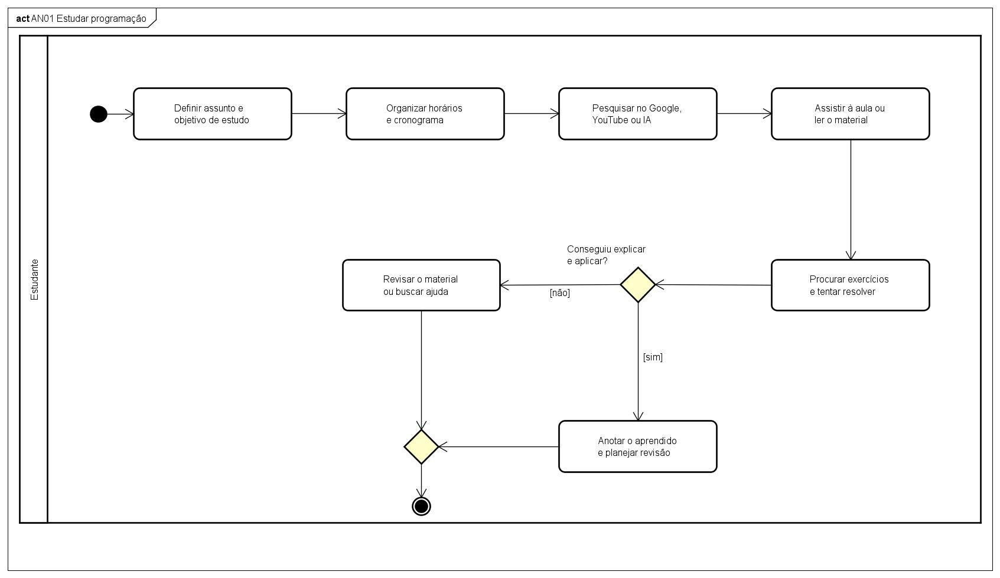
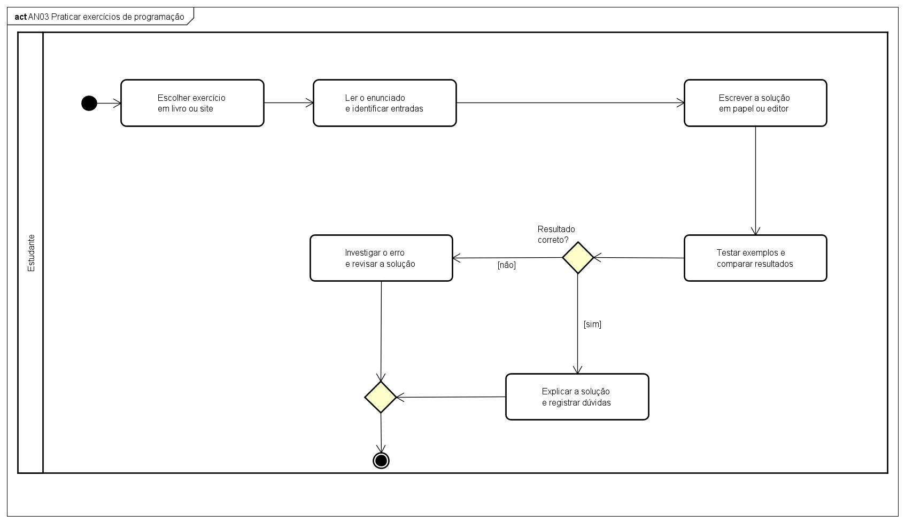
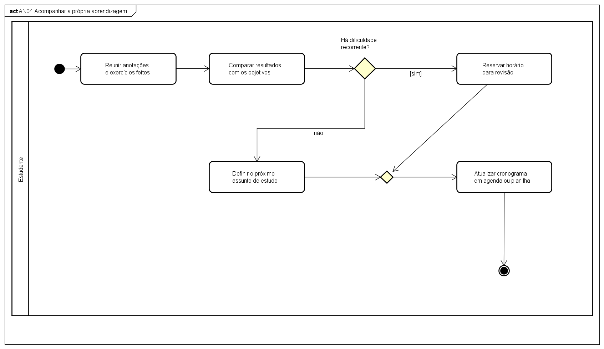
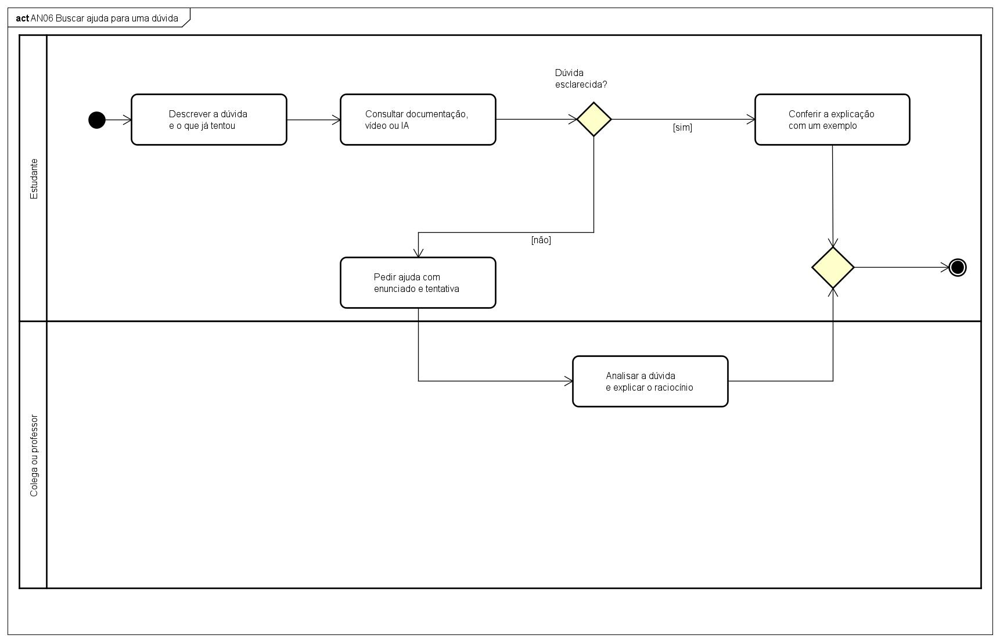
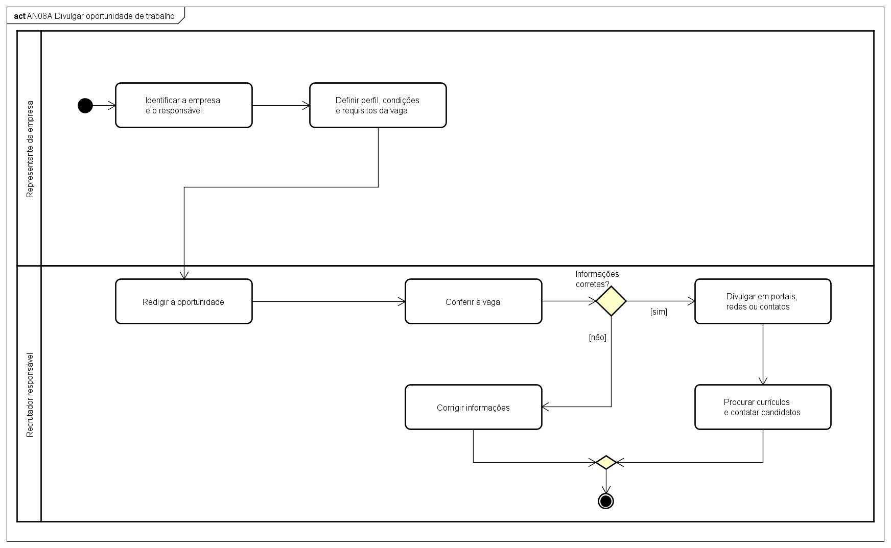
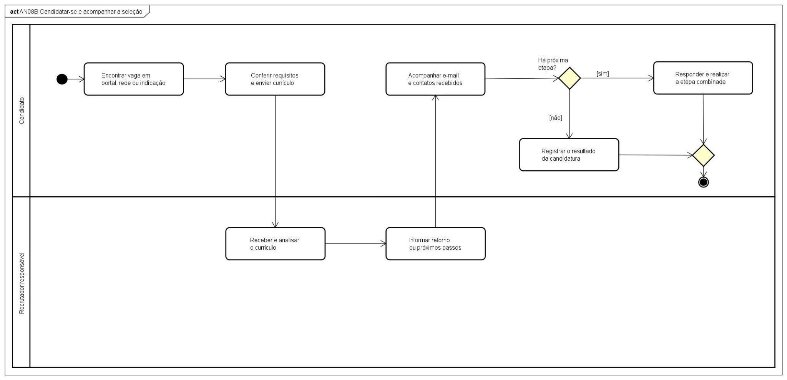
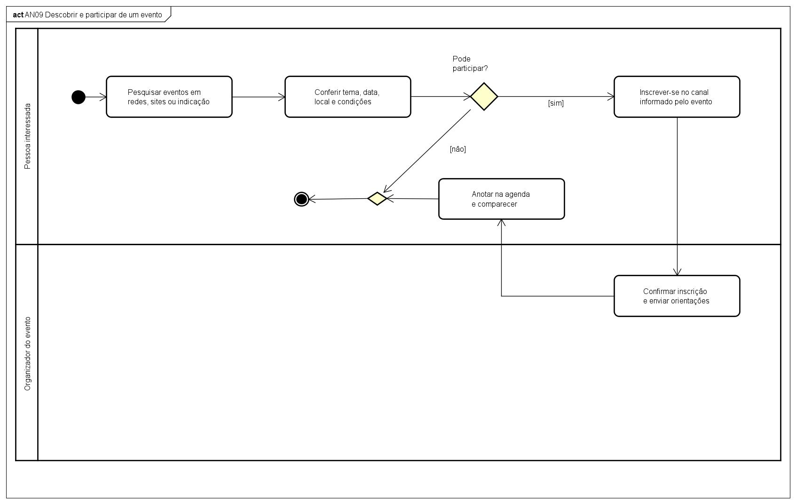

Stacklyst

Documento de Atividades do Negócio

Laboratório de Engenharia de Software
Projeto acadêmico
Revisão documental: 03/11/2026
Modelos atuais: stacklyst-seminario.asta e seminário Astah

1. Índice

2. Objetivo	3

3. Atividades do Negócio	3

3.1 AN01 — Estudar programação	3

3.1.1 Fluxo principal	3

3.1.2 Diagrama de Atividades	3

AN01 — Estudar programação	3

3.2 AN02 — Praticar exercícios de programação	3

3.2.1 Fluxo principal	3

3.2.2 Diagrama de Atividades	3

AN02 — Praticar exercícios de programação	3

3.3 AN03 — Acompanhar a própria aprendizagem	3

3.3.1 Fluxo principal	3

3.3.2 Diagrama de Atividades	3

AN03 — Acompanhar a própria aprendizagem	3

3.4 AN04 — Buscar ajuda para uma dúvida	3

3.4.1 Fluxo principal	3

3.4.2 Diagrama de Atividades	3

AN04 — Buscar ajuda para uma dúvida	3

3.5 AN05 — Divulgar oportunidade e acompanhar a seleção	3

3.5.1 Fluxos de divulgação e candidatura	3

3.5.2 Diagrama de Atividades	3

AN05A — Divulgar oportunidade de trabalho	3

AN05B — Candidatar-se e acompanhar a seleção	3

3.6 AN06 — Descobrir e participar de um evento	3

3.6.1 Fluxo principal	3

3.6.2 Diagrama de Atividades	3

4. Relação entre atividades e requisitos	3

5. Correspondência com os casos de uso	3

## 2. Objetivo

Este documento descreve os processos humanos de estudo, prática, colaboração, avaliação, recrutamento e participação em eventos relacionados ao Stacklyst. Os diagramas do seminário retratam como as pessoas realizam essas atividades, inclusive com livros, portais, agendas e contatos externos. A relação com os requisitos indica o apoio oferecido pelo Stacklyst, sem atribuir ao software todas as ações do processo humano.

## 3. Atividades do Negócio

AN01, AN02, AN03, AN04, AN05A, AN05B e AN06 foram atualizados com os diagramas apresentados no seminário. AN06 identifica agora a descoberta e participação em eventos.

### 3.1 AN01 — Estudar programação

Objetivo: Organizar o estudo de programação e verificar se o estudante consegue explicar e aplicar o conteúdo.

Participantes: Estudante ou desenvolvedor em formação.

Pré-condições: Interesse em aprender um assunto e disponibilidade de fontes de estudo e exercícios.

#### 3.1.1 Fluxo principal

1. O estudante define o assunto e o objetivo de estudo.

2. O estudante organiza os horários e o cronograma.

3. O estudante pesquisa materiais no Google, no YouTube ou em uma ferramenta de IA.

4. O estudante assiste à aula ou lê o material selecionado.

5. O estudante procura exercícios e tenta resolvê-los, conforme AN02.

6. Se ainda não consegue explicar e aplicar o conteúdo, revise o material ou busque ajuda e retome a prática.

7. Quando compreende o assunto, anota o que aprendeu e planeja a revisão.

Decisões: O estudante conseguiu explicar e aplicar o conteúdo? Precisa revisar o material ou buscar ajuda?

Exceções: Material insuficiente leva à busca de outra fonte ou de ajuda. A dificuldade na prática conduz à revisão, sem presumir aprendizagem concluída.

Resultado final: Conteúdo compreendido e aplicado, com registro do aprendizado e revisão planejada.

Rastreabilidade: F04–F10; UC004–UC007. O Stacklyst apoia o percurso com trilhas, lições, exercícios e progresso. Pesquisa externa, agenda pessoal e uso de IA no processo humano não constituem funcionalidades adicionais do sistema.

#### 3.1.2 Diagrama de Atividades

#### AN01 — Estudar programação

AN01 — Estudar programação.

Fonte editável: stacklyst-seminario.asta / AN01 Estudar programação. Exportação atual do projeto do seminário.

### 3.2 AN02 — Praticar exercícios de programação

Objetivo: Resolver problemas de programação, comparar os resultados e compreender os erros encontrados.

Participantes: Estudante ou desenvolvedor em formação.

Pré-condições: Exercício disponível em livro ou site e conhecimentos iniciais para interpretar o enunciado.

#### 3.2.1 Fluxo principal

1. O estudante escolhe um exercício em um livro ou site.

2. O estudante lê o enunciado e identifica as entradas e os resultados esperados.

3. O estudante escreve a solução em papel ou editor.

4. O estudante testa exemplos e compara os resultados obtidos.

5. Se o resultado estiver incorreto, investiga o erro, revisa a solução e repete os testes.

6. Quando obtém o resultado correto, explica a solução e registra as dúvidas restantes.

Decisões: O resultado está correto? É necessário investigar o erro e revisar a solução?

Exceções: Enunciado pouco compreendido ou dúvida conceitual exige revisão ou ajuda. Um teste sem resultado conclusivo não confirma a solução.

Resultado final: Solução compreendida e verificada com os exemplos, com dúvidas registradas para estudo.

Rastreabilidade: F07–F10; UC006, UC026 e UC027. No Stacklyst, testar código antes da submissão não conclui a atividade nem concede XP. Avaliação, execução isolada e registro do progresso pertencem ao comportamento do sistema.

#### 3.2.2 Diagrama de Atividades

#### AN02 — Praticar exercícios de programação

AN02 — Praticar exercícios de programação.

Fonte editável: stacklyst-seminario.asta / AN02 Praticar exercícios de programação. Exportação atual do projeto do seminário.

### 3.3 AN03 — Acompanhar a própria aprendizagem

Objetivo: Comparar os resultados do estudo com os objetivos e ajustar o planejamento de aprendizagem.

Participantes: Estudante ou desenvolvedor em formação.

Pré-condições: Anotações, exercícios realizados e objetivos de estudo disponíveis para análise.

#### 3.3.1 Fluxo principal

1. O estudante reúne as anotações e os exercícios feitos.

2. O estudante compara os resultados aos objetivos de estudo.

3. O estudante identifica se existe dificuldade recorrente.

4. Se houver dificuldade recorrente, reserva um horário para revisão.

5. Se não houver dificuldade recorrente, define o próximo assunto de estudo.

6. O estudante atualiza o cronograma em agenda ou planilha.

O planejamento revisto orienta o próximo ciclo de estudo.

Decisões: Há dificuldade recorrente? Deve-se reservar horário para revisão ou definir o próximo assunto?

Exceções: Sem registros suficientes, o estudante reúne mais evidências antes de avaliar a evolução. Uma dificuldade exige revisão do planejamento.

Resultado final: Cronograma atualizado conforme a necessidade de revisão ou o próximo assunto escolhido.

Rastreabilidade: F12–F14; UC007. O Stacklyst fornece histórico e indicadores, incluindo XP e ranking, para apoiar a análise. A agenda ou planilha citada no processo é uma ferramenta pessoal, sem integração pressuposta.

#### 3.3.2 Diagrama de Atividades

#### AN03 — Acompanhar a própria aprendizagem

AN03 — Acompanhar a própria aprendizagem.

Fonte editável: stacklyst-seminario.asta / AN03 Acompanhar a própria aprendizagem. Exportação atual do projeto do seminário.

### 3.4 AN04 — Buscar ajuda para uma dúvida

Objetivo: Esclarecer uma dúvida de programação e conferir a explicação por meio de um exemplo.

Participantes: Estudante; colega ou professor, quando necessário.

Pré-condições: Dúvida identificada e tentativa inicial disponível para explicar o problema.

#### 3.4.1 Fluxo principal

1. O estudante descreve a dúvida e o que já tentou.

2. O estudante consulta documentação, vídeo ou ferramenta de IA.

3. O estudante verifica se a dúvida foi esclarecida.

4. Se a dúvida persistir, pede ajuda a um colega ou professor, apresentando o enunciado e a tentativa; a pessoa consultada analisa a dúvida e explica o raciocínio.

5. O estudante confere a explicação com um exemplo e retoma o estudo.

Decisões: A dúvida foi esclarecida pela consulta inicial? É necessário pedir ajuda a outra pessoa?

Exceções: Uma explicação insuficiente exige nova consulta ou esclarecimento. A resposta de uma ferramenta ou pessoa deve ser conferida em um exemplo.

Resultado final: Dúvida esclarecida e explicação conferida na prática.

Rastreabilidade: F10; UC012 e extensão de ajuda de UC006. O sistema oferece dicas, documentação e sugestões conforme o modo de assistência. A consulta externa a IA, colega ou professor descreve o processo humano e não implica um serviço de IA implementado no Stacklyst.

#### 3.4.2 Diagrama de Atividades

#### AN04 — Buscar ajuda para uma dúvida

AN04 — Buscar ajuda para uma dúvida.

Fonte editável: stacklyst-seminario.asta / AN04 Buscar ajuda para uma dúvida. Exportação atual do projeto do seminário.

### 3.5 AN05 — Divulgar oportunidade e acompanhar a seleção

Objetivo: Divulgar uma oportunidade profissional e acompanhar a candidatura e o retorno da seleção.

Participantes: Representante da empresa; recrutador responsável; candidato.

Pré-condições: Empresa e responsável identificados para divulgar a vaga. Para candidatar-se, o interessado conhece os requisitos e o canal de envio.

#### 3.5.1 Fluxos de divulgação e candidatura

A1. O representante identifica a empresa e o responsável e define o perfil, as condições e os requisitos da vaga.

A2. O recrutador redige a oportunidade e confere as informações.

A3. Se houver erro, o recrutador corrige as informações e confere novamente.

A4. Com as informações corretas, divulga a vaga em portais, redes ou contatos e procura currículos ou contata candidatos. Esse processo pode terminar sem candidatura imediata.

B1. O candidato encontra uma vaga em portal, rede ou indicação, confere os requisitos e envia seu currículo pelo canal informado.

B2. O recrutador recebe e analisa o currículo e informa o retorno ou os próximos passos; o candidato acompanha o e-mail e os contatos recebidos.

B3. Se houver próxima etapa, o candidato responde e a realiza, e o recrutador analisa o resultado. O ciclo se repete até não haver outra etapa, quando o candidato registra o resultado da candidatura.

Decisões: As informações da vaga estão corretas? Há uma próxima etapa da seleção?

Exceções: Informações incorretas retornam à revisão. A ausência de retorno exige acompanhamento pelo candidato. No Stacklyst, vaga encerrada não recebe candidatura e a mesma candidatura não deve ser duplicada.

Resultado final: Oportunidade divulgada e resultado da candidatura acompanhado. Contato externo, entrevista, contratação e pagamento permanecem sob responsabilidade das pessoas envolvidas.

Rastreabilidade: F38–F41; UC017, UC018, UC022 e UC025. No Stacklyst, o responsável autorizado publica a vaga e consulta as candidaturas; o usuário envia sua candidatura e acompanha as etapas. UC025 gera notificação ao candidato da candidatura alterada, sem alerta geral por intenção de vaga ou garantia de envio de e-mail.

| Regra do processo: somente o responsável autorizado divulga a vaga e conduz a seleção; o candidato acompanha a própria candidatura. |
| --- |

#### 3.5.2 Diagrama de Atividades

#### AN05A — Divulgar oportunidade de trabalho

AN05A — Divulgar oportunidade de trabalho.

Fonte editável: stacklyst-seminario.asta / AN05A Divulgar oportunidade de trabalho. Exportação atual do projeto do seminário.

#### AN05B — Candidatar-se e acompanhar a seleção

AN05B — Candidatar-se e acompanhar a seleção.

Fonte editável: stacklyst-seminario.asta / AN05B Candidatar-se e acompanhar a seleção. Exportação atual do projeto do seminário.

### 3.6 AN06 — Descobrir e participar de um evento

Objetivo: Encontrar um evento compatível com os interesses e as condições da pessoa e organizar sua participação.

Participantes: Pessoa interessada; organizador do evento.

Pré-condições: Evento divulgado com tema, data, local, condições e canal de inscrição informados.

#### 3.6.1 Fluxo principal

1. A pessoa interessada pesquisa eventos em redes, sites ou por indicação.

2. A pessoa confere o tema, a data, o local e as condições de participação.

3. Se não puder participar, encerre a busca por esse evento; se puder, inscreva-se pelo canal informado.

4. O organizador confirma a inscrição e envia as orientações.

5. A pessoa anota o compromisso na agenda e comparece ao evento.

Decisões: A pessoa pode participar conforme as datas e condições do evento?

Exceções: A impossibilidade de participação encerra o processo sem inscrição. Se não houver confirmação, a pessoa verifica a situação com o organizador antes de considerar a inscrição concluída.

Resultado final: Inscrição confirmada e participação organizada, ou processo encerrado sem inscrição.

Rastreabilidade: F42–F44; UC015. No Stacklyst, O fluxo de participação permite inscrever-se e cancelar a própria inscrição antes do encerramento, respeitando o nível mínimo, a capacidade e a ausência de duplicidade. Agenda, comparecimento e comunicação externa do organizador não implicam funcionalidades adicionais de presença ou envio de e-mail.

#### 3.6.2 Diagrama de Atividades

AN06 — Descobrir e participar de um evento.

Fonte editável: stacklyst-seminario.asta / AN06 Descobrir e participar de um evento. Exportação atual do projeto do seminário.

## 4. Relação entre atividades e requisitos

| Atividade | Requisitos relacionados | Apoio do sistema ao processo humano |
| --- | --- | --- |
| AN01 — Estudar programação | F04–F10 | Apoiar o estudo com trilhas, lições, exercícios, resultados e progresso. |
| AN02 — Praticar exercícios de programação | F07–F10 | Receber e avaliar respostas; testar código sem concluir atividade nem conceder XP. |
| AN03 — Acompanhar a própria aprendizagem | F12–F14 | Disponibilizar histórico e indicadores para o planejamento do estudante. |
| AN04 — Buscar ajuda para uma dúvida | F10; F15–F18 | Disponibilizar dicas e documentação conforme o modo de assistência. |
| AN05A — Divulgar oportunidade de trabalho | F38–F39 | Apoiar cadastro da empresa, publicação autorizada e consulta de vagas e perfis públicos. |
| AN05B — Candidatar-se e acompanhar a seleção | F40–F41 | Registrar candidatura, apresentar as etapas e notificar o candidato após atualização autorizada. |
| AN06 — Descobrir e participar de um evento | F42–F44 | Disponibilizar eventos e permitir inscrição e cancelamento próprios, conforme as condições de participação. |

Fontes dos diagramas atualizados: exportações do projeto stacklyst-seminario.asta fornecidas nesta revisão e imagens correspondentes do seminário.

## 5. Correspondência com os casos de uso

As atividades do negócio preservam os processos e os diagramas aprovados. A tabela relaciona esses processos à numeração da vista Caso de Uso Geral.

| Atividade | Casos de uso relacionados |
| --- | --- |
| AN01 Estudar programação | UC004 Consultar Trilhas de Estudo; UC005 Realizar Lição |
| AN02 Praticar exercícios | UC006 Resolver exercício; UC026 Avaliar Resposta; UC027 Executar Código e Testes |
| AN03 Acompanhar aprendizagem | UC007 Emitir Classificação e Desempenho |
| AN04 Buscar ajuda | UC012 Consultar Ajuda de Exercício; UC013 Gerenciar Publicações; UC014 Registrar Interação |
| AN05 Divulgar oportunidade e acompanhar seleção | UC017 Gerenciar Empresas; UC018 Gerenciar Vagas; UC022 Registrar Candidatura; UC025 Gerenciar Candidaturas |
| AN06 Descobrir e participar de evento | UC015 Gerenciar Eventos; consultas e participação detalhadas no manual funcional |

