# Sequências completas e correspondência com o código

Cada diagrama representa uma jornada, incluindo confirmação e alternativas relevantes. Nomes como UI e Banco são participantes de responsabilidade, não nomes de arquivos. O [caderno de recortes](codigo-comentado.md) localiza as declarações reais e suas linhas.

## 1. Submeter etapa de lição

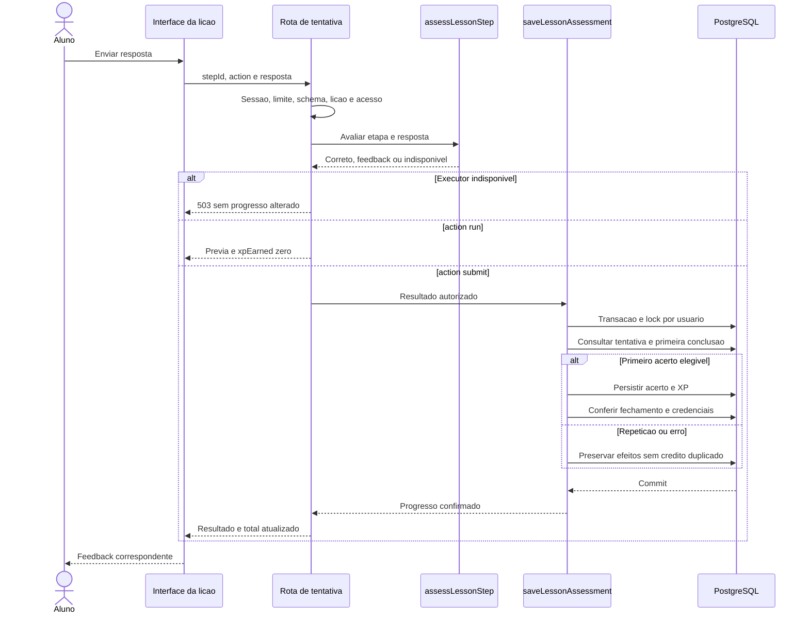

Recorte A: rota de tentativa, schema e `requireLessonAccess`. Recorte B: `assessLessonStep`, com despacho por tipo. Recorte C: `saveLessonAssessment`, com lock e `firstCompletion`. A demonstração deve repetir um acerto e mostrar que o segundo crédito é zero.

## 2. Executar e submeter exercício

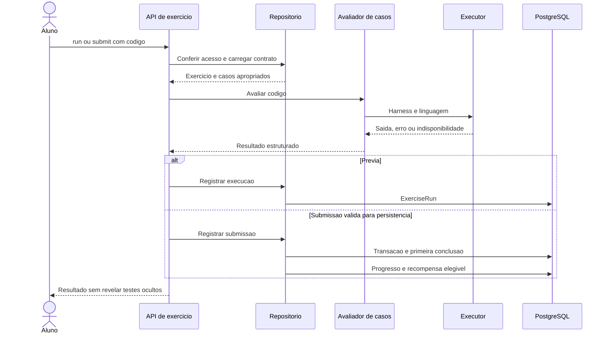

Arquivos: `exercises/evaluator.ts`, `exercises/repository.ts` e rotas `run`/`submit`. Observe que execução e submissão têm registros distintos; o adaptador também precisa tratar indisponibilidade antes de afirmar conclusão.

## 3. Reconciliar e verificar credencial

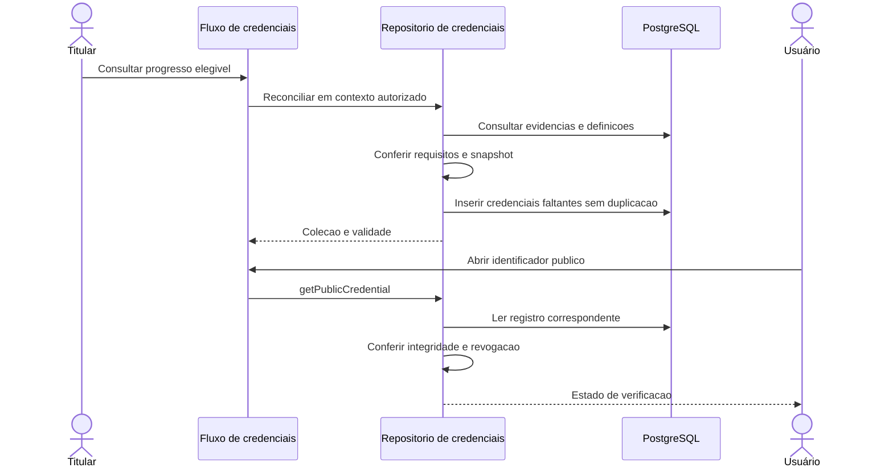

A visita pública não chama a concessão de nova credencial. Recortes: `reconcileCredentialsInTransaction`, `getEarnedCredentials` e `getPublicCredential`.

## 4. Publicar e consultar feed

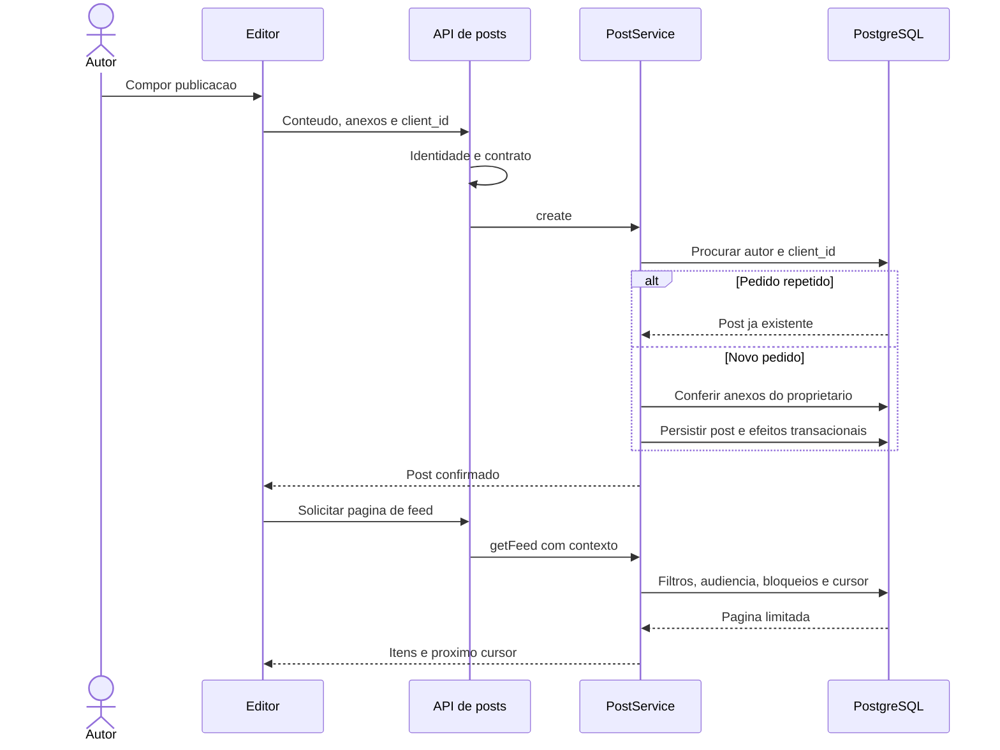

Recortes: `PostService.create`, `getFeed` e `visiblePostWhere`. `client_id` é por autor; o acesso do leitor é conferido de novo na consulta.

## 5. Enviar mensagem e recuperar histórico

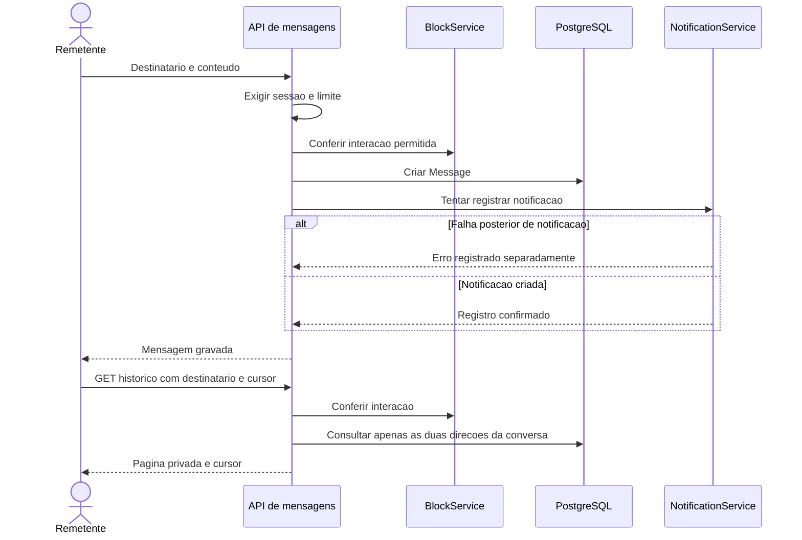

Fonte: `/api/messages`. Não inserir no desenho uma entrega em WebSocket obrigatória: o fluxo deve refletir o transporte realmente usado pelo cliente em cada superfície.

## 6. Resgatar baú diário

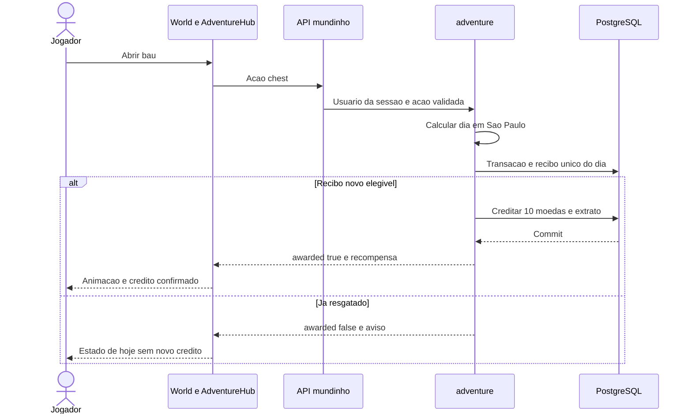

Recortes: `dayKey`, `credit` e o ramo `chest` da função `adventure`. Um erro de rede não deve ser desenhado como crédito bem-sucedido.

## 7. Convidar e entrar na arena

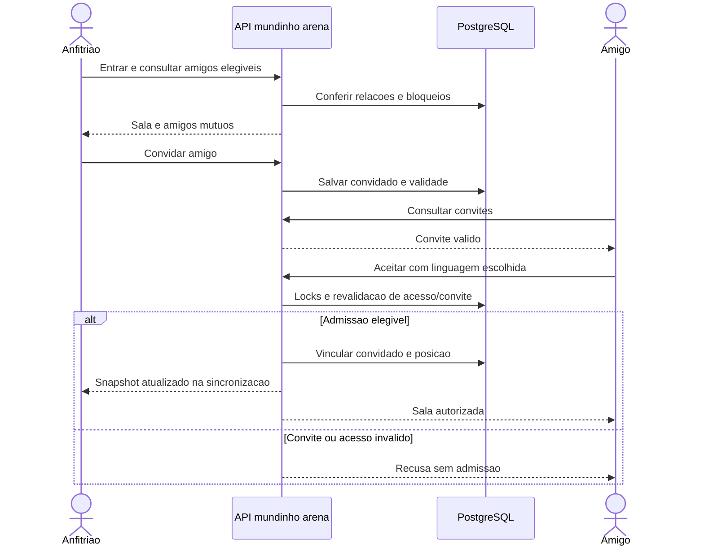

Fonte: `arena.ts`. O convite não é mensagem enviada por e-mail; a implementação consultada o apresenta na interface do Mundinho.

## 8. Turno PvP com exercício

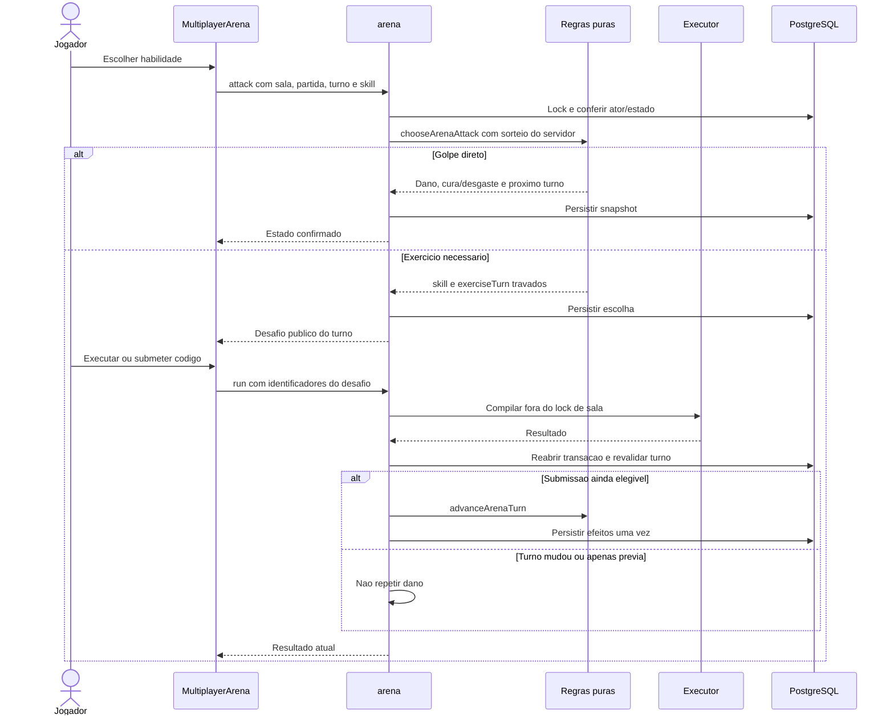

O snapshot inicial de equipamentos é criado quando os dois confirmam. Recortes: `equipmentStats`, `chooseArenaAttack`, `advanceArenaTurn` e verificações em `arena`.

## 9. Julgar e encerrar duelo competitivo

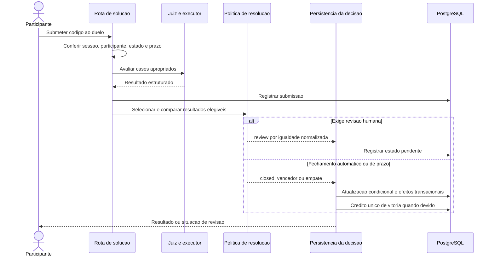

Há também entrada por manutenção de prazo. Ela usa a mesma política de resultado quando cabível, em vez de depender de uma pessoa manter a página aberta.

## 10. Emitir parecer humano

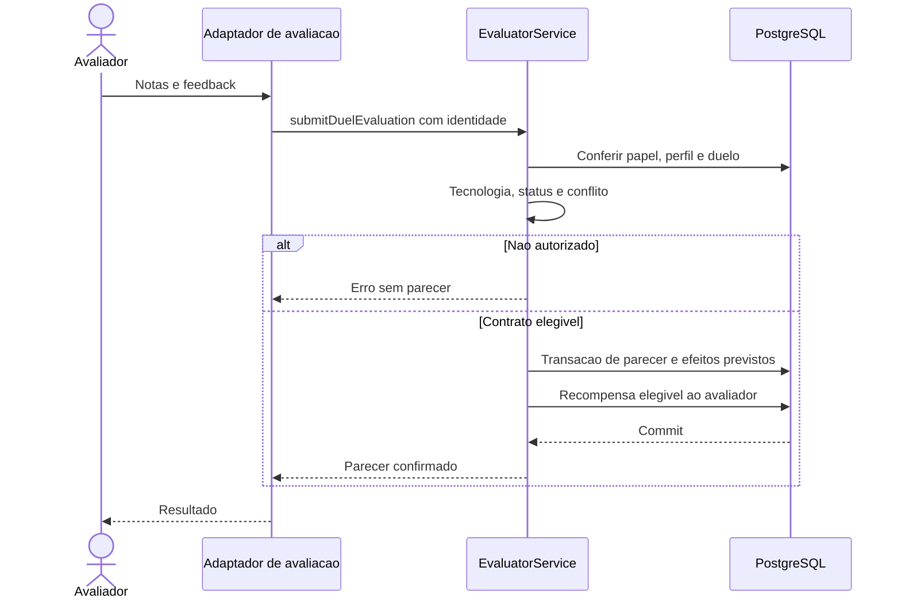

Recortes: `checkEligibility` explica o acesso ao processo de candidatura; `submitDuelEvaluation` explica a autorização de um caso concreto. São conferências diferentes.

## 11. Candidatar e mover no recrutamento

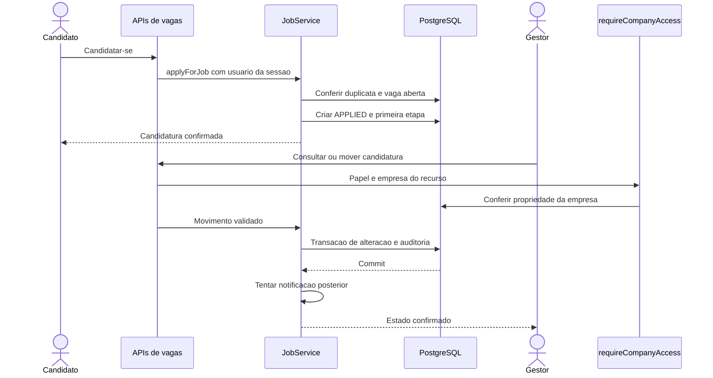

O adaptador de movimentação também precisa validar a compatibilidade dos IDs recebidos. Não apresente o método isolado de atualização como responsável por toda a autorização.

## 12. Inscrever em evento com limite

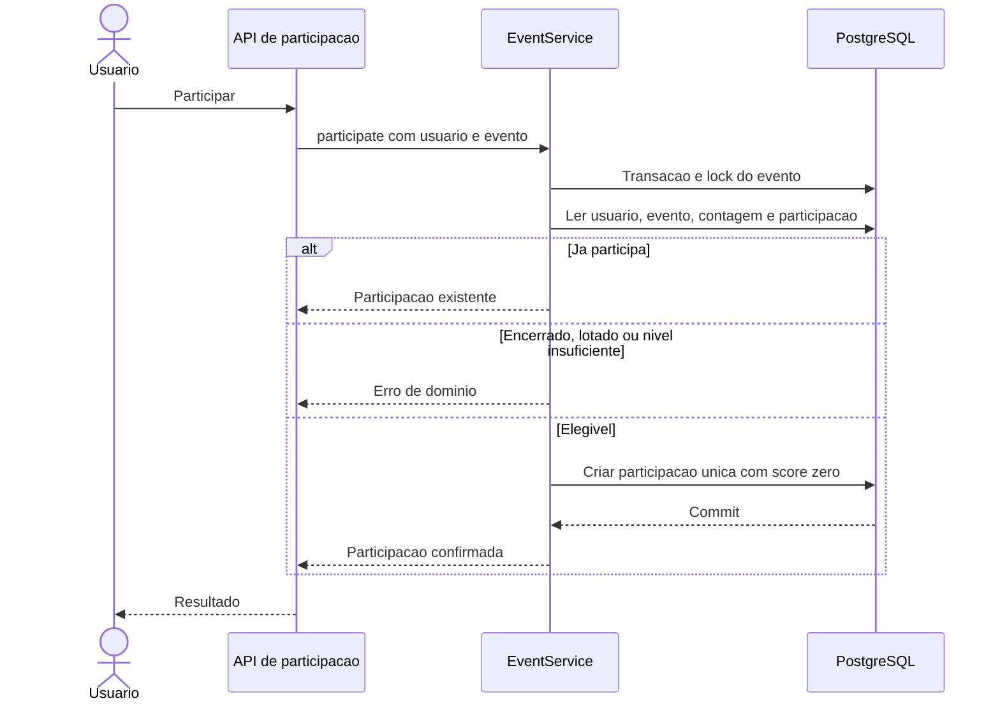

O lock é por evento porque a capacidade é disputada por todas as pessoas. Lock apenas por usuário não impediria duas contas diferentes de ocupar a última vaga simultaneamente.

## Relação entre diagramas e evidência

Os desenhos são explicações de implementação, não resultados de execução. Para provar cada comportamento em demonstração, use os testes e a ação correspondente no ambiente autorizado. Esta documentação não executa cadastros, candidaturas, mensagens ou partidas para produzir uma evidência fictícia.
