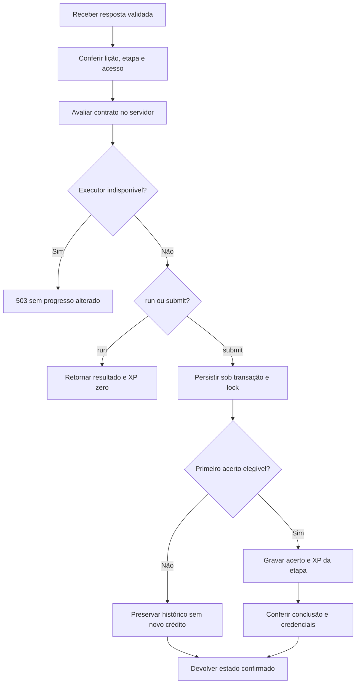

# Trilhas por dentro: do currículo ao progresso persistido

## 1. O que cada camada representa

As trilhas combinam duas organizações de conteúdo. O currículo de lições organiza sequências de atividades com IDs e pré-requisitos. O grafo de conhecimentos organiza nós e caminhos compartilhados. O usuário pode enxergar ambos por componentes de mapa/jornada; isso não torna seus registros intercambiáveis.

| Elemento           | Responsabilidade                                          | Fonte principal                                    |
| ------------------ | --------------------------------------------------------- | -------------------------------------------------- |
| Curso              | Agrupar uma experiência por linguagem/tema                | `learning/catalog-types.ts`, catálogo              |
| Lição              | Reunir etapas, objetivos e pré-requisitos                 | `learning/catalog.ts`, foundations/specializations |
| Etapa              | Definir uma interação avaliada ou explicação              | `lessons/types.ts`                                 |
| Nó de conhecimento | Representar competência no grafo                          | `KnowledgeNode`                                    |
| Aresta             | Expressar relação obrigatória, recomendada ou relacionada | `KnowledgeEdge`                                    |
| Caminho            | Selecionar e ordenar nós                                  | `LearningPath`, `LearningPathNode`                 |
| Exercício          | Definir problema, função, testes e política de ajuda      | `Exercise`, `ExerciseTestCase`                     |
| Execução           | Guardar uma prévia executada                              | `ExerciseRun`                                      |
| Submissão          | Guardar uma avaliação enviada para conclusão              | `ExerciseSubmission`                               |
| Progresso          | Registrar situação do usuário no nó                       | `UserNodeProgress`                                 |
| Tentativa de etapa | Vincular usuário à resposta de uma etapa                  | `QuizAttempt`, por compatibilidade histórica       |

O nome `QuizAttempt` pode induzir a erro: a tabela também guarda acertos de etapas do currículo. Um relatório precisa usar o ID e a origem para distinguir quiz diário, lição e recibos especiais.

## 2. Entrada na interface

A página [trails/page.tsx](../../../src/app/trails/page.tsx) prepara a experiência. `TrailsContent` coordena seleção e apresentação; os componentes de mapa, caminho e jornada apresentam os dados. Preferências de curso/modo e o tamanho disponível podem mudar qual visualização aparece.

Não se deve tomar uma animação ou um nó colorido como autoridade do progresso. O componente recebe estado do domínio e traduz esse estado para apresentação. Para investigar uma tela desatualizada, confira a resposta da API e a transformação de dados antes de mudar regras pedagógicas.

## 3. Disponibilidade do grafo

A função [deriveKnowledgeStatus](../../../src/lib/learning/progress.ts) recebe estado persistido, estados de requisitos obrigatórios e indicação de próximo recomendado.

1. Se o estado persistido é `MASTERED`, `COMPLETED` ou `IN_PROGRESS`, preserva-o.
2. Caso ainda haja requisito obrigatório sem conclusão/domínio, deriva `NOT_STARTED`.
3. Com requisitos satisfeitos, deriva `RECOMMENDED` para a próxima indicação.
4. Nos demais casos, deriva `AVAILABLE`.

Isso evita apagar um histórico por uma nova recomendação. Também mostra por que “recomendado” não significa “obrigatório”: são decisões diferentes.

`calculatePathProgress` conta nós em `COMPLETED` ou `MASTERED`, divide pelo total e arredonda o percentual. Caminho vazio retorna 0%, não divisão por zero. A próxima indicação é o primeiro nó ainda não concluído na ordem do caminho. O mesmo nó em percursos diferentes não deve exigir duas conclusões independentes.

## 4. Acesso a uma lição

[requireLessonAccess](../../../src/lib/learning/lesson-progress.ts) consulta as etapas corretas das lições pré-requisito e da própria lição. Se a lição atual já está completa legitimamente, permite revisão mesmo após alteração do currículo. Caso contrário, a ausência de pré-requisitos gera `LESSON_LOCKED` com status 403.

Há uma distinção importante: uma etapa existir no catálogo não implica que toda conta pode submetê-la imediatamente. A rota deve resolver a lição, localizar a etapa e aplicar a regra de acesso antes da avaliação.

## 5. Contrato de resposta

A [API de tentativa](../../../src/app/api/lessons/%5BlessonId%5D/attempt/route.ts) exige sessão e aplica limite de 30 pedidos por minuto por usuário nesse fluxo. `lessonAnswerSchema` limita os dados:

| Campo            | Uso                          | Limite atual                           |
| ---------------- | ---------------------------- | -------------------------------------- |
| `stepId`         | Identificar etapa da lição   | 1–200 caracteres                       |
| `action`         | Distinguir `run` de `submit` | Padrão `submit`                        |
| `selectedOption` | Escolha objetiva             | Inteiro 0–30, quando informado         |
| `code`           | Solução de código            | Até 20.000 caracteres                  |
| `blanks`         | Respostas de lacunas         | Valor de até 1.000 caracteres          |
| `tokens`         | Blocos ordenados             | Até 100 tokens de até 1.000 caracteres |
| `order`          | Ordem de IDs                 | Até 100 itens de até 200 caracteres    |
| `pairs`          | Correspondência              | Valor de até 1.000 caracteres          |
| `command`        | Atividade de terminal        | Até 2.000 caracteres                   |

O schema valida forma e limites. Depois disso, a etapa correta precisa ser encontrada na lição e avaliada segundo seu tipo. Um payload válido ainda pode conter uma resposta errada.

## 6. Avaliação por tipo

[assessLessonStep](../../../src/lib/learning/assessment.ts) não trata tudo como impressão de texto.

| Tipo                                       | Critério efetivo                                                                                                  |
| ------------------------------------------ | ----------------------------------------------------------------------------------------------------------------- |
| `concept_explanation`                      | Conteúdo explicativo; resultado de avaliação positivo não o torna uma atividade obrigatória equivalente às demais |
| `multiple_choice` / `output_prediction`    | Índice escolhido igual ao índice esperado                                                                         |
| `code_completion`                          | Cada lacuna precisa coincidir com uma alternativa esperada, após trim                                             |
| `drag_drop`                                | Sequência de tokens igual à sequência esperada                                                                    |
| `ordering`                                 | Ordem de IDs igual à ordem dos itens por `correctIndex`                                                           |
| `matching`                                 | Cada chave esquerda deve apontar ao correspondente direito                                                        |
| `terminal`                                 | Comando após trim igual ao comando esperado                                                                       |
| `code_editor` / `debug` / `boss_challenge` | Execução contra contrato de avaliação ou contra saída explicitamente configurada                                  |

Uma etapa de código sem testes aplicáveis ou saída esperada não deve ser considerada concluída apenas porque o programa rodou. A rota distingue indisponibilidade do executor e responde com `RUNNER_UNAVAILABLE`/503 antes de persistir progresso.

## 7. Prévia e submissão

Testes ocultos entram no contrato de submissão quando definidos. Em `run`, a prévia filtra os casos públicos. Console e saída são feedback, não recibo de conclusão.

## 8. Primeira conclusão e transação

[saveLessonAssessment](../../../src/lib/learning/lesson-progress.ts) abre `learningTransaction` e usa o lock `learning:<userId>`, compartilhado com outras recompensas pedagógicas. Isso protege tanto dois envios da mesma etapa quanto créditos de atividades diferentes concorrendo sobre o total do usuário.

A função consulta tentativas da lição, identifica a etapa e calcula `firstCompletion = isCorrect && !previous?.is_correct`. O XP é `max(0, step.xp)` apenas nessa primeira conclusão. Uma tentativa anteriormente errada pode passar a correta e receber o crédito elegível; uma já correta não volta a render XP.

Quando necessário, cria o registro `Quiz` correspondente à etapa. A tentativa é criada ou promovida a correta. O crédito é aplicado com `awardXPInTransaction`, e a resposta reúne `xpEarned`, `firstCompletion`, `completedStepIds`, `lessonCompleted` e `totalXp`.

Etapas obrigatórias para fechamento excluem `concept_explanation`. A lição é considerada completa quando todas as etapas restantes estão corretas e existe pelo menos uma etapa obrigatória. Se houve uma nova conclusão que fecha a lição, a reconciliação de credenciais ocorre no fluxo transacional.

## 9. Exercícios persistidos

O subsistema em [exercises/repository.ts](../../../src/lib/exercises/repository.ts) tem acesso, workspace, execução, submissão e eventos de ajuda próprios. Ele não deve ser confundido com a API de tentativa de lição, embora compartilhe execução e conceitos de progresso.

`requireExerciseAccess` confere o nó e requisitos. `getExerciseForEvaluation` pode buscar casos ocultos para uso interno; a versão pública não deve entregá-los. `recordExerciseRun` registra a prévia. `recordExerciseSubmission` valida o resultado, serializa a recompensa e registra primeira conclusão. `recordAssistanceEvent` registra ajuda conforme o contrato.

A primeira conclusão é um fato persistido (`first_completion`), não uma inferência de que “esta foi a primeira vez que vi o botão verde”. Progresso, XP e relatórios devem usar esse fato sem contar repetidamente cada execução de código.

## 10. Ajuda e domínio

Os modos são `GUIDED`, `STANDARD`, `HARD` e `NO_ASSIST`. No cálculo atual de [progression.ts](../../../src/lib/exercises/progression.ts), todos multiplicam XP por 1 e adicionam 0 ao domínio. Isso impede documentar bônus maiores apenas porque o modo se chama difícil.

O domínio calculado usa proporção de exercícios concluídos, limitada a 100. A derivação de conclusão retorna `IN_PROGRESS` quando faltam exercícios e `COMPLETED` quando o conjunto é concluído. O comentário da implementação ressalta que ajuda autodeclarada não mede domínio independente.

## 11. XP, nível e painéis

`awardXPInTransaction` atualiza o total e a linguagem quando aplicável, além das movimentações por período usadas pelo ranking. Um valor negativo não deve ser enviado ao helper geral como se fosse recompensa. Fluxos de reversão têm tratamento próprio.

O currículo declara o tipo da etapa e pode personalizar XP. Os painéis devem usar evidências confirmadas, não estimar conclusão a partir da quantidade de cliques. O mesmo vale para “Meus estudos”: preferência declarada de estudo e atividade efetivamente concluída são informações diferentes.

## 12. Credenciais

[credentials/catalog.ts](../../../src/lib/credentials/catalog.ts) define metas e requisitos. O repositório confere etapas corretas e exercícios aprovados; a credencial emitida guarda definição e versão, evidências e dados de integridade. Requisitos antigos legitimamente alcançados permanecem consultáveis por snapshot após evolução do currículo.

Consultar credencial pública não deve conceder uma nova. Gerar PDF representa o registro válido encontrado, com QR apontando à verificação. Título de perfil, XP e arte do certificado não substituem a conferência das evidências exigidas.

## 13. Como acrescentar uma lição

1. Defina o objetivo observável e o curso correto.
2. Escolha ID estável da lição e confira como `defineLesson` produz IDs de etapa.
3. Declare pré-requisitos existentes e evite ciclos.
4. Escolha tipos de interação e configure seus gabaritos/contratos internos.
5. Separe exemplos públicos de casos ocultos relevantes.
6. Confira a serialização de `publicLesson` para não expor soluções.
7. Teste caminho correto, incorreto, repetido, bloqueado e indisponibilidade.
8. Confira efeito em requisitos de credenciais, histórico e visualização mobile.

Não se deve renumerar etapas publicadas apenas para organizar melhor o arquivo sem analisar registros existentes. Compatibilidade de IDs é parte da manutenção pedagógica, não detalhe de apresentação.

## 14. Diagnóstico prático

| Sintoma                                    | Investigar primeiro                                                       |
| ------------------------------------------ | ------------------------------------------------------------------------- |
| Lição aparece trancada                     | Pré-requisitos no catálogo e tentativas corretas que o servidor encontrou |
| Código imprime e não passa                 | Contrato da função, tipo do retorno e casos ocultos                       |
| Resposta passa, mas XP é zero              | `run`, repetição correta, XP configurado e elegibilidade                  |
| Outra pessoa acessa atividade bloqueada    | Autorização e requisitos na rota/repositório, não somente a tela          |
| Percentual do caminho parece errado        | Conjunto de nós, compartilhamento e estados considerados concluídos       |
| Certificado não aparece                    | Meta concreta, primeira conclusão, reconciliação, versão e validade       |
| Atualização do currículo mudou o histórico | IDs, `legacyStepIds`, requisitos e snapshots                              |

Os testes de catálogo, progresso, persistência de lições e avaliação ficam nos diretórios `__tests__` das áreas correspondentes. Os [recortes de implementação](codigo-comentado.md) mostram trechos exatos para acompanhar o fluxo sem depender de nomes memorizados.
