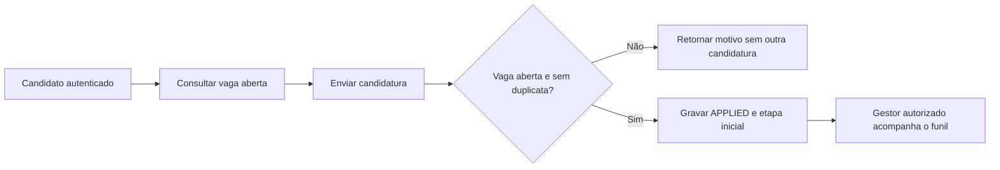

# Vagas, recrutamento, eventos e hackathons

## Empresa e autorização

A empresa tem dono (`owner_id`). Vaga pertence à empresa; candidatura pertence ao candidato e à vaga. O papel `RECRUITER` habilita uma categoria de operação, mas a autorização concreta depende da empresa.

[requireCompanyAccess](../../../src/lib/mobile/company-access.ts) consulta a empresa, retorna 404 quando não existe e exige administrador ou recrutador proprietário. Apesar da pasta `mobile`, esse helper também participa de operações web.

`JobService.createCompany` cria a empresa não verificada e promove uma conta comum a recrutador no fluxo observado, sem substituir automaticamente papéis privilegiados por um papel menor. Isso não significa que criar empresa dá acesso às empresas dos outros.

## Listagem e detalhe da vaga

[listJobs](../../../src/services/job.service.ts) monta filtros para busca, nível, modalidade, contrato, tecnologia, empresa e estado. Sem estado explícito, usa vagas abertas. Ordena por criação e inclui dados públicos selecionados da empresa, etapas e contagem de candidaturas.

`getJobById` agrega empresa e etapas ordenadas. Quando recebe usuário identificado, inclui a candidatura daquela pessoa. A listagem pública não deve se transformar em exportação de feedback interno e avaliações de todos os candidatos.

## Criação de vaga

O serviço recebe título, descrição, nível, tecnologias, modalidade, localização, contrato, faixa salarial, requisitos, benefícios e etapas opcionais. A validação e autorização da rota precisam ocorrer antes de aceitar esses dados como operação do gestor.

Quando as etapas não são fornecidas, o serviço dispõe de etapas padrão como inscrição, desafio técnico, duelo e avaliação. A existência de uma etapa nomeada não significa que a plataforma realiza automaticamente cada interação externa: entrevista e oferta podem ser estados de acompanhamento.

Os valores permitidos ficam nos enums de [schema.prisma](../../../prisma/schema.prisma), incluindo `JobLevel`, `JobModality`, `JobContract`, `JobStatus`, `ApplicationStatus` e `RecruitmentStageType`.

## Candidatura

`applyForJob` confere vaga existente, estado aberto e ausência de candidatura duplicada. A unicidade usuário/vaga também está no banco. O registro inicial usa `APPLIED` e a primeira etapa quando ela existe.

A candidatura não implica contratação, aprovação em prova ou conclusão de todas as etapas. Esses estados dependem dos atos posteriores registrados.

## Movimentação do funil

`getJobApplications` exige recrutador/administrador e `requireCompanyAccess`. A lista inclui perfil selecionado do candidato e etapa. Conhecer o ID da vaga não é suficiente para acessar sua lista privada.

`updateApplicationStage` grava mudança de etapa/status, feedback e nota técnica junto com auditoria. A rota participa da verificação de ator, empresa e etapa compatível. Não documente o método isolado como se ele conferisse toda a fronteira HTTP sozinho.

Depois do commit, o serviço tenta notificar o candidato. Falha dessa tentativa não significa que a movimentação foi revertida. Repetir a ação somente porque um push não apareceu pode produzir outra mudança indevida.

## Estados não equivalem a ordem obrigatória universal

`APPLIED`, `IN_REVIEW`, `TECHNICAL_CHALLENGE`, `DUEL`, `EVALUATION`, `INTERVIEW`, `OFFER` e `REJECTED` são alternativas do modelo de candidatura. A existência do enum não prova um motor rígido que percorre automaticamente todos os valores nessa ordem. Observe o que a rota permite e o que o gestor escolhe no fluxo.

## Eventos e hackathons

`Event` guarda tipo, datas, criador, vínculo opcional com empresa, nível mínimo, capacidade e recompensa declarada. Hackathon é um dos tipos possíveis. O status efetivo considera datas, evitando que um evento com término passado continue parecendo futuro apenas pelo estado persistido.

[EventService](../../../src/services/event.service.ts) trata consulta, criação, participação, cancelamento e exclusão. Valores padrão de criação observados incluem nível mínimo 1 e recompensa declarada 250 quando não fornecida. Recompensa declarada não é crédito automático na inscrição.

## Inscrição e capacidade

`participate` usa transação e lock por evento. Consulta pessoa, evento e participação existente. Uma participação já existente é devolvida sem duplicação. Para nova inscrição, confere encerramento, capacidade e nível calculado pelo XP oficial.

O lock protege a última vaga disputada por duas inscrições simultâneas. Uma checagem de contagem fora da transação não ofereceria a mesma proteção. `EventParticipant` começa com score zero.

Cancelamento rejeita evento concluído conforme o status efetivo; exclusão exige criador ou administrador no fluxo. A quantidade de participantes carregada num detalhe/classificação pode ser limitada e não deve ser confundida com a contagem total da base.

## Desafios do evento

[event-challenges.ts](../../../src/lib/event-challenges.ts) define o contrato: conjunto com 3–20 desafios; título de 3–120 caracteres; enunciado de 10–10.000; resposta esperada de 1–20.000; de 1–5 exemplos por desafio. Exemplos limitam entrada e saída a 5.000 caracteres e explicação a 2.000.

[EventChallengeService](../../../src/services/event-challenge.service.ts) entrega lista ordenada e oculta resposta esperada de quem não pode gerenciar. Substituição do conjunto exige autorização e ocorre em transação; o fluxo rejeita alterações depois do encerramento.

Essa resposta esperada não é automaticamente um conjunto de testes públicos/ocultos do juiz de exercícios. Não foi estabelecido neste manual um ciclo completo de equipes, submissão de repositório e classificação automática de hackathon apenas pela existência dessa tabela.

## Dependência de ambiente

Schema e migration versionada descrevem a estrutura prevista. Antes de operar desafios de eventos, confira migrations do ambiente; trabalhos anteriores registraram pendência específica dessa área. Uma documentação de domínio não deve afirmar que a tabela já foi aplicada em todo banco.

## Dados adequados para demonstração

Prepare uma empresa do demonstrador, uma vaga aberta, etapas e um candidato separado. Mostre uma candidatura e a movimentação por gestor autorizado. Para eventos, use datas coerentes, capacidade e nível que deixem claro por que uma inscrição é aceita ou recusada.

Não movimente candidaturas de usuários reais para simular apresentação. Prefira ambiente e identidades de demonstração controlados. As [sequências](sequencias.md) relacionam esses fluxos aos serviços e à persistência.
